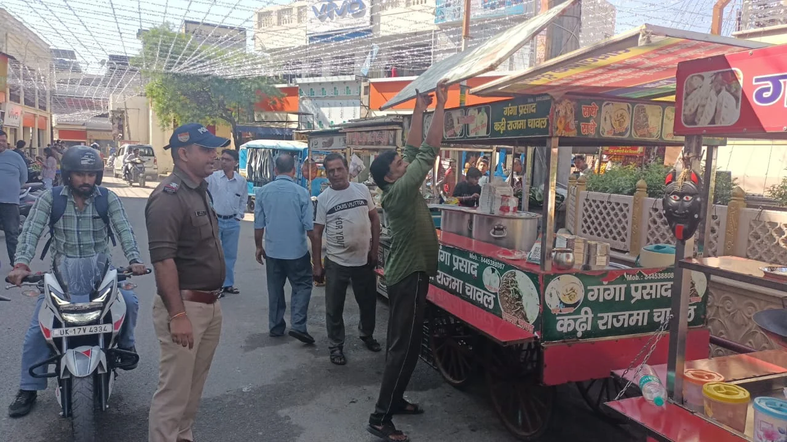
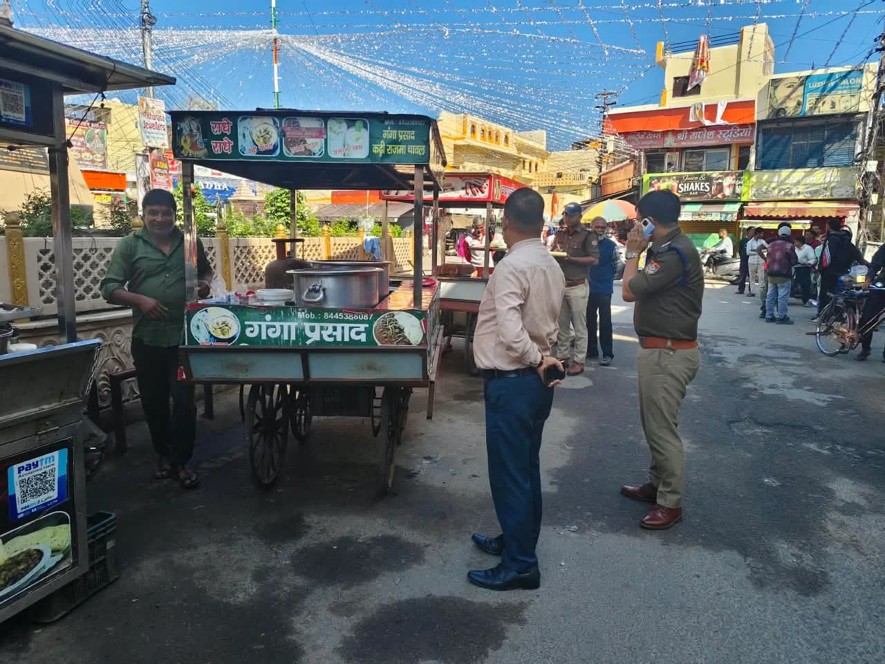

**हरिद्वार संवाददाता | आसिफ खान

हरिद्वार।** दीपावली के त्योहार से पहले हरिद्वार में सड़कों और फुटपाथों पर अवैध कब्जा जमाने वालों के खिलाफ जिला प्रशासन ने सख्त रुख अपना लिया है। शहर की यातायात व्यवस्था को पटरी पर लाने और आमजन को जाम से राहत दिलाने के लिए जिलाधिकारी मयूर दीक्षित के निर्देशन में अतिक्रमण के खिलाफ लगातार अभियान चलाया जा रहा है।

इसी क्रम में कनखल के झंडा चौक क्षेत्र में सिटी मजिस्ट्रेट हर गिरि के नेतृत्व में जिला प्रशासन एवं पुलिस की संयुक्त टीम ने अतिक्रमण हटाओ अभियान चलाया। अभियान के दौरान सड़क और फुटपाथ पर किए गए अवैध कब्जों को हटाया गया। प्रशासन की इस कार्रवाई से सार्वजनिक मार्गों पर कब्जा कर आवागमन बाधित करने वालों को स्पष्ट संदेश दिया गया कि सरकारी सड़क और फुटपाथ किसी की निजी जागीर नहीं हैं।

**फुटपाथ पर कब्जा नहीं, जनता को मिलेगा रास्ता**

दीपावली के दौरान बाजारों में बढ़ने वाली भीड़ और वाहनों के दबाव को देखते हुए प्रशासन ने अतिक्रमण के खिलाफ कार्रवाई तेज कर दी है। सड़क और फुटपाथ पर अवैध रूप से सामान रखकर या कब्जा कर रास्ता बाधित करने वालों के खिलाफ अभियान चलाया जा रहा है।

झंडा चौक क्षेत्र में चलाए गए अभियान का उद्देश्य आमजन को सुगम आवागमन उपलब्ध कराना और यातायात व्यवस्था को बेहतर बनाना है। प्रशासन की संयुक्त टीम ने सार्वजनिक मार्गों को अतिक्रमण मुक्त कराने की कार्रवाई की।

**प्रशासन का दो टूक संदेश, अतिक्रमण पर नहीं चलेगी मनमानी**

जिला प्रशासन ने स्पष्ट किया है कि सार्वजनिक सड़कों एवं फुटपाथों पर अवैध कब्जा किसी भी सूरत में बर्दाश्त नहीं किया जाएगा। दीपावली पर्व के दौरान शहर के प्रमुख बाजारों और मार्गों पर यातायात व्यवस्था सुचारू बनाए रखने के लिए अतिक्रमण हटाओ अभियान आगे भी जारी रहेगा।

अब देखना यह होगा कि अभियान की सख्ती कितनी देर तक कायम रहती है और सार्वजनिक मार्गों को अतिक्रमण मुक्त रखने के लिए प्रशासन की कार्रवाई कितनी प्रभावी साबित होती है। फिलहाल कनखल के झंडा चौक पर हुई कार्रवाई ने अतिक्रमणकारियों को साफ संकेत दे दिया है कि त्योहार के नाम पर सड़क और फुटपाथ पर कब्जे की मनमानी अब बर्दाश्त नहीं की जाएगी।
