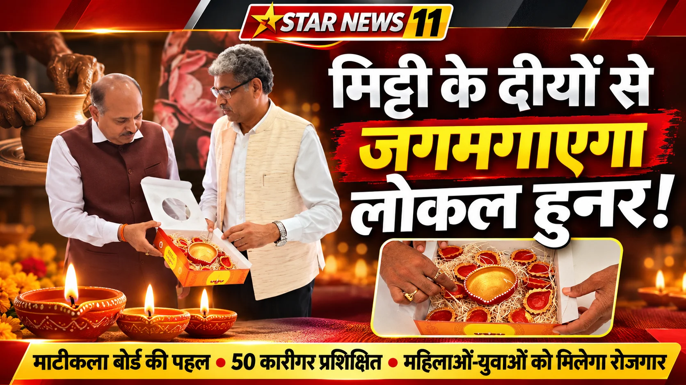

**हरिद्वार संवाददाता | आसिफ खान

हरिद्वार।** आधुनिकता की चकाचौंध में कहीं हमारी सदियों पुरानी माटीकला दम न तोड़ दे, इसी चिंता को दूर करने के लिए अब स्थानीय स्तर पर ठोस पहल की जा रही है। कभी हर घर की पहचान रहे मिट्टी के दीये और पारंपरिक मूर्तियां आज बाजार में आधुनिक उत्पादों की चुनौती का सामना कर रही हैं। ऐसे में माटीकला बोर्ड रुड़की ने इस प्राचीन विरासत को नया स्वरूप देने और स्थानीय कारीगरों को रोजगार से जोड़ने की मुहिम तेज कर दी है। प्रधानमंत्री नरेंद्र मोदी के ‘वोकल फॉर लोकल’ विजन को धरातल पर उतारने की दिशा में मुख्यमंत्री पुष्कर सिंह धामी के प्रयासों के क्रम में जनपद में माटीकला को प्रोत्साहित किया जा रहा है।

जिलाधिकारी मयूर दीक्षित एवं मुख्य विकास अधिकारी डॉ. ललित नारायण मिश्र की पहल पर ग्राम्य विकास विभाग के माध्यम से राष्ट्रीय ग्रामीण आजीविका मिशन (एनआरएलएम) एवं रीप परियोजना के सहयोग से माटीकला को नई पहचान दिलाने का प्रयास किया जा रहा है। रुड़की में लिथोप्रेस के समीप स्थानीय महिलाओं एवं पुरुषों को मिट्टी के आकर्षक दीये और मूर्तियां बनाने का प्रशिक्षण दिया जा रहा है। उद्देश्य साफ है—पारंपरिक हुनर को आधुनिक बाजार से जोड़ना, ग्रामीणों को स्वरोजगार उपलब्ध कराना और मिट्टी की कला को विलुप्त होने से बचाना।

**25-25 लोगों को प्रशिक्षण, अब तक 50 को मिला हुनर**

माटीकला बोर्ड के उपाध्यक्ष शोभाराम प्रजापति ने बताया कि प्रधानमंत्री नरेंद्र मोदी के ‘वोकल फॉर लोकल’ विजन को आगे बढ़ाने के लिए मुख्यमंत्री पुष्कर सिंह धामी निरंतर प्रयास कर रहे हैं। इसी क्रम में माटीकला बोर्ड द्वारा स्थानीय महिलाओं एवं पुरुषों को मिट्टी के दीये एवं मूर्तियां बनाने का प्रशिक्षण दिया जा रहा है।

उन्होंने बताया कि प्रत्येक दो माह में 25-25 लोगों को प्रशिक्षण देने का लक्ष्य निर्धारित किया गया है। अब तक 50 लोगों को प्रशिक्षित किया जा चुका है। प्रशिक्षण के साथ ही ग्रामीण महिलाओं एवं युवाओं को दीये बनाने वाली मशीनें भी उपलब्ध कराई जा रही हैं, जिससे वे अपना रोजगार शुरू कर सकें और नियमित आय अर्जित कर आत्मनिर्भर बन सकें।

शोभाराम प्रजापति ने कहा कि यह पहल केवल प्रशिक्षण तक सीमित नहीं है, बल्कि स्थानीय कारीगरों को आर्थिक रूप से मजबूत बनाने और उनकी कला को बाजार में उचित स्थान दिलाने की दिशा में महत्वपूर्ण कदम है।

**आकर्षक उत्पादों के साथ पैकेजिंग पर भी जोर**

मुख्य विकास अधिकारी डॉ. ललित नारायण मिश्र ने कहा कि माटीकला बोर्ड के माध्यम से हस्तनिर्मित मिट्टी के दीये एवं मूर्तियों को आकर्षक और बेहतर स्वरूप दिया जा रहा है। उत्पादों की गुणवत्ता के साथ-साथ उनकी पैकेजिंग पर भी विशेष ध्यान दिया जा रहा है, ताकि बाजार में उनकी अलग पहचान बन सके और उपभोक्ता स्थानीय उत्पादों की ओर आकर्षित हों।

उन्होंने कहा कि मिट्टी के दीये एवं मूर्तियां हमारी पौराणिक संस्कृति और परंपराओं का अभिन्न हिस्सा हैं। बदलते समय में इस पारंपरिक कला को संरक्षण देना बेहद जरूरी है। जिलाधिकारी मयूर दीक्षित की पहल पर ग्राम्य विकास विभाग, एनआरएलएम एवं रीप परियोजना के सहयोग से माटीकला बोर्ड को प्रोत्साहित किया जा रहा है।

इसका उद्देश्य स्थानीय उत्पादों को उचित पहचान एवं बाजार उपलब्ध कराने के साथ ही ग्रामीण महिलाओं और युवाओं को आर्थिक रूप से आत्मनिर्भर बनाना है।

**दीपावली पर मिट्टी के दीये खरीदें, स्थानीय हुनर को दें सम्मान**

मुख्य विकास अधिकारी डॉ. ललित नारायण मिश्र ने जनपदवासियों से अपील की कि दीपावली के पावन पर्व पर अपने घरों एवं प्रतिष्ठानों को सजाने के लिए स्थानीय कुम्हारों और माटीकला से जुड़े कारीगरों द्वारा तैयार मिट्टी के दीये एवं मूर्तियां खरीदें।

उन्होंने कहा कि बाजार में उपलब्ध आधुनिक उत्पादों के बीच स्थानीय कारीगरों के हस्तनिर्मित उत्पादों को प्राथमिकता देना समय की जरूरत है। स्थानीय उत्पादों को अपनाकर ‘वोकल फॉर लोकल’ अभियान को मजबूती मिलेगी और ग्रामीण महिलाओं एवं युवाओं के लिए रोजगार के नए अवसर पैदा होंगे।

उन्होंने कहा कि मिट्टी के दीये केवल सजावट का सामान नहीं, बल्कि हमारी संस्कृति, परंपरा और विरासत के प्रतीक हैं। इन्हें अपनाकर हम अपनी सांस्कृतिक पहचान को बचाने के साथ ही उन कारीगरों का उत्साहवर्धन भी कर सकते हैं, जिनकी मेहनत से यह कला पीढ़ी-दर-पीढ़ी जीवित रही है।

**मिट्टी की कला को मिलेगा नया बाजार, मजबूत होगी ग्रामीण अर्थव्यवस्था**

माटीकला बोर्ड की यह पहल पारंपरिक दीये और मूर्तियां बनाने तक सीमित नहीं है, बल्कि इसके माध्यम से स्थानीय हुनर को पहचान दिलाने, ग्रामीण अर्थव्यवस्था को मजबूत करने और महिलाओं एवं युवाओं को स्वरोजगार से जोड़ने का प्रयास किया जा रहा है।

प्रशिक्षण, मशीनों की उपलब्धता और उत्पादों की बेहतर पैकेजिंग के जरिए कारीगरों को आधुनिक बाजार की जरूरतों के अनुरूप तैयार किया जा रहा है। यदि स्थानीय उत्पादों को उपभोक्ताओं का समर्थन मिलता है, तो मिट्टी की यह प्राचीन कला न केवल नई पीढ़ी तक पहुंचेगी, बल्कि ग्रामीण परिवारों की आजीविका का मजबूत आधार भी बन सकती है।

अब जरूरत इस बात की है कि दीपावली की रोशनी में मिट्टी के दीयों को केवल परंपरा के प्रतीक के रूप में नहीं, बल्कि स्थानीय कारीगरों की मेहनत, हुनर और आत्मनिर्भरता के सम्मान के रूप में भी अपनाया जाए।
