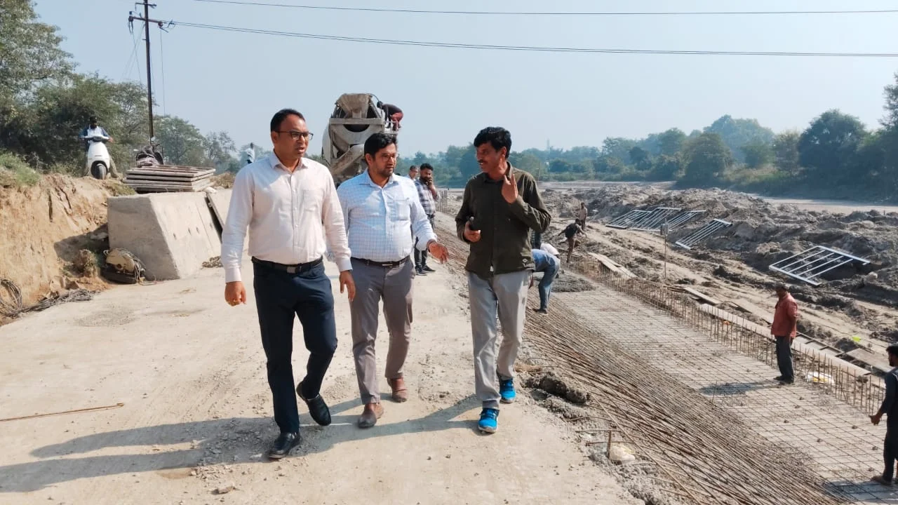
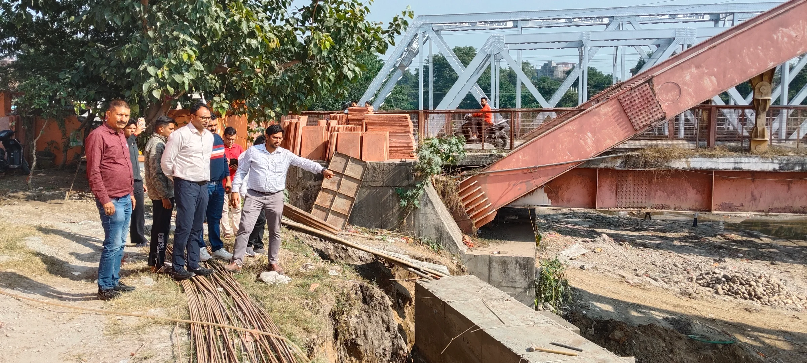
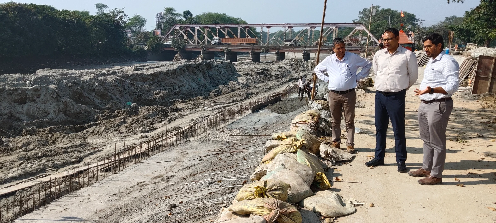

**हरिद्वार संवाददाता | आसिफ खान**

**हरिद्वार।** कुंभ मेला-2027 की तैयारियों को लेकर मेला प्रशासन ने निर्माण कार्यों में तेजी लाने के लिए कमर कस ली है। श्रद्धालुओं को सुरक्षित और सुविधाजनक गंगा स्नान की व्यवस्था उपलब्ध कराने के उद्देश्य से घाटों के निर्माण कार्यों पर विशेष जोर दिया जा रहा है। इसी क्रम में अपर मेलाधिकारी श्री दयानंद सरस्वती ने मंगलवार को बहादराबाद और ज्वालापुर क्षेत्र में निर्माणाधीन गंगा घाटों का स्थलीय निरीक्षण कर कार्यों की प्रगति परखी। उन्होंने कार्यदायी संस्था को स्पष्ट निर्देश दिए कि निर्माण कार्य निर्धारित समयसीमा में पूरे किए जाएं और गुणवत्ता के मानकों से किसी भी स्तर पर समझौता न किया जाए।

**गंगनहर बंदी का समय न गंवाएं, युद्धस्तर पर पूरा हो निर्माण**

निरीक्षण के दौरान अपर मेलाधिकारी ने विशेष रूप से गंगनहर बंदी की अवधि को निर्माण कार्यों के लिए महत्वपूर्ण बताते हुए जलमग्न रहने वाले घाटों के हिस्सों का निर्माण प्राथमिकता के आधार पर पूरा करने के निर्देश दिए। उन्होंने कहा कि कुंभ जैसे विशाल धार्मिक आयोजन में श्रद्धालुओं की सुरक्षा सर्वोपरि है। ऐसे में घाटों का निर्माण केवल समय पर पूरा करना ही नहीं, बल्कि मजबूत, सुरक्षित और गुणवत्तापूर्ण बनाना भी जरूरी है।

उन्होंने निर्माण कार्यों की नियमित निगरानी करने, कार्यों में तेजी लाने तथा गुणवत्ता सुनिश्चित करने के लिए समय-समय पर थर्ड पार्टी निरीक्षण और जांच कराने के निर्देश दिए। साफ संदेश दिया कि निर्माण कार्यों में लापरवाही और गुणवत्ता में कमी किसी भी सूरत में स्वीकार नहीं की जाएगी।

**बहादराबाद से ज्वालापुर तक घाट निर्माण की रफ्तार तेज**

बहादराबाद क्षेत्र में बैरियर संख्या छह के निकट करीब 200 मीटर लंबे छठ पूजा घाट का निर्माण कराया जा रहा है। वहीं, ज्वालापुर में जटवाड़ा पुल के अपस्ट्रीम क्षेत्र में लगभग 300 मीटर लंबे घाट और दुर्गा मंदिर के समीप करीब 30 मीटर लंबे घाट का निर्माण कार्य प्रगति पर है।

इन घाटों के निर्माण से स्थानीय नागरिकों के साथ-साथ विभिन्न पर्वों, धार्मिक आयोजनों और कुंभ मेला-2027 में आने वाले श्रद्धालुओं को गंगा स्नान के लिए बेहतर सुविधाएं मिल सकेंगी। घाटों के तैयार होने से स्नान व्यवस्था को सुगम बनाने और श्रद्धालुओं की सुविधा बढ़ाने में भी मदद मिलेगी।

**वर्षों पुरानी मांग पूरी होने की जगी उम्मीद**

ज्वालापुर क्षेत्र में घाट निर्माण को लेकर स्थानीय निवासियों और मंदिर समिति के सदस्यों ने राज्य सरकार तथा मेला प्रशासन का आभार व्यक्त किया। उन्होंने कहा कि घाट निर्माण की मांग लंबे समय से उठाई जा रही थी। अब निर्माण कार्य शुरू होने से क्षेत्रवासियों और श्रद्धालुओं को गंगा स्नान के लिए बेहतर एवं सुरक्षित सुविधा मिलने की उम्मीद है।

**अधिकारियों को निर्माण कार्यों की निगरानी के निर्देश**

निरीक्षण के दौरान अपर मेलाधिकारी दयानंद सरस्वती ने अधिकारियों को निर्देशित किया कि निर्माण कार्यों की प्रगति पर लगातार नजर रखी जाए और निर्धारित समयसीमा के भीतर सभी कार्य पूर्ण कराए जाएं। उन्होंने कहा कि कुंभ-2027 में देश-विदेश से आने वाले श्रद्धालुओं को बेहतर सुविधाएं उपलब्ध कराना मेला प्रशासन की प्राथमिकता है।

इस दौरान सिंचाई विभाग के अधिशासी अभियंता श्री अनुभव नौटियाल सहित अन्य अधिकारी उपस्थित रहे।

कुंभ-2027 की तैयारियों के बीच घाट निर्माण को लेकर मेला प्रशासन की सख्ती से साफ है कि अब निर्माण कार्यों में देरी और गुणवत्ता संबंधी लापरवाही के लिए कोई गुंजाइश नहीं छोड़ी जाएगी।
