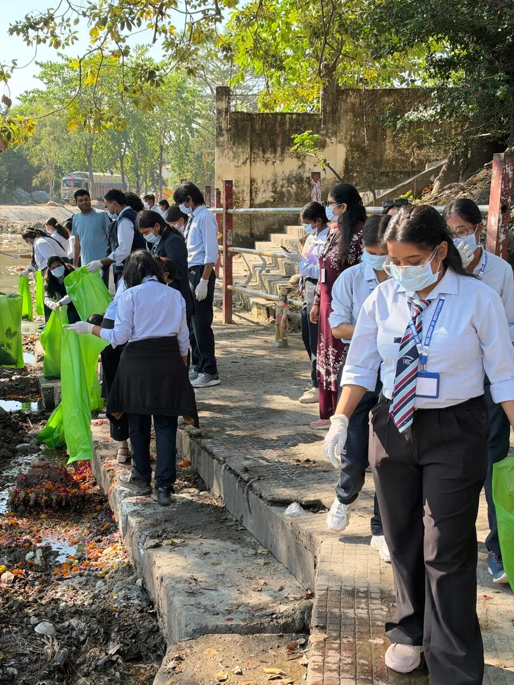
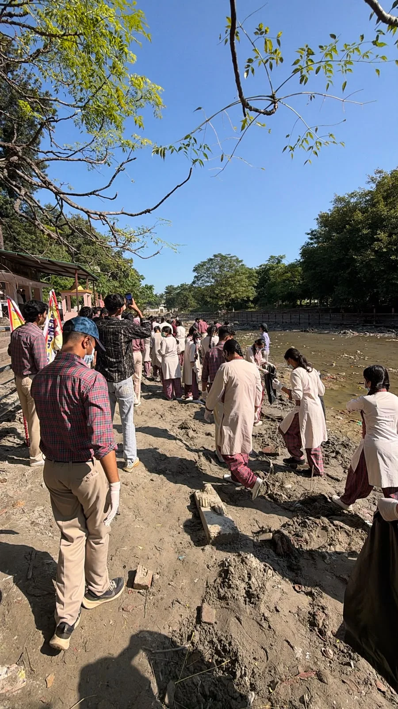
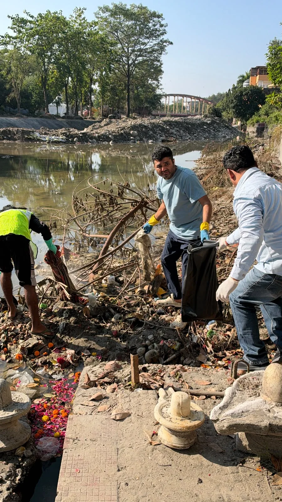

**हरिद्वार संवाददाता | आसिफ खान

हरिद्वार।** कुंभ-2027 की तैयारियों को लेकर धर्मनगरी हरिद्वार में स्वच्छता की मुहिम लगातार तेज होती जा रही है। मुख्यमंत्री पुष्कर सिंह धामी के निर्देशों के क्रम में कुंभ मेलाधिकारी सोनिका एवं जिलाधिकारी मयूर दीक्षित के निर्देशन में मंगलवार को 14वें दिन भी विशेष स्वच्छता महाअभियान जारी रहा। गंगा घाटों, मंदिर परिसरों और सार्वजनिक स्थलों को स्वच्छ एवं व्यवस्थित बनाने के लिए प्रशासन, नगर निगम, सामाजिक संस्थाओं और शैक्षणिक संस्थानों की टीमों ने मोर्चा संभाला। अभियान के दौरान गंगा घाटों एवं आसपास के क्षेत्रों से लगभग 150 बैग कपड़ा कचरा एकत्रित किया गया।

कुंभ-2027 से पहले हरिद्वार की स्वच्छता व्यवस्था को मजबूत करने के उद्देश्य से चलाए जा रहे इस अभियान के तहत दक्ष मंदिर, शीतल माता मंदिर, कश्यप घाट, ऋषिकुल पुल के आसपास स्थित घाटों, बिड़ला घाट एवं विष्णु घाट सहित विभिन्न क्षेत्रों में व्यापक सफाई अभियान चलाया गया। घाटों पर जमा कूड़े और अपशिष्ट को हटाने के लिए जेसीबी एवं ट्रैक्टर-ट्रॉलियों की मदद ली गई। एकत्रित कचरे को उचित निस्तारण के लिए नगर निगम को सौंपा गया।

**घाटों से लेकर मंदिर परिसरों तक सफाई की मुहिम**

स्वच्छता अभियान में नगर निगम के साथ श्री भुवनेश्वरी महिला आश्रम, आईटीसी मिशन सुनहरा कल, आदर्श युवा समिति, डेवलपमेंट अल्टरनेटिव्स, डीएवी पब्लिक स्कूल की एनएसएस यूनिट, एचईसी ग्रुप ऑफ इंस्टीट्यूशंस एवं सोनिया फाउंडेशन चैरिटेबल ट्रस्ट सहित विभिन्न संस्थाओं ने सक्रिय सहभागिता की।

कोर यूनिवर्सिटी के छात्र-छात्राओं ने कश्यप घाट एवं ऋषिकुल पुल के आसपास स्थित घाटों पर विशेष सफाई अभियान चलाया। वहीं, जिला पंचायत की ओर से बहादराबाद विकासखंड के जमालपुर कलां एवं पंजनहेड़ी सहित विभिन्न क्षेत्रों में स्वच्छता अभियान संचालित किया गया।

इस दौरान जिला पंचायत की टीमों ने 54 किलोग्राम सूखा कूड़ा एवं 153 किलोग्राम गीला कूड़ा एकत्रित किया। वहीं, गंगा घाटों एवं आसपास के क्षेत्रों से लगभग 150 बैग कपड़ा कचरा एकत्रित कर नगर निगम हरिद्वार को उचित निस्तारण के लिए सौंपा गया।

**165 स्वयंसेवकों ने संभाली सफाई की कमान**

एचईसी ग्रुप ऑफ इंस्टीट्यूशंस के 165 स्वयंसेवकों ने भी अभियान में बढ़-चढ़कर प्रतिभाग किया। संस्थान के शिक्षकगण एवं अन्य सदस्यों ने स्वयंसेवकों के साथ मिलकर विभिन्न स्थानों पर सफाई कार्य किया। अभियान में युवाओं की भागीदारी ने स्वच्छता के प्रति जनजागरूकता का संदेश दिया।

**कुंभ से पहले स्वच्छ हरिद्वार बनाने की तैयारी**

जिला प्रशासन द्वारा कुंभ मेला-2027 से पहले गंगा घाटों, मंदिर परिसरों एवं सार्वजनिक स्थलों को स्वच्छ एवं व्यवस्थित बनाने के लिए लगातार विशेष स्वच्छता अभियान चलाया जा रहा है। प्रशासन ने आमजन एवं सामाजिक संगठनों से अभियान में बढ़-चढ़कर सहभागिता करने की अपील की है।

प्रशासन ने लोगों से गंगा घाटों एवं सार्वजनिक स्थलों पर कूड़ा-कचरा न फैलाने तथा कपड़ों एवं अन्य अपशिष्ट सामग्री को गंगा में प्रवाहित करने के बजाय निर्धारित स्थानों पर जमा कराने का आग्रह किया है, ताकि मां गंगा की स्वच्छता एवं निर्मलता बनाए रखी जा सके।

अभियान के दौरान राष्ट्रीय सेवा योजना (एनएसएस) के कार्यक्रम अधिकारी उमराव सिंह, एनएसएस जिला समन्वयक डॉ. एस.पी. सिंह, सहायक नगर आयुक्त गौरव रावत, डीएवी पब्लिक स्कूल से श्रीमती अमिता सिंह, मुख्य सफाई निरीक्षक श्रीकान्त, सफाई निरीक्षक मोहित कुमार तथा सुपरवाइजर बलराम, दीपक, प्रदीप, अमित, शशांक, रूपा बिश्नोई एवं सुनीति त्यागी सहित नगर निगम की टीम, एनएसएस इकाइयों, विभिन्न संस्थाओं के प्रतिनिधियों एवं पर्यावरण मित्रों ने सक्रिय सहभागिता की।

कुंभ-2027 की तैयारियों के बीच प्रशासन का स्पष्ट संदेश है कि गंगा घाटों की स्वच्छता केवल अभियान तक सीमित नहीं, बल्कि जनभागीदारी से निरंतर चलने वाला संकल्प है।
