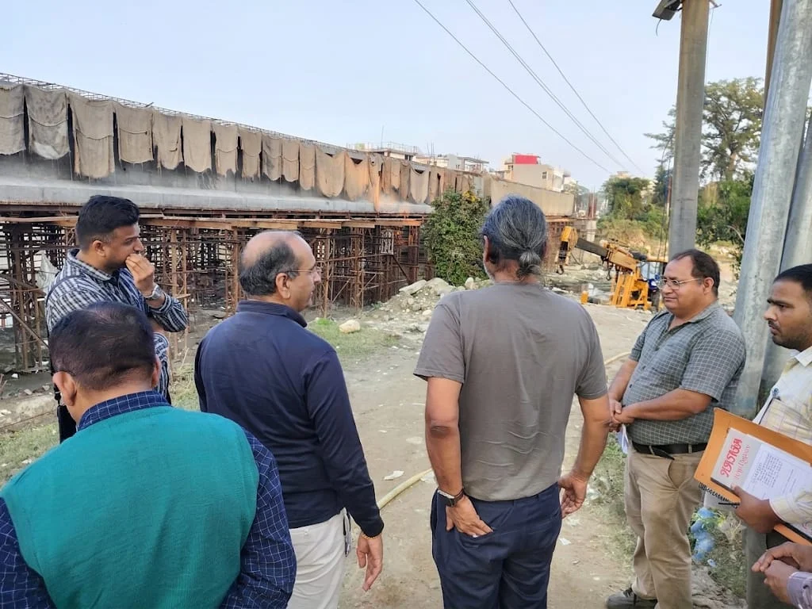
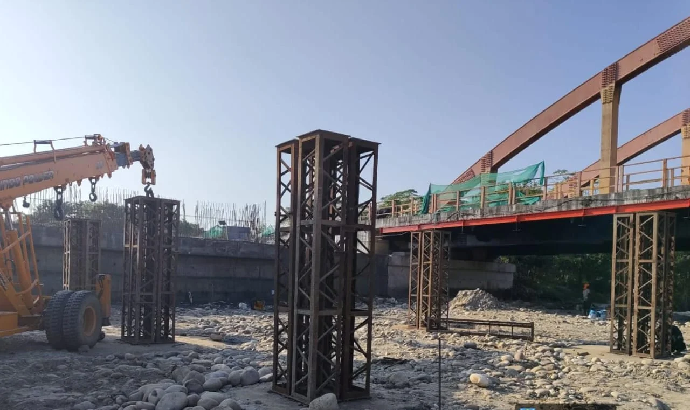
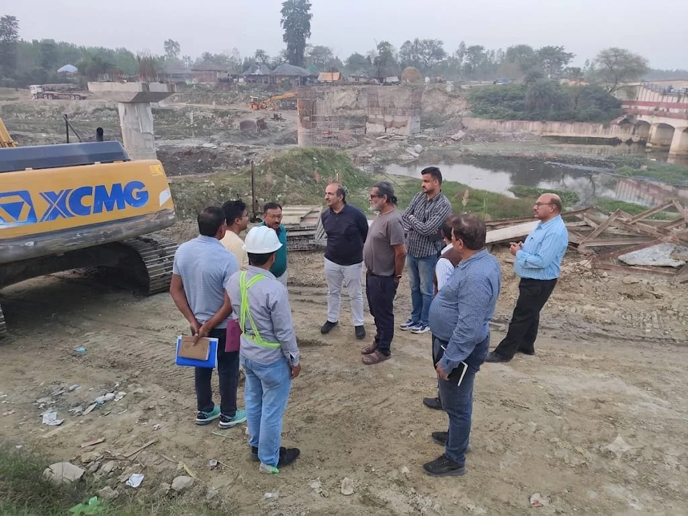

**हरिद्वार संवाददाता | आसिफ खान

हरिद्वार।** कुंभ-2027 की तैयारियों में किसी भी तरह की लापरवाही और गुणवत्ता से समझौते की गुंजाइश नहीं छोड़ी जा रही है। श्रद्धालुओं की सुरक्षित आवाजाही और हरिद्वार की चरमराती यातायात व्यवस्था को बेहतर बनाने के लिए निर्माणाधीन चार बड़े स्थायी पुल अब विशेषज्ञों की तकनीकी निगरानी के दायरे में हैं। मेलाधिकारी श्रीमती सोनिका की पहल पर आईआईटी रुड़की के विशेषज्ञों को मैदान में उतारा गया है, ताकि करोड़ों की लागत से तैयार हो रहे इन महत्वपूर्ण पुलों की मजबूती, निर्माण तकनीक और सुरक्षा मानकों की वास्तविक स्थिति परखी जा सके।

कुंभ मेले में लाखों श्रद्धालुओं की आवाजाही के मद्देनजर इन पुलों का निर्माण बेहद महत्वपूर्ण माना जा रहा है। मेला प्रशासन का स्पष्ट लक्ष्य है कि कुंभ शुरू होने से पहले सभी पुल तैयार हों, लेकिन समयसीमा पूरी करने की जल्दबाजी में गुणवत्ता से कोई समझौता न हो। इसी उद्देश्य से थर्ड पार्टी गुणवत्ता जांच के साथ अब आईआईटी रुड़की के विशेषज्ञों से भी तकनीकी परीक्षण कराया जा रहा है।

**प्रो. डॉ. संजय के नेतृत्व में टीम ने खोली निर्माण कार्यों की परतें**

आईआईटी रुड़की के प्रोफेसर डॉ. संजय के नेतृत्व में विशेषज्ञों की टीम ने चारों निर्माणाधीन पुलों का स्थलीय निरीक्षण किया। टीम ने निर्माण स्थलों पर पहुंचकर कार्यों की प्रगति, अपनाई जा रही निर्माण तकनीक, तकनीकी मानकों और सुरक्षा संबंधी व्यवस्थाओं का बारीकी से परीक्षण किया। विशेषज्ञों ने निर्माण कार्यों की गुणवत्ता का आकलन करते हुए निर्धारित मानकों के अनुपालन की भी पड़ताल की।

**इन चार पुलों पर विशेषज्ञों ने किया तकनीकी परीक्षण**

1. सुखी नदी पर डबल लेन पुल: खड़खड़ी मार्ग पर निर्माणाधीन डबल लेन पुल का निरीक्षण कर निर्माण की स्थिति और तकनीकी गुणवत्ता का जायजा लिया गया।

2. दक्षद्वीप-बैरागी कैंप पुल: मायापुर एस्केप चैनल पर पूर्व निर्मित पुल के डाउनस्ट्रीम में बनाए जा रहे 60 मीटर स्पान के बो-स्ट्रिंग स्टील गर्डर डबल लेन पुल की जांच की गई। यह पुल दोनों महत्वपूर्ण क्षेत्रों के बीच संपर्क मजबूत करेगा।

3. पथरी रौ नदी पर आरसीसी पुल: ज्वालापुर से ईदगाह, सुभाषनगर पीएसी होते हुए शिवालिक नगर जाने वाले मोटर मार्ग पर निर्माणाधीन 60 मीटर स्पान के प्री-स्ट्रेस्ड आरसीसी पुल का निरीक्षण किया गया।

4. धनौरी-सिडकुल लिंक रोड पुल: पुराने गंगनहर साइफन के डाउनस्ट्रीम में पथरी रौ नदी पर बन रहे 90 मीटर स्पान के कम्पोजिट स्टील गर्डर डबल लेन पुल का तकनीकी परीक्षण किया गया।

**कुंभ के बाद भी हरिद्वार को मिलेगी स्थायी राहत**

इन चारों पुलों के निर्माण से हरिद्वार के विभिन्न क्षेत्रों के बीच सड़क संपर्क को नई मजबूती मिलने की उम्मीद है। कुंभ के दौरान श्रद्धालुओं की आवाजाही के लिए अतिरिक्त मार्ग उपलब्ध होंगे, जिससे प्रमुख मार्गों पर यातायात का दबाव कम करने और जाम की समस्या से निपटने में मदद मिलेगी। इन परियोजनाओं का लाभ केवल कुंभ तक सीमित नहीं रहेगा, बल्कि भविष्य में भी स्थानीय नागरिकों और यात्रियों को बेहतर यातायात सुविधा मिल सकेगी।

**सोनिका की पहल: गुणवत्ता पर रहेगी तीसरी आंख की निगरानी**

मेलाधिकारी श्रीमती सोनिका की पहल पर निर्माण कार्यों की निगरानी के लिए बहुस्तरीय व्यवस्था अपनाई जा रही है। कार्यदायी संस्थाओं की नियमित समीक्षा, विभागीय अभियंताओं की तकनीकी जांच, थर्ड पार्टी गुणवत्ता परीक्षण और आईआईटी रुड़की के विशेषज्ञों का सहयोग इसी व्यवस्था का हिस्सा है। इसका उद्देश्य यह सुनिश्चित करना है कि कुंभ के नाम पर तैयार होने वाले स्थायी निर्माण केवल समय पर पूरे न हों, बल्कि मजबूती और सुरक्षा की कसौटी पर भी खरे उतरें।

निरीक्षण के दौरान उप मेलाधिकारी आकाश जोशी, मेला कार्यालय के तकनीकी प्रकोष्ठ के अधीक्षण अभियंता मनोज कुमार भट्ट सहित लोक निर्माण विभाग एवं सिंचाई विभाग के अभियंतागण मौजूद रहे।

अब इन चारों पुलों की गुणवत्ता और निर्माण की प्रगति पर मेला प्रशासन की निगरानी रहेगी। कुंभ-2027 के लिए तैयार हो रहा बुनियादी ढांचा आने वाले वर्षों में हरिद्वार की यातायात व्यवस्था की भी बड़ी परीक्षा होगा।
