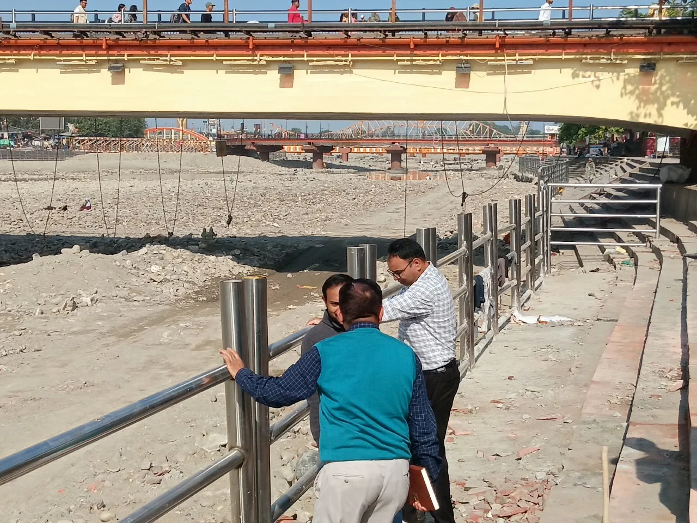
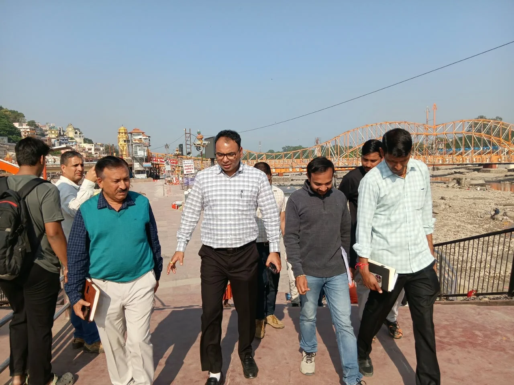
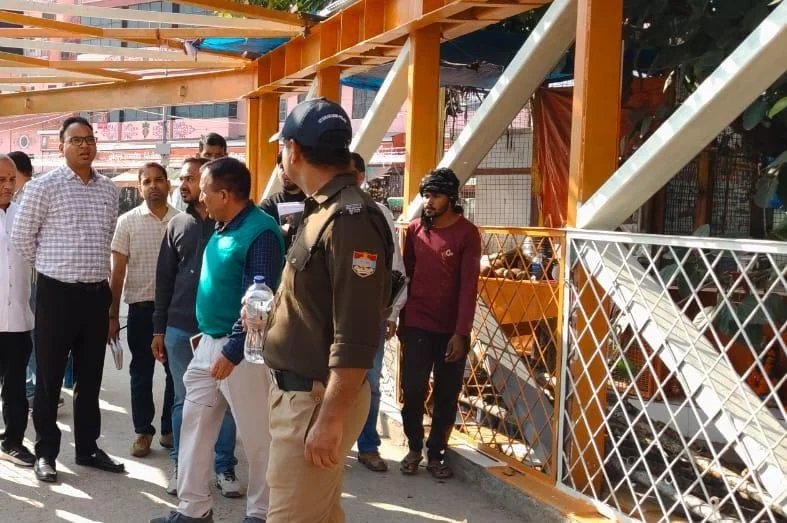

**हरिद्वार संवाददाता | आसिफ खान

हरिद्वार।** कुंभ मेला-2027 की तैयारियों को लेकर मेला प्रशासन अब निर्माण एवं मरम्मत कार्यों में तेजी लाने के मूड में है। गंगा नहर बंदी को घाटों के जीर्णोद्धार के लिए अहम अवसर मानते हुए प्रशासन ने कार्यदायी संस्थाओं को स्पष्ट निर्देश दिए हैं कि इस अवधि का एक-एक दिन महत्वपूर्ण है। घाटों के जलमग्न हिस्सों की मरम्मत में लापरवाही या देरी बर्दाश्त नहीं की जाएगी। कुंभ से पहले हरकी पैड़ी समेत प्रमुख घाटों और हाथीपुल को श्रद्धालुओं की आवाजाही एवं स्नान के लिए सुरक्षित और व्यवस्थित बनाने का लक्ष्य रखा गया है।

इसी क्रम में अपर मेलाधिकारी दयानंद सरस्वती ने बुधवार को यूआईआईडीबी की हरकी पैड़ी एवं रोड़ी बेलवाला पुनर्विकास योजना के तहत चल रहे निर्माण और मरम्मत कार्यों का स्थलीय निरीक्षण किया। उन्होंने यूपीडीसीसी के अधिकारियों को मौके पर ही आवश्यक दिशा-निर्देश देते हुए कहा कि गंगा नहर बंदी के दौरान जलमग्न रहने वाले हिस्सों की मरम्मत को सर्वोच्च प्राथमिकता पर पूरा किया जाए। ऐसा अवसर दोबारा मिलने का इंतजार करने के बजाय उपलब्ध समय का पूरा उपयोग किया जाए।

**घाटों पर श्रद्धालुओं की सुरक्षा से कोई समझौता नहीं**

निरीक्षण के दौरान अपर मेलाधिकारी ने घाटों पर सुरक्षा व्यवस्था को लेकर विशेष सख्ती दिखाई। उन्होंने पर्याप्त ऊंचाई और मजबूती वाली रेलिंग एवं चेन लगाने के निर्देश दिए। मौके पर स्थापित रेलिंग की मजबूती और निर्माण गुणवत्ता को भी परखा। उन्होंने साफ किया कि गंगा स्नान के दौरान श्रद्धालुओं की सुरक्षा सर्वोपरि है। ऐसे में घाटों पर सुरक्षा इंतजाम केवल औपचारिकता बनकर नहीं रहने चाहिए, बल्कि हर व्यवस्था मजबूत और मानकों के अनुरूप होनी चाहिए।

**हाथीपुल पर सुरक्षा रेलिंग और रोशनी दुरुस्त करने के निर्देश**

अपर मेलाधिकारी ने हाथीपुल पर चल रहे मरम्मत कार्यों का भी बारीकी से जायजा लिया। उन्होंने पुल पर निर्धारित ऊंचाई तक सुरक्षा रेलिंग लगाने का काम शीघ्र पूरा करने को कहा। इसके अलावा पुल के प्रवेश स्थल और स्तंभों पर स्थापित मूर्तियों की मरम्मत, सौंदर्यीकरण तथा पर्याप्त प्रकाश व्यवस्था सुनिश्चित करने के निर्देश दिए। प्रशासन का जोर है कि कुंभ के दौरान पुल से गुजरने वाले श्रद्धालुओं को सुरक्षित आवागमन की सुविधा मिले और पुल का स्वरूप भी बेहतर दिखाई दे।

**टूटी टाइल्स और पत्थर बदलने में भी गुणवत्ता की परीक्षा**

इसके बाद विष्णुघाट, कुशावर्त घाट, गौ घाट, सुभाष घाट और मालवीय द्वीप क्षेत्र में चल रहे कार्यों का निरीक्षण किया गया। यहां क्षतिग्रस्त टाइल्स और पत्थरों को शीघ्र बदलने के निर्देश दिए गए। अपर मेलाधिकारी ने स्पष्ट किया कि मरम्मत के नाम पर घाटों के मूल स्वरूप से छेड़छाड़ नहीं होनी चाहिए। नई टाइल्स और पत्थरों का रंग, आकार तथा बनावट पहले से मौजूद निर्माण के अनुरूप होनी चाहिए, ताकि घाटों की एकरूपता और ऐतिहासिक सुंदरता बरकरार रहे।

**समयसीमा और गुणवत्ता पर अधिकारियों की जवाबदेही तय**

अपर मेलाधिकारी ने कार्यदायी संस्था के अधिकारियों को दो टूक निर्देश दिए कि सभी निर्माण एवं मरम्मत कार्य निर्धारित गुणवत्ता मानकों के अनुसार समयबद्ध ढंग से पूरे किए जाएं। खासकर गंगा नहर बंदी के दौरान जलमग्न हिस्सों की मरम्मत में किसी भी प्रकार की ढिलाई न हो। कुंभ-2027 में लाखों श्रद्धालुओं की आवाजाही और स्नान व्यवस्था को देखते हुए घाटों तथा पुलों की सुरक्षा में कोई कमी नहीं रहनी चाहिए।

अब निगाहें इस बात पर रहेंगी कि कार्यदायी संस्थाएं इन निर्देशों को जमीन पर कितनी तेजी और गुणवत्ता के साथ अमल में लाती हैं। कुंभ से पहले हरकी पैड़ी और आसपास के प्रमुख घाटों को सुरक्षित, सुंदर और व्यवस्थित बनाना मेला प्रशासन के लिए बड़ी चुनौती है।

निरीक्षण के दौरान मेला कार्यालय की तकनीकी सेल के अधीक्षण अभियंता मनोज भट्ट, यूपीडीसीसी के परियोजना प्रबंधक सुमित मलवाल सहित अन्य अधिकारी मौजूद रहे।
