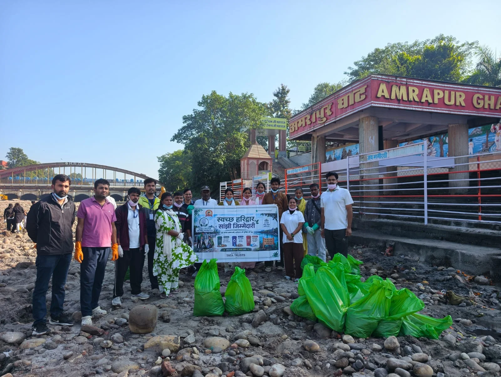
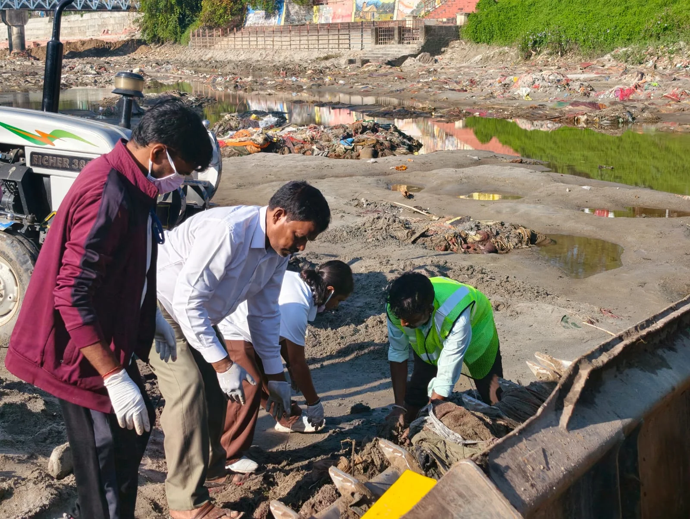
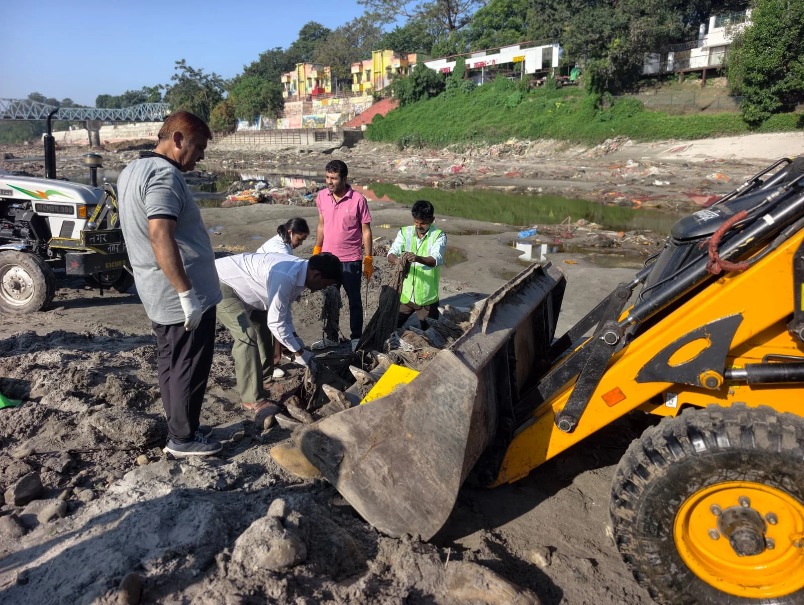

**हरिद्वार संवाददाता | आसिफ खान

हरिद्वार।** कुंभ मेला-2027 से पहले धर्मनगरी हरिद्वार को स्वच्छ और सुंदर बनाने के लिए जिला प्रशासन ने सफाई अभियान की रफ्तार तेज कर दी है। मुख्यमंत्री पुष्कर सिंह धामी के निर्देशों के तहत कुंभ मेलाधिकारी सोनिका एवं जिलाधिकारी मयूर दीक्षित के निर्देशन में संचालित विशेष स्वच्छता महाअभियान बुधवार को लगातार 15वें दिन भी जारी रहा। इस दौरान अमरपुर घाट पर व्यापक स्तर पर सफाई अभियान चलाकर करीब दो टन कचरा और अपशिष्ट सामग्री एकत्रित की गई।

**अमरपुर घाट पर चला सफाई का बड़ा अभियान**

अभियान के दौरान अमरपुर घाट और आसपास के क्षेत्रों में फैले कूड़े-कचरे को हटाने के लिए प्रशासनिक टीमों ने मोर्चा संभाला। जिला प्रशासन, एसबीएमए, डेवलपमेंट अल्टरनेटिव्स, आदर्श युवा समिति, श्री भुवनेश्वरी महिला आश्रम, आईटीसी मिशन सुनहरा कल, एसएमजेएन कॉलेज के छात्र-छात्राओं, नगर निगम हरिद्वार और आपदा प्रबंधन टीम सहित विभिन्न संस्थाओं के प्रतिनिधियों ने श्रमदान कर सफाई अभियान में भागीदारी की।

सफाई कार्य को प्रभावी बनाने के लिए जेसीबी मशीनों की मदद से बड़ी मात्रा में कचरा एकत्रित किया गया। वहीं ट्रैक्टर-ट्रॉलियों के जरिए अपशिष्ट को निर्धारित स्थान तक पहुंचाकर उचित निस्तारण के लिए नगर निगम को सौंपा गया। अभियान में करीब दो टन कचरा एकत्रित होना इस बात का संकेत है कि घाटों की स्वच्छता बनाए रखने के लिए अभी निरंतर और सामूहिक प्रयासों की जरूरत है।

**कुंभ से पहले घाटों को स्वच्छ बनाने की चुनौती**

कुंभ मेला-2027 को लेकर हरिद्वार में तैयारियां तेज हो रही हैं। ऐसे में गंगा घाटों, मंदिर परिसरों और सार्वजनिक स्थलों की स्वच्छता प्रशासन के लिए महत्वपूर्ण जिम्मेदारी बन गई है। इसी उद्देश्य से लगातार विशेष स्वच्छता महाअभियान चलाया जा रहा है। प्रशासन का प्रयास है कि कुंभ के दौरान देश-विदेश से आने वाले श्रद्धालुओं को स्वच्छ और व्यवस्थित धर्मनगरी का वातावरण मिले।

**गंगा में कचरा डालने वालों से प्रशासन की अपील**

जिला प्रशासन ने आमजन, श्रद्धालुओं और सामाजिक संगठनों से स्वच्छता अभियान में सहयोग करने की अपील की है। लोगों से कहा गया है कि गंगा घाटों और सार्वजनिक स्थलों पर कूड़ा न फैलाएं। पुराने कपड़े, पूजन सामग्री और अन्य अपशिष्ट को गंगा में प्रवाहित करने के बजाय निर्धारित स्थानों पर ही जमा कराएं। गंगा की निर्मलता और घाटों की स्वच्छता केवल प्रशासन की जिम्मेदारी नहीं, बल्कि प्रत्येक नागरिक का कर्तव्य है।

अभियान के दौरान राष्ट्रीय सेवा योजना (एनएसएस) के स्वयंसेवकों, नगर निगम के कर्मचारियों, पर्यावरण मित्रों और विभिन्न सामाजिक संस्थाओं के प्रतिनिधियों ने सक्रिय सहभागिता कर स्वच्छता का संदेश दिया। प्रशासन की ओर से स्पष्ट किया गया कि कुंभ-2027 की तैयारियों के साथ स्वच्छता अभियान को भी लगातार जारी रखा जाएगा।
