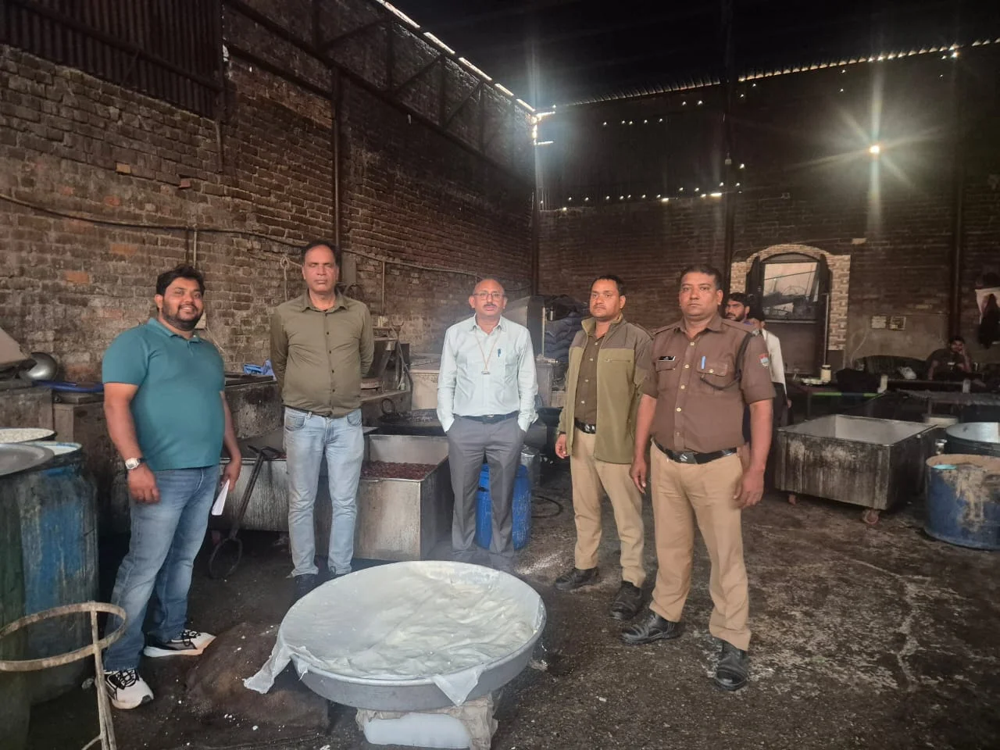

**हरिद्वार संवाददाता | आसिफ खान

हरिद्वार।** त्योहारों के बीच लोगों की सेहत से खिलवाड़ करने वालों के खिलाफ खाद्य सुरक्षा विभाग ने सख्त रुख अपना लिया है। बुधवार को शिवालिक नगर, इकबालपुर, मंगलौर और झबरेड़ा क्षेत्र में विभाग की अलग-अलग टीमों ने मिठाई निर्माण इकाइयों, रिटेल स्टोर और खाद्य पदार्थों की जांच के लिए व्यापक अभियान चलाया। कार्रवाई के दौरान जहां खुले रसगुल्ले और गुलाब जामुन के नमूने प्रयोगशाला जांच के लिए भेजे गए, वहीं नियमों की अनदेखी मिलने पर एक मिठाई निर्माण इकाई को नोटिस थमाया गया। शिवालिक नगर के एक रिटेल स्टोर से निर्माता का नाम और पता अंकित नहीं होने पर पेड़ा मिठाई के कुल 35 पैकेट हटवाकर उनकी बिक्री पर रोक लगा दी गई।

आयुक्त खाद्य सुरक्षा उत्तराखंड विनय शंकर पांडेय एवं जिलाधिकारी मयूर दीक्षित के निर्देशों पर सहायक आयुक्त खाद्य सुरक्षा महिमानंद जोशी के नेतृत्व में वरिष्ठ खाद्य सुरक्षा अधिकारी दिलीप जैन की टीम ने शिवालिक नगर एवं इकबालपुर क्षेत्र में मिठाई निर्माण इकाइयों और दुकानों का निरीक्षण किया।

पथरी थाना पुलिस से प्राप्त सूचना के आधार पर एक मिठाई निर्माण इकाई में पहुंची टीम को निरीक्षण के दौरान कई कमियां मिलीं। मौके से खुले रसगुल्ले और खुले गुलाब जामुन के दो नमूने लेकर प्रयोगशाला जांच के लिए भेजे गए। इसके अलावा इकाई संचालक अनिवार्य दस्तावेज प्रस्तुत नहीं कर सका। मिठाइयों के बड़े डिब्बे ढके हुए नहीं मिले और गंदे पानी की निकासी की भी उचित व्यवस्था नहीं पाई गई। इन अनियमितताओं पर विभाग ने तत्काल नोटिस जारी करते हुए साफ-सफाई और जरूरी दस्तावेज उपलब्ध कराने तक मिठाइयों का निर्माण, भंडारण एवं बिक्री बंद रखने के निर्देश दिए।

**बिना उचित खाद्य श्रेणी के मिठाई बेचने पर भी कार्रवाई**

शिवालिक नगर स्थित एक रिटेल स्टोर पर भी खाद्य सुरक्षा विभाग ने कार्रवाई की। यहां से पेड़ा मिठाई का नमूना प्रयोगशाला जांच के लिए लिया गया। जांच में सामने आया कि संबंधित प्रतिष्ठान के खाद्य पंजीकरण में मिठाई की खाद्य श्रेणी शामिल एवं अनुमोदित नहीं थी। विभाग ने आवश्यक संशोधन होने तक मिठाइयों के भंडारण और बिक्री पर रोक लगा दी।

इतना ही नहीं, पैकेटों पर निर्माता का नाम और पता अंकित नहीं होने की गंभीर कमी मिलने पर 400 ग्राम के 11 और 800 ग्राम के 23 पैकेट सहित कुल 35 पेड़ा मिठाई के पैकेट मौके से हटवा दिए गए। इन सभी पैकेटों की बिक्री पर रोक लगा दी गई।

**मोबाइल फूड वैन से 82 खाद्य पदार्थों की जांच, 15 पर गिरी गाज**

दूसरी ओर उपायुक्त लैब वीरेंद्र सिंह बिष्ट के नेतृत्व में वरिष्ठ खाद्य सुरक्षा अधिकारी पवन कुमार की टीम ने मंगलौर कस्बे और झबरेड़ा क्षेत्र में मोबाइल फूड वैन के माध्यम से जांच अभियान चलाया। टीम ने मिठाई, खाद्य तेल और नमकीन सहित कुल 82 खाद्य पदार्थों की जांच की। इस दौरान 15 खाद्य पदार्थ निर्धारित मानकों के अनुरूप नहीं पाए गए, जिन्हें तत्काल मौके से हटवा दिया गया।

**जनता की सेहत से खिलवाड़ बर्दाश्त नहीं**

खाद्य सुरक्षा विभाग की इस कार्रवाई से मिठाई कारोबारियों में हड़कंप की स्थिति रही। विभाग ने स्पष्ट किया है कि आमजन के स्वास्थ्य को ध्यान में रखते हुए खाद्य पदार्थों की गुणवत्ता सुनिश्चित करने के लिए निरीक्षण और जांच अभियान लगातार जारी रहेगा। नियमों की अनदेखी, खाद्य सुरक्षा मानकों में कमी और आवश्यक दस्तावेजों के अभाव में संबंधित प्रतिष्ठानों के खिलाफ नियमानुसार कार्रवाई की जाएगी।

अब देखना होगा कि विभाग की यह सख्ती केवल निरीक्षण तक सीमित रहती है या खाद्य कारोबारियों में नियमों के पालन को लेकर स्थायी सुधार भी देखने को मिलता है।
