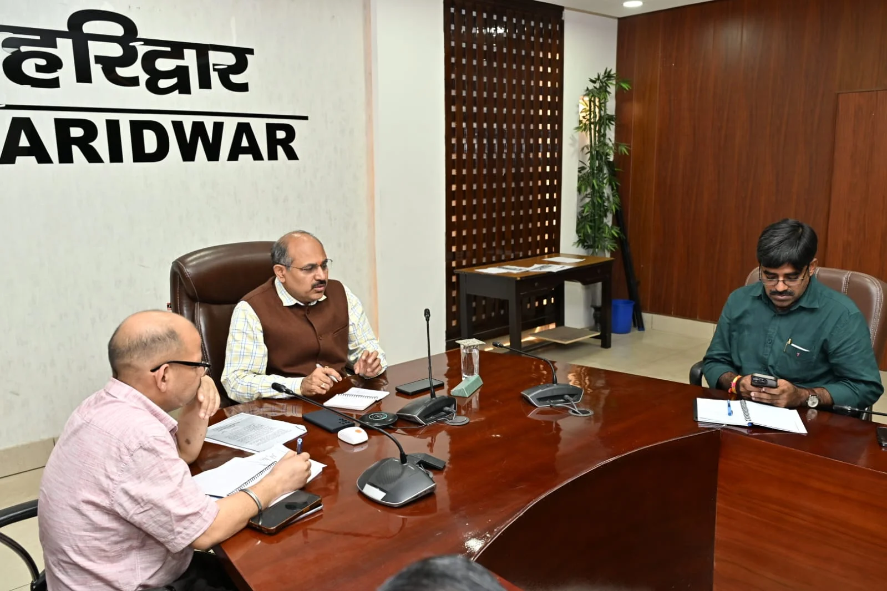
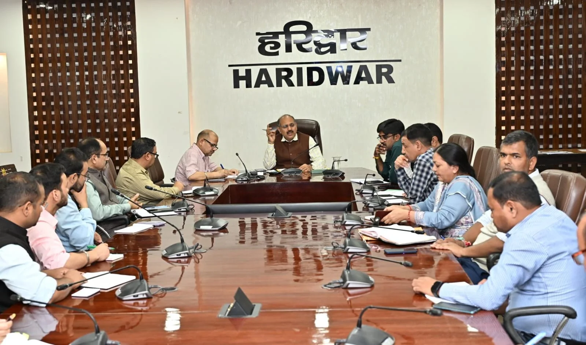
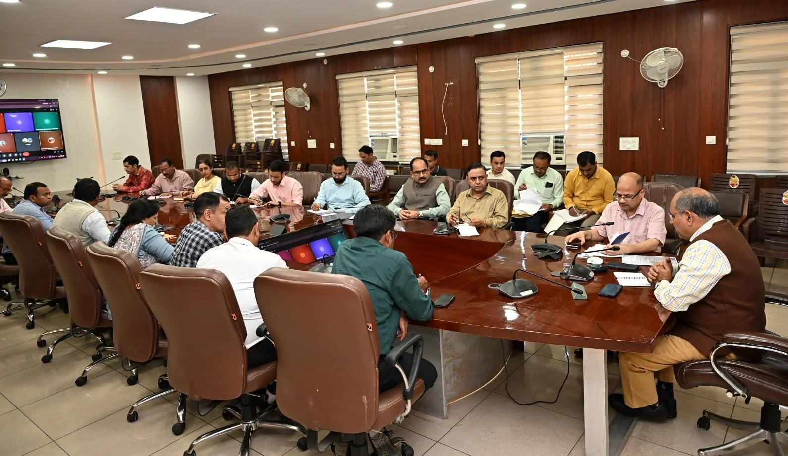

**हरिद्वार संवाददाता | आसिफ खान

हरिद्वार।** उत्तराखण्ड राज्य स्थापना की 26वीं वर्षगांठ को जनपद हरिद्वार में ऐतिहासिक, भव्य और यादगार बनाने की तैयारियां तेज हो गई हैं। राज्य की गौरवशाली विकास यात्रा, सांस्कृतिक विरासत और उपलब्धियों को जन-जन तक पहुंचाने के लिए जनपदभर में उत्सव का माहौल तैयार किया जाएगा। मुख्य आयोजन ऋषिकुल ऑडिटोरियम में होगा, जबकि सभी विकास खंडों में भी सांस्कृतिक एवं विभिन्न जनकल्याणकारी कार्यक्रम आयोजित किए जाएंगे। समारोह को केवल औपचारिक आयोजन तक सीमित न रखते हुए इसमें जनभागीदारी, विकास की उपलब्धियों और सरकारी योजनाओं का लाभ पात्र लोगों तक पहुंचाने पर विशेष जोर दिया जा रहा है।

कार्यक्रम की तैयारियों को लेकर जिलाधिकारी मयूर दीक्षित के निर्देशन में मुख्य विकास अधिकारी डॉ. ललित नारायण मिश्र की अध्यक्षता में विकास भवन सभागार में संबंधित विभागों के अधिकारियों की महत्वपूर्ण बैठक आयोजित हुई। बैठक में कार्यक्रम की रूपरेखा तय करने के साथ ही अधिकारियों को उनकी जिम्मेदारियां सौंपते हुए स्पष्ट निर्देश दिए गए कि सभी तैयारियां समय से पहले पूरी हों और आयोजन में किसी भी स्तर पर लापरवाही न बरती जाए। खंड विकास अधिकारियों सहित कई अधिकारी वर्चुअल माध्यम से भी बैठक में शामिल हुए।

मुख्य विकास अधिकारी डॉ. ललित नारायण मिश्र ने कहा कि राज्य स्थापना दिवस उत्तराखण्ड की पहचान, संघर्ष, गौरवशाली इतिहास और विकास की उपलब्धियों को प्रदर्शित करने का महत्वपूर्ण अवसर है। इस दिन आयोजित होने वाले कार्यक्रमों में प्रदेश की सांस्कृतिक विरासत के साथ विकास की तस्वीर भी दिखाई देनी चाहिए। उन्होंने सभी विभागों को आपसी समन्वय के साथ सक्रिय भूमिका निभाने और कार्यक्रमों को भव्य एवं गरिमामय स्वरूप देने के निर्देश दिए।

**उत्कृष्ट कार्य करने वालों को मिलेगा सम्मान, प्रतिभाओं को मिलेगा मंच**

राज्य स्थापना दिवस के मुख्य समारोह में विभिन्न क्षेत्रों में उल्लेखनीय एवं उत्कृष्ट कार्य करने वाले व्यक्तियों और कार्मिकों को प्रशस्ति पत्र देकर सम्मानित किया जाएगा। इसके साथ ही विभिन्न विभागों की जनकल्याणकारी योजनाओं से लाभान्वित होने वाले पात्र लाभार्थियों को भी सम्मानित किया जाएगा। इसके लिए सभी विभागाध्यक्षों को अपने-अपने विभाग से उत्कृष्ट कार्य करने वाले व्यक्तियों एवं लाभार्थियों का चयन कर निर्धारित समय पर सूची उपलब्ध कराने के निर्देश दिए गए हैं।

शिक्षा विभाग को विकसित उत्तराखण्ड एवं विकसित भारत की थीम पर विभिन्न प्रतियोगिताएं आयोजित कराने की जिम्मेदारी सौंपी गई है। इन प्रतियोगिताओं में उत्कृष्ट प्रदर्शन करने वाले छात्र-छात्राओं को भी मुख्य समारोह में सम्मानित किया जाएगा। इससे जहां विद्यार्थियों को अपनी प्रतिभा दिखाने का अवसर मिलेगा, वहीं नई पीढ़ी को प्रदेश के विकास और भविष्य के निर्माण से जोड़ने का संदेश भी दिया जाएगा।

**एक ही परिसर में दिखेगी सरकारी योजनाओं और उपलब्धियों की झलक**

समारोह स्थल पर विभिन्न विभागों की ओर से जनकल्याणकारी योजनाओं एवं विभागीय उपलब्धियों पर आधारित आकर्षक स्टॉल लगाए जाएंगे। इन स्टॉलों के माध्यम से आमजन को सरकारी योजनाओं, पात्रता, आवेदन प्रक्रिया और मिलने वाले लाभ की विस्तृत जानकारी उपलब्ध कराई जाएगी। अधिकारियों को निर्देश दिए गए हैं कि केवल स्टॉल लगाकर औपचारिकता पूरी न की जाए, बल्कि पात्र व्यक्तियों को चिह्नित कर आवश्यक औपचारिकताएं पूरी कराते हुए उन्हें योजनाओं का वास्तविक लाभ भी दिलाया जाए।

इस व्यवस्था से आम नागरिकों को एक ही स्थान पर विभिन्न विभागों की योजनाओं की जानकारी और लाभ प्राप्त करने का अवसर मिलेगा। विभागीय अधिकारियों को स्टॉलों पर योजनाओं से संबंधित जानकारी स्पष्ट रूप से प्रदर्शित करने के निर्देश दिए गए हैं, ताकि आमजन को किसी प्रकार की परेशानी का सामना न करना पड़े।

**सांस्कृतिक कार्यक्रमों से गूंजेगा जनपद, रोशनी से जगमगाएंगे सरकारी भवन और चौराहे**

राज्य स्थापना दिवस के अवसर पर जनपद के विभिन्न क्षेत्रों में सांस्कृतिक एवं अन्य कार्यक्रमों का आयोजन किया जाएगा। वहीं नगर निगम, नगर पालिकाओं और नगर पंचायतों को अपने-अपने क्षेत्रों में विशेष स्वच्छता अभियान चलाकर साफ-सफाई सुनिश्चित करने के निर्देश दिए गए हैं। प्रमुख चौराहों और सार्वजनिक स्थलों को भी आकर्षक ढंग से सजाने एवं प्रकाशमान करने पर जोर दिया गया है।

मुख्य विकास अधिकारी ने निर्देश दिए कि जनपद के सभी शासकीय कार्यालयों, सरकारी भवनों और प्रमुख चौराहों को आकर्षक एलईडी विद्युत लाइटों से रोशन किया जाए, ताकि स्थापना दिवस पर हरिद्वार में उत्सव और गौरव का माहौल दिखाई दे। इसके साथ ही मुख्य समारोह स्थल पर मंच, बैठक व्यवस्था, साफ-सफाई, विद्युत आपूर्ति, प्रकाश सज्जा, यातायात प्रबंधन, पार्किंग और सुरक्षा सहित सभी आवश्यक व्यवस्थाएं समय रहते पूरी करने के निर्देश दिए गए हैं।

**अधिकारियों को सौंपी जिम्मेदारी, समयबद्ध तैयारियों पर रहेगा विशेष जोर**

सीडीओ डॉ. ललित नारायण मिश्र ने सभी विभागाध्यक्षों को स्पष्ट निर्देश दिए कि उन्हें जो जिम्मेदारियां सौंपी गई हैं, उनका गंभीरता और जवाबदेही के साथ निर्वहन करें। कार्यक्रम से संबंधित सभी व्यवस्थाएं निर्धारित समय से पूर्व पूर्ण कर ली जाएं। उन्होंने कहा कि राज्य स्थापना दिवस प्रदेश की अस्मिता और गौरव से जुड़ा अवसर है, इसलिए सभी अधिकारी आपसी समन्वय बनाकर आयोजन को सफल बनाने में अपना योगदान दें।

बैठक में जिला विकास अधिकारी कमलेश कुमार पंत, जिला प्रोबेशन अधिकारी अविनाश भदौरिया, महाप्रबंधक उद्योग उत्तम कुमार तिवारी, जिला अर्थ एवं संख्या अधिकारी नलिनी ध्यानी, मुख्य कृषि अधिकारी गोपाल भंडारी, मुख्य पशु चिकित्साधिकारी सतीश जोशी, मुख्य उद्यान अधिकारी तेजपाल सिंह, जिला पंचायत राज अधिकारी अतुल प्रताप सिंह, मुख्य जिला क्रीड़ा अधिकारी रविन्द्र सिंह, जिला युवा कल्याण अधिकारी प्रमोद चन्द्र पांडे सहित विभिन्न विभागों के विभागाध्यक्ष एवं संबंधित अधिकारी उपस्थित रहे। कई अधिकारी वर्चुअल माध्यम से भी बैठक में जुड़े।

कुल मिलाकर, उत्तराखण्ड राज्य स्थापना की 26वीं वर्षगांठ पर हरिद्वार में भव्य आयोजनों के साथ प्रदेश की विकास यात्रा, सांस्कृतिक पहचान और जनकल्याणकारी योजनाओं को प्रदर्शित करने की तैयारी है। अब निगाहें आयोजन की तैयारियों और इस बात पर रहेंगी कि सरकारी योजनाओं का लाभ कितने पात्र लोगों तक पहुंचता है।
