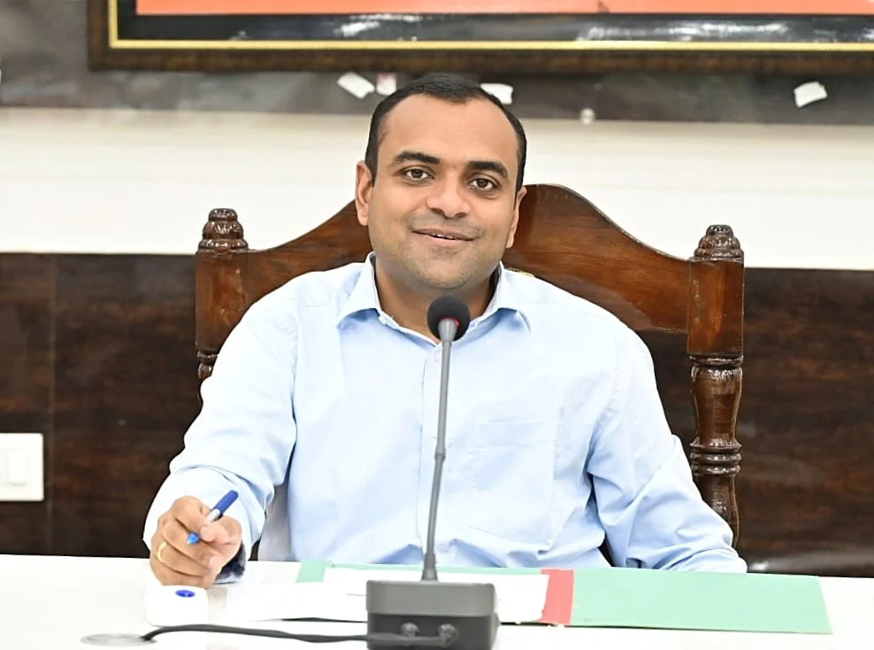

**हरिद्वार संवाददाता | आसिफ खान

हरिद्वार।** त्योहारों की रौनक में खलल डालने, सामाजिक सौहार्द बिगाड़ने और कानून व्यवस्था को चुनौती देने वाले असामाजिक तत्वों के खिलाफ जिला प्रशासन ने सख्त रुख अपना लिया है। धनतेरस से लेकर दीपावली, गोवर्धन पूजा, भैयादूज, छठ पूजा और ईगास-बग्वाल तक जनपद में शांति व्यवस्था बनाए रखने के लिए जिलाधिकारी मयूर दीक्षित ने अधिकारियों को कड़े निर्देश जारी किए हैं। डीएम ने साफ कर दिया है कि त्योहारों के दौरान किसी भी प्रकार की लापरवाही बर्दाश्त नहीं की जाएगी और अफवाह फैलाने, धार्मिक भावनाएं भड़काने तथा माहौल खराब करने की कोशिश करने वालों के खिलाफ तत्काल प्रभावी कार्रवाई की जाएगी।

जिलाधिकारी ने वरिष्ठ पुलिस अधीक्षक, नगर मजिस्ट्रेट, उपजिलाधिकारी हरिद्वार, लक्सर, भगवानपुर सहित तमाम संबंधित अधिकारियों को निर्देशित किया है कि सभी संवेदनशील क्षेत्रों में विशेष सतर्कता बरती जाए। पुलिस और प्रशासन आपसी समन्वय के साथ मैदान में सक्रिय रहें तथा किसी भी अप्रिय घटना की आशंका को पहले ही समाप्त करने के लिए प्रभावी कदम उठाएं।

**छह बड़े पर्वों पर प्रशासन की विशेष निगरानी**

जिलाधिकारी द्वारा जारी निर्देशों के अनुसार 06 नवंबर 2026 को धनतेरस, 08 नवंबर को दीपावली, 10 नवंबर को गोवर्धन पूजा, 11 नवंबर को भैयादूज, 14 एवं 15 नवंबर को छठ पूजा तथा 20 नवंबर को ईगास-बग्वाल पर्व मनाया जाएगा। इन अवसरों पर बाजारों में भारी भीड़, खरीदारी, आतिशबाजी, धार्मिक आयोजन और श्रद्धालुओं की आवाजाही को देखते हुए सुरक्षा व्यवस्था को मजबूत बनाने के निर्देश दिए गए हैं।

डीएम ने स्पष्ट किया है कि बाजारों, धार्मिक स्थलों, जुलूस मार्गों, रेलवे स्टेशन, बस स्टेशन, पार्किंग स्थलों और भीड़भाड़ वाले क्षेत्रों में विशेष निगरानी रखी जाए। किसी भी संदिग्ध गतिविधि या वस्तु की सूचना मिलने पर तत्काल कार्रवाई की जाए, ताकि आम नागरिकों में भय का माहौल पैदा न हो।

**सोशल मीडिया पर अफवाह फैलाने वालों पर शिकंजा**

त्योहारों के दौरान सोशल मीडिया के माध्यम से भ्रामक, भड़काऊ और धार्मिक भावनाएं आहत करने वाली सामग्री प्रसारित किए जाने की आशंका को देखते हुए जिलाधिकारी ने सोशल मीडिया मॉनिटरिंग सेल को पूरी तरह सक्रिय रहने के निर्देश दिए हैं। धार्मिक आपत्तिजनक टिप्पणियां, तस्वीरें और अफवाहें फैलाकर माहौल खराब करने वालों पर कड़ी निगरानी रखी जाएगी। ऐसी सामग्री सामने आने पर उसका तत्काल खंडन करने और संबंधित व्यक्तियों के विरुद्ध नियमानुसार कार्रवाई करने के निर्देश दिए गए हैं।

खाद्य पदार्थों में थूकने जैसी घटनाओं के वीडियो वायरल होने के मामलों का उल्लेख करते हुए डीएम ने ऐसी घटनाओं की पुनरावृत्ति रोकने के लिए सत्यापन अभियान चलाने और सीसीटीवी कैमरों का प्रभावी उपयोग सुनिश्चित करने को कहा है। उन्होंने स्पष्ट किया कि किसी भी घटना पर त्वरित और निष्पक्ष कार्रवाई की जाए, ताकि सामाजिक सौहार्द प्रभावित न हो।

**पटाखा कारोबारियों को चेतावनी, नियम तोड़े तो होगी कार्रवाई**

दीपावली पर आतिशबाजी की दुकानों और पटाखों के भंडारण को लेकर भी प्रशासन ने सख्त रुख अपनाया है। जिलाधिकारी ने निर्देश दिए हैं कि पटाखों की दुकानें भीड़भाड़ वाले इलाकों से दूर खुले मैदानों में सीमित संख्या में लगाने की अनुमति दी जाए। प्रत्येक दुकान पर अग्निशमन के पर्याप्त इंतजाम अनिवार्य होंगे। बिना सुरक्षा व्यवस्था के किसी भी दुकान को अनुमति नहीं दी जाएगी।

दुकानों और गोदामों की जांच कर पटाखों की गुणवत्ता सुनिश्चित करने तथा अवैध भंडारण और अनधिकृत कारोबार करने वालों के विरुद्ध कठोर कार्रवाई के निर्देश दिए गए हैं। आगजनी की घटनाओं को रोकने के लिए अग्निशमन विभाग को भी चौबीसों घंटे सतर्क रहने और आवश्यक संसाधन उपलब्ध रखने को कहा गया है।

**महिलाओं की सुरक्षा और बाजारों में यातायात पर विशेष फोकस**

धनतेरस और दीपावली के दौरान बाजारों में महिलाओं की भारी आवाजाही को देखते हुए छेड़छाड़, चैन स्नैचिंग, लूट और अन्य आपराधिक घटनाओं की रोकथाम के लिए पुलिस को विशेष सतर्कता बरतने के निर्देश दिए गए हैं। बाजारों में यातायात व्यवस्था सुचारू रखने, अतिक्रमण हटाने और भीड़ को नियंत्रित करने पर भी विशेष जोर दिया गया है।

जुलूस और शोभायात्राओं के दौरान यातायात बाधित होने, वाहनों से टकराव अथवा किसी प्रकार के विवाद की स्थिति पैदा न हो, इसके लिए पहले से ही आवश्यक व्यवस्थाएं करने को कहा गया है। मंदिरों और अन्य धार्मिक स्थलों के आसपास भगदड़ जैसी स्थिति रोकने के लिए भी विशेष इंतजाम किए जाएंगे।

**छठ घाटों पर सफाई, रोशनी और सुरक्षा के पुख्ता इंतजाम**

छठ पूजा के दौरान नदी और तालाबों के किनारे सुबह-शाम बड़ी संख्या में श्रद्धालुओं के पहुंचने की संभावना को देखते हुए घाटों की सफाई, प्रकाश व्यवस्था, भीड़ नियंत्रण और यातायात प्रबंधन के निर्देश दिए गए हैं। श्रद्धालुओं की सुविधा और सुरक्षा को प्राथमिकता देते हुए संबंधित विभागों को समय से सभी व्यवस्थाएं पूरी करने को कहा गया है।

**कनखल, रुड़की, ज्वालापुर और बहादराबाद पर विशेष नजर**

जनपद के मिश्रित आबादी वाले एवं साम्प्रदायिक दृष्टि से संवेदनशील क्षेत्रों में पुलिस और प्रशासन को अतिरिक्त सतर्कता बरतने के निर्देश दिए गए हैं। विशेष रूप से कनखल, रुड़की, ज्वालापुर और बहादराबाद सहित संवेदनशील स्थानों पर असामाजिक तत्वों की गतिविधियों पर नजर रखी जाएगी। मेलों, धार्मिक आयोजनों और अन्य सार्वजनिक कार्यक्रमों में देश-विदेश से आने वाले श्रद्धालुओं एवं पर्यटकों की सुरक्षा को लेकर भी विशेष इंतजाम किए जाएंगे।

**जुआ, अवैध भंडारण और हुड़दंग पर भी रहेगी नजर**

त्योहारों के दौरान जुआ खेलने, हार-जीत को लेकर विवाद, पटाखों के असुरक्षित परिवहन और भंडारण तथा एक-दूसरे समुदाय के प्रति आपत्तिजनक टिप्पणी करने जैसी घटनाओं को रोकने के लिए भी प्रभावी कार्रवाई के निर्देश दिए गए हैं। विद्युत आपूर्ति बाधित होने की स्थिति में किसी प्रकार का हंगामा न हो, इसके लिए विद्युत विभाग को भी आवश्यक तैयारियां रखने को कहा गया है।

जिलाधिकारी ने राष्ट्रीय एवं अंतरराष्ट्रीय सुरक्षा परिस्थितियों का हवाला देते हुए धार्मिक स्थलों, रेलवे स्टेशनों, सैन्य संस्थानों, स्कूलों, बस अड्डों और अन्य महत्वपूर्ण स्थानों की सुरक्षा व्यवस्था की समय-समय पर समीक्षा करने के निर्देश भी दिए हैं। किसी भी साम्प्रदायिक घटना अथवा दुर्घटना की सूचना मिलने पर संबंधित वरिष्ठ अधिकारी स्वयं तत्काल घटनास्थल पर पहुंचकर आवश्यक कार्रवाई सुनिश्चित करेंगे।

**लापरवाही पर नहीं मिलेगी कोई छूट**

डीएम मयूर दीक्षित ने सभी उपजिलाधिकारियों, पुलिस उपाधीक्षकों और संबंधित विभागीय अधिकारियों को निर्देश दिए हैं कि त्योहारों से पहले सभी तैयारियां पूरी कर ली जाएं। मुख्य चिकित्साधिकारी, नगर निगम हरिद्वार एवं रुड़की, विद्युत विभाग, अग्निशमन विभाग, खाद्य सुरक्षा विभाग, परिवहन विभाग, पेयजल निगम, जल संस्थान और नगर निकायों को भी अपनी जिम्मेदारियों का गंभीरता से निर्वहन करने को कहा गया है।

जिलाधिकारी का स्पष्ट संदेश है कि त्योहारों की खुशियों के बीच शांति व्यवस्था बिगाड़ने की किसी को अनुमति नहीं दी जाएगी। प्रशासन की प्राथमिकता है कि जनपदवासी भयमुक्त वातावरण में त्योहार मनाएं, बाजारों में सुरक्षित खरीदारी करें और धार्मिक आयोजन आपसी भाईचारे एवं सौहार्द के साथ संपन्न हों। त्योहारों के दौरान कानून हाथ में लेने और माहौल बिगाड़ने की कोशिश करने वालों के खिलाफ नियमानुसार सख्त कार्रवाई की जाएगी।
