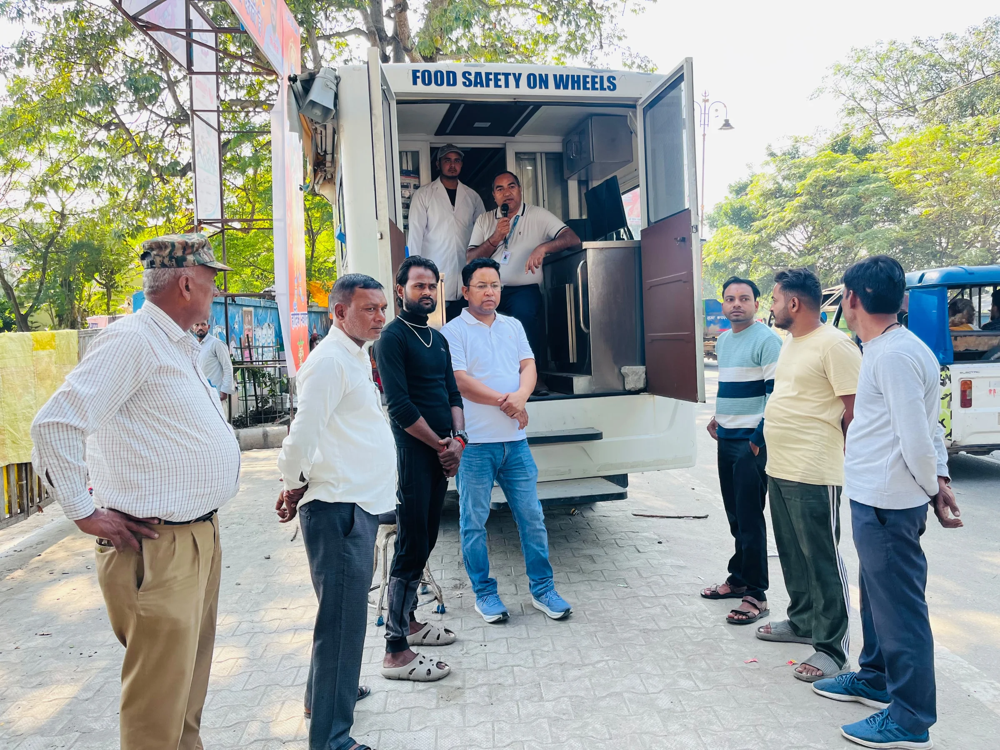
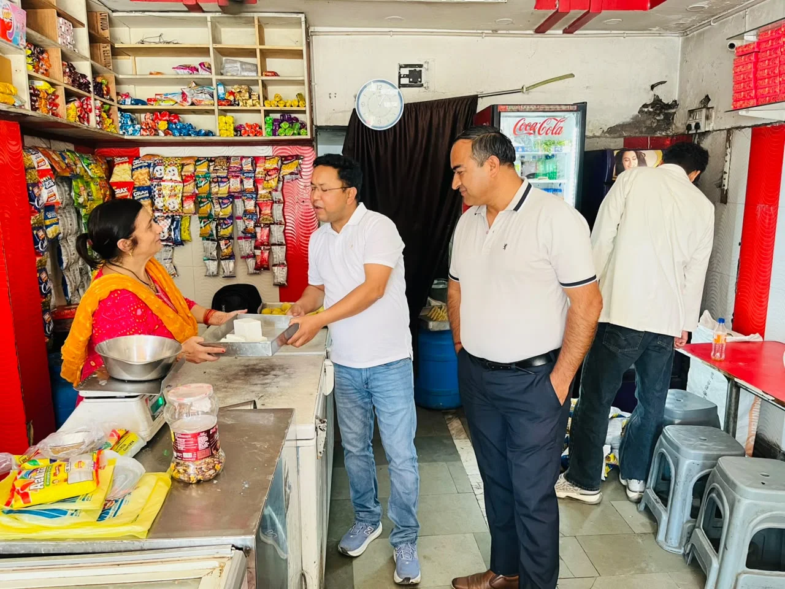

**हरिद्वार संवाददाता | आसिफ खान

हरिद्वार।** दीपावली के त्योहार पर लोगों की सेहत से खिलवाड़ करने वाले खाद्य कारोबारियों पर शिकंजा कसने के लिए खाद्य सुरक्षा एवं औषधि प्रशासन ने अपनी कार्रवाई तेज कर दी है। त्योहार के दौरान बाजारों में मिठाइयों, दूध, पनीर, बेकरी उत्पादों और अन्य खाद्य सामग्री की बढ़ती मांग को देखते हुए विभाग ने गुरुवार, 5 नवंबर 2026 को नगर निगम क्षेत्र में विशेष जांच अभियान चलाया। इस दौरान सचल खाद्य परीक्षण प्रयोगशाला के माध्यम से विभिन्न खाद्य प्रतिष्ठानों पर खाद्य पदार्थों की मौके पर ही जांच की गई।

अभियान के दौरान कुल 81 खाद्य नमूने जांच के लिए लिए गए, जिनमें से 11 नमूने अधोमानक पाए गए। जांच में मानकों पर खरे नहीं उतरने वाले खाद्य पदार्थों को तत्काल संबंधित प्रतिष्ठानों से हटवा दिया गया। विभाग की इस कार्रवाई से खाद्य कारोबारियों में हड़कंप की स्थिति देखने को मिली।

आयुक्त खाद्य सुरक्षा एवं औषधि प्रशासन उत्तराखंड विनय शंकर पांडेय तथा जिलाधिकारी हरिद्वार मयूर दीक्षित के निर्देशों के अनुपालन में चलाए गए इस अभियान का नेतृत्व सहायक आयुक्त खाद्य सुरक्षा महिमानंद जोशी एवं उपायुक्त प्रयोगशाला बीरेंद्र सिंह बिष्ट ने किया।

खाद्य सुरक्षा विभाग की संयुक्त टीम ने ऋषिकुल, गोविंदपुरी, रानीपुर मोड़ और प्रेम नगर आश्रम क्षेत्र में स्थित मिठाई की दुकानों, बेकरी, डेयरी एवं अन्य खाद्य प्रतिष्ठानों पर पहुंचकर सघन जांच की। इस दौरान मिठाइयों, पनीर, दूध, दही, केक, पेस्ट्री, सॉस, मसाले, तेल, बेसन, दालों और कन्फेक्शनरी उत्पादों सहित विभिन्न खाद्य सामग्री की जांच की गई।

**81 में से 11 नमूने अधोमानक, मौके पर हटवाई गई खाद्य सामग्री**

अभियान की सबसे महत्वपूर्ण बात यह रही कि मौके पर की गई जांच में 11 खाद्य नमूने अधोमानक पाए गए। विभागीय टीम ने तत्काल कार्रवाई करते हुए संबंधित प्रतिष्ठानों से अधोमानक खाद्य सामग्री को हटवा दिया, ताकि ऐसी सामग्री आम उपभोक्ताओं तक न पहुंच सके। त्योहार के मौके पर मिलावट और खराब गुणवत्ता वाले खाद्य पदार्थों की आशंका को देखते हुए विभाग की यह कार्रवाई उपभोक्ताओं के स्वास्थ्य की सुरक्षा के लिहाज से महत्वपूर्ण मानी जा रही है।

**मिठाई और बेकरी उत्पादों की निर्माण-अवसान तिथि भी जांची**

खाद्य पदार्थों की गुणवत्ता जांच के साथ ही टीम ने मिठाई और बेकरी उत्पादों की पैकिंग एवं लेबलिंग से जुड़े नियमों का भी निरीक्षण किया। वरिष्ठ खाद्य सुरक्षा अधिकारी कैलाश चंद्र टम्टा ने मिठाई विक्रेता प्रतिष्ठानों और बेकरी दुकानों में उत्पादों पर निर्माण एवं अवसान की तिथि अंकित होने की जांच की। निरीक्षण के दौरान अधिकांश प्रतिष्ठानों पर मिठाई और बेकरी उत्पादों पर नियमानुसार निर्माण एवं अवसान की तिथि अंकित पाई गई।

**अधिकारियों की संयुक्त टीम ने संभाला मोर्चा**

इस विशेष अभियान में वरिष्ठ खाद्य सुरक्षा अधिकारी नगर निगम हरिद्वार कैलाश चंद्र टम्टा, वरिष्ठ खाद्य सुरक्षा अधिकारी रुड़की नगर निगम योगेंद्र पांडेय, जूनियर फूड एनालिस्ट अनुराग मियां तथा लैब सहायक गौरव कुमार सहित अन्य कर्मचारी मौजूद रहे।

दीपावली से पहले खाद्य सुरक्षा विभाग की इस कार्रवाई ने साफ संकेत दिया है कि त्योहार के दौरान खाद्य पदार्थों की गुणवत्ता से समझौता बर्दाश्त नहीं किया जाएगा। बाजारों में बिकने वाली मिठाइयों, डेयरी उत्पादों और बेकरी सामग्री पर विभाग की निगरानी जारी है। आम जनता को सुरक्षित खाद्य सामग्री उपलब्ध कराने के उद्देश्य से विभाग द्वारा जांच अभियान चलाया जा रहा है।
