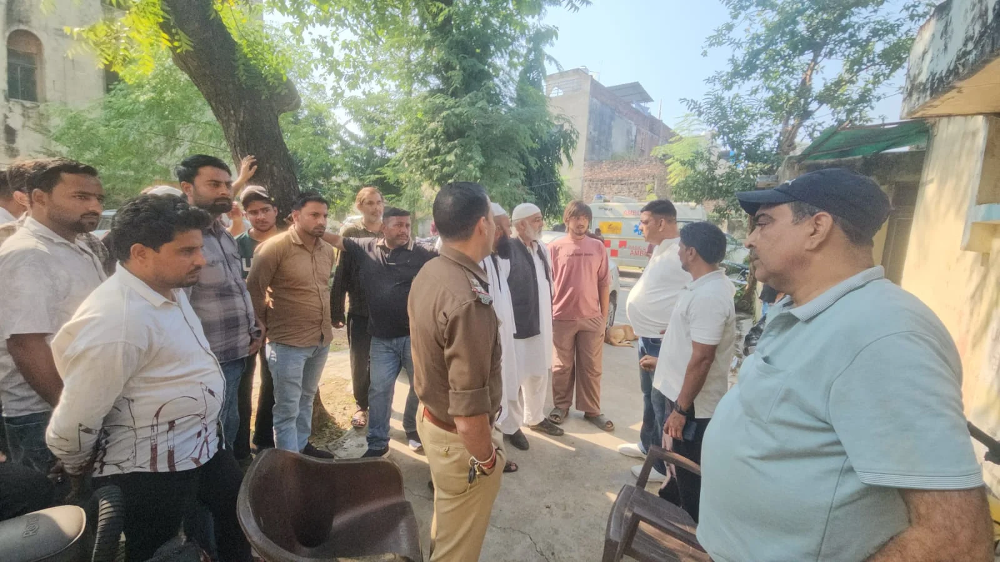

**रूडकी संवाददाता | आसिफ खान 

रुड़की।** गंगनहर कोतवाली क्षेत्र के रामपुर चुंगी के पास मामूली कहासुनी के बाद एक युवक पर कथित तौर पर करीब एक दर्जन युवकों द्वारा किए गए हमले का सनसनीखेज मामला सामने आया है। साइड देने को लेकर शुरू हुई कहासुनी ने कुछ ही देर में हिंसक रूप ले लिया। आरोप है कि युवकों ने लाठी-डंडों, धारदार हथियारों, लोहे की रॉड और पत्थरों से युवक को घेरकर हमला कर दिया। हमलावरों ने उसकी लग्जरी कार को भी निशाना बनाते हुए शीशे तोड़कर बुरी तरह क्षतिग्रस्त कर दिया। अचानक हुए हमले के बीच पीड़ित ने किसी तरह मौके से भागकर अपनी जान बचाई। पूरी घटना आसपास लगे सीसीटीवी कैमरों में कैद होने की बात सामने आई है। घटना के बाद क्षेत्र में दहशत का माहौल है।

जानकारी के अनुसार मोहम्मद साजिद पुत्र जिन्दा हसन निवासी ग्राम बलेलपुर पनियाला, चंदापुर, रुड़की, 3 नवंबर 2026 को शाम करीब 5:30 बजे दून पब्लिक स्कूल की तरफ से रामपुर चुंगी की ओर आ रहे थे। इसी दौरान रास्ते में साइड देने को लेकर कुछ युवकों से उनकी कहासुनी हो गई। बताया गया कि उस समय मामला सामान्य बहस तक ही सीमित रहा, लेकिन आरोप है कि करीब दो घंटे बाद शाम 7:30 बजे जब साजिद दोबारा उसी रास्ते से गुजरे तो पहले से घात लगाए बैठे करीब एक दर्जन युवकों ने उन्हें घेर लिया और हमला बोल दिया।

आरोप है कि हमलावरों ने साजिद पर लाठी-डंडों, धारदार हथियारों, रॉड और पत्थरों से हमला किया। इतना ही नहीं, उनकी लग्जरी कार पर भी जमकर हमला किया गया और कार के शीशे तोड़ दिए गए। अचानक हुए हमले से मौके पर अफरा-तफरी मच गई। साजिद ने किसी तरह वहां से भागकर अपनी जान बचाई। इस वारदात ने रामपुर चुंगी क्षेत्र की सुरक्षा व्यवस्था और सार्वजनिक स्थानों पर बढ़ती दबंगई को लेकर सवाल खड़े कर दिए हैं।

**सीसीटीवी में कैद हुई वारदात, हाथों में लाठी-डंडे लिए नजर आए युवक**

इस पूरे मामले में सीसीटीवी फुटेज अहम साक्ष्य के रूप में सामने आ रही है। बताया जा रहा है कि घटनास्थल के आसपास लगे कैमरों में कई युवक हाथों में लाठी-डंडे लेकर दिखाई दे रहे हैं। पीड़ित पक्ष ने वकार, अलकसीम, उवैश सहित कुछ अन्य लोगों पर हमले में शामिल होने का आरोप लगाया है। अब पुलिस के सामने सीसीटीवी फुटेज के आधार पर हमले में शामिल प्रत्येक व्यक्ति की पहचान करने और घटना की पूरी सच्चाई सामने लाने की चुनौती है।

**मो. तालिब ने उठाया रामपुर चुंगी पर अतिक्रमण और जाम का मुद्दा**

पीड़ित पक्ष की ओर से मो. तालिब ने बताया कि परिवार की किसी से कोई पुरानी रंजिश नहीं है। मामूली कहासुनी के बाद इतनी बड़ी वारदात को अंजाम दिया जाना बेहद गंभीर मामला है। उन्होंने रामपुर चुंगी की व्यवस्थाओं पर भी सवाल उठाते हुए कहा कि यहां ठेले और दुकानों के बाहर खड़े वाहनों के कारण अक्सर जाम की स्थिति बनी रहती है। इसी अव्यवस्था के चलते आए दिन विवाद की आशंका बनी रहती है। उन्होंने प्रशासन से क्षेत्र में अतिक्रमण और अव्यवस्थित पार्किंग के खिलाफ प्रभावी कार्रवाई करने की मांग उठाई।

**तहरीर के बाद पुलिस जांच शुरू, फुटेज से खुलेगा हमलावरों का राज!**

घटना के संबंध में पीड़ित पक्ष ने गंगनहर कोतवाली में तहरीर देकर आरोपियों के खिलाफ कार्रवाई की मांग की है। पीड़ित ने सीसीटीवी फुटेज के आधार पर हमले में शामिल युवकों की पहचान कर उनके विरुद्ध सख्त कानूनी कार्रवाई करने की मांग की है। घटना के बाद से परिवार दहशत में है और न्याय की गुहार लगा रहा है।

वहीं एसपी देहात ने बताया कि रामपुर चुंगी पर मारपीट की घटना के संबंध में पुलिस को तहरीर प्राप्त हुई है। मामले की जांच की जा रही है और सीसीटीवी फुटेज के आधार पर आरोपियों की पहचान की जा रही है। जांच में सामने आने वाले तथ्यों के आधार पर संबंधित आरोपियों के खिलाफ सख्त कानूनी कार्रवाई की जाएगी।

अब सबसे बड़ा सवाल यह है कि मामूली कहासुनी के बाद करीब एक दर्जन युवकों के एकत्र होकर हमला करने की नौबत कैसे आई? क्या रामपुर चुंगी पर असामाजिक तत्वों के हौसले इतने बुलंद हैं कि आम नागरिकों की सुरक्षा भी खतरे में पड़ रही है? पुलिस जांच और सीसीटीवी फुटेज से ही इस पूरी वारदात की असल तस्वीर सामने आएगी।
