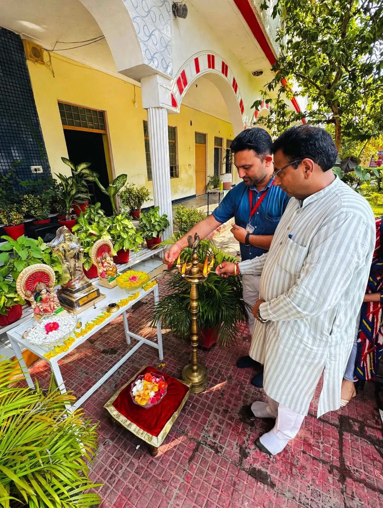
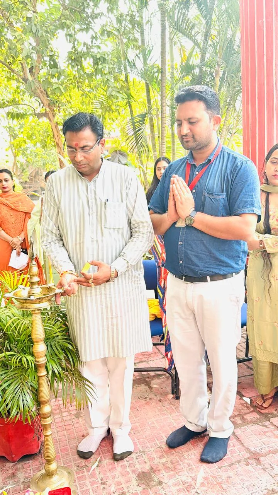

**रूडकी संवाददाता | आसिफ खान 

रुड़की।** रूपचंद शर्मा एजुकेशन ट्रस्ट द्वारा संचालित बिशंभर सहाय ग्रुप ऑफ इंस्टीट्यूशंस में दीपावली के पावन अवसर पर भव्य एवं गरिमामय दीपावली महोत्सव का आयोजन किया गया। दीपों की रोशनी, सांस्कृतिक प्रस्तुतियों और उत्साह से सराबोर इस आयोजन में छात्र-छात्राओं ने अपनी प्रतिभा का शानदार प्रदर्शन कर उपस्थित अतिथियों एवं दर्शकों का मन मोह लिया। पूरे परिसर में उत्सव का माहौल देखने को मिला।

कार्यक्रम का शुभारंभ मुख्य अतिथि एवं भारतीय जनता पार्टी के प्रदेश संयोजक सौरव भूषण शर्मा, संस्थान के मैनेजिंग डायरेक्टर गौरव भूषण शर्मा तथा सचिव चंद्र भूषण शर्मा ने संयुक्त रूप से दीप प्रज्वलित कर किया। दीप प्रज्वलन के साथ ही महोत्सव का विधिवत आगाज हुआ और परिसर दीपावली के उल्लास से जगमगा उठा।

महोत्सव के दौरान छात्र-छात्राओं ने रंगारंग सांस्कृतिक कार्यक्रमों, मनमोहक नृत्य और संगीत की शानदार प्रस्तुतियां दीं। विद्यार्थियों की आकर्षक प्रस्तुतियों ने भारतीय संस्कृति और परंपराओं की खूबसूरत झलक पेश की। कार्यक्रम में मौजूद अतिथियों ने विद्यार्थियों की प्रतिभा, मेहनत और आत्मविश्वास की जमकर सराहना की।

**संस्कृति और संस्कारों के साथ राष्ट्र निर्माण में योगदान दें युवा : सौरव भूषण शर्मा**

मुख्य अतिथि सौरव भूषण शर्मा ने अपने संबोधन में कहा कि दीपावली केवल दीपों का त्योहार नहीं, बल्कि अंधकार पर प्रकाश और असत्य पर सत्य की विजय का प्रतीक है। यह पर्व हमें जीवन में सकारात्मकता, सद्भाव और सत्य के मार्ग पर चलने की प्रेरणा देता है। उन्होंने विद्यार्थियों से भारतीय संस्कृति, मूल्यों और परंपराओं को सहेजने के साथ राष्ट्र निर्माण में अपना उत्कृष्ट योगदान देने का आह्वान किया।

**शिक्षा के साथ सांस्कृतिक विरासत से जोड़ना संस्थान की प्राथमिकता : गौरव भूषण शर्मा**

मैनेजिंग डायरेक्टर गौरव भूषण शर्मा ने कहा कि संस्थान का उद्देश्य विद्यार्थियों को उच्च गुणवत्ता वाली शिक्षा उपलब्ध कराने के साथ-साथ उन्हें देश की समृद्ध सांस्कृतिक विरासत से जोड़े रखना भी है। ऐसे आयोजन विद्यार्थियों के सर्वांगीण विकास, आत्मविश्वास और रचनात्मक प्रतिभा को निखारने में महत्वपूर्ण भूमिका निभाते हैं। उन्होंने कहा कि शिक्षा के साथ संस्कार और संस्कृति का समावेश ही विद्यार्थियों को एक बेहतर नागरिक बनाता है।

**आपसी सौहार्द और भाईचारे का संदेश देता है दीपावली पर्व : चंद्र भूषण शर्मा**

संस्थान के सचिव चंद्र भूषण शर्मा ने कहा कि दीपावली का पर्व आपसी प्रेम, सौहार्द और भाईचारे का संदेश देता है। उन्होंने कहा कि पूरा बिशंभर सहाय परिवार एकजुट होकर शिक्षा एवं समाजसेवा के क्षेत्र में निरंतर नए आयाम स्थापित करने के लिए प्रयासरत है। उन्होंने सभी को दीपावली की शुभकामनाएं देते हुए विद्यार्थियों के उज्ज्वल भविष्य की कामना की।

इस अवसर पर डीन ऑफ फैकल्टी दिवाकर जैन ने विद्यार्थियों की सांस्कृतिक प्रस्तुतियों की सराहना करते हुए कहा कि छात्र-छात्राओं ने अपनी प्रतिभा और मेहनत से कार्यक्रम को यादगार बना दिया। वहीं प्रिंसिपल शाहजीब आलम ने विद्यार्थियों को अनुशासन और कड़ी मेहनत का महत्व समझाते हुए कहा कि सफलता प्राप्त करने के लिए निरंतर प्रयास और समर्पण जरूरी है।

कार्यक्रम में सुधीर सैनी, जितेंद्र रावत, विशाल सैनी, आयुषी शर्मा, सोनी सहित संस्थान के समस्त अध्यापक-अध्यापिकाएं, स्टाफ सदस्य और बड़ी संख्या में छात्र-छात्राएं मौजूद रहे।

महोत्सव का समापन हर्षोल्लास के साथ हुआ। इस दौरान उपस्थित सभी लोगों को दीपावली की शुभकामनाएं दी गईं तथा मिठाई वितरित की गई। रंगारंग प्रस्तुतियों और उत्साहपूर्ण सहभागिता के साथ आयोजित यह महोत्सव विद्यार्थियों के लिए यादगार बन गया।
