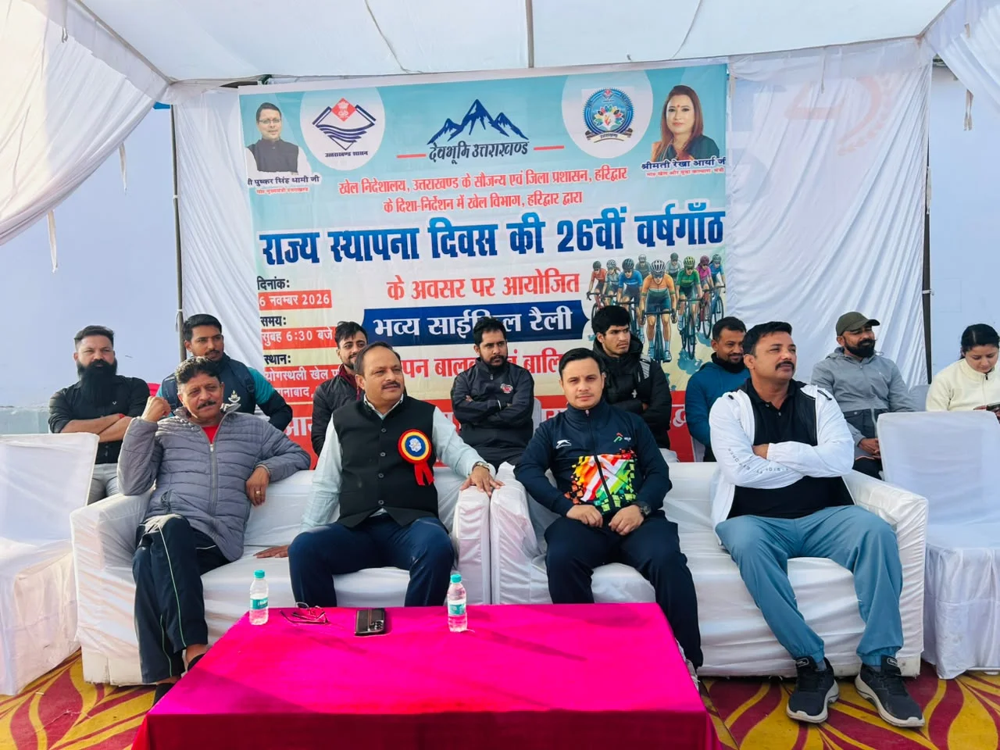
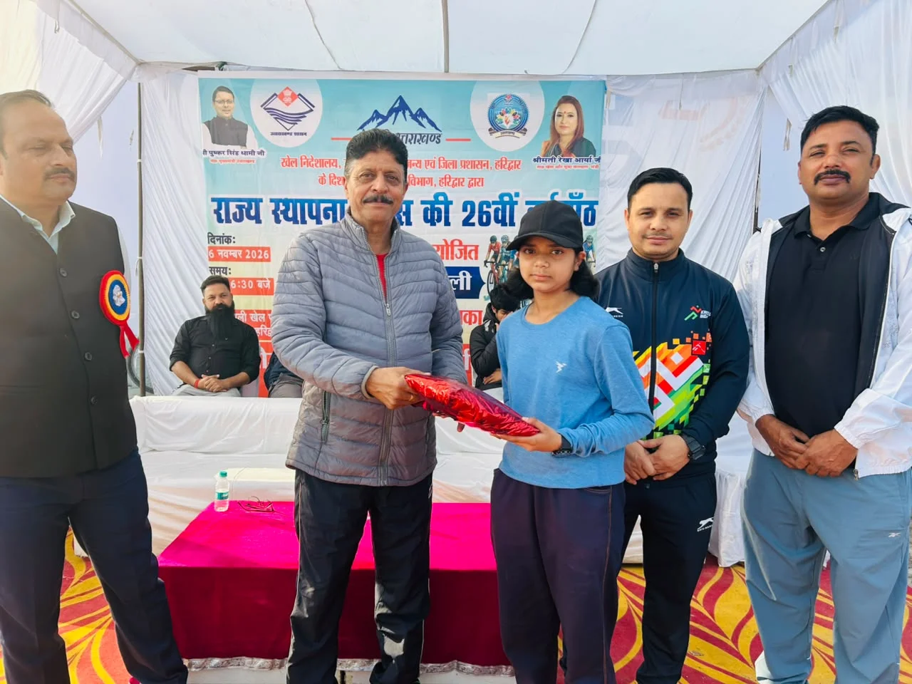
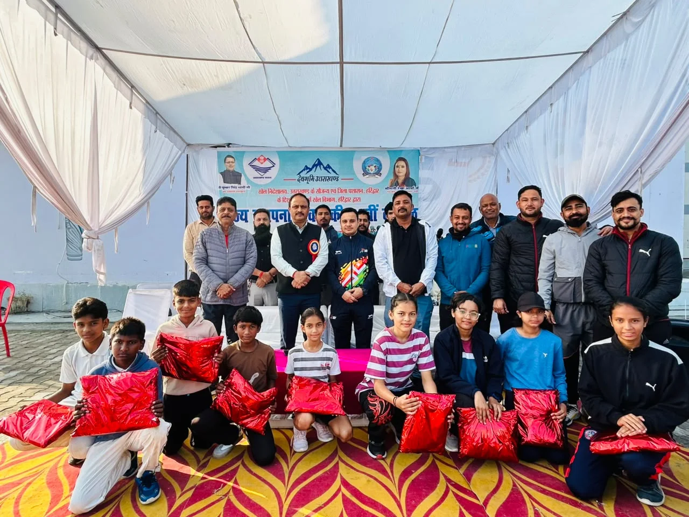

**हरिद्वार संवाददाता | आसिफ खान

हरिद्वार।** उत्तराखंड राज्य स्थापना दिवस के अवसर पर हरिद्वार में खेल उत्साह और युवा जोश का शानदार नजारा देखने को मिला। खेल निदेशालय उत्तराखंड एवं जिला प्रशासन हरिद्वार के मार्गदर्शन में जिला खेल कार्यालय की ओर से शुक्रवार, 06 नवंबर 2026 को ओपन वर्ग बालक-बालिका साइकिल रैली का भव्य आयोजन किया गया। रैली में 97 बालक एवं बालिका खिलाड़ियों ने पूरे उत्साह और उमंग के साथ प्रतिभाग कर खेल भावना, अनुशासन और स्वस्थ जीवनशैली का संदेश दिया।

कार्यक्रम का शुभारंभ एवं पुरस्कार वितरण मुख्य अतिथि जिला युवा कल्याण एवं प्रांतीय रक्षक दल अधिकारी प्रमोद चंद्र पांडेय ने किया। इस दौरान खिलाड़ियों का उत्साह देखते ही बन रहा था। राज्य स्थापना दिवस के जश्न को खेल गतिविधियों से जोड़ते हुए आयोजित इस रैली ने युवाओं को फिटनेस और नियमित खेल गतिविधियों के प्रति प्रेरित करने का संदेश दिया।

**योगस्थली खेल परिसर से शुरू हुई रैली, शहर के प्रमुख मार्गों से गुजरे खिलाड़ी**

साइकिल रैली का शुभारंभ योगस्थली खेल परिसर रोशनाबाद से हुआ। यहां से रैली नवोदय चौक एवं हीरो चौक होते हुए वापस योगस्थली खेल परिसर पहुंचकर संपन्न हुई। पूरे मार्ग पर खिलाड़ियों में खासा उत्साह नजर आया। 97 प्रतिभागियों की मौजूदगी ने आयोजन को खास बना दिया। बालक एवं बालिका खिलाड़ियों ने पूरे जोश के साथ रैली में हिस्सा लेकर राज्य स्थापना दिवस को यादगार बनाया।

**लॉटरी ड्रॉ से 10 खिलाड़ियों को मिला पुरस्कार**

आयोजन के दौरान खेल विभाग की ओर से खिलाड़ियों का उत्साह बढ़ाने के लिए विशेष पुरस्कार वितरण कार्यक्रम भी आयोजित किया गया। ओपन वर्ग बालक-बालिका साइकिल रैली में लॉटरी ड्रॉ के माध्यम से पांच बालक एवं पांच बालिका खिलाड़ियों का चयन किया गया। इस प्रकार कुल 10 खिलाड़ियों को पुरस्कृत कर उनका उत्साहवर्धन किया गया।

**खेलों के जरिए स्वस्थ और सशक्त उत्तराखंड का संदेश**

इस आयोजन का मुख्य उद्देश्य बच्चों एवं युवाओं में खेलों के प्रति रुचि बढ़ाना, शारीरिक फिटनेस के प्रति जागरूकता पैदा करना तथा स्वस्थ जीवनशैली अपनाने के लिए प्रेरित करना रहा। राज्य स्थापना दिवस जैसे महत्वपूर्ण अवसर पर साइकिल रैली का आयोजन खेल विभाग की उस पहल को भी दर्शाता है, जिसके माध्यम से युवाओं को खेल गतिविधियों से जोड़कर स्वस्थ एवं सशक्त उत्तराखंड के निर्माण का संदेश दिया जा रहा है।

कार्यक्रम में जिला क्रीड़ा अधिकारी रविंद्र भंडारी, सहायक प्रशिक्षक अनुराग राठी, मुख्य प्रशासनिक अधिकारी प्रजापति कुकरैती, वरिष्ठ सहायक शिवम रावत, कनिष्ठ सहायक विक्रम सिंह, राजन राणा, मंगल सिंह, अक्षय राठी, अनुराग सिंह धमांदा, गौरव कुमार, आदित्य गुप्ता एवं संविदा प्रशिक्षक शिवानी नैथानी सहित अनेक खेल प्रेमी उपस्थित रहे।

राज्य स्थापना दिवस पर आयोजित इस साइकिल रैली ने एक बार फिर साबित किया कि खेल केवल प्रतिस्पर्धा का माध्यम नहीं, बल्कि स्वस्थ समाज, अनुशासित युवा और मजबूत उत्तराखंड की नींव भी हैं।
