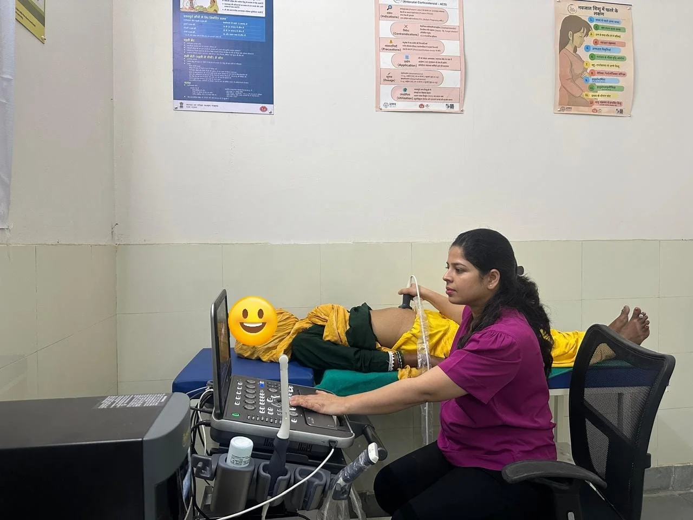
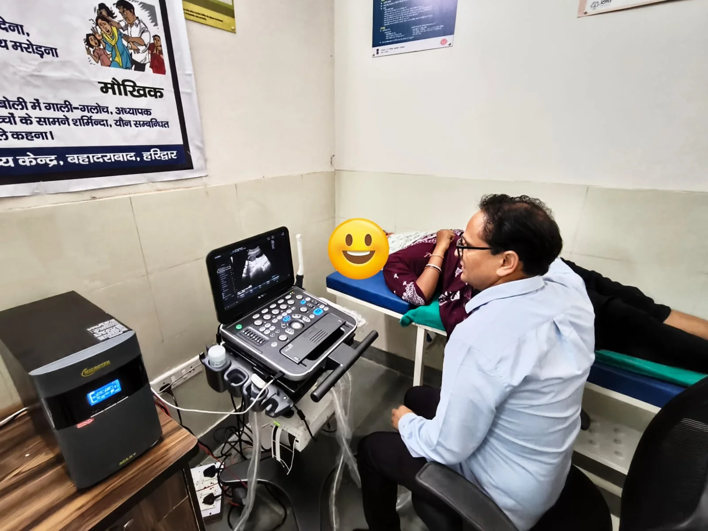

**हरिद्वार संवाददाता | आसिफ खान

बहादराबाद।** क्षेत्र की स्वास्थ्य सुविधाओं को मजबूत बनाने की दिशा में सामुदायिक स्वास्थ्य केंद्र (CHC) बहादराबाद में एक महत्वपूर्ण कदम उठाया गया है। अब गर्भवती महिलाओं को अल्ट्रासाउंड जांच के लिए दूसरे अस्पतालों के चक्कर नहीं काटने पड़ेंगे। सीएचसी बहादराबाद में अल्ट्रासाउंड सेवाओं का विधिवत शुभारंभ कर दिया गया है। स्वास्थ्य विभाग की इस पहल से क्षेत्र की गर्भवती महिलाओं को स्थानीय स्तर पर ही जांच की सुविधा मिल सकेगी।

मुख्य चिकित्सा अधिकारी हरिद्वार डॉ. आर.के. सिंह के निर्देश पर चिकित्सा अधीक्षक डॉ. यशपाल तोमर ने केंद्र में अल्ट्रासाउंड सुविधा का शुभारंभ किया। सेवा शुरू होने के पहले ही दिन डॉ. अंतिमा एवं डॉ. यशपाल तोमर द्वारा दो गर्भवती महिलाओं का अल्ट्रासाउंड किया गया। इससे स्वास्थ्य केंद्र में आने वाली महिलाओं को बड़ी राहत मिलने की उम्मीद है।

**सप्ताह में दो दिन होगी अल्ट्रासाउंड जांच**

मुख्य चिकित्सा अधिकारी डॉ. आर.के. सिंह ने बताया कि सीएचसी बहादराबाद में अल्ट्रासाउंड सेवाओं को नियमित रूप से संचालित करने के लिए डॉ. राकेश को सप्ताह में दो दिन जांच करने के निर्देश दिए गए हैं। इसका सीधा लाभ क्षेत्र की गर्भवती महिलाओं को मिलेगा। अब उन्हें सामान्य जांच के लिए दूरस्थ स्वास्थ्य केंद्रों तक जाने की परेशानी से काफी हद तक निजात मिल सकेगी।

**अब सी-सेक्शन सुविधा शुरू करने की तैयारी**

सीएचसी बहादराबाद में स्वास्थ्य सेवाओं का दायरा लगातार बढ़ाया जा रहा है। चिकित्सा अधीक्षक डॉ. यशपाल तोमर ने बताया कि संस्थागत प्रसव को बढ़ावा देने के उद्देश्य से केंद्र में जल्द ही सिजेरियन यानी सी-सेक्शन प्रसव की सुविधा भी शुरू की जाएगी। इसके शुरू होने से उन गर्भवती महिलाओं को विशेष लाभ मिलेगा, जिन्हें प्रसव के दौरान ऑपरेशन की आवश्यकता होती है। स्थानीय स्तर पर यह सुविधा उपलब्ध होने से मरीजों को बेहतर चिकित्सा सेवाएं मिल सकेंगी।

**सात महीने में 38 हजार से अधिक लाभार्थियों को मिला उपचार**

सीएचसी बहादराबाद में उपलब्ध स्वास्थ्य सेवाओं के आंकड़े भी केंद्र में मरीजों की बड़ी संख्या को दर्शाते हैं। चिकित्सा अधीक्षक के अनुसार अक्टूबर 2026 में कुल 5,151 लाभार्थियों ने स्वास्थ्य सेवाओं का लाभ उठाया। इनमें 3,315 नए मरीज और 1,836 पुराने मरीज शामिल रहे। वहीं अप्रैल से अक्टूबर 2026 तक कुल 38,263 लाभार्थियों को विभिन्न स्वास्थ्य सेवाएं उपलब्ध कराई गईं। इस अवधि में 610 मरीजों को भर्ती कर उपचार भी किया गया।

**अक्टूबर में 52 और सात महीने में 358 प्रसव**

प्रसव सेवाओं के मोर्चे पर भी सीएचसी बहादराबाद लगातार सेवाएं दे रहा है। अक्टूबर माह में यहां कुल 52 प्रसव कराए गए, जबकि अप्रैल से अक्टूबर 2026 तक कुल 358 प्रसव सफलतापूर्वक संपन्न कराए जा चुके हैं। वर्तमान में केंद्र में 24 घंटे सातों दिन आकस्मिक चिकित्सा सेवाएं और संस्थागत प्रसव की सुविधा उपलब्ध है।

**स्थानीय स्तर पर बेहतर इलाज उपलब्ध कराने पर जोर**

मुख्य चिकित्सा अधिकारी डॉ. आर.के. सिंह ने कहा कि जनपद में आमजन को सुलभ, गुणवत्तापूर्ण और बेहतर स्वास्थ्य सुविधाएं उपलब्ध कराना स्वास्थ्य विभाग की प्राथमिकता है। इसी दिशा में स्वास्थ्य केंद्रों पर सुविधाओं का विस्तार किया जा रहा है। सीएचसी बहादराबाद में अल्ट्रासाउंड सेवा शुरू होने और आगामी समय में सी-सेक्शन प्रसव की सुविधा उपलब्ध होने से गर्भवती महिलाओं सहित अन्य मरीजों को राहत मिलेगी।

कुल मिलाकर बहादराबाद सामुदायिक स्वास्थ्य केंद्र में अल्ट्रासाउंड सुविधा की शुरुआत और सी-सेक्शन सेवा की आगामी तैयारी क्षेत्र की स्वास्थ्य व्यवस्था के विस्तार की दिशा में अहम पहल है। अब स्थानीय लोगों को बेहतर चिकित्सा सुविधाएं अपने ही क्षेत्र में उपलब्ध कराने पर जोर दिया जा रहा है।
