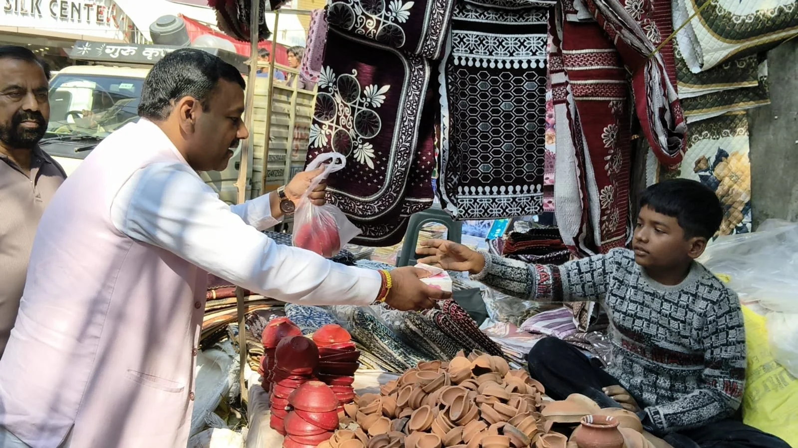
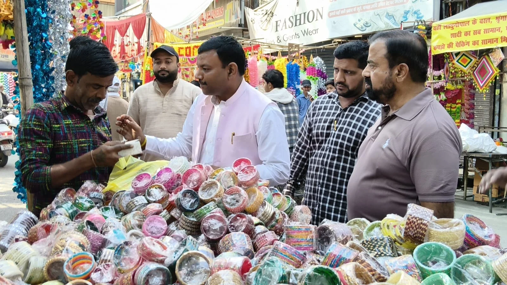
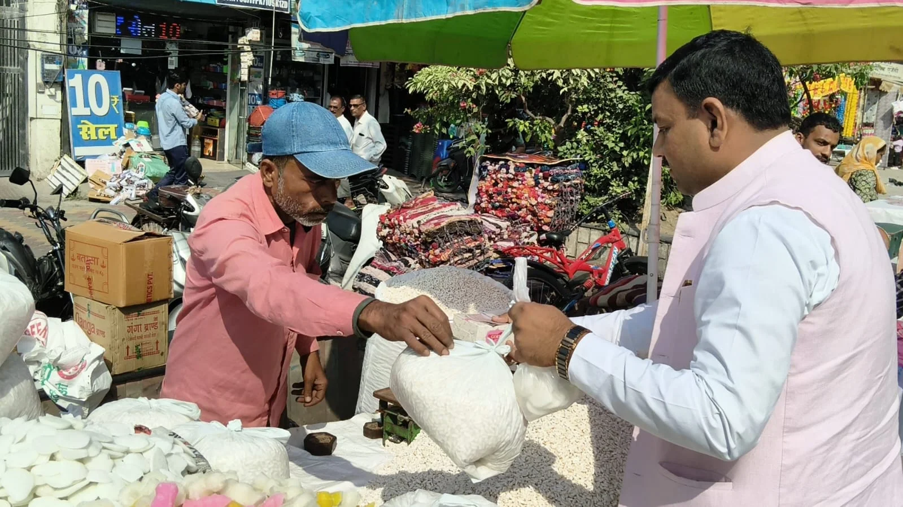

**रुड़की संवाददाता | आसिफ खान**

**रुड़की।** दीपावली के पावन पर्व पर जहां बाजारों में खरीदारी की चहल-पहल दिखाई दे रही है, वहीं स्वदेशी उत्पादों को बढ़ावा देने और स्थानीय व्यापारियों के चेहरे पर मुस्कान लाने के उद्देश्य से पूर्व मेयर गौरव गोयल ने बाजारों में पहुंचकर एक अलग ही संदेश दिया। उन्होंने विदेशी उत्पादों की चमक-दमक के बीच स्वदेशी सामान की अहमियत को सामने रखते हुए स्थानीय दुकानदारों से दीपावली में उपयोग होने वाली वस्तुओं एवं घरेलू सामान की खरीदारी की। इतना ही नहीं, उन्होंने दुकानदारों को मिठाई वितरित कर दीपावली की शुभकामनाएं भी दीं।

पूर्व मेयर गौरव गोयल ने रुड़की के विभिन्न बाजारों एवं दुकानों पर पहुंचकर स्थानीय स्तर पर निर्मित दीपावली के सामान, मिट्टी के दीपक तथा घरेलू उपयोग की वस्तुओं की खरीदारी की। इस दौरान उन्होंने दुकानदारों से बातचीत कर उनके कारोबार और त्योहार के दौरान होने वाले व्यापार की जानकारी भी ली। उनके इस कदम से स्थानीय दुकानदारों में उत्साह दिखाई दिया।

इस अवसर पर गौरव गोयल ने कहा कि स्वदेशी की भावना कोई नई अवधारणा नहीं है। महात्मा गांधी ने देश की आजादी के आंदोलन के दौरान स्वदेशी और आत्मनिर्भरता को जन आंदोलन का स्वरूप दिया था। उनका मानना था कि देश की आर्थिक मजबूती तभी संभव है, जब देशवासी अपने देश में बने उत्पादों को प्राथमिकता दें और स्थानीय कारीगरों, छोटे व्यापारियों एवं लघु उद्योगों को आर्थिक रूप से मजबूत करें।

उन्होंने कहा कि आज दीपावली जैसे बड़े त्योहारों पर करोड़ों रुपये का कारोबार होता है। ऐसे में यदि प्रत्येक व्यक्ति विदेशी और बड़े ब्रांडों के सामान के साथ-साथ अपने आसपास के छोटे दुकानदारों, कारीगरों और स्थानीय उत्पादकों से भी खरीदारी करने का संकल्प ले, तो इसका सीधा लाभ हजारों परिवारों तक पहुंच सकता है। एक छोटी-सी खरीदारी किसी दुकानदार के परिवार की दीपावली रोशन कर सकती है।

**स्थानीय दुकानदारों की मेहनत को मिले सम्मान**

पूर्व मेयर ने कहा कि भारत की असली पहचान केवल बड़े उद्योगों और चमकदार बाजारों से नहीं, बल्कि गांवों, कस्बों और शहरों में मेहनत करने वाले उन छोटे कारोबारियों से भी है, जो अपने हुनर और परिश्रम के दम पर परिवार का पालन-पोषण करते हैं। मिट्टी के दीपक बनाने वाले कुम्हार, सजावटी सामान तैयार करने वाले कारीगर, घरेलू वस्तुएं बनाने वाले छोटे उद्यमी और फुटपाथ पर दुकान लगाकर अपना रोजगार चलाने वाले लोग भी देश की अर्थव्यवस्था की महत्वपूर्ण कड़ी हैं।

उन्होंने कहा कि त्योहारों पर केवल अपने घरों को रोशन करना ही पर्याप्त नहीं है, बल्कि उन लोगों के घरों में भी खुशहाली पहुंचाने का प्रयास होना चाहिए, जिनकी मेहनत से बाजारों में रौनक आती है। यदि हम स्थानीय उत्पादों को प्राथमिकता देंगे तो छोटे कारोबारियों की आमदनी बढ़ेगी और रोजगार के नए अवसर भी पैदा होंगे।

**स्वदेशी खरीदारी बने हर परिवार का संकल्प**

गौरव गोयल ने नगरवासियों से अपील करते हुए कहा कि दीपावली पर अधिक से अधिक स्वदेशी एवं स्थानीय स्तर पर निर्मित वस्तुओं की खरीदारी करें। मिट्टी के दीपक, सजावटी सामान, घरेलू उपयोग की वस्तुएं और स्थानीय कारीगरों द्वारा तैयार उत्पाद खरीदकर उनके हुनर को प्रोत्साहित करें। उन्होंने कहा कि स्वदेशी अपनाने का संदेश केवल भाषणों तक सीमित नहीं रहना चाहिए, बल्कि इसे अपने दैनिक जीवन और खरीदारी की आदतों में भी शामिल करना होगा।

उन्होंने विभिन्न दुकानों एवं स्टालों पर पहुंचकर दुकानदारों को मिठाई वितरित की और उनके साथ दीपावली की खुशियां साझा कीं। साथ ही सभी व्यापारियों के उज्ज्वल भविष्य, अच्छे कारोबार और परिवारों की सुख-समृद्धि की कामना की।

पूर्व मेयर का कहना था कि देश तभी आत्मनिर्भर बनेगा, जब देश का छोटा व्यापारी आर्थिक रूप से मजबूत होगा। इसलिए इस दीपावली पर स्वदेशी सामान खरीदना केवल एक विकल्प नहीं, बल्कि स्थानीय रोजगार, कारीगरों की मेहनत और देश की आर्थिक मजबूती को समर्थन देने का एक सार्थक प्रयास है।

उन्होंने समस्त नगरवासियों को दीपावली की हार्दिक शुभकामनाएं देते हुए कहा कि यह पर्व प्रत्येक परिवार के जीवन में सुख, शांति, समृद्धि और खुशहाली लेकर आए।
