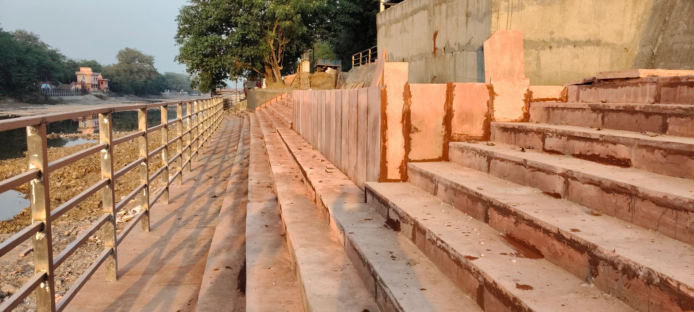
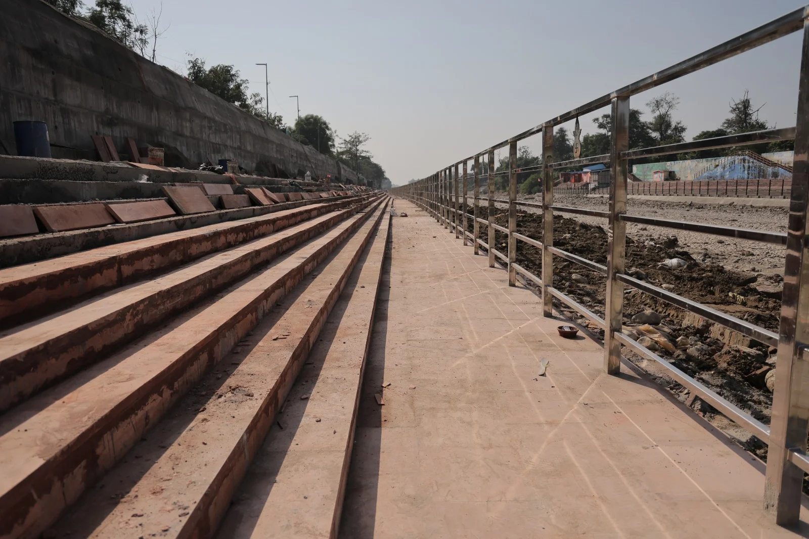

**हरिद्वार संवाददाता | आसिफ खान

हरिद्वार।** कुंभ मेला-2027 की तैयारियों को लेकर हरिद्वार में घाट निर्माण का सबसे चुनौतीपूर्ण चरण सफलतापूर्वक पार कर लिया गया है। गंगा नहर क्लोजर की समयसीमा खत्म होने से पहले ही सिंचाई विभाग ने उन महत्वपूर्ण निर्माण एवं मरम्मत कार्यों को पूरा कर लिया है, जिनके लिए नहर का बंद रहना बेहद जरूरी था। क्लोजर अवधि का एक-एक दिन महत्वपूर्ण था और इसी को देखते हुए निर्माण कार्यों को युद्धस्तर पर दिन-रात अंजाम दिया गया।

कुंभ की तैयारियों में इस बार घाटों का निर्माण प्रशासन के सामने बड़ी तकनीकी चुनौती बनकर खड़ा था। सामान्य जलप्रवाह शुरू होने के बाद नदी तल और जलमग्न हिस्सों में निर्माण करना आसान नहीं था। ऐसे में मेलाधिकारी श्रीमती सोनिका के निर्देश पर क्लोजर अवधि को निर्णायक समय मानते हुए अधिकारियों और निर्माण टीमों को पूरी ताकत के साथ मैदान में उतारा गया। लगातार निगरानी और समयबद्ध कार्ययोजना के चलते निर्धारित समय से पहले ही सबसे जरूरी काम पूरे कर लिए गए।

**सवा तीन किलोमीटर में 10 नए घाटों का निर्माण**

सिंचाई विभाग के अधिशासी अभियंता अनुभव नौटियाल के अनुसार, कुंभ मेला-2027 में लाखों श्रद्धालुओं की आवाजाही और गंगा स्नान की व्यवस्था को बेहतर बनाने के लिए हरिद्वार में लगभग सवा तीन किलोमीटर की लंबाई में 10 नए घाटों का निर्माण कराया जा रहा है। इन घाटों का अधिकांश निर्माण कार्य पूरा हो चुका है। शेष निर्माण कार्यों को भी 30 नवंबर तक पूरा करने का लक्ष्य निर्धारित किया गया है।

**56 पुराने घाटों को भी मिला नया संबल**

नए घाटों के निर्माण के साथ-साथ पुराने घाटों की स्थिति सुधारने पर भी विशेष ध्यान दिया गया। अपर गंगा कैनाल पर स्थित 34 पुराने घाटों और एस्केप चैनल के 22 घाटों के जलमग्न हिस्सों की मरम्मत का कार्य भी क्लोजर अवधि में पूरा कर लिया गया है। कुल 56 पुराने घाटों की मरम्मत पूरी होने से कुंभ के दौरान श्रद्धालुओं की सुविधा और सुरक्षा के लिहाज से महत्वपूर्ण आधार तैयार हुआ है।

**क्लोजर खत्म, अब सौंदर्यीकरण और फिनिशिंग की बारी**

अधिशासी अभियंता अनुभव नौटियाल ने बताया कि गंगा नहर बंदी की अवधि आज रात समाप्त हो रही है। क्लोजर के दौरान किए जाने वाले सभी आवश्यक निर्माण एवं मरम्मत कार्य निर्धारित समयसीमा में पूरे कर लिए गए हैं। अब जलप्रवाह सामान्य होने के बाद घाटों के जलस्तर से ऊपर के शेष निर्माण, सौंदर्यीकरण और फिनिशिंग के कार्यों को तेजी से आगे बढ़ाया जाएगा।

**कुंभ से पहले घाटों को तैयार करने की अग्निपरीक्षा**

कुंभ मेला-2027 में देश-विदेश से आने वाले श्रद्धालुओं को सुरक्षित, सुव्यवस्थित और सुविधाजनक स्नान घाट उपलब्ध कराना मेला प्रशासन की बड़ी जिम्मेदारी है। गंगा नहर क्लोजर के दौरान जरूरी कार्यों का पूरा होना इस दिशा में अहम उपलब्धि माना जा रहा है। अब निगाहें 30 नवंबर की निर्धारित समयसीमा पर टिकी हैं। असली परीक्षा यह होगी कि शेष निर्माण और सौंदर्यीकरण के कार्य भी इसी तेजी और गुणवत्ता के साथ पूरे होते हैं या नहीं।
