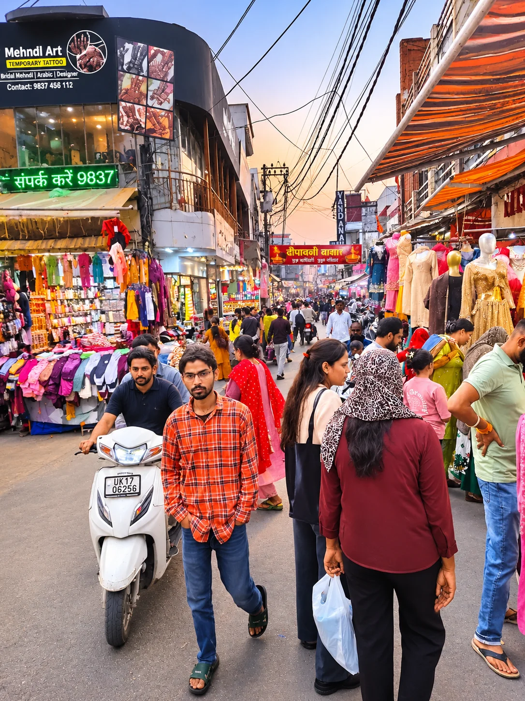
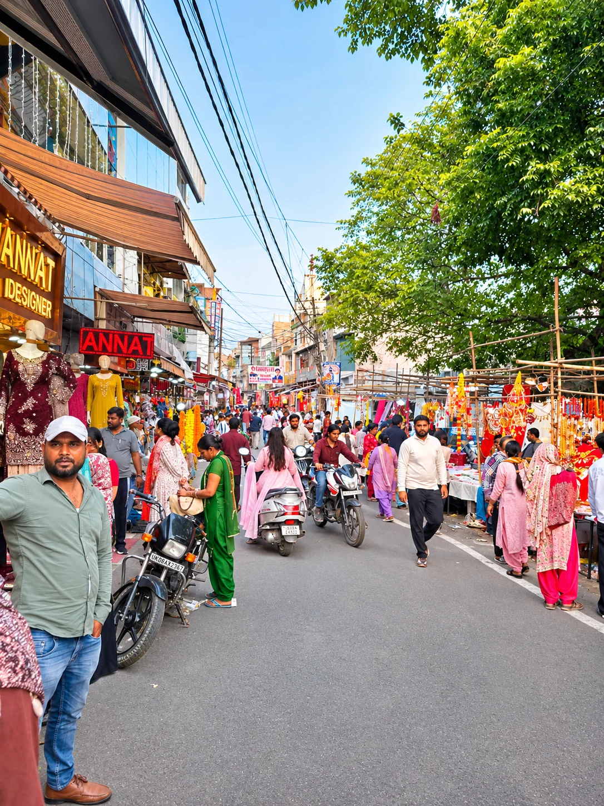

**हरिद्वार संवाददाता | आसिफ खान

हरिद्वार/रुड़की।** दीपों का महापर्व दीपावली एक बार फिर खुशियों, उमंग और नई उम्मीदों के साथ दस्तक दे रहा है। हरिद्वार से लेकर रुड़की, ज्वालापुर, मंगलौर, भगवानपुर और आसपास के क्षेत्रों में बाजारों को सजाने की तैयारियां जोरों पर हैं। दुकानों पर रंग-बिरंगी झालरें, आकर्षक सजावटी सामान, मिट्टी के दीये, मिठाइयां और उपहार त्योहार की रौनक बढ़ा रहे हैं। लेकिन इस चमक-दमक के बीच कई ऐसे सवाल भी हैं, जिनका जवाब आम जनता के लिए बेहद जरूरी है।

एक तरफ दीपावली की खुशियां हैं, तो दूसरी तरफ महंगाई, मिलावट की आशंका, यातायात व्यवस्था, अग्नि सुरक्षा और बाजारों में भीड़ प्रबंधन जैसी चुनौतियां प्रशासन के सामने खड़ी हैं। सवाल यह है कि क्या त्योहार की चमक के साथ आम जनता की सुरक्षा और सुविधाओं का भी पूरा ध्यान रखा जा रहा है?

महंगाई की मार! दीपावली मनाएं या घर का बजट संभालें?
दीपावली पर हर परिवार अपने घर को रोशन करना चाहता है। नए कपड़े, मिठाइयां, उपहार और घर की सजावट त्योहार का अहम हिस्सा हैं। लेकिन सीमित आय वाले परिवारों के लिए त्योहार का बजट संभालना आसान नहीं होता।

बाजारों में उपलब्ध सामान की कीमतें और अलग-अलग दुकानों के दाम उपभोक्ताओं के लिए महत्वपूर्ण मुद्दा हैं। ऐसे में सवाल उठता है कि क्या त्योहार के अवसर पर आम आदमी को उचित कीमतों पर सामान मिल पा रहा है? क्या बाजारों में मूल्य सूची और उपभोक्ता अधिकारों का पालन सुनिश्चित किया जा रहा है?
मिठाई की मिठास में कहीं मिलावट का जहर तो नहीं? खाद्य सुरक्षा विभाग के सामने बड़ी चुनौती!

दीपावली के अवसर पर मिठाइयों, मावा, पनीर, दूध और अन्य खाद्य पदार्थों की मांग बढ़ना स्वाभाविक है। ऐसे समय में मिलावटी एवं घटिया गुणवत्ता वाले खाद्य पदार्थों की बिक्री रोकना खाद्य सुरक्षा विभाग की बड़ी जिम्मेदारी बन जाती है।

त्योहारी सीजन में सवाल केवल खाद्य पदार्थों के नमूने लेने का नहीं, बल्कि संदिग्ध उत्पादों की समय पर जांच, रिपोर्ट और नियमों का उल्लंघन मिलने पर प्रभावी कार्रवाई का भी है।

आखिर उपभोक्ताओं की थाली तक शुद्ध मिठाई पहुंचाने के लिए कितनी मजबूत है निगरानी व्यवस्था? क्या बाजारों में नियमित निरीक्षण हो रहे हैं? क्या खाद्य कारोबारियों को स्वच्छता और गुणवत्ता मानकों के पालन के लिए पर्याप्त रूप से जागरूक किया जा रहा है?

हालांकि बिना जांच रिपोर्ट के किसी दुकान या कारोबारी पर मिलावट का आरोप लगाना उचित नहीं होगा, लेकिन उपभोक्ताओं की सेहत से जुड़े सवालों पर सख्त निगरानी बेहद जरूरी है।

**बाजारों में भीड़ बढ़ी तो कौन संभालेगा यातायात? पुलिस की तैयारियों पर नजर!**

हरिद्वार, ज्वालापुर और रुड़की के प्रमुख बाजारों में दीपावली के दौरान खरीदारों की आवाजाही बढ़ने की संभावना है। संकरी सड़कों, व्यस्त चौराहों और बाजारों के आसपास वाहनों की पार्किंग यातायात व्यवस्था के लिए चुनौती बन सकती है।

ऐसे में पुलिस और यातायात विभाग के सामने सबसे बड़ी जिम्मेदारी बाजारों में सुचारु आवाजाही, महिलाओं एवं बच्चों की सुरक्षा और आपातकालीन वाहनों के लिए रास्ता सुनिश्चित करने की होगी।

सवाल यह है कि क्या भीड़भाड़ वाले बाजारों में पर्याप्त पुलिस बल, पार्किंग व्यवस्था और यातायात प्रबंधन की प्रभावी योजना तैयार है?
पटाखों की चिंगारी कहीं खुशियों को मातम में न बदल दे!
दीपावली पर आतिशबाजी के दौरान आग लगने और चोट लगने की आशंका को नजरअंदाज नहीं किया जा सकता। घनी आबादी वाले इलाकों, संकरी गलियों और व्यस्त बाजारों में अग्नि सुरक्षा इंतजाम विशेष महत्व रखते हैं।

पटाखों की दुकानों के लिए निर्धारित सुरक्षा मानकों, बिक्री की अनुमति, अग्निशमन उपकरणों की उपलब्धता और आपातकालीन सेवाओं की तैयारियों पर निगरानी जरूरी है।

दीपावली की एक छोटी सी लापरवाही किसी परिवार की खुशियों पर भारी पड़ सकती है। इसलिए प्रशासनिक सतर्कता के साथ आम नागरिकों की जिम्मेदारी भी उतनी ही महत्वपूर्ण है।

**मिट्टी के दीयों से रोशन हो घर-आंगन, छोटे कारोबारियों की दीपावली भी बने खुशहाल!**

दीपावली केवल बड़े बाजारों और महंगी सजावट का त्योहार नहीं, बल्कि उन कुम्हारों और छोटे दुकानदारों की उम्मीदों का भी पर्व है, जो सालभर इस अवसर का इंतजार करते हैं।

मिट्टी के दीये बनाने वाले कारीगरों की मेहनत हमारी परंपरा और संस्कृति का महत्वपूर्ण हिस्सा है। स्थानीय उत्पादों की खरीद से न केवल पारंपरिक कला को प्रोत्साहन मिलता है, बल्कि छोटे कारोबारियों की आजीविका को भी सहारा मिलता है।

दीपावली की वास्तविक खुशियां तभी सार्थक होंगी, जब रोशनी केवल बड़े प्रतिष्ठानों तक सीमित न रहकर छोटे दुकानदारों और जरूरतमंद परिवारों के घरों तक भी पहुंचे।

**दीपावली पर प्रशासन के सामने पांच बड़े सवाल!**

1\. क्या बाजारों में खाद्य पदार्थों की शुद्धता सुनिश्चित करने के लिए पर्याप्त जांच और निगरानी की जा रही है?
2. क्या प्रमुख बाजारों में यातायात और पार्किंग की ठोस व्यवस्था है?
3. क्या पटाखा बिक्री स्थलों पर अग्नि सुरक्षा के मानकों का पालन सुनिश्चित कराया जा रहा है?
4. क्या उपभोक्ताओं को अधिक कीमत वसूलने और घटिया सामान की बिक्री से बचाने के लिए प्रभावी व्यवस्था है?
5. क्या त्योहार के दौरान सफाई, बिजली, पेयजल और आपातकालीन सेवाओं की पर्याप्त तैयारी है?

**STAR NEWS 11 की विशेष अपील: खुशियां बांटिए, सावधानी बरतिए!**

दीपावली अंधकार पर प्रकाश, बुराई पर अच्छाई और निराशा पर आशा की विजय का प्रतीक है। यह त्योहार समाज को एकजुट करने और जरूरतमंदों के जीवन में खुशियां भरने का संदेश देता है।

इस दीपावली मिट्टी के दीये जलाएं, स्थानीय व्यापारियों का सहयोग करें, मिठाइयां विश्वसनीय दुकानों से खरीदें, आतिशबाजी के दौरान सुरक्षा का ध्यान रखें और पर्यावरण संरक्षण में अपना योगदान दें।

क्योंकि दीपावली की असली रोशनी सिर्फ घरों को सजाने में नहीं, बल्कि हर चेहरे पर मुस्कान लाने में है।
