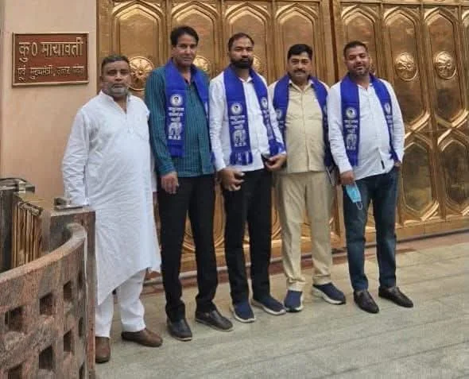

**हरिद्वार संवाददाता | आसिफ खान** 

उत्तराखंड की राजनीति में विधानसभा चुनाव 2027 से पहले सियासी हलचल तेज होने लगी है। हरिद्वार जनपद की खानपुर विधानसभा से एक बड़ा राजनीतिक घटनाक्रम सामने आया है। कांग्रेस के पूर्व राज्यमंत्री एवं लंबे समय तक पार्टी में सक्रिय रहे यासिर अराफात ने कांग्रेस का साथ छोड़कर बहुजन समाज पार्टी (बसपा) का दामन थाम लिया है। उनके इस राजनीतिक फैसले ने हरिद्वार जनपद के सियासी गलियारों में नई चर्चा छेड़ दी है।

कांग्रेस में लंबे समय तक राजनीतिक सफर तय करने वाले और राज्यमंत्री की जिम्मेदारी संभाल चुके यासिर अराफात का बसपा में शामिल होना महज एक सामान्य राजनीतिक बदलाव नहीं, बल्कि 2027 के विधानसभा चुनाव से पहले खानपुर की राजनीति में एक महत्वपूर्ण घटनाक्रम के रूप में देखा जा रहा है।

यासिर अराफात ने बसपा की सदस्यता ग्रहण करने के बाद पार्टी सुप्रीमो एवं पूर्व मुख्यमंत्री मायावती से मुलाकात की। इस दौरान उत्तराखंड प्रभारी हाजी सरफराज राईन और बसपा के प्रदेश अध्यक्ष नरेश गौतम भी मौजूद रहे। बसपा के शीर्ष नेतृत्व के साथ उनकी इस मुलाकात के बाद उनकी नई राजनीतिक पारी को लेकर चर्चाएं तेज हो गई हैं।

**कांग्रेस में लंबा राजनीतिक सफर, राज्यमंत्री की जिम्मेदारी तक पहुंचे यासर अराफात**

यासिर अराफात का राजनीतिक सफर लंबे समय तक कांग्रेस पार्टी के साथ जुड़ा रहा है। उन्होंने कांग्रेस में रहकर राजनीति की, संगठन के साथ काम किया और पार्टी की राजनीतिक गतिविधियों में सक्रिय भागीदारी निभाई। वर्षों तक कांग्रेस से जुड़े रहने के बाद उन्होंने अपनी राजनीतिक पहचान बनाई और राज्यमंत्री की जिम्मेदारी तक पहुंचे। यह उनके राजनीतिक जीवन का महत्वपूर्ण पड़ाव रहा।

राज्यमंत्री रह चुके यासिर अराफात का कांग्रेस छोड़ना पार्टी के लिए स्थानीय राजनीतिक स्तर पर चर्चा का विषय बन गया है। जिस कांग्रेस के साथ उन्होंने लंबे समय तक अपना राजनीतिक सफर तय किया, अब उसी से अलग होकर उन्होंने बसपा की राजनीतिक राह चुन ली है।

उनका यह कदम ऐसे समय पर सामने आया है, जब उत्तराखंड में 2027 के विधानसभा चुनाव की तैयारियों को लेकर राजनीतिक दलों की गतिविधियां तेज होने लगी हैं। ऐसे में यासिर अराफात का बसपा में जाना राजनीतिक दृष्टि से महत्वपूर्ण माना जा रहा है।

**2027 के चुनाव में खानपुर से संभावित प्रत्याशी हो सकते हैं यासिर अराफात!**

यासिर अराफात के बसपा में शामिल होने के बाद सबसे बड़ा सवाल खानपुर विधानसभा सीट को लेकर खड़ा हो गया है। क्या बसपा 2027 के विधानसभा चुनाव में उन्हें अपना उम्मीदवार बनाएगी? क्या पूर्व राज्यमंत्री के राजनीतिक अनुभव को पार्टी खानपुर की चुनावी राजनीति में इस्तेमाल करने की तैयारी कर रही है?

राजनीतिक गलियारों में यासिर अराफात को खानपुर विधानसभा सीट से बसपा के संभावित प्रत्याशी के रूप में देखा जा रहा है। हालांकि, अभी तक पार्टी की ओर से उनकी उम्मीदवारी को लेकर कोई आधिकारिक घोषणा नहीं की गई है, लेकिन बसपा सुप्रीमो मायावती से मुलाकात और पार्टी में उनकी एंट्री के बाद इस संभावना को लेकर चर्चाएं जरूर तेज हो गई हैं।

यदि बसपा उन्हें खानपुर से चुनावी मैदान में उतारती है तो विधानसभा क्षेत्र में राजनीतिक मुकाबले का स्वरूप बदल सकता है। उनके सामने अपने पुराने राजनीतिक अनुभव को नई पार्टी के संगठन के साथ जोड़कर जनता के बीच अपनी भूमिका स्थापित करने की चुनौती होगी।

**कांग्रेस के लिए आत्ममंथन का विषय, बसपा को मिला राजनीतिक अनुभव**

यासिर अराफात का कांग्रेस छोड़ना स्थानीय कांग्रेस संगठन के लिए भी चर्चा का विषय बन गया है। लंबे समय तक पार्टी में सक्रिय रहे और राज्यमंत्री की जिम्मेदारी संभाल चुके नेता का दूसरी पार्टी में जाना संगठनात्मक स्तर पर कई सवाल खड़े करता है।

वहीं दूसरी ओर बसपा को एक ऐसे नेता का साथ मिला है, जो कांग्रेस में लंबा राजनीतिक अनुभव रखता है और प्रदेश की राजनीति में राज्यमंत्री की जिम्मेदारी निभा चुका है। अब देखना होगा कि बसपा उनके अनुभव का किस तरह उपयोग करती है और खानपुर विधानसभा क्षेत्र में संगठन को कितनी मजबूती मिलती है।

**खानपुर में 2027 की सियासी बिसात बिछनी शुरू!**

विधानसभा चुनाव 2027 में अभी समय जरूर है, लेकिन हरिद्वार जनपद की राजनीतिक गतिविधियां धीरे-धीरे चुनावी दिशा में आगे बढ़ती दिखाई दे रही हैं। यासर अराफात का बसपा में शामिल होना इसी बदलते राजनीतिक परिदृश्य का एक अहम घटनाक्रम है।

अब निगाहें कांग्रेस की अगली रणनीति, बसपा की संगठनात्मक तैयारियों और यासर अराफात की क्षेत्र में आगामी राजनीतिक सक्रियता पर रहेंगी। क्या वह बसपा के संभावित उम्मीदवार के रूप में खानपुर में अपनी नई राजनीतिक पारी को आगे बढ़ाएंगे या पार्टी उन्हें कोई दूसरी संगठनात्मक जिम्मेदारी देगी, इसका जवाब आने वाला वक्त देगा।

फिलहाल इतना जरूर है कि कांग्रेस में लंबे समय तक राजनीतिक सफर तय करने और राज्यमंत्री की जिम्मेदारी निभाने के बाद यासिर अराफात ने बसपा का दामन थामकर अपनी राजनीतिक दिशा बदल दी है। अब 2027 के विधानसभा चुनाव में खानपुर की सियासत में उनकी भूमिका क्या होगी, इस पर राजनीतिक निगाहें टिकी रहेंगी।
