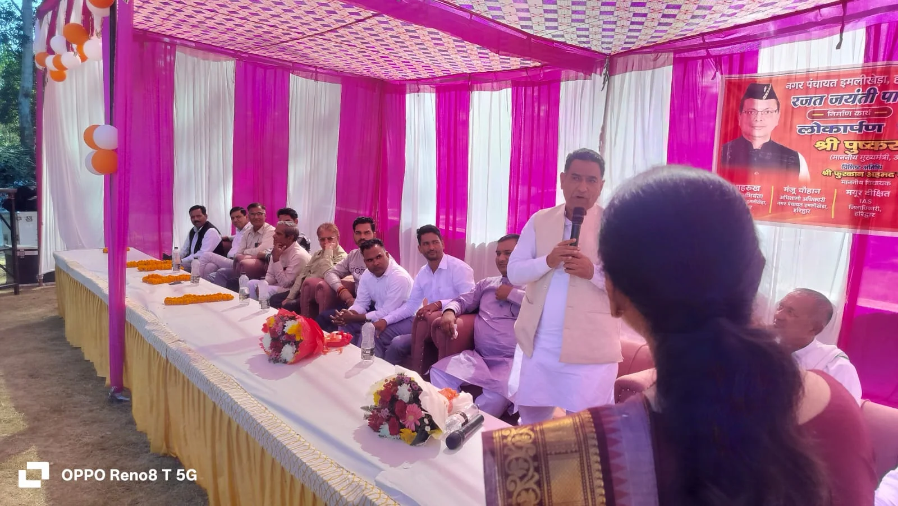
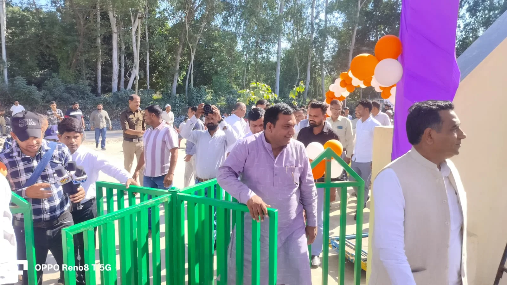

**रुड़की संवाददाता | आसिफ खान

पीरान कलियर इमलीखेड़ा।** भैया दूज के पावन पर्व पर इमलीखेड़ा नगर पंचायत में विकास की खुशियों ने दस्तक दी। मुख्यमंत्री पुष्कर सिंह धामी ने नगरवासियों को रजत जयंती पार्क की सौगात देकर त्योहार की खुशियों को दोगुना कर दिया। मुख्यमंत्री ने वर्चुअल माध्यम से पार्क का उद्घाटन किया तो पूरे नगर में उत्साह और जश्न का माहौल बन गया। सैकड़ों की संख्या में उमड़े नगरवासियों ने इस खास पल का गवाह बनकर विकास की इस नई शुरुआत का स्वागत किया।

इमलीखेड़ा के लिए यह सिर्फ एक पार्क का उद्घाटन नहीं, बल्कि नगर की तस्वीर और पहचान को बेहतर बनाने की दिशा में एक महत्वपूर्ण कदम है। बेहतर सार्वजनिक सुविधाओं की जरूरत महसूस कर रहे नगरवासियों को रजत जयंती पार्क के रूप में एक नया ठिकाना मिलने जा रहा है। बच्चों की किलकारियों से लेकर बुजुर्गों की सुबह की सैर और परिवारों के आपसी मेलजोल तक, यह पार्क नगर की सामाजिक जिंदगी का नया केंद्र बनने की उम्मीद जगा रहा है।

**मुख्यमंत्री का साफ संदेश- विकास का लाभ अंतिम व्यक्ति तक पहुंचना चाहिए**

मुख्यमंत्री पुष्कर सिंह धामी ने अपने वर्चुअल संबोधन में कहा कि विकास की योजनाओं का लाभ केवल बड़े शहरों और महानगरों तक सीमित नहीं रहना चाहिए। कस्बों और ग्रामीण क्षेत्रों में रहने वाले लोगों को भी बेहतर बुनियादी सुविधाएं उपलब्ध कराना सरकार की प्राथमिकता है। उन्होंने सभी नगर निकायों को निर्देशित किया कि पार्कों का निर्माण कराने के साथ उनकी साफ-सफाई, नियमित रखरखाव और सौंदर्यीकरण पर भी विशेष ध्यान दिया जाए।

मुख्यमंत्री ने खेलकूद और शारीरिक गतिविधियों के महत्व पर जोर देते हुए कहा कि पार्क बच्चों और युवाओं की प्रतिभा को निखारने तथा नागरिकों को स्वस्थ जीवनशैली से जोड़ने का माध्यम हैं। ऐसे सार्वजनिक स्थलों से समाज में स्वास्थ्य के प्रति जागरूकता भी बढ़ती है।

**मनोज सैनी की अगुवाई में विकास की ओर बढ़ता इमलीखेड़ा, मुख्यमंत्री का जताया आभार**

नगर पंचायत अध्यक्ष मनोज सैनी ने मुख्यमंत्री पुष्कर सिंह धामी का आभार व्यक्त करते हुए कहा कि भैया दूज के अवसर पर इमलीखेड़ा को मिली यह सौगात नगरवासियों के लिए यादगार उपहार है। उन्होंने कहा कि इमलीखेड़ा को विकास, स्वच्छता और आधुनिक जनसुविधाओं के मामले में नई पहचान दिलाना नगर पंचायत का संकल्प है।

अध्यक्ष मनोज सैनी ने कहा कि नगर के विकास को लेकर लगातार प्रयास किए जा रहे हैं। जनहित के कार्यों को प्राथमिकता देते हुए आने वाले समय में भी विकास की योजनाओं को आगे बढ़ाया जाएगा। रजत जयंती पार्क नगर की सुंदरता में चार चांद लगाने के साथ ही आम जनता के लिए उपयोगी साबित होगा। उन्होंने इस सौगात को मुख्यमंत्री की ओर से इमलीखेड़ा की जनता के लिए भैया दूज का विशेष उपहार बताया।

**सैकड़ों लोगों की मौजूदगी, जनप्रतिनिधियों और अधिकारियों का लगा जमावड़ा**

कार्यक्रम में कलियर विधायक फुरकान अहमद, नायब तहसीलदार सुशील कुमार चौहान, कानूनगो सुभाष जेमनेई, नगर पंचायत ईओ मंजू चौहान, अवर अभियंता शाहरुख, कोतवाल कमल मोहन भंडारी, रवींद्र सैनी, साहब सिंह सैनी सहित सभी वार्डों के सभासद और सैकड़ों नगरवासी मौजूद रहे।

**उद्घाटन के बाद अब रखरखाव की परीक्षा, पार्क को व्यवस्थित रखने की जिम्मेदारी नगर पंचायत पर**

रजत जयंती पार्क के उद्घाटन के साथ इमलीखेड़ा को विकास की एक नई पहचान मिली है। हालांकि किसी भी सार्वजनिक परियोजना की असली सफलता उसके निर्माण के बाद बेहतर रखरखाव और नियमित देखरेख से तय होती है। ऐसे में अब नगरवासियों की उम्मीदें इस बात पर टिकी हैं कि पार्क को साफ-सुथरा, सुरक्षित और व्यवस्थित बनाए रखने के लिए नगर पंचायत भी लगातार सक्रिय रहेगी। भैया दूज पर मिली इस विकास की सौगात ने फिलहाल इमलीखेड़ा की खुशियों को दोगुना कर दिया है।
