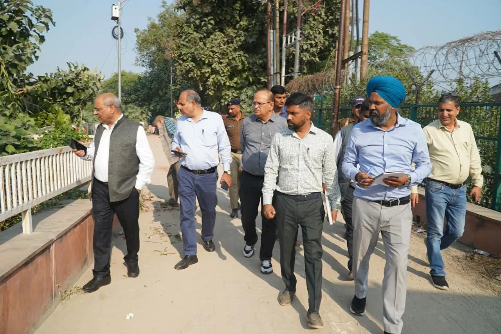
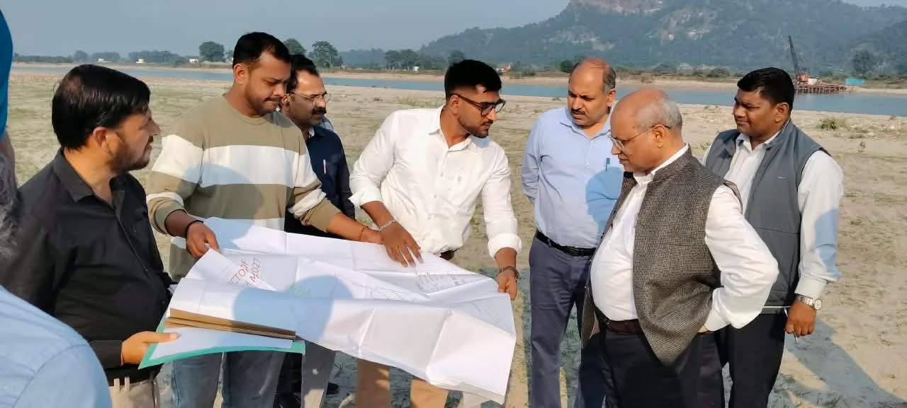
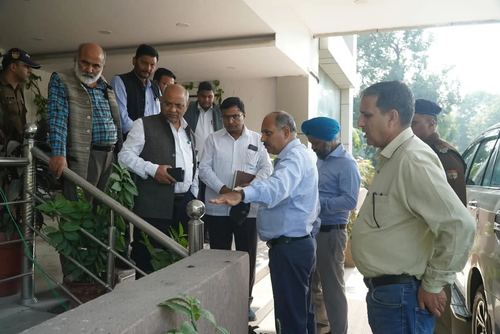
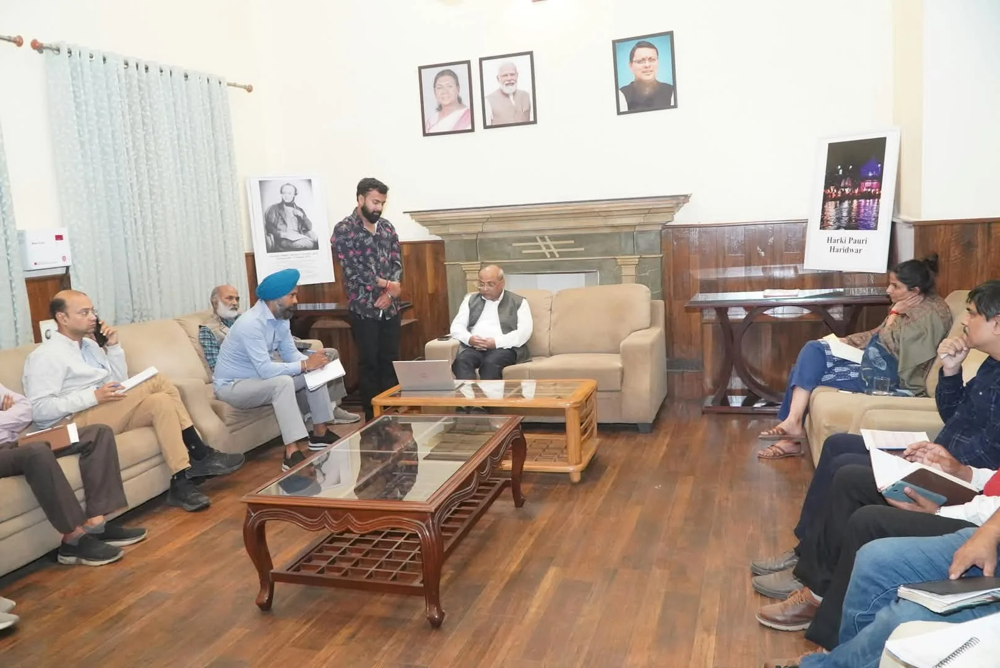
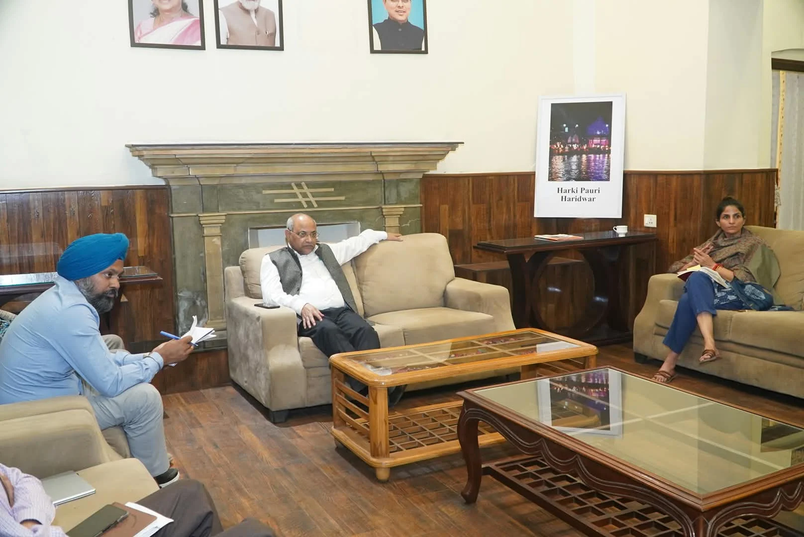

**हरिद्वार संवाददाता | आसिफ खान

हरिद्वार।** कुंभ-2027 के भव्य आयोजन की उल्टी गिनती के बीच तैयारियों में किसी भी तरह की ढिलाई अब अधिकारियों को भारी पड़ सकती है। निर्माण कार्यों की धीमी रफ्तार और व्यवस्थाओं में संभावित लापरवाही को लेकर मंडलायुक्त गढ़वाल मंडल आनंद स्वरूप ने सख्त तेवर दिखाते हुए अधिकारियों और कार्यदायी संस्थाओं को दो टूक चेतावनी दे दी है। उन्होंने स्पष्ट कर दिया कि कुंभ जैसे विश्वस्तरीय आयोजन में बहानेबाजी, लापरवाही और अनावश्यक देरी बिल्कुल बर्दाश्त नहीं की जाएगी। निर्धारित समयसीमा में गुणवत्तापूर्ण काम पूरा नहीं हुआ तो संबंधित कार्यदायी संस्थाओं के जिम्मेदार अधिकारियों के खिलाफ सख्त कार्रवाई की जाएगी।

सोमवार को हरिद्वार पहुंचे मंडलायुक्त आनंद स्वरूप ने कुंभ-2027 की तैयारियों को लेकर केवल कागजी समीक्षा तक खुद को सीमित नहीं रखा, बल्कि विभिन्न निर्माण स्थलों पर पहुंचकर जमीनी हकीकत भी परखी। उन्होंने अटल बिहारी वाजपेयी राज्य अतिथि गृह, भगत सिंह चौक, अमरापुर घाट, नगर निगम घाट, बैरागी कैंप, दक्षद्वीप, सतीद्वीप और गौरीशंकर क्षेत्र का स्थलीय निरीक्षण किया। इसके बाद डाम कोठी में अधिकारियों के साथ बैठक कर विभागवार कार्यों की प्रगति का हिसाब लिया।

**घाटों की साज-सज्जा में देरी नहीं होगी बर्दाश्त**

मंडलायुक्त ने अमरापुर घाट और नगर निगम घाट पर चल रहे निर्माण एवं अनुरक्षण कार्यों का निरीक्षण करते हुए शेष कार्यों को तत्काल पूरा करने के निर्देश दिए। गंगा नहर की क्लोजर अवधि में जलमग्न रहने वाले घाटों के हिस्सों का निर्माण और मरम्मत पूरा होने पर उन्होंने संतोष जताया, लेकिन साफ कर दिया कि केवल निर्माण पूरा कर देना ही काफी नहीं है। घाटों की साज-सज्जा और सौंदर्यीकरण भी समय रहते पूरा होना चाहिए। अमरापुर घाट के निकट कांवड़ पटरी से सटे हरित क्षेत्र की रेलिंग की पेंटिंग, सीवर लाइन के लिए बने पुल का रंग-रोगन और आसपास के क्षेत्र को व्यवस्थित करने के निर्देश भी दिए गए।

**पैदल यात्रियों की सुरक्षा पर भी सख्ती**

भगत सिंह चौक पर निर्माणाधीन फुटपाथ का निरीक्षण करते हुए मंडलायुक्त ने अधिकारियों को निर्देश दिए कि काम निर्धारित समय में पूरा किया जाए। पैदल यात्रियों की आवाजाही सुरक्षित और सुगम बनाने के लिए जरूरी इंतजाम किए जाएं। वहीं राज्य अतिथि गृह के अनुरक्षण कार्यों को भी कुंभ शुरू होने से पहले पूरी तरह व्यवस्थित और सुसज्जित करने के निर्देश दिए।

**शिविर क्षेत्रों में अधूरी तैयारियों पर बढ़ाया दबाव**

कुंभ के प्रमुख शिविर क्षेत्रों बैरागी कैंप, दक्षद्वीप, सतीद्वीप और गौरीशंकर में अस्थाई सड़कों, पार्किंग, अस्थाई पुलों, पेयजल और विद्युत आपूर्ति की व्यवस्थाओं का भी निरीक्षण किया गया। मंडलायुक्त ने स्पष्ट किया कि किसी एक विभाग की सुस्ती के कारण दूसरे विभागों के काम प्रभावित नहीं होने चाहिए। सभी सेक्टरों में अस्थाई व्यवस्थाओं के कार्य समानांतर रूप से संचालित किए जाएं। उन्होंने इन कार्यों की प्रभावी निगरानी के लिए अलग से अधिकारियों की तैनाती करने को भी कहा।

**रोजाना फोटो सहित देनी होगी रिपोर्ट, ऑनलाइन डैशबोर्ड पर भी नजर**

मंडलायुक्त आनंद स्वरूप ने अधिकारियों को निर्देश दिए कि प्रतिदिन पूरे किए गए कार्यों की प्रगति रिपोर्ट फोटोग्राफ सहित उपलब्ध कराई जाए। सभी निर्माण कार्यों की वास्तविक और अद्यतन स्थिति ऑनलाइन डैशबोर्ड पर नियमित रूप से दर्ज की जाए। इससे साफ है कि अब कुंभ की तैयारियों में केवल बैठकों और आश्वासनों से काम नहीं चलने वाला, बल्कि प्रत्येक कार्य की प्रगति का हिसाब देना होगा।

**पुलों के निर्माण में तेजी लाने के निर्देश**

डाम कोठी में आयोजित समीक्षा बैठक में सड़कों, पुलों, पेयजल, विद्युत आपूर्ति और अन्य आधारभूत सुविधाओं की विभागवार समीक्षा की गई। मंडलायुक्त ने विशेष रूप से स्थायी पुलों के निर्माण में तेजी लाने के निर्देश दिए। उन्होंने कहा कि कुंभ के दौरान श्रद्धालुओं की भारी भीड़ को देखते हुए आवागमन की व्यवस्था मजबूत और सुरक्षित होनी चाहिए। किसी भी स्तर पर समन्वय की कमी या काम में देरी नहीं होनी चाहिए।

**70 प्रतिशत से अधिक काम पूरा होने का दावा, 2,500 लाइटें लगेंगी**

बैठक में मेलाधिकारी सोनिका ने तैयारियों की जानकारी देते हुए बताया कि गौरीशंकर, बैरागी कैंप, दक्षद्वीप और सतीद्वीप सेक्टर में अस्थाई सड़कों, पेयजल और विद्युत आपूर्ति से जुड़े कार्यों में 70 प्रतिशत से अधिक प्रगति हासिल की जा चुकी है। अस्थाई पुलों का निर्माण भी जारी है और इन्हें निर्धारित समयसीमा में पूरा कराने का लक्ष्य है।

उन्होंने बताया कि हरिद्वार की प्रकाश व्यवस्था को मजबूत करने के लिए पीआईयू और नगर निगम के माध्यम से लगभग 2,500 लाइटें लगाई जा रही हैं। इनमें सोलर लाइटें भी शामिल हैं। स्थायी पुलों के निर्माण में दिन-रात काम कराया जा रहा है और नियमित निगरानी की जा रही है।

**भव्य कुंभ के दावे के बीच अब परीक्षा अधिकारियों की**

कुंभ-2027 को दिव्य और भव्य बनाने की राज्य सरकार की प्रतिबद्धता के बीच मंडलायुक्त की इस सख्ती ने साफ संकेत दे दिए हैं कि अब तैयारियों में किसी भी तरह की ढिलाई को नजरअंदाज नहीं किया जाएगा। श्रद्धालुओं की सुविधा, सुरक्षा और सुगम आवागमन के लिए सभी विभागों को आपसी तालमेल के साथ काम करना होगा। सवाल अब सिर्फ योजनाओं और बजट का नहीं, बल्कि समय पर धरातल पर दिखाई देने वाले काम का है। आने वाले दिनों में यह देखना अहम होगा कि अधिकारियों की यह सक्रियता निर्माण स्थलों पर कितनी तेजी और गुणवत्ता के रूप में नजर आती है।

इस दौरान मुख्य विकास अधिकारी डॉ. ललित नारायण मिश्र, उप मेलाधिकारी आकाश जोशी, मनजीत सिंह सहित विभिन्न विभागों के अधिकारी मौजूद रहे।
