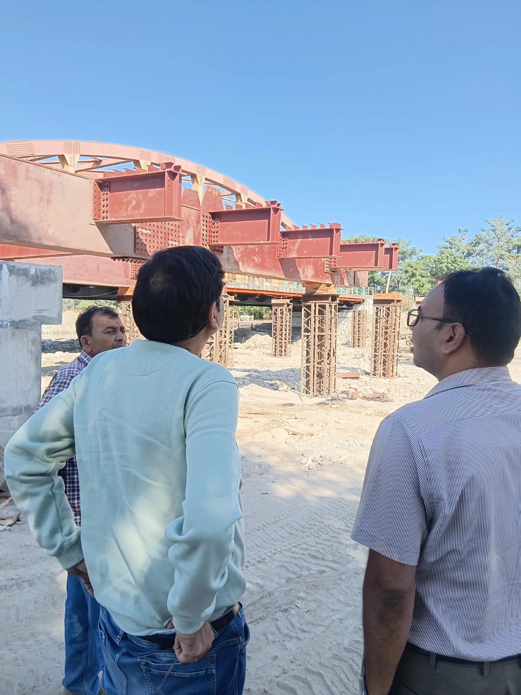
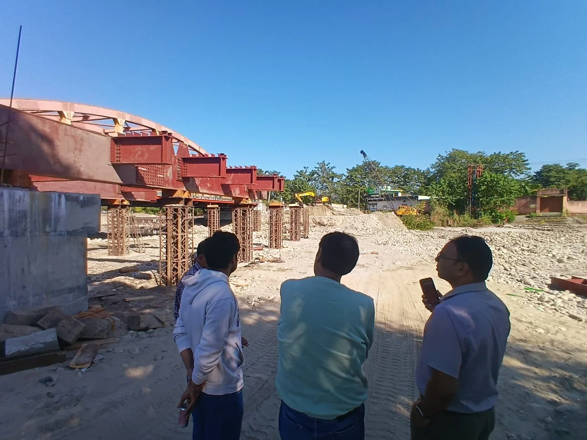
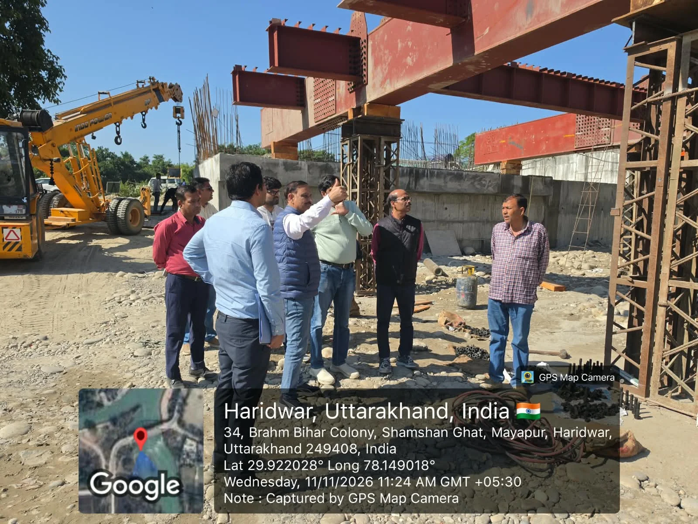

**हरिद्वार संवाददाता | आसिफ खान

हरिद्वार।** कुंभ मेला-2027 को लेकर हरिद्वार में तैयारियों का दायरा लगातार बढ़ रहा है, लेकिन अब मेला प्रशासन की नजर केवल योजनाओं की घोषणा और कागजी प्रगति तक सीमित नहीं है। धरातल पर निर्माण कार्य कितनी तेजी से हो रहे हैं और निर्धारित समयसीमा में कितने कार्य पूरे हो पाएंगे, इसे लेकर अधिकारियों ने स्थलीय निरीक्षण तेज कर दिया है। खासतौर पर पुलों, प्रमुख सड़कों और फुटपाथ निर्माण को लेकर मेला प्रशासन ने गंभीरता दिखानी शुरू कर दी है। साफ निर्देश हैं कि निर्माण कार्यों में अनावश्यक देरी न हो और गुणवत्ता के नाम पर भी कोई समझौता न किया जाए।

मेलाधिकारी श्रीमती सोनिका के निर्देशों के बाद मेला क्षेत्र में चल रहे निर्माण कार्यों की निगरानी लगातार की जा रही है। इसी कड़ी में बुधवार को अपर मेलाधिकारी श्री दयानंद सरस्वती ने खड़खड़ी स्थित सूखी नदी पर निर्माणाधीन डबल लेन स्टील गर्डर पुल और दक्षद्वीप में एस्केप चैनल पर बन रहे पुल का निरीक्षण किया। निरीक्षण के दौरान उन्होंने निर्माण कार्यों की वास्तविक स्थिति का जायजा लिया और संबंधित अधिकारियों से अब तक हुई प्रगति की विस्तृत जानकारी ली।

**पुल निर्माण में देरी की गुंजाइश नहीं, संसाधन बढ़ाकर तेज करें काम**

अपर मेलाधिकारी दयानंद सरस्वती ने कार्यदायी संस्थाओं को स्पष्ट निर्देश दिए कि पुल निर्माण के कार्य निर्धारित समयसीमा के भीतर पूरे किए जाएं। इसके लिए पर्याप्त मशीनरी, श्रमिकों और अन्य जरूरी संसाधनों की उपलब्धता सुनिश्चित की जाए। उन्होंने कहा कि निर्माण कार्यों में तेजी लाने के साथ गुणवत्ता के निर्धारित मानकों का सख्ती से पालन भी जरूरी है।

उन्होंने अधिकारियों को स्पष्ट किया कि कुंभ मेले के दौरान लाखों श्रद्धालुओं और स्थानीय नागरिकों की आवाजाही को देखते हुए पुलों का निर्माण केवल एक सामान्य विकास कार्य नहीं, बल्कि यातायात व्यवस्था से जुड़ा महत्वपूर्ण आधारभूत कार्य है। ऐसे में निर्माण की गुणवत्ता, सुरक्षा और समयबद्धता तीनों पर विशेष ध्यान देना होगा।

**सड़क और फुटपाथ निर्माण की सुस्ती पर भी अधिकारियों का ध्यान**

अपर मेलाधिकारी ने पुराने दिल्ली-नीति पास मार्ग पर चल रहे सड़क सुधारीकरण और फुटपाथ निर्माण कार्यों का भी निरीक्षण किया। निरीक्षण के दौरान उन्होंने पाया कि कुछ हिस्सों में सीसीटीवी नेटवर्क की भूमिगत केबल डालने और सीवरेज लाइन से जुड़े कार्यों के कारण सड़क सुधारीकरण का काम लंबित था। अब संबंधित कार्य पूरे हो चुके हैं, ऐसे में सड़क और फुटपाथ निर्माण को लटकाए रखने का कोई कारण नहीं होना चाहिए।

उन्होंने लोक निर्माण विभाग के अधिशासी अभियंता श्री योगेश कुमार को निर्देश दिए कि लंबित सड़क सुधारीकरण और फुटपाथ निर्माण के कार्यों को बिना किसी अनावश्यक विलंब के पूरा कराया जाए। उन्होंने कहा कि कुंभ मेले के दौरान प्रमुख मार्गों का व्यवस्थित और सुरक्षित होना बेहद जरूरी है। सड़कें दुरुस्त होंगी तो वाहनों की आवाजाही सुगम होगी और फुटपाथ तैयार होने से पैदल चलने वाले श्रद्धालुओं को भी राहत मिलेगी।

**लोक निर्माण और सिंचाई विभाग के आला अधिकारियों ने भी संभाला मोर्चा**

कुंभ मेला-2027 के निर्माण कार्यों की प्रगति और गुणवत्ता की समीक्षा के लिए लोक निर्माण विभाग के प्रमुख अभियंता एवं विभागाध्यक्ष श्री राजेश चंद्र शर्मा, अधीक्षण अभियंता श्री डीपी सिंह तथा सिंचाई विभाग के अधीक्षण अभियंता श्री बीसी पांडे सहित विभिन्न कार्यदायी संस्थाओं के वरिष्ठ अधिकारियों ने भी मेला क्षेत्र में निर्माणाधीन कार्यों का निरीक्षण किया।

इस दौरान अधिकारियों ने विभिन्न निर्माण स्थलों पर पहुंचकर कार्यों की स्थिति का जायजा लिया और संबंधित अधिकारियों से प्रगति रिपोर्ट प्राप्त की। उन्होंने भी निर्धारित समयसीमा के भीतर निर्माण कार्य पूरे करने तथा गुणवत्ता के मानकों का विशेष ध्यान रखने पर जोर दिया।

**कुंभ से पहले हर व्यवस्था दुरुस्त करने की तैयारी**

कुंभ मेला-2027 को लेकर मेला प्रशासन के सामने सबसे बड़ी चुनौती समय रहते सभी जरूरी आधारभूत सुविधाएं तैयार करने की है। पुलों से लेकर सड़कों, फुटपाथों और अन्य स्थायी एवं अस्थायी निर्माण कार्यों तक हर स्तर पर निगरानी बढ़ाई जा रही है।

मेलाधिकारी श्रीमती सोनिका के निर्देशों के तहत अधिकारी लगातार निर्माण स्थलों का निरीक्षण कर रहे हैं, ताकि योजनाएं केवल फाइलों में आगे न बढ़ें, बल्कि धरातल पर भी समय से पूरी होती दिखाई दें।

अब देखने वाली बात यह होगी कि निरीक्षण और निर्देशों के बाद निर्माण कार्यों की रफ्तार कितनी तेज होती है और संबंधित कार्यदायी संस्थाएं तय समयसीमा में अपनी जिम्मेदारी किस तरह निभाती हैं। फिलहाल मेला प्रशासन ने स्पष्ट कर दिया है कि कुंभ-2027 की तैयारियों में पुलों, सड़कों और यातायात से जुड़े कार्यों को प्राथमिकता के आधार पर पूरा कराया जाएगा।
