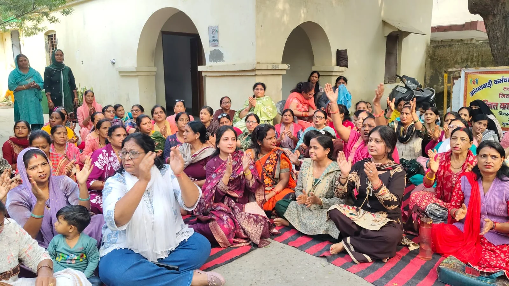
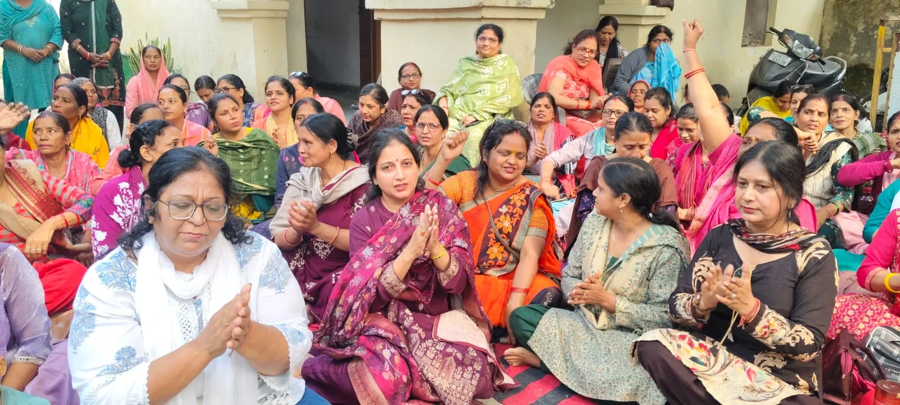
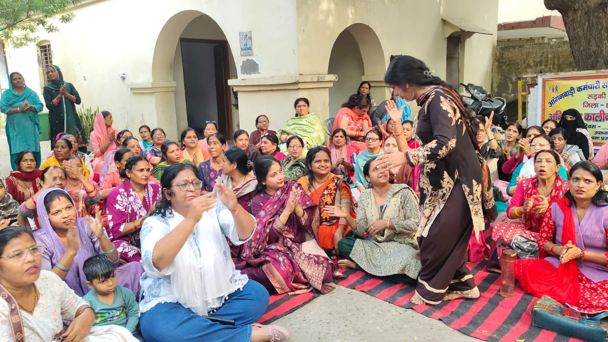
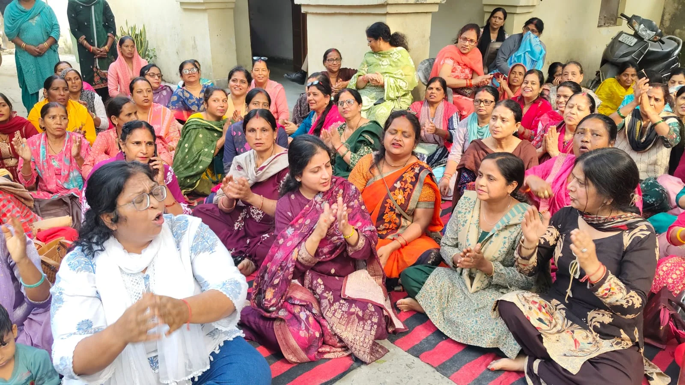

**रूडकी स्टार न्यूज़ 11 संवाददाता | आसिफ खान** 

**रुड़की (हरिद्वार)।** मानदेय वृद्धि के नाम पर वर्षों से मिल रहे आश्वासनों ने अब आंगनबाड़ी कार्यकर्ताओं के सब्र का बांध तोड़ दिया है। सरकार के वादों और तारीखों के खेल से नाराज महिलाओं ने अब सीधे मोर्चा खोल दिया है। आंगनबाड़ी कर्मचारी संयुक्त मोर्चा उत्तराखंड, रुड़की शहर एवं जिला हरिद्वार के बैनर तले आंगनबाड़ी कार्यकर्ताओं ने ज्वाइंट मजिस्ट्रेट रुड़की के कार्यालय के बाहर अनिश्चितकालीन धरना शुरू कर सरकार के सामने अपनी नाराजगी जाहिर कर दी है। आंदोलनकारी महिलाओं का साफ कहना है कि अब केवल घोषणाओं और जुबानी आश्वासनों से काम नहीं चलेगा। सरकार को लिखित में जवाब देना होगा, वरना धरना लगातार जारी रहेगा।

धरने पर बैठीं संगठन की अध्यक्ष अंजू शर्मा ने सरकार के रवैये पर तीखा हमला बोलते हुए कहा कि आंगनबाड़ी कार्यकर्ताओं के मानदेय में वृद्धि को लेकर मुख्यमंत्री बार-बार आश्वासन देते रहे हैं, लेकिन धरातल पर आज तक कोई ठोस फैसला दिखाई नहीं दिया। हर बार नई तारीख और नया भरोसा देकर महिलाओं को शांत करने की कोशिश की जाती है। उन्होंने सवाल उठाया कि आखिर कब तक आंगनबाड़ी कार्यकर्ता सरकार के वादों के भरोसे अपना काम करती रहेंगी? क्या उनकी मेहनत, जिम्मेदारी और वर्षों की सेवा का कोई मूल्य नहीं है?

अंजू शर्मा ने कहा कि अब सरकार की ओर से 1 दिसंबर को मानदेय बढ़ाने का आश्वासन दिया गया है, लेकिन आंगनबाड़ी कार्यकर्ता इस बार किसी भी मौखिक भरोसे में आने वाली नहीं हैं। उन्होंने आशंका जताई कि विधानसभा चुनाव 2027 नजदीक आते ही सरकार फिर कोई नया बहाना बना सकती है। चुनावी आचार संहिता लागू होने का हवाला देकर मानदेय वृद्धि को टाला जा सकता है और महिलाओं को एक बार फिर आश्वासनों का लॉलीपॉप थमा दिया जाएगा।

उन्होंने दो टूक शब्दों में कहा कि सरकार को अब यह समझ लेना चाहिए कि आंगनबाड़ी कार्यकर्ता केवल आश्वासन सुनने के लिए नहीं बैठी हैं। जब तक मानदेय वृद्धि को लेकर लिखित आश्वासन नहीं मिलता और मांग पर ठोस कार्रवाई नहीं होती, तब तक धरना समाप्त नहीं किया जाएगा। इस बार आंदोलन किसी तारीख या घोषणा के भरोसे वापस नहीं लिया जाएगा।

**भाजपा के खिलाफ प्रदेशभर में छेड़ेंगे चुनावी मुहिम, घर-घर पहुंचेगी आंगनबाड़ी कार्यकर्ता**

अंजू शर्मा ने सरकार को सबसे बड़ा राजनीतिक संदेश देते हुए कहा कि यदि जल्द ही आंगनबाड़ी कार्यकर्ताओं की मांगों पर निर्णय नहीं लिया गया तो प्रदेशभर में आंदोलन को व्यापक रूप दिया जाएगा। उत्तराखंड की हजारों आंगनबाड़ी महिलाओं को एकजुट कर भाजपा सरकार के खिलाफ अभियान चलाया जाएगा। कार्यकर्ता घर-घर जाकर जनता से आगामी 2027 विधानसभा चुनाव में भाजपा के खिलाफ मतदान करने की अपील करेंगी।

उन्होंने कहा कि जो महिलाएं सरकार की योजनाओं को गांव-गांव और घर-घर तक पहुंचाने में महत्वपूर्ण भूमिका निभाती हैं, जब उन्हीं महिलाओं की समस्याओं को सुनने का समय आता है तो सरकार चुप्पी साध लेती है। अब इस चुप्पी का जवाब भी चुनाव में दिया जाएगा। उन्होंने साफ किया कि मानदेय वृद्धि का मुद्दा अब केवल विभागीय मांग नहीं रहा, बल्कि यह महिलाओं के सम्मान, मेहनत और अधिकारों से जुड़ा सवाल बन चुका है।

**पूजा गुप्ता ने सरकार को घेरा, कांग्रेस का प्रदेशव्यापी आंदोलन का ऐलान**

धरना स्थल पर पहुंचीं कांग्रेस नेत्री पूजा गुप्ता ने भी आंगनबाड़ी कार्यकर्ताओं के आंदोलन को खुला समर्थन देते हुए सरकार पर निशाना साधा। उन्होंने कहा कि आंगनबाड़ी कार्यकर्ता सरकार की व्यवस्था की रीढ़ हैं। जब भी सरकार को इन महिलाओं की जरूरत पड़ती है तो उनसे हर तरह के काम कराए जाते हैं। एसआईआर (SIR) जैसे महत्वपूर्ण कार्यों में भी इनकी सेवाएं ली गईं, लेकिन जब इनके मानदेय और अधिकारों की बात आती है तो सरकार पीछे हटती नजर आती है।

पूजा गुप्ता ने कहा कि दिन-रात मेहनत करने वाली इन महिलाओं को उनका उचित मानदेय और सम्मान मिलना चाहिए। सरकार को यह नहीं भूलना चाहिए कि जिन महिलाओं के कंधों पर जमीनी स्तर पर सरकारी योजनाओं को पहुंचाने की जिम्मेदारी है, उनकी आवाज को लगातार अनसुना करना किसी भी सूरत में उचित नहीं है।

उन्होंने सरकार को चेतावनी देते हुए कहा कि यदि आंगनबाड़ी कार्यकर्ताओं को कोई ठोस आश्वासन नहीं दिया गया तो वह स्वयं और कांग्रेस का पूरा प्रदेश संगठन इनके साथ कंधे से कंधा मिलाकर खड़ा रहेगा। जरूरत पड़ी तो कांग्रेस प्रदेशभर में आंदोलन छेड़ेगी और सरकार को महिलाओं की मांगों पर जवाब देने के लिए मजबूर करने का प्रयास करेगी।

**अब आश्वासन नहीं, फैसले की मांग; सरकार की परीक्षा शुरू**

रुड़की में ज्वाइंट मजिस्ट्रेट कार्यालय के बाहर शुरू हुआ यह धरना सरकार के लिए एक और चुनौती बनता दिखाई दे रहा है। एक तरफ आंगनबाड़ी संगठन ने मानदेय वृद्धि को लेकर अनिश्चितकालीन आंदोलन का बिगुल बजा दिया है, तो दूसरी तरफ 2027 के विधानसभा चुनाव में भाजपा के खिलाफ घर-घर अभियान चलाने की चेतावनी ने इस मुद्दे को राजनीतिक रंग भी दे दिया है। कांग्रेस के समर्थन के बाद आंदोलन को और धार मिलने के संकेत हैं।

अब सबसे बड़ा सवाल यह है कि क्या सरकार इस बार भी आंगनबाड़ी कार्यकर्ताओं को सिर्फ नई तारीख देकर शांत कराने की कोशिश करेगी या फिर उनकी वर्षों पुरानी मांग पर कोई ठोस फैसला लेगी? फिलहाल महिलाओं ने साफ कर दिया है कि इस बार लड़ाई अधूरी छोड़कर वापस लौटने का सवाल ही नहीं उठता। सरकार को अब वादों से नहीं, अपने फैसले से जवाब देना होगा।
