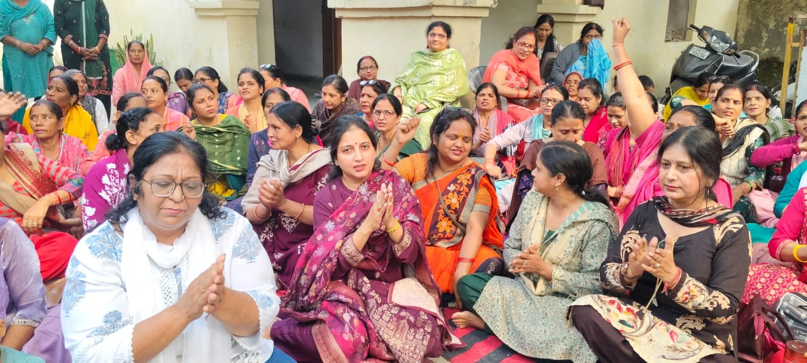
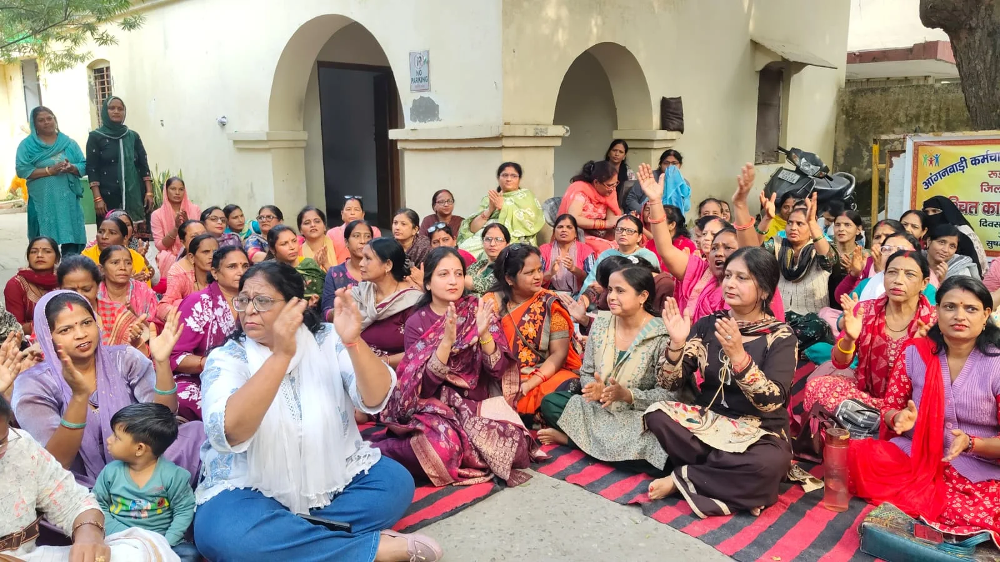

**स्टार न्यूज़ 11 रूडकी संवाददाता | आसिफ खान 

रुड़की (हरिद्वार)।** उत्तराखंड की धामी सरकार के खिलाफ अब आंगनबाड़ी कार्यकर्ताओं का आक्रोश सड़कों पर फूटने लगा है। मानदेय वृद्धि की वर्षों पुरानी मांग को लेकर रुड़की में महिलाओं ने ऐसा मोर्चा खोला है, जिसने सरकार के दावों और आश्वासनों पर गंभीर सवाल खड़े कर दिए हैं। आंगनबाड़ी कर्मचारी संयुक्त मोर्चा उत्तराखंड, रुड़की शहर एवं जिला हरिद्वार के बैनर तले आंगनबाड़ी कार्यकर्ताओं ने ज्वाइंट मजिस्ट्रेट रुड़की के कार्यालय के बाहर अनिश्चितकालीन धरना शुरू कर दिया है। धरना स्थल पर महिलाओं की भारी मौजूदगी, आक्रामक नारेबाजी और सरकार के खिलाफ खुली नाराजगी ने आंदोलन को राजनीतिक रूप से भी चर्चा में ला दिया है।

धरने के दौरान आक्रोशित महिलाओं ने मुख्यमंत्री पुष्कर सिंह धामी और सरकार को निशाने पर लेते हुए जमकर नारेबाजी की। महिलाओं ने तंज कसते हुए नारे लगाए – "एक कटोरी दो समोसा, धामी तेरा क्या भरोसा" और "धामी तेरे शासन में, कीड़े पड़ गए राशन में"। इन नारों के जरिए कार्यकर्ताओं ने सरकार के प्रति अपनी नाराजगी जाहिर करते हुए मानदेय और राशन से जुड़े मुद्दों को लेकर विरोध दर्ज कराया। महिलाओं का कहना था कि सरकार को उनकी मेहनत और जिम्मेदारियों की जरूरत तो हर समय पड़ती है, लेकिन जब उनके मानदेय और अधिकारों की बात आती है तो उन्हें केवल आश्वासन थमा दिए जाते हैं।

**अंजू शर्मा ने सरकार को घेरा, बोलीं – अब आर-पार की लड़ाई होगी**

संगठन की अध्यक्ष अंजू शर्मा ने सरकार के रवैये पर तीखा प्रहार करते हुए कहा कि मुख्यमंत्री की ओर से बार-बार आंगनबाड़ी कार्यकर्ताओं का मानदेय बढ़ाने की बात कही जाती रही है, लेकिन घोषणाओं के बावजूद महिलाओं को वास्तविक राहत नहीं मिली। उन्होंने कहा कि अब एक बार फिर 1 दिसंबर का आश्वासन दिया गया है, लेकिन सवाल यह है कि आखिर कब तक आंगनबाड़ी कार्यकर्ता तारीखों के भरोसे बैठी रहेंगी?

अंजू शर्मा ने कहा कि विधानसभा चुनाव 2027 नजदीक आते जा रहे हैं। उन्हें आशंका है कि यदि सरकार ने समय रहते मानदेय वृद्धि का फैसला नहीं किया तो चुनावी आचार संहिता का बहाना बनाकर इस मांग को फिर टाल दिया जाएगा। इसके बाद महिलाओं को एक बार फिर आश्वासनों का लॉलीपॉप थमा दिया जाएगा। उन्होंने साफ शब्दों में कहा कि इस बार संगठन सरकार के किसी मौखिक आश्वासन पर आंदोलन समाप्त नहीं करेगा। जब तक लिखित रूप में ठोस आश्वासन नहीं दिया जाता, तब तक धरना जारी रहेगा।

उन्होंने कहा कि आंगनबाड़ी कार्यकर्ता अब अपने अधिकारों के लिए पीछे हटने वाली नहीं हैं। सरकार को यह समझना होगा कि वर्षों तक काम लेने के बाद महिलाओं की मांगों को नजरअंदाज नहीं किया जा सकता। अब केवल बयानबाजी नहीं, बल्कि मानदेय वृद्धि पर ठोस निर्णय चाहिए।

**2027 के चुनाव में भाजपा के खिलाफ उतरेगा आंगनबाड़ी संगठन, घर-घर चलेगी मुहिम**

अंजू शर्मा ने सरकार को सीधी राजनीतिक चेतावनी देते हुए कहा कि यदि जल्द उनकी मांगें नहीं मानी गईं तो उत्तराखंड की सभी आंगनबाड़ी कार्यकर्ताओं को एकजुट कर भाजपा सरकार के खिलाफ प्रदेशव्यापी मुहिम चलाई जाएगी। संगठन की महिलाएं घर-घर जाकर लोगों से आगामी 2027 विधानसभा चुनाव में भाजपा के खिलाफ मतदान करने की अपील करेंगी।

उन्होंने कहा कि जो महिलाएं सरकार की योजनाओं को जनता तक पहुंचाने के लिए दिन-रात काम करती हैं, आज उन्हीं की आवाज सुनने वाला कोई नहीं है। अब महिलाएं अपनी मेहनत और अधिकारों की अनदेखी का जवाब लोकतांत्रिक तरीके से चुनाव में देने की अपील करेंगी। यह आंदोलन अब केवल मानदेय वृद्धि की मांग नहीं, बल्कि महिलाओं के सम्मान और हक की लड़ाई बन चुका है।

**पूजा गुप्ता ने सरकार को दी चेतावनी, कांग्रेस उतरेगी प्रदेशव्यापी आंदोलन में**

धरना स्थल पर पहुंचीं कांग्रेस नेत्री पूजा गुप्ता ने भी आंदोलनकारी महिलाओं को समर्थन देते हुए धामी सरकार पर निशाना साधा। उन्होंने कहा कि आंगनबाड़ी कार्यकर्ता सरकारी व्यवस्था की रीढ़ हैं। जब भी सरकार को किसी महत्वपूर्ण कार्य के लिए इनकी जरूरत पड़ती है, इन महिलाओं से जिम्मेदारियां निभाने की अपेक्षा की जाती है। एसआईआर (SIR) जैसे महत्वपूर्ण कार्यों में भी इनकी सेवाएं ली गईं, लेकिन जब इनके मानदेय और अधिकारों की बात आती है तो सरकार की ओर से अपेक्षित गंभीरता दिखाई नहीं देती।

पूजा गुप्ता ने कहा कि इन महिलाओं की मेहनत का सम्मान करना सरकार की जिम्मेदारी है। इन्हें केवल सरकारी योजनाओं का काम करने वाली कर्मचारी समझकर इनकी आर्थिक परेशानियों को नजरअंदाज नहीं किया जा सकता। उन्होंने दो टूक कहा कि यदि सरकार ने आंगनबाड़ी कार्यकर्ताओं को कोई ठोस आश्वासन नहीं दिया तो वह और कांग्रेस का पूरा प्रदेश संगठन इनके साथ कंधे से कंधा मिलाकर खड़ा रहेगा। जरूरत पड़ी तो कांग्रेस प्रदेशव्यापी आंदोलन छेड़ने से भी पीछे नहीं हटेगी।

**सरकार के लिए बढ़ती चुनौती, अब जवाब मांग रही हैं आंगनबाड़ी महिलाएं**

रुड़की में शुरू हुआ यह अनिश्चितकालीन धरना अब धामी सरकार के सामने एक बड़ा सवाल खड़ा कर रहा है। एक तरफ महिलाएं मानदेय वृद्धि के लिए लिखित गारंटी की मांग पर अड़ी हैं, दूसरी तरफ संगठन ने 2027 के विधानसभा चुनाव में भाजपा के खिलाफ घर-घर अभियान चलाने का ऐलान कर दिया है। कांग्रेस के समर्थन ने आंदोलन को और राजनीतिक धार दे दी है।

सरकार के सामने अब सवाल यह है कि क्या आंगनबाड़ी कार्यकर्ताओं को एक बार फिर तारीख और आश्वासन देकर शांत कराने की कोशिश होगी या उनकी मांगों पर कोई ठोस फैसला लिया जाएगा? फिलहाल महिलाओं का रुख साफ है – न तारीखों का झांसा चाहिए, न खोखले वादे; अब मानदेय वृद्धि पर लिखित फैसला चाहिए।

**संवाददाता – आसिफ खान | STAR NEWS 11**
