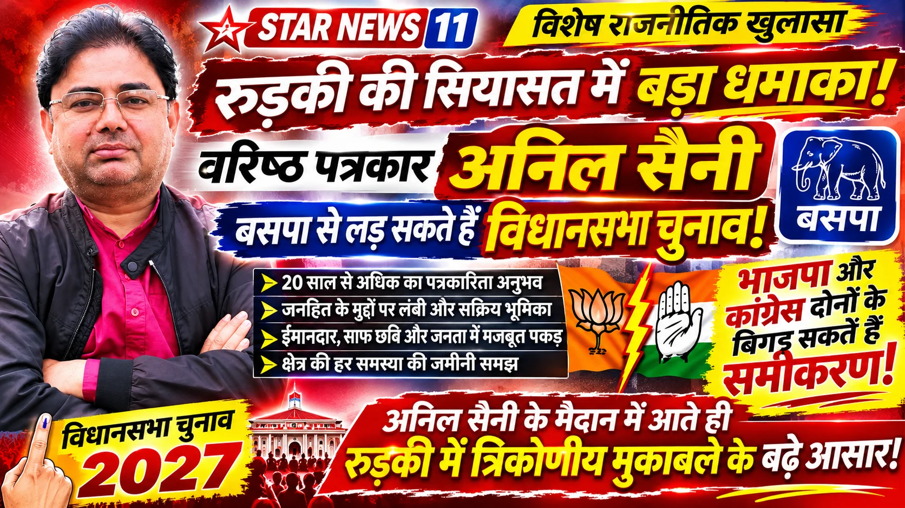

\*\*विशेष रिपोर्ट | आसिफ खान

रुड़की।\*\* उत्तराखंड विधानसभा चुनाव 2027 की आहट के साथ ही रुड़की विधानसभा की सियासत में नए राजनीतिक समीकरणों की चर्चा तेज हो गई है। चुनावी मैदान में उतरने की तैयारी कर रहे संभावित दावेदारों के बीच अब एक ऐसा नाम सामने आया है, जिसकी पहचान राजनीतिक मंच से अधिक पत्रकारिता और जनहित के मुद्दों को लेकर रही है। वरिष्ठ पत्रकार अनिल सैनी के विधानसभा चुनाव लड़ने की चर्चाओं ने रुड़की के राजनीतिक गलियारों में नया सवाल खड़ा कर दिया है—क्या 2027 में रुड़की की चुनावी लड़ाई भाजपा और कांग्रेस के बीच सीधे मुकाबले तक सीमित नहीं रहेगी?

सूत्रों के अनुसार, वरिष्ठ पत्रकार अनिल सैनी रुड़की विधानसभा से बहुजन समाज पार्टी (बसपा) के टिकट पर अपनी दावेदारी पेश कर सकते हैं। यदि यह चर्चा राजनीतिक फैसले में बदलती है तो भाजपा और कांग्रेस दोनों के सामने एक अतिरिक्त चुनावी चुनौती खड़ी हो सकती है। हालांकि, अनिल सैनी की उम्मीदवारी और बसपा से टिकट को लेकर अभी कोई आधिकारिक पुष्टि नहीं हुई है।

**भाजपा-कांग्रेस के सियासी गणित में तीसरे मोर्चे की चुनौती? अनिल सैनी के नाम ने बढ़ाई चुनावी चर्चा!**

रुड़की विधानसभा की राजनीति में अब तक जिन संभावित दावेदारों और राजनीतिक दलों को लेकर चुनावी समीकरण तैयार किए जा रहे थे, उनके बीच अनिल सैनी का नाम सामने आना एक नया घटनाक्रम है। यदि बसपा उन्हें चुनावी मैदान में उतारती है तो भाजपा और कांग्रेस को भी संभावित त्रिकोणीय मुकाबले के मद्देनजर अपनी रणनीतियों पर विचार करना पड़ सकता है।

सवाल केवल यह नहीं है कि अनिल सैनी चुनाव लड़ेंगे या नहीं। बड़ा सवाल यह भी है कि यदि वह मैदान में उतरते हैं तो किस तरह के स्थानीय मुद्दों को प्रमुखता देंगे और विभिन्न वर्गों के बीच अपनी राजनीतिक पहचान किस तरह स्थापित करेंगे।

भाजपा और कांग्रेस के सामने चुनौती यह होगी कि वे जनता के बीच अपने कामकाज, विकास के दावों और भविष्य की योजनाओं को कितनी मजबूती से रख पाती हैं। वहीं बसपा के लिए भी यह देखना महत्वपूर्ण होगा कि क्या किसी नए चेहरे के माध्यम से वह रुड़की विधानसभा में अपनी राजनीतिक सक्रियता को नई दिशा दे सकती है।

**20 साल से ज्यादा पत्रकारिता का अनुभव, अब विधानसभा में जनता की आवाज उठाने की चर्चा!**

अनिल सैनी को पत्रकारिता के क्षेत्र में 20 साल से अधिक का अनुभव बताया जाता है। लंबे समय से पत्रकारिता के माध्यम से जनहित के मुद्दों को उठाने और आम लोगों की समस्याओं को सामने लाने के कारण उनकी पहचान एक वरिष्ठ पत्रकार के रूप में रही है।

पत्रकारिता के दौरान प्रशासनिक व्यवस्थाओं, सरकारी योजनाओं, स्थानीय समस्याओं और जनता से जुड़े मामलों को समझने का अनुभव राजनीति में प्रवेश करने वाले किसी भी व्यक्ति के लिए महत्वपूर्ण हो सकता है।

लेकिन चुनावी मैदान पत्रकारिता से अलग होता है। यहां जनता के मुद्दे उठाने के साथ-साथ उनके समाधान की स्पष्ट योजना, संगठनात्मक तैयारी और जनसमर्थन की भी परीक्षा होती है। यदि अनिल सैनी राजनीति में कदम रखते हैं तो उन्हें इन सभी मोर्चों पर अपनी भूमिका स्पष्ट करनी होगी।

**साफ छवि के साथ राजनीतिक मैदान में उतरने की चर्चा, क्या बदलेंगे रुड़की के समीकरण?**

अनिल सैनी की संभावित दावेदारी के साथ उनकी साफ छवि और जनहित के कार्यों में सक्रियता की चर्चा भी हो रही है। उनके समर्थकों और परिचितों के बीच बनी छवि चुनावी राजनीति में कितनी प्रभावी साबित होगी, यह फिलहाल कहना जल्दबाजी होगी।

रुड़की विधानसभा में सड़क, जलभराव, यातायात, स्वास्थ्य, शिक्षा, रोजगार और विकास कार्यों से जुड़े मुद्दे महत्वपूर्ण हैं। ऐसे में कोई भी नया संभावित प्रत्याशी इन सवालों से बच नहीं सकता।

अनिल सैनी यदि चुनावी मैदान में उतरते हैं तो उनके सामने भी जनता के वही सवाल होंगे, जिनका जवाब भाजपा, कांग्रेस और अन्य राजनीतिक दलों के दावेदारों को देना होगा।

**बसपा से टिकट की चर्चा ने खड़े किए कई बड़े राजनीतिक सवाल!**

रुड़की की राजनीति में इस समय सबसे अधिक उत्सुकता इस बात को लेकर है कि क्या बसपा अनिल सैनी को अपना प्रत्याशी बनाएगी। क्या वरिष्ठ पत्रकार स्वयं अपनी राजनीतिक दावेदारी की घोषणा करेंगे? और क्या बसपा के संभावित प्रत्याशी के रूप में उनकी मौजूदगी चुनावी मुकाबले को नया स्वरूप देगी?

यदि उनकी उम्मीदवारी सामने आती है तो चुनावी मैदान में भाजपा और कांग्रेस के साथ बसपा की रणनीति भी राजनीतिक चर्चा के केंद्र में होगी। स्थानीय स्तर पर उम्मीदवारों की छवि, जनता से संपर्क, दलों का संगठन और चुनावी मुद्दे इस मुकाबले की दिशा तय करने वाले प्रमुख कारक होंगे।

**2027 की चुनावी जंग से पहले रुड़की में नया सियासी सवाल—क्या भाजपा-कांग्रेस के सामने बसपा उतारेगी अनिल सैनी को?**

विधानसभा चुनाव 2027 को लेकर राजनीतिक गतिविधियां जैसे-जैसे बढ़ेंगी, वैसे-वैसे नए चेहरों और संभावित उम्मीदवारों के नाम भी सामने आएंगे। लेकिन वरिष्ठ पत्रकार अनिल सैनी की दावेदारी की चर्चा ने रुड़की विधानसभा में एक अलग राजनीतिक संभावना को जन्म दिया है।

अब नजरें अनिल सैनी के अगले कदम और बसपा नेतृत्व के निर्णय पर टिकी हैं। यदि उनकी संभावित दावेदारी आधिकारिक रूप लेती है तो रुड़की की राजनीति में भाजपा-कांग्रेस के साथ बसपा की भूमिका को लेकर नए सिरे से बहस शुरू हो सकती है।

फिलहाल सबसे बड़ा सवाल यही है—क्या 20 साल से अधिक समय तक पत्रकारिता के जरिए जनहित के मुद्दे उठाने वाले अनिल सैनी अब विधानसभा चुनाव के मैदान में उतरकर भाजपा और कांग्रेस के सामने नई राजनीतिक चुनौती पेश करेंगे?

**संवाददाता: आसिफ खान**
**STAR NEWS 11 | रुड़की**
