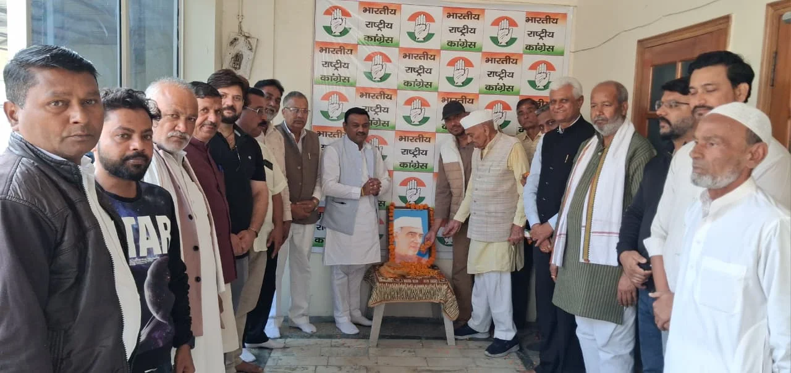
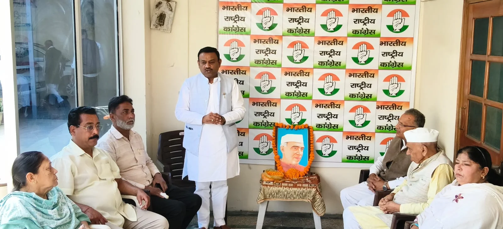
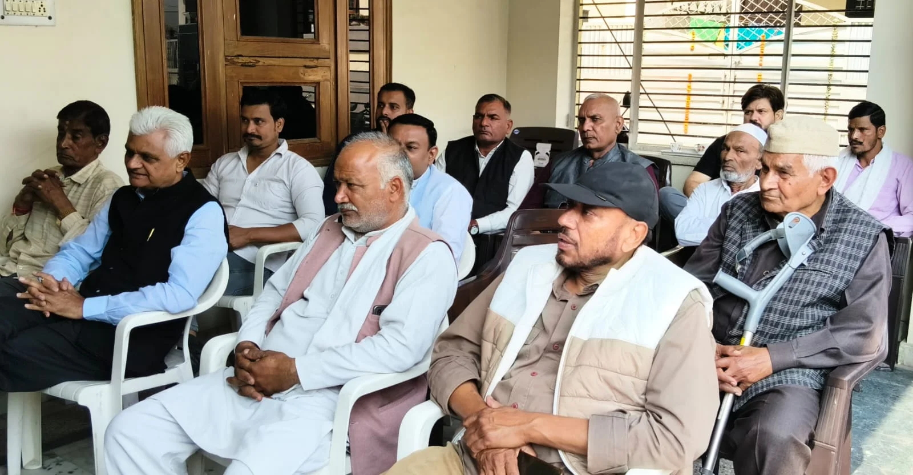

**रूडकी संवाददाता | आसिफ खान 

रुड़की।** जिला कांग्रेस कमेटी के कैंप कार्यालय में देश के प्रथम प्रधानमंत्री, भारत रत्न एवं महान स्वतंत्रता सेनानी पंडित जवाहरलाल नेहरू की 137वीं जयंती पूरे सम्मान और उत्साह के साथ मनाई गई। इस दौरान कांग्रेस नेताओं ने नेहरू के राष्ट्र निर्माण में दिए गए ऐतिहासिक योगदान को याद करते हुए उनके विचारों को आज भी प्रासंगिक बताया। कार्यक्रम में जहां नेहरू के त्याग, संघर्ष और दूरदर्शी सोच का गुणगान हुआ, वहीं उनके योगदान पर सवाल उठाने वालों को भी कांग्रेस नेताओं ने आड़े हाथों लिया।

कार्यक्रम की अध्यक्षता ब्लॉक अध्यक्ष रिजवान अहमद ने की, जबकि संचालन कांग्रेस सेवादल के प्रदेश उपाध्यक्ष जसवीर सिंह प्रधान ने किया।

पूर्व मंत्री राम सिंह सैनी ने अपने संबोधन में कहा कि पंडित जवाहरलाल नेहरू बेहद शिक्षित, दूरदर्शी और विशाल सोच रखने वाले नेता थे। उन्होंने अपना पूरा जीवन देश की आजादी और उसके विकास के लिए समर्पित कर दिया। स्वतंत्रता आंदोलन के दौरान दस वर्षों से अधिक समय जेल में बिताने वाले नेहरू ने आजाद भारत के प्रथम प्रधानमंत्री के रूप में देश को विकास की नई दिशा देने का काम किया। उन्होंने कहा कि आज की युवा पीढ़ी को नेहरू के राष्ट्रप्रेम, त्याग और समर्पण से प्रेरणा लेनी चाहिए तथा देश के उत्थान में अपनी भूमिका निभानी चाहिए।

महानगर कांग्रेस जिलाध्यक्ष राजेंद्र चौधरी एडवोकेट ने कहा कि आज कुछ ऐसे लोग भी पंडित नेहरू के योगदान पर सवाल खड़े कर रहे हैं, जिन्हें आजादी के आंदोलन, नेहरू के संघर्ष, त्याग और बलिदान के इतिहास की बुनियादी जानकारी तक नहीं है। उन्होंने कहा कि इतिहास को नजरअंदाज करने या किसी महान व्यक्तित्व को राजनीतिक चश्मे से देखने से उसका योगदान कम नहीं हो जाता। पंडित जवाहरलाल नेहरू आधुनिक भारत के शिल्पकार थे और देश उनके योगदान को कभी भुला नहीं सकता। उन्होंने अनेक बड़े संस्थानों की स्थापना कर भारत को वैज्ञानिक, औद्योगिक और शैक्षणिक विकास की मजबूत नींव प्रदान की।

पूर्व मेयर गौरव गोयल ने कहा कि पंडित नेहरू का संपूर्ण जीवन राष्ट्र को समर्पित रहा। स्वतंत्रता के बाद देश को विकासशील बनाने और आधुनिक भारत की आधारशिला रखने में उनकी महत्वपूर्ण भूमिका रही। उन्होंने कहा कि नेहरू ने अपनी दूरदर्शी सोच और कार्यों से देश को आगे बढ़ाने का काम किया। उनके योगदान को नकारने की कोशिश करना देश के इतिहास के साथ अन्याय है।

वक्ताओं ने रुड़की की ऐतिहासिक पहचान का उल्लेख करते हुए कहा कि देश के प्रथम विश्वविद्यालय, केंद्रीय भवन अनुसंधान संस्थान (सीबीआरआई), सिंचाई विभाग के मुख्यालय और बीएचईएल जैसे महत्वपूर्ण संस्थानों के विकास एवं स्थापना से क्षेत्र को विशेष पहचान मिली। इन संस्थानों ने रुड़की को शिक्षा, अनुसंधान और औद्योगिक क्षेत्र में महत्वपूर्ण स्थान दिलाया।

कार्यक्रम में महिला कांग्रेस जिलाध्यक्ष यासमीन खान, जिला महामंत्री मोहित त्यागी, जिला महामंत्री संगठन मुनफैत अली, जिला महामंत्री गौरव अग्रवाल सहित अनेक कांग्रेस पदाधिकारियों और कार्यकर्ताओं ने भी पंडित नेहरू के जीवन, विचारों और राष्ट्र निर्माण में उनके योगदान पर अपने विचार रखे।

**कांग्रेस में नए चेहरों की एंट्री, एक दर्जन से अधिक लोगों ने थामा पार्टी का हाथ**

नेहरू जयंती कार्यक्रम के समापन के बाद कांग्रेस को संगठनात्मक मजबूती देने की दिशा में भी महत्वपूर्ण गतिविधि देखने को मिली। प्रदीप सिंघल के नेतृत्व में एक दर्जन से अधिक लोगों ने कांग्रेस पार्टी की सदस्यता ग्रहण की। जिला अध्यक्ष राजेंद्र चौधरी ने सभी नए सदस्यों का स्वागत करते हुए कहा कि कांग्रेस परिवार में शामिल होने वाले प्रत्येक व्यक्ति के सहयोग और सम्मान का पूरा ध्यान रखा जाएगा। उन्होंने कहा कि संगठन को मजबूत बनाने में नए साथियों की भूमिका महत्वपूर्ण होगी।

इस अवसर पर नीरज सैनी, मुस्तकीम अहमद, तुषार अरोरा, शमशेर अली, डॉक्टर इरशाद मीर, पूर्व प्रधानाचार्य मनोज सैनी, वीणा आनंद, पंडित वीरेंद्र शर्मा, रामपाल सिंह, प्रदीप कुमार, भीम सिंह, गौरव प्रधान, रवि, बिजेंद्र चौधरी, अक्षय कुमार गौतम, नौशाद, गफ्फार अली, सलमान खान सहित अनेक लोग मौजूद रहे।

कार्यक्रम के जरिए कांग्रेस नेताओं ने एक तरफ पंडित नेहरू की विरासत और विचारधारा को याद किया, वहीं दूसरी ओर नए सदस्यों के पार्टी में शामिल होने से संगठन में नई ऊर्जा आने का संदेश भी दिया।
