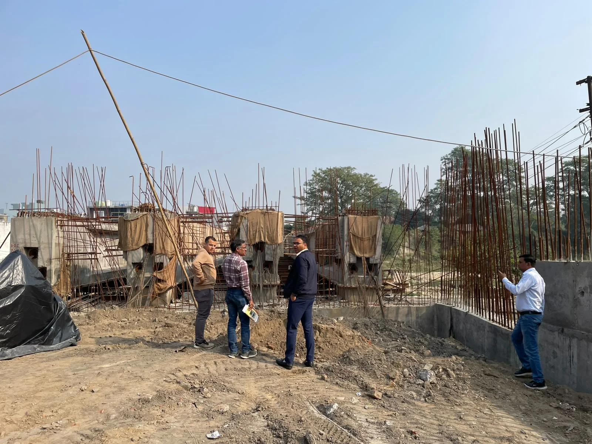
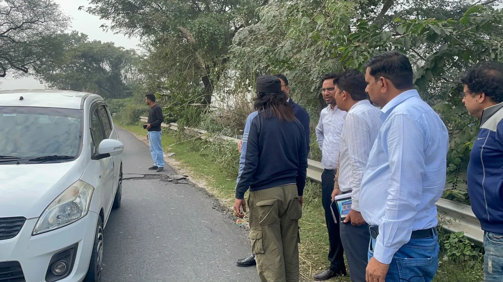
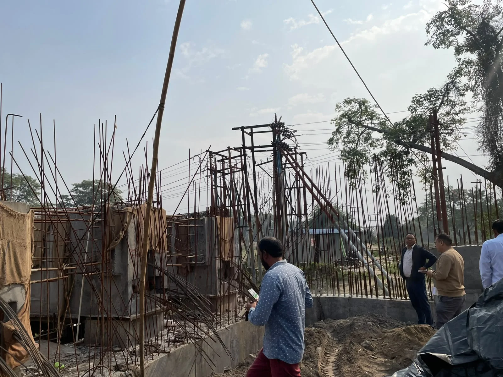

**हरिद्वार विशेष संवाददाता | आसिफ खान

हरिद्वार।** कुंभ मेला-2027 को लेकर मेला प्रशासन ने निर्माण कार्यों की रफ्तार और गुणवत्ता को लेकर निगरानी तेज कर दी है। कुंभ की तैयारियों के नाम पर निर्माण कार्यों में किसी भी तरह की लापरवाही, घटिया सामग्री के इस्तेमाल अथवा निर्धारित समयसीमा में देरी को लेकर प्रशासन ने अपना रुख स्पष्ट कर दिया है। मेलाधिकारी श्रीमती सोनिका के निर्देशों पर अधिकारी लगातार निर्माण स्थलों पर पहुंचकर कार्यों की हकीकत परख रहे हैं। इसी कड़ी में शनिवार को अपर मेलाधिकारी दयानंद सरस्वती ने ज्वालापुर, शिवालिक नगर और बहादराबाद क्षेत्र में लोक निर्माण विभाग के अंतर्गत चल रहे विभिन्न निर्माण एवं सड़क सुधार कार्यों का स्थलीय निरीक्षण किया।

निरीक्षण के दौरान अपर मेलाधिकारी ने केवल कागजी प्रगति की जानकारी लेने तक खुद को सीमित नहीं रखा, बल्कि मौके पर पहुंचकर निर्माण कार्यों की स्थिति, गुणवत्ता और निर्धारित समयसीमा के अनुरूप हो रही प्रगति का जायजा लिया। उन्होंने संबंधित अधिकारियों और कार्यदायी संस्थाओं को साफ निर्देश दिए कि कुंभ-2027 से जुड़े निर्माण कार्यों में गुणवत्ता के साथ कोई समझौता नहीं किया जाएगा। जहां भी कमियां दिखाई दें, उन्हें तत्काल दुरुस्त कराया जाए।

**पथरी रोह नदी पर पुल निर्माण की समयसीमा तय**

अपर मेलाधिकारी ने ज्वालापुर से ईदगाह, सुभाषनगर, पीएसी होते हुए शिवालिक नगर तक जाने वाले मार्ग पर पथरी रोह नदी में निर्माणाधीन 60 मीटर स्पान के प्रीस्ट्रेस्ड आरसीसी सेतु का निरीक्षण किया। इस पुल का निर्माण कुंभ की तैयारियों के लिहाज से महत्वपूर्ण माना जा रहा है। निरीक्षण के दौरान उन्होंने निर्माण कार्य की प्रगति की जानकारी ली और कार्यदायी संस्था के अधिकारियों से निर्धारित समयसीमा के संबंध में जवाब तलब किया।

इस पर कार्यदायी संस्था के अधिकारियों ने भरोसा दिलाया कि पुल का स्लैब निर्माण कार्य 20 दिसंबर तक पूरा कर लिया जाएगा। अब कार्यदायी संस्था के इस दावे पर निर्धारित समयसीमा के भीतर अमल करना बड़ी जिम्मेदारी होगी।

**सड़क नवीनीकरण में भी गुणवत्ता की परीक्षा**

अपर मेलाधिकारी ने ज्वालापुर-ईदगाह-सुभाषनगर-पीएसी-शिवालिक नगर मार्ग पर बिटुमिनस कंक्रीट (बीसी) से किए जा रहे सड़क नवीनीकरण और आबादी वाले क्षेत्रों में सड़क के शोल्डर पर इंटरलॉकिंग टाइल्स लगाने के कार्यों का भी निरीक्षण किया। उन्होंने निर्माण सामग्री की गुणवत्ता और कार्य की तकनीकी मानकों के अनुरूप स्थिति सुनिश्चित करने के निर्देश दिए।

उन्होंने स्पष्ट किया कि सड़क निर्माण केवल खानापूर्ति के लिए नहीं होना चाहिए। निर्माण ऐसा हो, जो निर्धारित मानकों पर खरा उतरे और लंबे समय तक लोगों को बेहतर आवागमन की सुविधा दे सके।

**बहादराबाद-सिडकुल मार्ग पर भी अधिकारियों की जवाबदेही तय**

निरीक्षण के दौरान अपर मेलाधिकारी ने बहादराबाद सिडकुल के चार लेन मार्ग पर भाईचारा ढाबा से बीएचईएल बैरियर संख्या-8 होते हुए शिवालिक नगर चौक (बीएचईएल मध्य मार्ग) तक प्रस्तावित चौड़ीकरण एवं सुदृढ़ीकरण कार्यों की प्रगति भी देखी। उन्होंने संबंधित अधिकारियों को निर्माण कार्य में तेजी लाने के साथ गुणवत्ता के निर्धारित मानकों का पालन करने के निर्देश दिए।

इसके अलावा बहादराबाद-धनौरी-इमलीखेड़ा-भगवानपुर-गागलहेड़ी राज्य मार्ग-68 के सुदृढ़ीकरण एवं नवीनीकरण कार्य का भी निरीक्षण किया गया। अपर मेलाधिकारी ने कार्यदायी संस्था को स्पष्ट निर्देश दिए कि जहां भी सुधार की आवश्यकता है, वहां बिना देरी किए सुधारात्मक कार्य कराया जाए। निर्माण कार्यों में लापरवाही अथवा गुणवत्ता से जुड़ी कमियों को नजरअंदाज नहीं किया जाना चाहिए।

**कुंभ के नाम पर लापरवाही नहीं, हर निर्माण की होगी निगरानी**

अपर मेलाधिकारी दयानंद सरस्वती ने कहा कि कुंभ मेला-2027 की तैयारियों को देखते हुए सभी निर्माण कार्यों को निर्धारित समयसीमा में उच्च गुणवत्ता के साथ पूरा कराना प्रशासन की प्राथमिकता है। कार्यदायी संस्थाओं के अधिकारी नियमित रूप से निर्माण स्थलों की निगरानी करें और कार्यों की प्रगति के साथ गुणवत्ता पर भी विशेष ध्यान दें।

कुल मिलाकर कुंभ-2027 से पहले सड़कों, पुलों और बुनियादी ढांचे को दुरुस्त करने की कवायद तेज हो गई है। अब निगाहें इस बात पर रहेंगी कि निर्माण एजेंसियां निरीक्षण के दौरान किए गए वादों और दिए गए निर्देशों को जमीन पर कितनी गंभीरता से उतारती हैं।

निरीक्षण के दौरान लोक निर्माण विभाग के अधिशासी अभियंता योगेश कुमार सहित संबंधित विभागों के अधिकारी मौजूद रहे।
