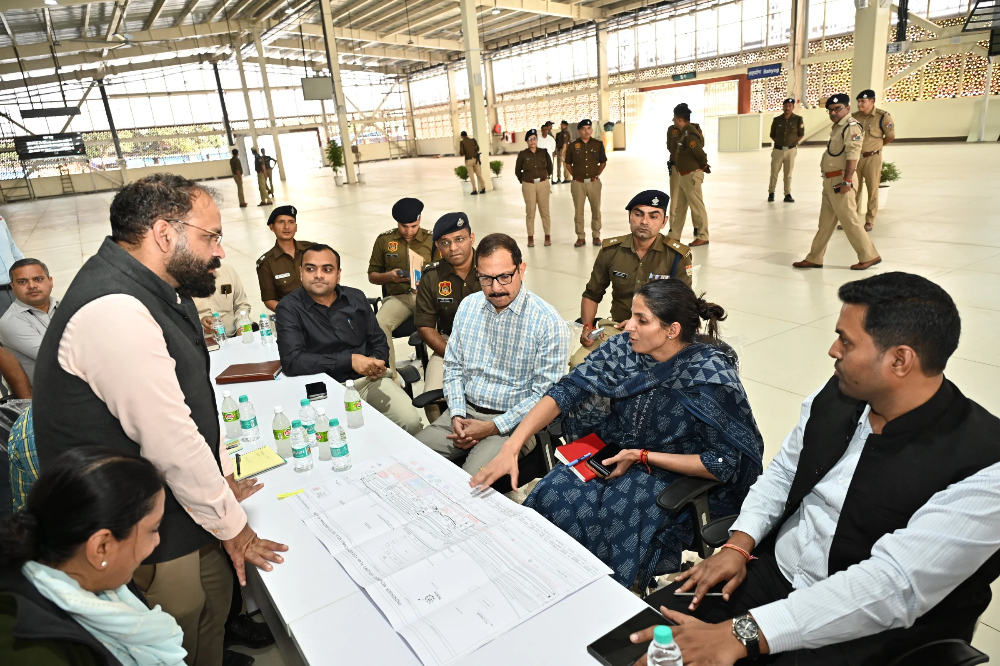
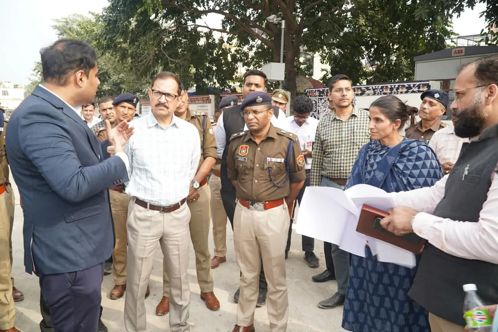
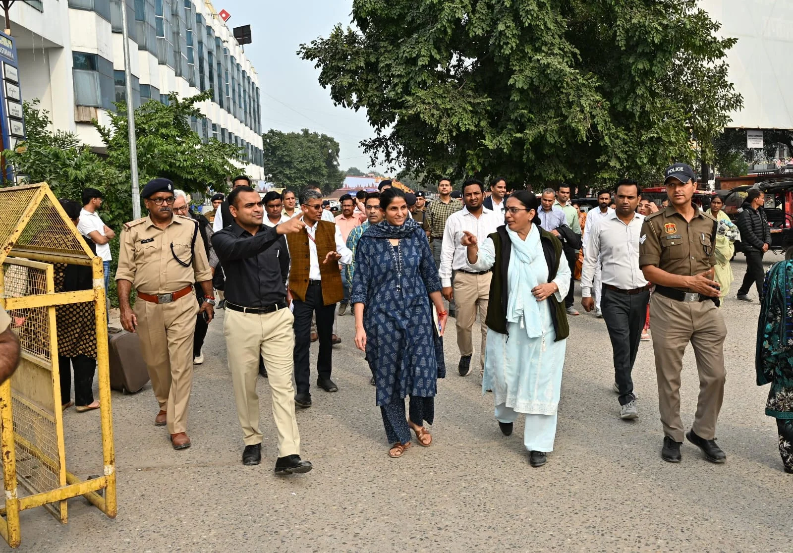
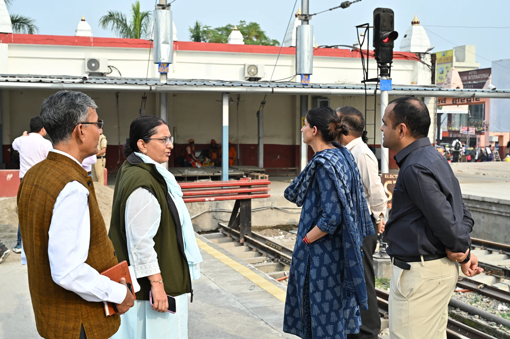

**हरिद्वार विशेष संवाददाता | आसिफ खान

हरिद्वार।** कुंभ मेला-2027 में देश-विदेश से करोड़ों श्रद्धालुओं के हरिद्वार पहुंचने की संभावना के बीच रेलवे स्टेशन पर भीड़ प्रबंधन और सुरक्षा व्यवस्था को लेकर प्रशासन ने अभी से कमर कसनी शुरू कर दी है। कुंभ के दौरान हरिद्वार रेलवे स्टेशन पर उमड़ने वाली यात्रियों की भारी भीड़ किसी बड़ी चुनौती से कम नहीं होगी। ऐसे में यात्रियों की सुरक्षित आवाजाही, ट्रेनों का संचालन, प्लेटफॉर्म पर भीड़ नियंत्रण और आपातकालीन परिस्थितियों से निपटने के लिए रेलवे प्रशासन और मेला प्रशासन के बीच समन्वय को लेकर गंभीर मंथन शुरू हो गया है।

इसी कड़ी में शुक्रवार को मेलाधिकारी श्रीमती सोनिका, आईजी कुंभ डॉ. योगेंद्र सिंह रावत, उत्तर रेलवे के मुरादाबाद मंडल की मंडलीय रेल प्रबंधक श्रीमती विनीता श्रीवास्तव, जिलाधिकारी मयूर दीक्षित और एसएसपी कुंभ आयुष अग्रवाल ने वरिष्ठ अधिकारियों के साथ हरिद्वार रेलवे स्टेशन का संयुक्त निरीक्षण किया। इस दौरान अधिकारियों ने रेलवे की तैयारियों का बारीकी से जायजा लेते हुए यात्री सुविधाओं, सुरक्षा इंतजामों और भीड़ नियंत्रण की प्रस्तावित रणनीति पर विस्तृत चर्चा की।

**भीड़ का दबाव बढ़ा तो कैसे संभलेगा स्टेशन, इसी पर हुआ मंथन**

कुंभ मेले में श्रद्धालुओं की आवाजाही के दौरान रेलवे स्टेशन पर अचानक बढ़ने वाले यात्री दबाव को नियंत्रित करना प्रशासन के सामने सबसे बड़ी प्राथमिकताओं में शामिल है। अधिकारियों ने स्पष्ट किया कि केवल कागजों पर योजना तैयार करने से काम नहीं चलेगा, बल्कि धरातल पर ऐसी व्यवस्था विकसित करनी होगी, जिससे लाखों यात्रियों की आवाजाही के दौरान अव्यवस्था की स्थिति पैदा न हो।

निरीक्षण के दौरान नवनिर्मित अनारक्षित टिकट केंद्र, प्रतीक्षालय, होल्डिंग एरिया और यात्रियों के आवागमन के लिए प्रस्तावित व्यवस्थाओं को देखा गया। रेलवे अधिकारियों ने संभावित यात्री संख्या को ध्यान में रखते हुए किए जा रहे कार्यों और भविष्य की तैयारियों की जानकारी दी।

**मॉक ड्रिल में खुलेगी व्यवस्थाओं की असली परीक्षा**

मेलाधिकारी सोनिका और पुलिस अधिकारियों ने सुरक्षा तथा भीड़ प्रबंधन की व्यवस्थाओं को मॉक ड्रिल के माध्यम से परखने पर विशेष जोर दिया। अधिकारियों का कहना था कि प्रवेश, निकास, ठहराव और यात्रियों की आवाजाही के लिए ऐसी व्यवस्था होनी चाहिए, जिसमें किसी भी स्तर पर भ्रम या अव्यवस्था की गुंजाइश न रहे। आपातकालीन स्थिति में यात्रियों को सुरक्षित बाहर निकालने के लिए पर्याप्त निकास मार्ग और प्रभावी सुरक्षा इंतजाम सुनिश्चित किए जाएं।

साफ निर्देश दिए गए कि संभावित परिस्थितियों को पहले ही ध्यान में रखकर तैयारियां की जाएं, ताकि भीड़ का दबाव बढ़ने या किसी आकस्मिक घटना की स्थिति में प्रशासन और रेलवे के अधिकारी तत्काल कार्रवाई कर सकें।

**पार्किंग से लेकर प्लेटफॉर्म तक अलग-अलग व्यवस्था पर जोर**

निरीक्षण के दौरान रेलवे स्टेशन परिसर में पर्याप्त पार्किंग की व्यवस्था सुनिश्चित करने पर भी विशेष चर्चा हुई। पुलिस अधिकारियों ने कहा कि कुंभ के दौरान वाहनों की अनियंत्रित पार्किंग से सड़कों पर जाम की स्थिति पैदा नहीं होनी चाहिए। इसके लिए पार्किंग स्थलों का उचित निर्धारण और यातायात प्रबंधन की ठोस योजना तैयार करना जरूरी है।

आरक्षित और अनारक्षित श्रेणी के यात्रियों के लिए अलग-अलग प्रवेश मार्ग निर्धारित करने, प्लेटफॉर्म तक पहुंचने की व्यवस्था को व्यवस्थित करने और अलग-अलग दिशाओं में जाने वाले यात्रियों के लिए पृथक प्रस्थान मार्ग विकसित करने पर भी विचार किया गया। इसका उद्देश्य स्टेशन परिसर में अनावश्यक भीड़ को रोकना और यात्रियों की आवाजाही को सुचारु बनाए रखना है।

**ट्रेनों के समय और यात्रियों की संख्या में होगा बेहतर तालमेल**

अधिकारियों ने ट्रेन संचालन को लेकर भी महत्वपूर्ण बिंदुओं पर चर्चा की। ट्रेनों के आगमन और प्रस्थान के समय यात्रियों की संख्या तथा स्टेशन की उपलब्ध क्षमता के बीच बेहतर तालमेल बनाए रखने पर जोर दिया गया। एक ही समय में अत्यधिक यात्रियों के स्टेशन पर एकत्र होने से रोकने के लिए यात्री दबाव के अनुरूप ट्रेनों के संचालन और अन्य जरूरी व्यवस्थाओं की योजना तैयार करने की बात कही गई।

**रेलवे की कार्ययोजना को जल्द मिलेगा अंतिम रूप**

संयुक्त निरीक्षण के दौरान सामने आए सुझावों और सुरक्षा संबंधी आवश्यकताओं को ध्यान में रखते हुए रेलवे प्रशासन अपनी प्रस्तावित कार्ययोजना को जल्द अंतिम रूप देगा। इसके बाद इस कार्ययोजना को मेला प्रशासन के साथ साझा किया जाएगा, ताकि दोनों विभाग आपसी समन्वय से जिम्मेदारियों और व्यवस्थाओं को अंतिम रूप दे सकें।

कुल मिलाकर कुंभ-2027 को लेकर रेलवे स्टेशन पर तैयारियों की दिशा में प्रशासन ने सक्रियता बढ़ा दी है। अब सबसे अहम सवाल यही है कि निरीक्षण में तय किए गए सुझाव कितनी तेजी से धरातल पर उतरते हैं। क्योंकि कुंभ के दौरान हरिद्वार रेलवे स्टेशन पर उमड़ने वाली भीड़ के बीच व्यवस्था की छोटी-सी चूक भी बड़ी परेशानी का कारण बन सकती है। ऐसे में समयबद्ध तैयारी, मजबूत सुरक्षा और प्रभावी भीड़ प्रबंधन ही प्रशासन की असली परीक्षा होगी।

**ये अधिकारी रहे मौजूद**

निरीक्षण के दौरान उत्तर रेलवे के ओएसडी (कुंभ) राजीव रंजन 'राजू', सीनियर डिवीजनल कॉमर्शियल मैनेजर महेश यादव, सीनियर डिवीजनल इंजीनियर तेजवीर सिंह, सिटी मजिस्ट्रेट हर गिरि, अपर पुलिस अधीक्षक (कुंभ) राजेश भट्ट, अपर पुलिस अधीक्षक (संचार) विपिन कुमार, सीओ जीआरपी अनुज कुमार सहित मेला प्रशासन, पुलिस, जीआरपी और आरपीएफ के अनेक अधिकारी मौजूद रहे।
