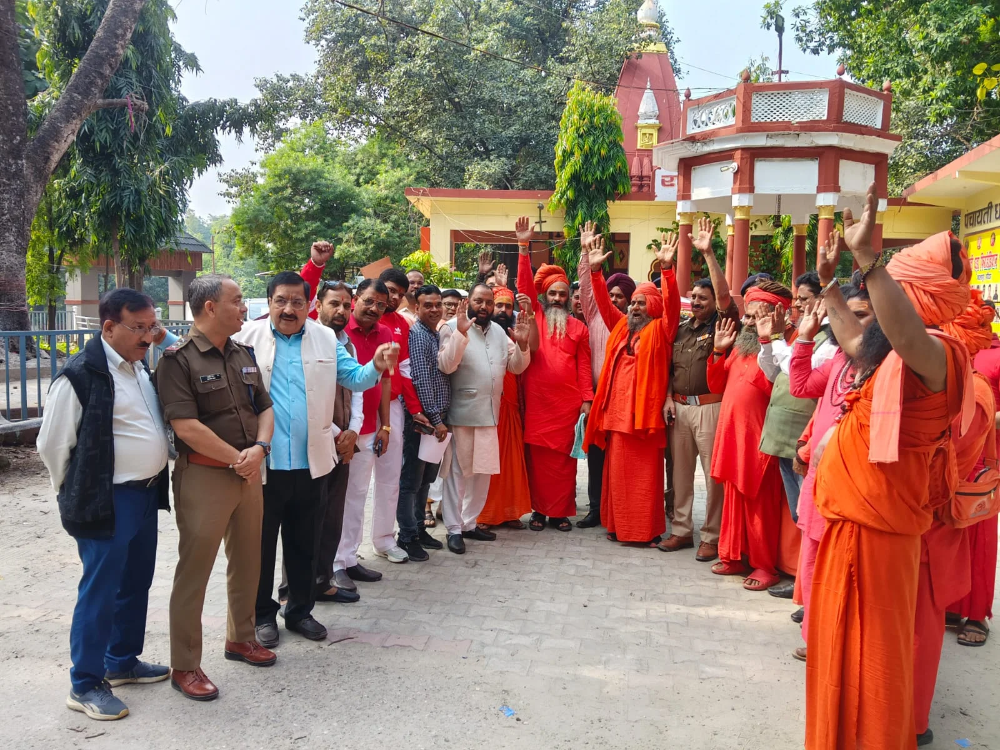

**हरिद्वार संवाददाता | आसिफ खान

हरिद्वार।** कुंभ मेला-2027 को भव्य, दिव्य और ऐतिहासिक स्वरूप देने की तैयारियों के बीच अब अखाड़ों की पेशवाइयों को लेकर मेला प्रशासन ने भी कमर कसनी शुरू कर दी है। कुंभ में अखाड़ों की पेशवाई केवल धार्मिक शोभायात्रा नहीं, बल्कि सनातन परंपरा, संत संस्कृति और आध्यात्मिक वैभव का ऐसा विराट प्रदर्शन होती है, जिसे देखने के लिए देश-विदेश से श्रद्धालु हरिद्वार पहुंचते हैं। ऐसे में पेशवाई की व्यवस्थाओं में किसी भी तरह की लापरवाही श्रद्धालुओं की सुविधा और आयोजन की गरिमा पर सवाल खड़े कर सकती है। इसी को देखते हुए मेला प्रशासन ने जूना अखाड़े की पेशवाई को लेकर तैयारियों का खाका तैयार करना शुरू कर दिया है।

शुक्रवार को पांडेवाला स्थित गुघाल मंदिर परिसर में अपर मेलाधिकारी दयानंद सरस्वती के नेतृत्व में मेला प्रशासन, पुलिस और विभिन्न विभागों के अधिकारियों ने जूना अखाड़े के पदाधिकारियों एवं संतों के साथ महत्वपूर्ण बैठक की। बैठक में पेशवाई के प्रस्तावित मार्ग, रमता पंचों के विश्राम स्थल और अखाड़े की छावनी तक पहुंचने वाली व्यवस्थाओं पर विस्तार से मंथन किया गया। अधिकारियों ने केवल कागजी तैयारियों तक सीमित रहने के बजाय मौके पर पहुंचकर मार्ग की वास्तविक स्थिति का भी जायजा लिया।

**पेशवाई मार्ग के हर महत्वपूर्ण पड़ाव पर रहेगी नजर**

पांडेवाला मंदिर से जूना अखाड़े की छावनी तक जाने वाले पारंपरिक मार्ग में पड़ने वाले प्रमुख चौराहों, बाजारों, संकरे रास्तों और संवेदनशील स्थानों का निरीक्षण किया गया। पेशवाई में बड़ी संख्या में साधु-संतों, नागा संन्यासियों, अखाड़े के प्रतिनिधियों और श्रद्धालुओं की भागीदारी को देखते हुए मार्ग को सुगम बनाने पर विशेष जोर दिया गया। संबंधित विभागों को निर्देशित किया गया कि मार्ग में जहां भी सुधार, मरम्मत अथवा अन्य व्यवस्थाओं की आवश्यकता है, उन्हें समय रहते पूरा किया जाए।

**रमता पंचों के विश्राम स्थल से छावनी तक व्यवस्थाओं की परीक्षा**

बैठक में श्यामपुर स्थित रमता पंचों के विश्राम स्थल से पेशवाई के प्रस्थान और वहां से अखाड़े की छावनी तक की व्यवस्थाओं पर भी गंभीरता से चर्चा हुई। अधिकारियों के सामने स्पष्ट किया गया कि पेशवाई के दौरान साधु-संतों को किसी प्रकार की असुविधा नहीं होनी चाहिए। इसके लिए आवागमन, साफ-सफाई, पेयजल, बिजली, प्रकाश और अन्य मूलभूत सुविधाओं को दुरुस्त रखने की आवश्यकता पर जोर दिया गया।

**यातायात, सुरक्षा और अग्निशमन पर विशेष फोकस**

पेशवाई के दौरान संभावित भीड़ और यातायात के दबाव को देखते हुए ट्रैफिक प्लान, वैकल्पिक मार्गों और निर्बाध आवागमन की व्यवस्थाओं की समीक्षा की गई। इसके साथ ही चिकित्सा शिविर, अग्निशमन प्रबंध, विद्युत व्यवस्था, स्वच्छता और मार्ग में आने वाले पेड़ों की लॉपिंग जैसे महत्वपूर्ण कार्यों पर भी चर्चा हुई। प्रशासन की कोशिश है कि पेशवाई के दौरान भीड़ प्रबंधन और सुरक्षा व्यवस्था ऐसी हो कि श्रद्धालुओं को दर्शन करने में परेशानी न हो और शोभायात्रा भी निर्धारित मार्ग से सुचारु रूप से आगे बढ़ सके।

**जूना अखाड़े के संतों से लिया फीडबैक**

अधिकारियों ने जूना अखाड़े के अध्यक्ष प्रेमगिरि महाराज, उपाध्यक्ष महेश पुरी, सचिव शैलेन्द्र गिरि जी महाराज तथा महंत भास्कर पुरी से व्यवस्थाओं को लेकर विस्तार से विचार-विमर्श किया। अखाड़े के पदाधिकारियों की ओर से दिए गए सुझावों को गंभीरता से लेते हुए संबंधित विभागों को आवश्यक कार्रवाई करने के निर्देश दिए गए।

इस दौरान उप मेलाधिकारी मनजीत सिंह, सीओ कुंभ उमेश मलिक, तकनीकी सेल के अधीक्षण अभियंता मनोज कुमार भट्ट, मुख्य अग्निशमन अधिकारी वंश बहादुर यादव, नगर स्वास्थ्य अधिकारी डॉ. पवन कार्की, मेला अधिष्ठान के व्यवस्था अधिकारी विकास शर्मा सहित विभिन्न विभागों के अधिकारी मौजूद रहे।

**मेलाधिकारी सोनिका ने स्पष्ट किया प्राथमिकता का एजेंडा**

मेलाधिकारी सोनिका ने कहा कि कुंभ मेला-2027 में अखाड़ों की पेशवाइयां धार्मिक और सांस्कृतिक दृष्टि से अत्यंत महत्वपूर्ण हैं। इन आयोजनों को सुरक्षित, सुव्यवस्थित और गरिमापूर्ण ढंग से संपन्न कराना मेला प्रशासन की प्राथमिकता है। उन्होंने अधिकारियों को निर्देश दिए कि अखाड़ों के प्रतिनिधियों के साथ लगातार समन्वय बनाए रखा जाए और पेशवाई से जुड़ी सभी व्यवस्थाएं समयबद्ध तरीके से पूरी की जाएं।

कुल मिलाकर कुंभ-2027 की तैयारियों में अब अखाड़ों की पेशवाई को लेकर प्रशासनिक सक्रियता तेज होती दिखाई दे रही है। चुनौती केवल भव्य आयोजन कराने की नहीं, बल्कि देश-दुनिया से आने वाले श्रद्धालुओं के सामने हरिद्वार की धार्मिक परंपरा, प्रशासनिक व्यवस्था और कुंभ की गरिमा का बेहतर उदाहरण प्रस्तुत करने की भी है। अब देखना होगा कि निरीक्षण और बैठकों में तय किए गए निर्देशों को संबंधित विभाग धरातल पर कितनी तेजी और गंभीरता से उतारते हैं।
