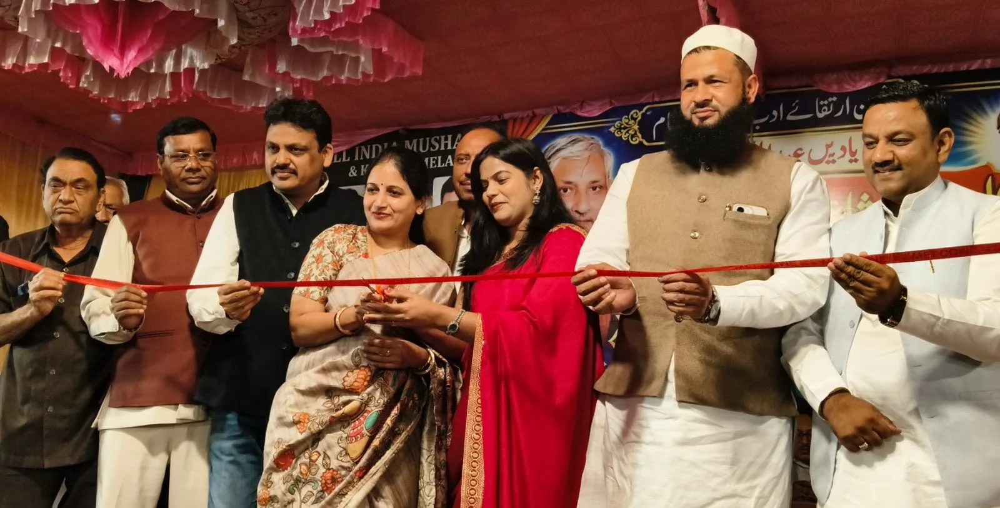
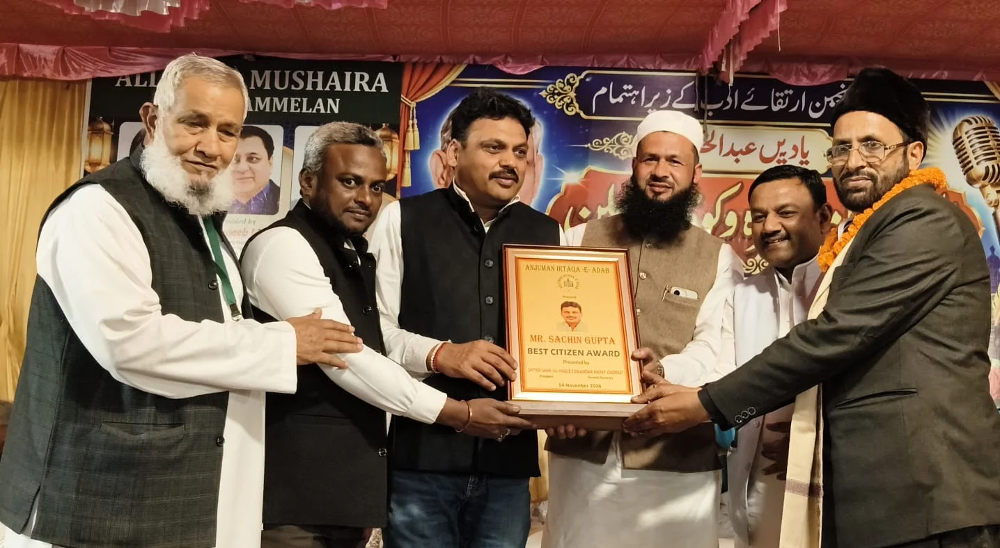
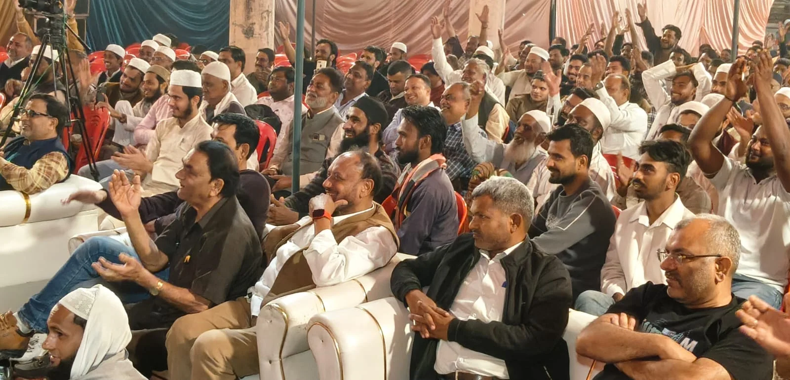

**रूडकी संवाददाता | आसिफ खान 

रुड़की।** नगर निगम प्रांगण में अंजुमन इतरका-ए-अदब के तत्वावधान में आयोजित ऑल इंडिया मुशायरा एवं कवि सम्मेलन ने अदब, तहजीब, भाईचारे और साहित्यिक संस्कृति की ऐसी मिसाल पेश की कि देर रात से लेकर सुबह तक पूरा पंडाल वाह-वाह और तालियों की गड़गड़ाहट से गूंजता रहा। 'यादें अब्दुल हकीम' के उनवान से आयोजित इस शानदार महफिल में देश के विभिन्न राज्यों से पहुंचे नामचीन शायरों और कवियों ने अपनी बेहतरीन गजलों, गीतों, नज्मों और हास्य व्यंग्य से श्रोताओं को मंत्रमुग्ध कर दिया।

कार्यक्रम का उद्घाटन मुख्य अतिथि वरिष्ठ समाजसेविका पूजा गुप्ता ने रिबन काटकर किया। मुशायरे की सदारत कर्नाटक से पहुंचे अंजुमन के सरपरस्त डॉ. बाबा अब्दुल रज्जाक ने की, जबकि मंच का संचालन देवास मध्य प्रदेश से आए शायर ने किया। इस अवसर पर प्रसिद्ध समाजसेवी एवं वरिष्ठ कांग्रेस नेता सचिन गुप्ता को संस्था की ओर से 'बेस्ट ऑफ सिटीजन' अवार्ड देकर सम्मानित किया गया।

मुख्य अतिथि पूजा गुप्ता ने अपने संबोधन में कहा कि इतने शानदार और यादगार आयोजन में आमंत्रित किया जाना उनके लिए सम्मान की बात है। उन्होंने कहा कि अंजुमन इतरका-ए-अदब का यह प्रयास समाज में आपसी भाईचारे, प्रेम और सद्भाव को मजबूत करने का काम करेगा। उन्होंने कहा कि नगरवासियों के किसी भी काम आना उनके लिए सौभाग्य की बात होगी।

मुशायरे का आगाज एटा से आए शायर अज्म शाकिरी ने नाते पाक से किया। इसके बाद खुर्शीद हैदर ने राष्ट्र को समर्पित गीत 'जिंदाबाद-ए-वतन' प्रस्तुत कर महफिल में देशभक्ति का जोश भर दिया। उनकी प्रस्तुति पर पूरा पंडाल तालियों से गूंज उठा।

दिल्ली से आए उस्ताद शायर इकबाल अशर ने एक के बाद एक शानदार गजलें पेश कर श्रोताओं की खूब दाद बटोरी। उनका शेर—

नहीं है तेरी चमक में कोई कमी सूरज,
मैं खुद वही हूं जहां रोशनी नहीं जाती।

वहीं अज्म शाकिरी ने अपने बेहतरीन तरन्नुम में सुनाया—

तू अगर छोड़ के जाने पे तुला है तो जा,
जान भी जिस्म से जाती है तो कब पूछती है।

तरन्नुम के बादशाह खुर्शीद हैदर ने भी अपनी प्रस्तुति से श्रोताओं को झूमने पर मजबूर कर दिया। उन्होंने फरमाया—

गैर परों पर उड़ सकते हैं हद से हद दीवारों तक,
अंबर पर तो वही उड़ेंगे जिनके अपने पर होंगे।

हास्य के विश्वविख्यात शायर एवं अंजुमन के जनरल सेक्रेटरी सिकंदर हयात गड़बड़ ने अपने चुटीले अंदाज से महफिल में हंसी के फव्वारे छोड़ दिए। उनके इस अंदाज पर पूरा पंडाल ठहाकों और तालियों से गूंज उठा—

इश्क का रोग है जो नींद उड़ा देता है,
नौजवानों से करोगे तो सजा देता है।
इश्क करना है तो हम जैसे बुजुर्गों से करो,
पिलपिला आम ही खाने में मजा देता है।

नैनीताल से पहुंचे शायर मोहन मुन्तजिर ने अपनी नज्मों और गजलों से श्रोताओं को प्रभावित किया। उन्होंने समाज की बदलती तस्वीर पर कटाक्ष करते हुए पढ़ा—

काशी में एक फकीर के महफूज थी मगर,
आकर अमीरजादों में दौलत बिगड़ गई।

देहरादून की शायरा मोनिका मंतशा ने अपनी दिलकश आवाज और बेहतरीन तरन्नुम से समां बांध दिया। उनकी प्रस्तुति पर भी जमकर दाद मिली। उन्होंने फरमाया—

रिफाकतों के उजाले सदा रहें कायम,
जहां चराग बुझे हमने दिल जलाया है।

बिलाल साहरनपुरी ने अपने जोशीले अंदाज में सामाजिक सच्चाई को शायरी के जरिए पेश कर खूब वाहवाही लूटी। उनका शेर—

रिक्शा चलाने वालों ने बच्चे पढ़ा लिए,
जो थे अमीरजादे नजाकत में मर गए।

वसीम राजुपुरी ने पिता के उनवान पर अपनी भावुक नज्म पेश कर महफिल को गंभीर कर दिया। उन्होंने पढ़ा—

दिल चकनाचूर हो गया तेरे सुलूक से,
जिसको समेटने में बिखरना पड़ा मुझे।

महमूद असर ने भी अपनी शायरी से श्रोताओं का दिल जीत लिया। उन्होंने कहा—

गिरेबां खोलकर पहनी जो तूने चैन सोने की,
यही पहचान है बेटा तेरे कमज़र्फ होने की।

इसके अलावा इमरान फैज, राधिका मित्तल, मनोज शाश्वत, जावेद मुशीरी सहित अन्य शायरों और कवियों ने भी अपनी शानदार प्रस्तुतियों से कार्यक्रम को यादगार बना दिया।

मुशायरे की खास बात यह रही कि मंच पर शायरी की अलग-अलग विधाओं के साथ सामाजिक सरोकार, देशभक्ति, मोहब्बत, रिश्तों और जिंदगी की हकीकत को भी खूबसूरती से पेश किया गया। श्रोताओं ने हर अच्छे कलाम पर खुलकर दाद दी और देर रात से सुबह तक महफिल का सिलसिला जारी रहा।

इस अवसर पर पूर्व मेयर गौरव गोयल, उदय सिंह पुंडीर, प्रणय प्रताप सिंह, आदिल फरीदी, जुबैर शमशी, मोहम्मद फारूक, सुहेल सैफी, चांद खान, मोहम्मद शावेज, तजमुल हुसैन, समून अहमद, शाहनवाज त्यागी, मुखिया त्यागी, मोहम्मद इरफान, अब्दुल नदीम, अब्दुल अजीम, शाहिद अख्तर, मोहम्मद अखलाक, बबलू भाई, मोहम्मद परवेज सहित अनेक गणमान्य लोग मौजूद रहे।

कार्यक्रम के अंत में संस्था के अध्यक्ष सैयद सनाउल हक ने सभी अतिथियों, शायरों, कवियों और उपस्थित श्रोताओं का आभार व्यक्त किया।
