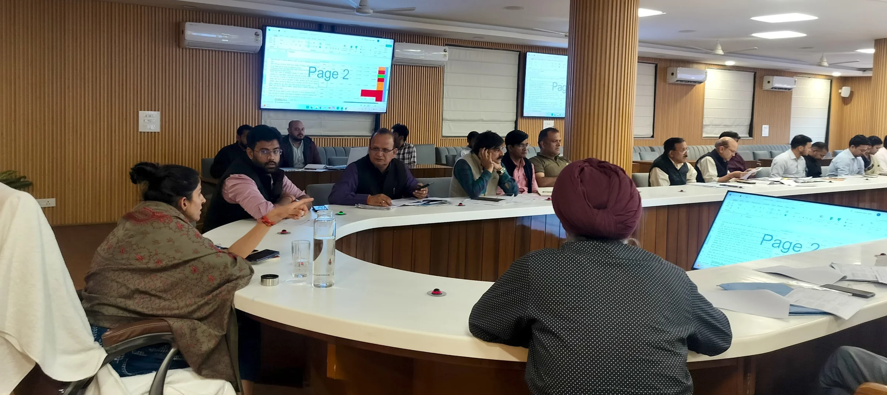
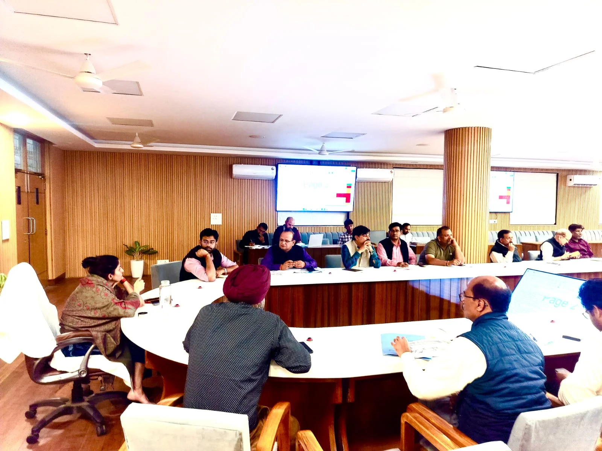

**हरिद्वार संवाददाता | आसिफ खान

हरिद्वार।** कुंभ मेला-2027 के भव्य आयोजन की उल्टी गिनती के बीच मेला प्रशासन ने निर्माण कार्यों को लेकर सख्त रुख अपना लिया है। कुंभ नगरी में स्थाई और अस्थाई व्यवस्थाओं को समय से पूरा कराने के लिए अब अधिकारियों और कार्यदायी संस्थाओं पर काम की रफ्तार बढ़ाने का दबाव साफ दिखाई देने लगा है। सात अस्थाई कोर एरिया पार्किंग का निर्माण तत्काल शुरू कराने, श्रमिकों की संख्या बढ़ाने और दिन-रात निर्माण कार्य संचालित करने के निर्देशों ने साफ कर दिया है कि अब काम में देरी को लेकर किसी तरह की ढिलाई बर्दाश्त नहीं की जाएगी।

मेलाधिकारी सोनिका ने सीसीआर सभागार में विभिन्न विभागों और कार्यदायी संस्थाओं के अधिकारियों के साथ समीक्षा बैठक कर निर्माण कार्यों की विभागवार प्रगति परखी। उन्होंने स्पष्ट निर्देश दिए कि कुंभ से जुड़े सभी स्थाई और अस्थाई कार्य निर्धारित समयसीमा के भीतर पूरे किए जाएं। केवल कागजों में प्रगति दिखाने के बजाय धरातल पर काम की रफ्तार और गुणवत्ता दिखाई देनी चाहिए। अधिकारियों को आपसी समन्वय के साथ निर्धारित लक्ष्य हासिल करने के निर्देश दिए गए।

**निर्माण पूरा होते ही हटाना होगा मलबा, लापरवाही पर कार्रवाई**

निर्माण कार्यों के साथ-साथ सड़कों और सार्वजनिक स्थलों पर फैली निर्माण सामग्री एवं मलबे को लेकर भी मेलाधिकारी ने कड़ा रुख अपनाया। उन्होंने निर्देश दिए कि जिन स्थानों पर निर्माण कार्य पूरा हो चुका है या अंतिम चरण में है, वहां से तत्काल मलबा और निर्माण सामग्री हटाई जाए। निर्माण के बाद स्थल को साफ-सुथरा और व्यवस्थित करना संबंधित कार्यदायी संस्था की जिम्मेदारी होगी। सड़कों अथवा सार्वजनिक स्थानों पर मलबा मिलने पर संबंधित संस्था के खिलाफ सख्त कार्रवाई की चेतावनी दी गई।

**अब दिन-रात चलेगा काम, रात में भी होगी अधिकारियों की निगरानी**

निर्माण कार्यों की रफ्तार बढ़ाने के लिए श्रमिकों की संख्या बढ़ाने और आवश्यकता के अनुसार रात में भी काम जारी रखने के निर्देश दिए गए हैं। इतना ही नहीं, सेक्टरों में अस्थाई व्यवस्थाओं की निगरानी के लिए तैनात अधिकारियों को रात्रिकालीन निरीक्षण भी करना होगा। अधिकारी निर्माण स्थलों पर पहुंचकर वास्तविक प्रगति का जायजा लेंगे और नियमित रिपोर्ट प्रस्तुत करेंगे। इसका उद्देश्य निर्माण कार्यों में सामने आने वाली कमियों को तत्काल दूर कराना और समयसीमा का पालन सुनिश्चित करना है।

**सात अस्थाई पार्किंग पर विशेष फोकस, शिविरों की सुविधाएं भी प्राथमिकता में**

कुंभ क्षेत्र में प्रस्तावित सात अस्थाई कोर एरिया पार्किंग का निर्माण तत्काल शुरू कराने के निर्देश दिए गए हैं। इसके साथ ही सभी सेक्टरों में शिविर स्थलों को तैयार करने, समतलीकरण, लेवलिंग और साफ-सफाई का काम प्राथमिकता से पूरा कराने को कहा गया है। शिविरों में बिजली, पेयजल, शौचालय और अन्य जरूरी सुविधाएं समय रहते उपलब्ध करानी होंगी। अस्थाई पुलों और संपर्क मार्गों का निर्माण भी निर्धारित समय में पूरा करने पर जोर दिया गया।

**19 अस्थाई पुल और तीन हजार से अधिक विद्युत पोल: धरातल पर चल रहा बड़ा निर्माण अभियान**

बैठक में अधिकारियों ने बताया कि कुंभ मेला व्यवस्थाओं के लिए हरिद्वार में कुल 19 अस्थाई पुलों का निर्माण कराया जा रहा है। वहीं अस्थाई विद्युतीकरण के लिए तीन हजार से अधिक विद्युत पोल लगाए जा रहे हैं। विभिन्न सेक्टरों में शिविर स्थलों के समतलीकरण और सफाई के साथ अस्थाई सड़कों तथा पेयजल लाइनों को बिछाने का काम भी जारी है।

बैरागी कैंप, गौरीशंकर, दक्षद्वीप और पंतद्वीप जैसे प्रमुख सेक्टरों में अधिकांश कार्य अंतिम चरण में पहुंचने की जानकारी दी गई है। इन क्षेत्रों में टेंट और शौचालय स्थापित करने का काम भी शुरू हो चुका है।

**गुणवत्ता से समझौता नहीं, जवाबदेही होगी तय**

मेलाधिकारी सोनिका ने अधिकारियों को दो टूक निर्देश दिए कि कुंभ-2027 की तैयारियों में समयबद्धता और निर्माण गुणवत्ता से कोई समझौता नहीं होना चाहिए। संबंधित विभागों और कार्यदायी संस्थाओं को अपने हिस्से के काम की जिम्मेदारी सुनिश्चित करनी होगी। अब निगरानी केवल बैठकों तक सीमित नहीं रहेगी, बल्कि निर्माण स्थलों पर नियमित निरीक्षण के जरिए काम की वास्तविक स्थिति परखी जाएगी।

कुंभ जैसे विशाल आयोजन में करोड़ों श्रद्धालुओं, संत-महात्माओं और कल्पवासियों की सुविधाओं का दारोमदार इन्हीं व्यवस्थाओं पर निर्भर करेगा। ऐसे में मेला प्रशासन के सामने सबसे बड़ी चुनौती यह है कि घोषित समयसीमा तक निर्माण कार्यों को जमीन पर उतारकर सभी व्यवस्थाओं को सुचारु बनाया जाए।

बैठक में ये अधिकारी रहे मौजूद: अपर मेलाधिकारी नंदन कुमार, मुख्य विकास अधिकारी डॉ. ललित नारायण मिश्र, एचआरडीए सचिव प्रत्यूष सिंह, उप मेलाधिकारी मनजीत सिंह, सिंचाई विभाग के अधीक्षण अभियंता मनोज कुमार सिंह, लोक निर्माण विभाग के अधीक्षण अभियंता डीपी सिंह, टेक्निकल सेल के अधीक्षण अभियंता मनोज कुमार भट्ट सहित विभिन्न विभागों के अधिकारी मौजूद रहे।
