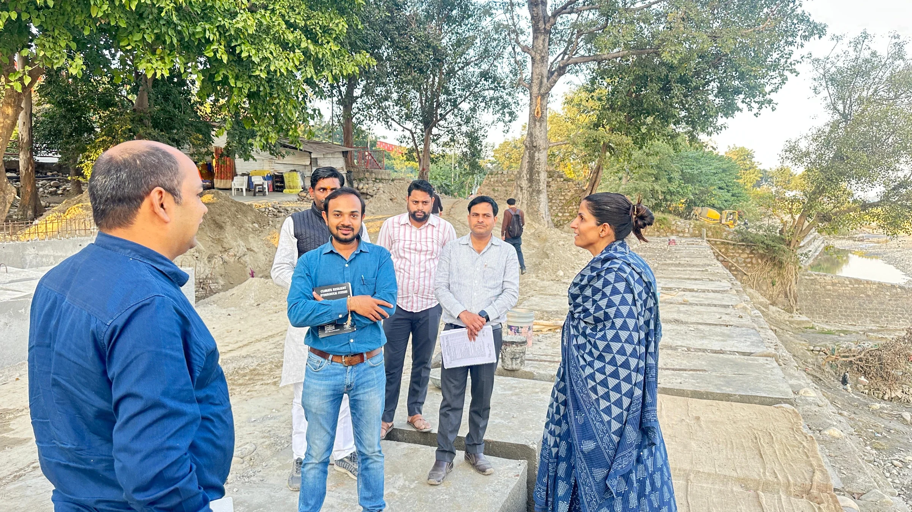
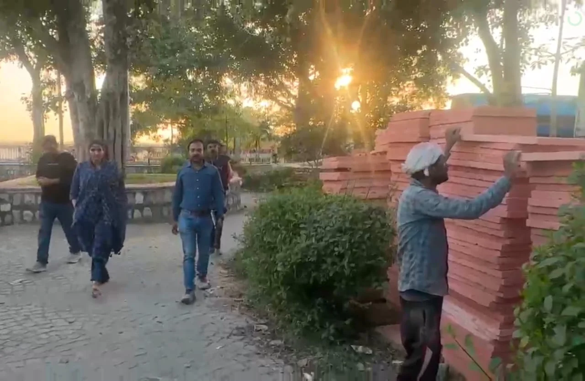

**हरिद्वार विशेष संवाददाता | आसिफ खान

हरिद्वार।** कुंभ-2027 की तैयारियों को लेकर हरिद्वार में विकास कार्यों की रफ्तार तेज हो गई है। इस बार श्रद्धालुओं की भारी भीड़ को नियंत्रित करने और हरकी पैड़ी तक आवागमन को सुगम बनाने के लिए आस्थापथ को नया स्वरूप देने की तैयारी है। धनुष पुल से बैरागी कैंप तक आस्थापथ के विस्तार की महत्वाकांक्षी परियोजना पर काम तेजी से आगे बढ़ाया जा रहा है। दावा है कि यह मार्ग कुंभ के दौरान भीड़ के दबाव को कम करने के साथ-साथ आपातकालीन परिस्थितियों में श्रद्धालुओं की सुरक्षित निकासी का अहम माध्यम बनेगा।

कुंभ जैसे विशाल आयोजन में करोड़ों श्रद्धालुओं की आवाजाही के बीच रास्तों की व्यवस्था सबसे बड़ी चुनौती होती है। ऐसे में आस्थापथ का विस्तार केवल सौंदर्यीकरण तक सीमित नहीं, बल्कि यातायात प्रबंधन और श्रद्धालुओं की सुरक्षा से जुड़ी महत्वपूर्ण परियोजना माना जा रहा है।

इसी क्रम में मेलाधिकारी सोनिका ने बुधवार को चंडी चौक से धनुष पुल तक पैदल भ्रमण कर निर्माण कार्यों की जमीनी हकीकत परखी। उन्होंने अलग-अलग स्थानों पर चल रहे कार्यों का निरीक्षण किया और संबंधित अधिकारियों को स्पष्ट निर्देश दिए कि निर्माण कार्यों में अनावश्यक देरी बर्दाश्त नहीं की जाएगी। निर्धारित समयसीमा के भीतर गुणवत्ता के साथ सभी कार्य पूरे किए जाएं। अधिकारियों को जरूरत पड़ने पर दिन-रात कार्य कराने और श्रमिकों की उपलब्धता सुनिश्चित करने के निर्देश भी दिए गए।

**270 मीटर एलिवेटेड रोड पर विशेष जोर**

परियोजना के तहत धनुष पुल से आस्था पुल को जोड़ते हुए दीनदयाल उपाध्याय पार्किंग तक मार्ग का निर्माण अंतिम चरण में पहुंच चुका है। इसके आगे पार्किंग से सटे तटवर्ती क्षेत्र में करीब 270 मीटर लंबे एलिवेटेड मार्ग का निर्माण तेजी से कराया जा रहा है।

मेलाधिकारी ने इस हिस्से का निरीक्षण करते हुए निर्माण कार्य में तेजी लाने के निर्देश दिए। उन्होंने कहा कि कुंभ मेला शुरू होने से पहले आस्थापथ का विस्तारित हिस्सा पूरी तरह व्यवस्थित और श्रद्धालुओं के आवागमन के लिए तैयार होना चाहिए। निर्माण की गुणवत्ता, नियमित निगरानी और समयबद्ध प्रगति पर विशेष ध्यान देने को कहा गया।

**नए घाट पर अधूरे काम तत्काल पूरे करने के निर्देश**

धनुष पुल से सीसीआर के बीच नवनिर्मित घाट का भी निरीक्षण किया गया। यहां अंतिम चरण में चल रहे कार्यों को जल्द पूरा करने के निर्देश दिए गए। मेलाधिकारी ने स्पष्ट किया कि घाट पर केवल निर्माण पूरा होना पर्याप्त नहीं होगा, बल्कि श्रद्धालुओं की सुरक्षा, प्रकाश व्यवस्था और अन्य जनसुविधाओं का भी पुख्ता इंतजाम होना चाहिए।

**रोड़ी बेलवाला में अतिक्रमण पर भी रहेगी नजर**

निरीक्षण के दौरान रोड़ी बेलवाला क्षेत्र में चल रहे विकास कार्यों और एडमिन रोड की प्रगति भी जांची गई। मेलाधिकारी ने संबंधित अधिकारियों को सभी कार्य तय समय में पूरे करने के निर्देश दिए। साथ ही रोड़ी बेलवाला क्षेत्र को अतिक्रमणमुक्त बनाए रखने के लिए नियमित निगरानी और प्रभावी कार्रवाई सुनिश्चित करने को कहा।

**धनुष पुल से बैरागी कैंप तक जुड़ेगा आस्थापथ**

गौरतलब है कि आस्थापथ विस्तार परियोजना के अंतर्गत धनुष पुल से चंडी चौक तक करीब डेढ़ किलोमीटर लंबे हिस्से का निर्माण यूआईआईडीबी की रोड़ी बेलवाला पुनर्विकास परियोजना के तहत यूपीडीसीसी के माध्यम से कराया जा रहा है। इसके आगे आस्थापथ को बैरागी कैंप से जोड़ने का कार्य उत्तर प्रदेश सिंचाई विभाग कर रहा है।

परियोजना पूरी होने के बाद हरकी पैड़ी की ओर आने-जाने वाले श्रद्धालुओं को एक अतिरिक्त सुगम मार्ग उपलब्ध होगा। कुंभ के दौरान भीड़ का दबाव अलग-अलग मार्गों पर बांटने, आवागमन को व्यवस्थित करने और आपात स्थिति में सुरक्षित निकासी के लिए यह मार्ग महत्वपूर्ण साबित हो सकता है।

अब सबसे बड़ी चुनौती तय समयसीमा में निर्माण पूरा कराने की है। कुंभ-2027 से पहले आस्थापथ का यह विस्तार धरातल पर कितना तैयार होता है, इस पर श्रद्धालुओं और स्थानीय लोगों की नजर रहेगी।

निरीक्षण के दौरान यूपीडीसीसी के परियोजना प्रबंधक सुमित मलवाल, उत्तर प्रदेश सिंचाई विभाग के अभियंता भारत भूषण सहित अन्य अधिकारी मौजूद रहे।

**STAR NEWS 11 | हर खबर पर पैनी नजर**
