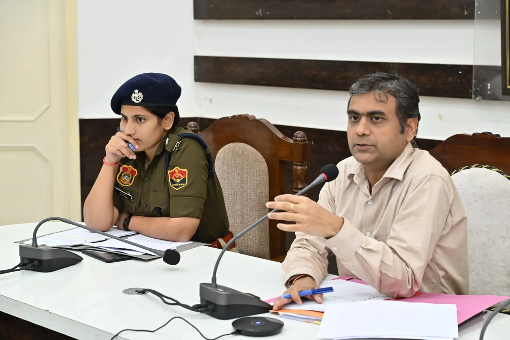
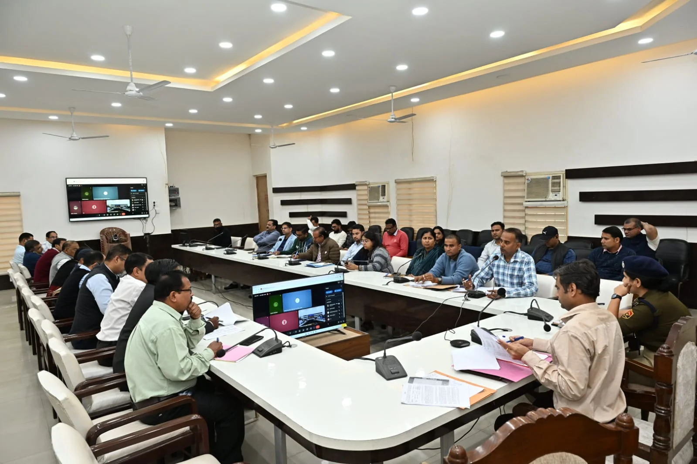
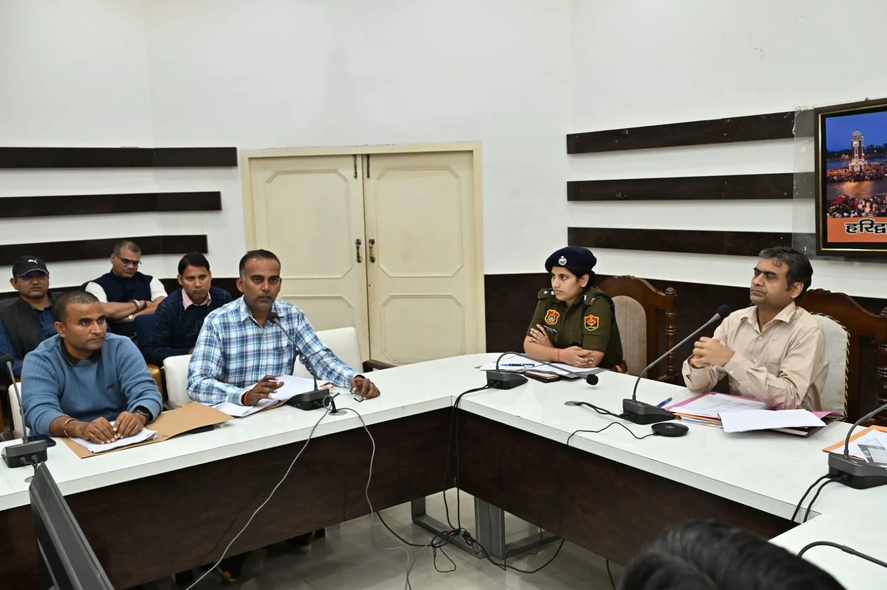

**हरिद्वार संवाददाता | आसिफ खान

हरिद्वार।** उत्तराखंड लोक सेवा आयोग की सम्मिलित राज्य/प्रवर अधीनस्थ सेवा प्रारंभिक परीक्षा-2026 को लेकर जिला प्रशासन पूरी तरह अलर्ट मोड में आ गया है। आगामी 29 नवंबर को होने वाली इस महत्वपूर्ण परीक्षा में जनपद के 20,958 अभ्यर्थी अपना भाग्य आजमाएंगे। परीक्षा की शुचिता, पारदर्शिता और निष्पक्षता बनाए रखने के लिए प्रशासन ने तैयारियों को तेज करते हुए सुरक्षा व्यवस्था से लेकर गोपनीय प्रश्नपत्रों के परिवहन तक अधिकारियों की जिम्मेदारी तय कर दी है। साफ निर्देश हैं कि परीक्षा व्यवस्था में किसी भी स्तर पर लापरवाही बर्दाश्त नहीं की जाएगी।

जिलाधिकारी मयूर दीक्षित के निर्देशन में अपर जिलाधिकारी वैभव गुप्ता की अध्यक्षता में कलेक्ट्रेट सभागार में सेक्टर मजिस्ट्रेटों और संबंधित अधिकारियों की बैठक आयोजित की गई। बैठक में परीक्षा को नकलविहीन और शांतिपूर्ण ढंग से संपन्न कराने के लिए विस्तृत रणनीति तैयार की गई। अधिकारियों को निर्देश दिए गए कि परीक्षा से पहले सभी केंद्रों का स्थलीय निरीक्षण कर व्यवस्थाओं की कमियों को दूर किया जाए।

**52 केंद्रों पर होगी परीक्षा, रुड़की में 16 और हरिद्वार में 36 केंद्र**

जनपद में परीक्षा के लिए कुल 52 केंद्र बनाए गए हैं। इनमें रुड़की क्षेत्र में 16 तथा हरिद्वार क्षेत्र में 36 परीक्षा केंद्र निर्धारित किए गए हैं। कुल 20,958 अभ्यर्थियों में रुड़की क्षेत्र के 6,494 और हरिद्वार क्षेत्र के 13,464 परीक्षार्थी शामिल होंगे। परीक्षा दो पालियों में आयोजित की जाएगी। पहली पाली सुबह 10 बजे से दोपहर 12 बजे तक तथा दूसरी पाली दोपहर 2 बजे से शाम 4 बजे तक चलेगी।

**मोबाइल और इलेक्ट्रॉनिक उपकरणों पर पूर्ण प्रतिबंध**

परीक्षा केंद्रों में मोबाइल फोन सहित किसी भी प्रकार के इलेक्ट्रॉनिक उपकरण ले जाने पर पूरी तरह प्रतिबंध रहेगा। अपर जिलाधिकारी वैभव गुप्ता ने सेक्टर मजिस्ट्रेटों को निर्देश दिए कि आयोग के नियमों का सख्ती से पालन कराया जाए। परीक्षा केंद्रों पर प्रवेश के दौरान अभ्यर्थियों की निर्धारित प्रक्रिया के तहत सघन जांच सुनिश्चित की जाए। किसी भी संदिग्ध गतिविधि पर तत्काल कार्रवाई की जाए।

उन्होंने केंद्र व्यवस्थापकों और प्रधानाचार्यों के साथ समन्वय स्थापित कर बिजली, पेयजल, शौचालय और अन्य मूलभूत सुविधाओं की व्यवस्था पहले से दुरुस्त रखने के निर्देश भी दिए।

**प्रश्नपत्रों की सुरक्षा पर विशेष निगरानी, लापरवाही की गुंजाइश नहीं**

परीक्षा की गोपनीयता बनाए रखने के लिए प्रश्नपत्रों को कोषागार से निर्धारित प्रक्रिया के तहत परीक्षा केंद्रों तक सुरक्षित पहुंचाने की जिम्मेदारी संबंधित अधिकारियों को सौंपी गई है। अपर जिलाधिकारी ने स्पष्ट किया कि गोपनीय परीक्षा सामग्री के रखरखाव और परिवहन में किसी भी प्रकार की लापरवाही नहीं होनी चाहिए। आयोग की समय-सारिणी और दिशा-निर्देशों का शत-प्रतिशत पालन सुनिश्चित कराया जाए।

**डेढ़ घंटे पहले पहुंचना होगा अभ्यर्थियों को**

उत्तराखंड लोक सेवा आयोग के अवर सचिव आशीष जायसवाल ने बैठक में बताया कि आयोग की ओर से परीक्षा आयोजन की सभी आवश्यक तैयारियां पूरी कर ली गई हैं। उन्होंने अभ्यर्थियों को परीक्षा शुरू होने से डेढ़ घंटे पहले केंद्र पर पहुंचने के निर्देश दिए हैं। प्रवेश के दौरान निर्धारित प्रक्रिया के अनुसार सघन जांच की जाएगी, जिससे परीक्षा की शुचिता और पारदर्शिता बनी रहे।

उन्होंने बताया कि रुड़की क्षेत्र में आयोजित परीक्षा की उत्तर पुस्तिकाएं डाकघर में जमा कराई जाएंगी, जबकि हरिद्वार क्षेत्र की उत्तर पुस्तिकाएं परीक्षा संपन्न होने के बाद संबंधित सेक्टर मजिस्ट्रेटों द्वारा उत्तराखंड लोक सेवा आयोग के कार्यालय में जमा कराई जाएंगी।

**कानून व्यवस्था से लेकर उत्तर पुस्तिकाओं तक रहेगी निगरानी**

प्रशासन ने परीक्षा के दौरान कानून एवं शांति व्यवस्था बनाए रखने, अधिकारियों के बीच बेहतर समन्वय स्थापित करने और प्रत्येक स्तर पर सतर्कता बरतने के निर्देश दिए हैं। अब 29 नवंबर को होने वाली परीक्षा प्रशासनिक तैयारियों की भी बड़ी परीक्षा होगी। 52 केंद्रों पर हजारों अभ्यर्थियों की मौजूदगी के बीच व्यवस्था को सुचारू बनाए रखना जिला प्रशासन के सामने महत्वपूर्ण चुनौती है।

बैठक में एसपी क्राइम निशा यादव, जिला विकास अधिकारी केके पंत, आरओ लोक सेवा आयोग सुशील डंगवाल, जिला प्रोबेशन अधिकारी अविनाश भदौरिया, महाप्रबंधक जिला उद्योग केंद्र उत्तम कुमार तिवारी, अपर मुख्य अधिकारी जिला पंचायत महेश विश्नोई, जिला समाज कल्याण अधिकारी सुबोध शर्मा सहित संबंधित सेक्टर मजिस्ट्रेट एवं अन्य अधिकारी उपस्थित रहे।
