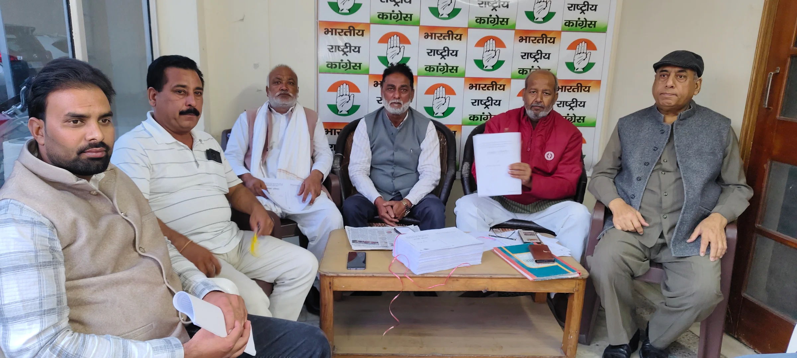
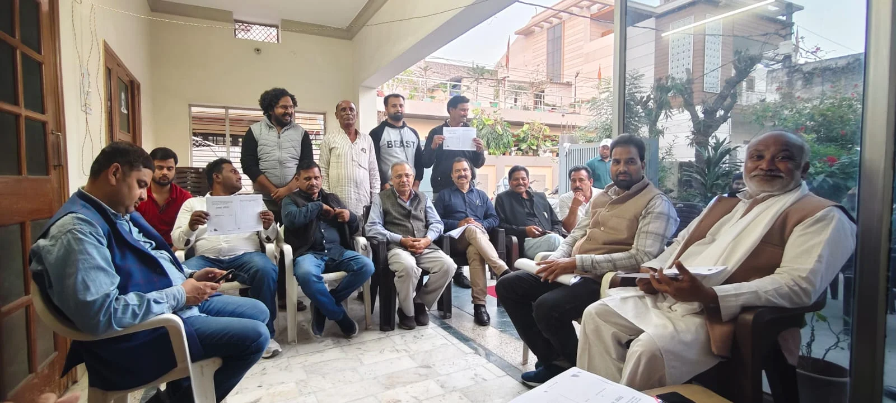

**रूडकी संवाददाता | आसिफ खान 

रुड़की।** उत्तराखंड की धामी सरकार के खिलाफ भ्रष्टाचार के आरोपों को लेकर कांग्रेस ने अपना मोर्चा खोल दिया है। प्रदेश कांग्रेस कमेटी के निर्देश पर जिला कांग्रेस कमेटी रुड़की महानगर कार्यालय में चल रहा हस्ताक्षर अभियान अब दूसरे चरण में पहुंच गया है। कांग्रेस नेताओं ने मुख्यमंत्री पुष्कर सिंह धामी सहित कैबिनेट मंत्री गणेश जोशी, रेखा आर्य और धन सिंह रावत को लेकर भ्रष्टाचार के आरोप उठाते हुए सरकार पर तीखा हमला बोला।

हस्ताक्षर अभियान के संयोजक डॉ. हरविंदर सिंह और महामंत्री संगठन मुन्फेत अली ने पदाधिकारियों को हस्ताक्षर फॉर्म वितरित किए। साथ ही अभियान को व्यापक स्तर पर चलाने और अधिक से अधिक लोगों को इससे जोड़ने की जिम्मेदारी सौंपी गई।

इस दौरान अपने संबोधन में राजेंद्र चौधरी ने धामी सरकार पर सीधा निशाना साधते हुए कहा कि वर्तमान सरकार भ्रष्टाचार के आरोपों से घिरी हुई है और प्रदेश की जनता परेशान है। उन्होंने आरोप लगाया कि सरकार के कई मंत्री बिना धन लिए आम लोगों के काम नहीं कर रहे हैं। उन्होंने कहा कि जनता के मुद्दों और भ्रष्टाचार के आरोपों को लेकर कांग्रेस चुप बैठने वाली नहीं है।

राजेंद्र चौधरी ने जनता से अपील की कि वह हस्ताक्षर अभियान में बढ़-चढ़कर हिस्सा ले और सरकार के खिलाफ अपनी आवाज बुलंद करे। उन्होंने कहा कि कांग्रेस इस अभियान के माध्यम से जनता की आवाज को प्रदेश स्तर तक पहुंचाएगी और आगामी चुनाव में सरकार को इन मुद्दों पर जवाब देने के लिए मजबूर करेगी।

कांग्रेस नेताओं ने स्पष्ट किया कि हस्ताक्षर अभियान को केवल पार्टी कार्यालय तक सीमित नहीं रखा जाएगा, बल्कि आम जनता के बीच ले जाकर सरकार के खिलाफ उठाए जा रहे सवालों को व्यापक रूप दिया जाएगा।

इस अवसर पर वरिष्ठ कांग्रेस नेता सलीम खान, प्रधान जसवीर सिंह, अनिल पुंडीर, प्रमुख गर्ग, ब्लॉक अध्यक्ष रिजवान अहमद, नीरज सैनी, जिला उपाध्यक्ष मदनपाल भड़ाना, संजय गुड्डू, पूर्व पार्षद मुस्तकीम अहमद, विशाल सहगल, गौरव अग्रवाल, मिलन चौधरी, अक्षय गौतम, डॉ. परवेज, अब्दुल कादिर, विकास चौधरी, प्रसून, परविंदर, जितेंद्र सैनी सहित अनेक कांग्रेस पदाधिकारी एवं कार्यकर्ता मौजूद रहे।
