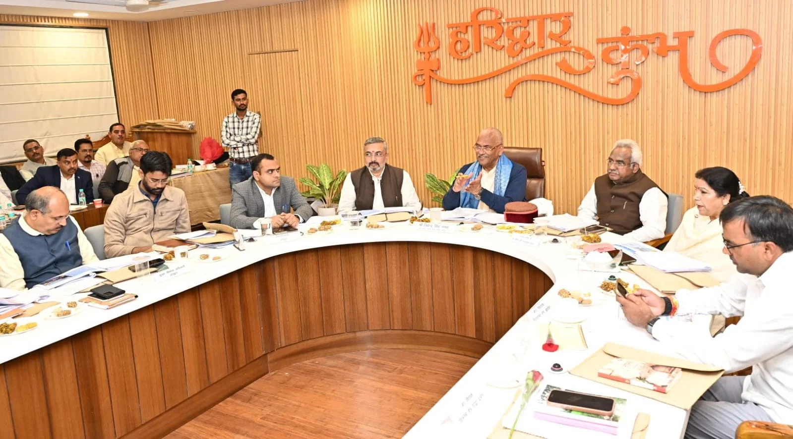
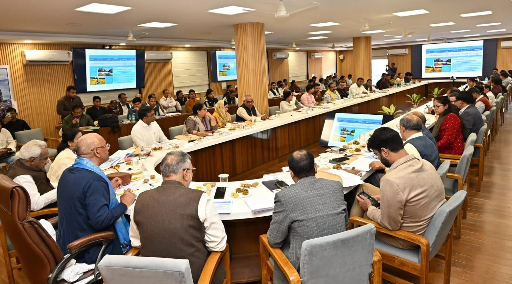
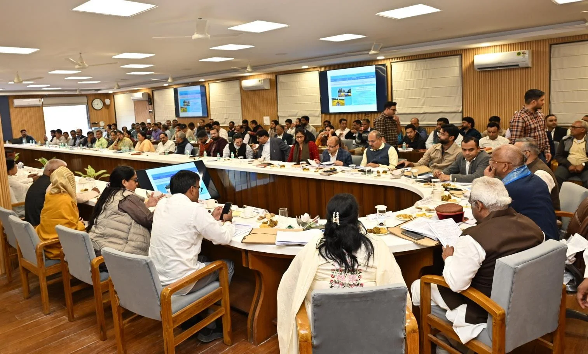

**हरिद्वार संवाददाता | आसिफ खान

हरिद्वार।** सरकारी योजनाओं की फाइलों में उपलब्धियां गिनाने से अब काम नहीं चलेगा, योजनाओं का वास्तविक लाभ हर पात्र व्यक्ति तक पहुंचाना होगा। विकास कार्यों में लापरवाही और योजनाओं के क्रियान्वयन में ढिलाई किसी भी कीमत पर बर्दाश्त नहीं की जाएगी। यह दोटूक संदेश हरिद्वार सांसद एवं पूर्व मुख्यमंत्री त्रिवेंद्र सिंह रावत ने जिला विकास समन्वय एवं निगरानी समिति (दिशा) की बैठक में अधिकारियों को दिया।

कुंभ मेला नियंत्रण भवन सभागार में आयोजित बैठक में सांसद ने केंद्र सरकार की विभिन्न जनकल्याणकारी योजनाओं की विभागवार समीक्षा करते हुए अधिकारियों को स्पष्ट निर्देश दिए कि सरकारी योजनाएं केवल कागजों और आंकड़ों तक सीमित न रहें, बल्कि उनका लाभ अंतिम पंक्ति में खड़े पात्र व्यक्ति तक पहुंचे। उन्होंने कहा कि जनता की समस्याओं का समाधान करना अधिकारियों की प्राथमिक जिम्मेदारी है और इसमें किसी भी तरह की लापरवाही स्वीकार नहीं की जाएगी।

**कुंभ से पहले सड़कों की बदहाली दूर करने का अल्टीमेटम**

कुंभ-2027 की तैयारियों को लेकर सांसद ने राष्ट्रीय राजमार्ग, लोक निर्माण विभाग और प्रधानमंत्री ग्राम सड़क योजना के अधिकारियों को विशेष रूप से चेताया। उन्होंने निर्देश दिए कि जनपद में चल रहे सड़क निर्माण और मरम्मत के सभी आवश्यक कार्य दिसंबर माह के अंत तक हर हाल में पूरे किए जाएं।

उन्होंने कहा कि जनवरी से प्रारंभ होने वाले कुंभ मेले को देखते हुए श्रद्धालुओं और तीर्थयात्रियों के लिए आवागमन सुगम बनाना बेहद जरूरी है। सड़कों की खराब स्थिति कुंभ व्यवस्थाओं में बाधा नहीं बननी चाहिए। इसके लिए संबंधित विभाग अभी से युद्धस्तर पर कार्य करें और निर्धारित समयसीमा का पालन सुनिश्चित करें।

**पेंशन से वंचित बुजुर्गों और विधवाओं को मिलेगा लाभ**

सांसद त्रिवेंद्र सिंह रावत ने वृद्धावस्था और विधवा पेंशन योजनाओं की स्थिति पर भी अधिकारियों को निर्देश दिए। उन्होंने कहा कि पात्र होने के बावजूद जो बुजुर्ग और विधवा महिलाएं पेंशन से वंचित हैं, उन्हें चिह्नित कर जल्द से जल्द योजनाओं से जोड़ा जाए।

उन्होंने प्रधानमंत्री आवास योजना, जल जीवन मिशन, प्रधानमंत्री किसान सम्मान निधि, आयुष्मान भारत, स्वच्छ भारत मिशन, राष्ट्रीय स्वास्थ्य मिशन, पोषण अभियान और रोजगार एवं स्वरोजगार योजनाओं की प्रगति की समीक्षा करते हुए लाभार्थियों के चयन में पारदर्शिता बरतने तथा शिकायतों का प्राथमिकता से निस्तारण करने को कहा।

**सड़क दुर्घटनाओं पर लगाम लगाने के प्रयासों की सराहना**

बैठक में सड़क सुरक्षा का मुद्दा भी प्रमुखता से उठा। सांसद ने जिलाधिकारी मयूर दीक्षित और परिवहन विभाग की कार्यप्रणाली की सराहना करते हुए कहा कि पिछले तीन महीनों से लगातार चलाए जा रहे चेकिंग अभियान का सकारात्मक असर देखने को मिला है।

यातायात नियमों का उल्लंघन करने वाले वाहन चालकों और वाहनों के खिलाफ नियमानुसार कार्रवाई किए जाने को उन्होंने महत्वपूर्ण कदम बताया। साथ ही अन्य संबंधित विभागों को भी सड़क सुरक्षा के लिए गंभीरता से काम करने की जरूरत बताई।

**सुकन्या समृद्धि योजना के प्रचार पर जोर**

सांसद ने सुकन्या समृद्धि योजना का व्यापक प्रचार-प्रसार करने के निर्देश देते हुए कहा कि अधिक से अधिक पात्र बालिकाओं और उनके अभिभावकों को इस योजना से जोड़ा जाए। उन्होंने ग्रामीण एवं शहरी क्षेत्रों में पेयजल आपूर्ति, क्षतिग्रस्त सड़कों, विद्युत व्यवस्था, स्वास्थ्य सुविधाओं, शिक्षा और सिंचाई से जुड़ी समस्याओं पर भी समयबद्ध कार्रवाई करने को कहा।

**डीएम ने दिया शत-प्रतिशत अनुपालन का भरोसा**

जिलाधिकारी मयूर दीक्षित ने जनपद में संचालित केंद्र पोषित योजनाओं की प्रगति से सांसद को अवगत कराया। उन्होंने आश्वस्त किया कि बैठक में दिए गए निर्देशों का सभी संबंधित विभागों से शत-प्रतिशत अनुपालन सुनिश्चित कराया जाएगा। उन्होंने बताया कि नियमित समीक्षा बैठकों के माध्यम से योजनाओं की प्रगति और क्रियान्वयन की लगातार निगरानी की जा रही है।

बैठक में कैबिनेट मंत्री मदन कौशिक, महापौर किरण जैसल, भाजपा जिलाध्यक्ष आशुतोष शर्मा, विधायक हरिद्वार ग्रामीण अनुपमा रावत, विधायक झबरेड़ा वीरेंद्र कुमार जाति, नगर आयुक्त नंदन कुमार, मुख्य विकास अधिकारी डॉ. ललित नारायण मिश्र, अपर मुख्य चिकित्सा अधिकारी डॉ. अनिल वर्मा, जिला विकास अधिकारी के.के. पंत सहित दिशा समिति के सदस्य, जनप्रतिनिधि और विभिन्न विभागों के जिलास्तरीय अधिकारी मौजूद रहे।

अब निगाहें अधिकारियों की कार्रवाई पर हैं। दिशा समिति की बैठक में मिले निर्देशों के बाद देखना होगा कि दिसंबर तक सड़कें कितनी दुरुस्त होती हैं और सरकारी योजनाओं का लाभ कितने पात्र परिवारों तक पहुंच पाता है।
