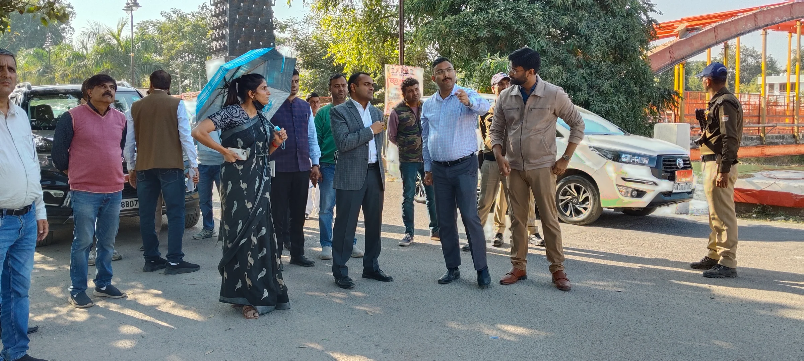
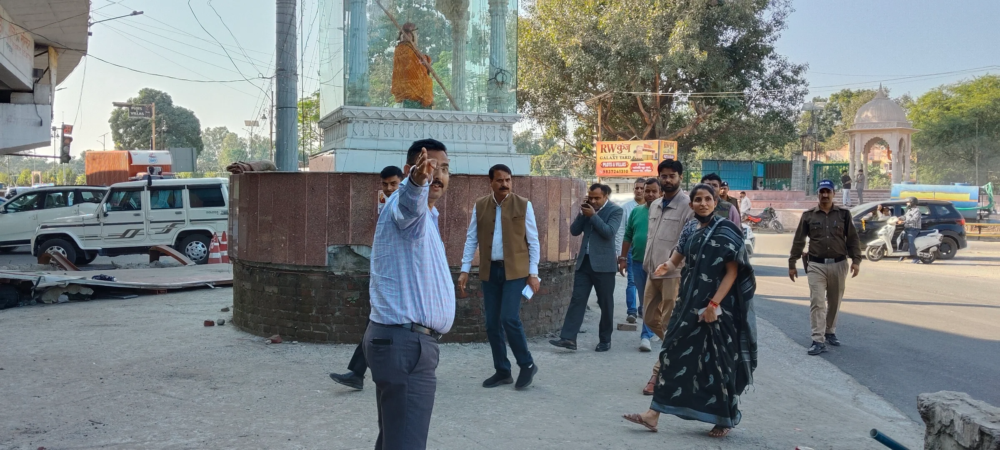
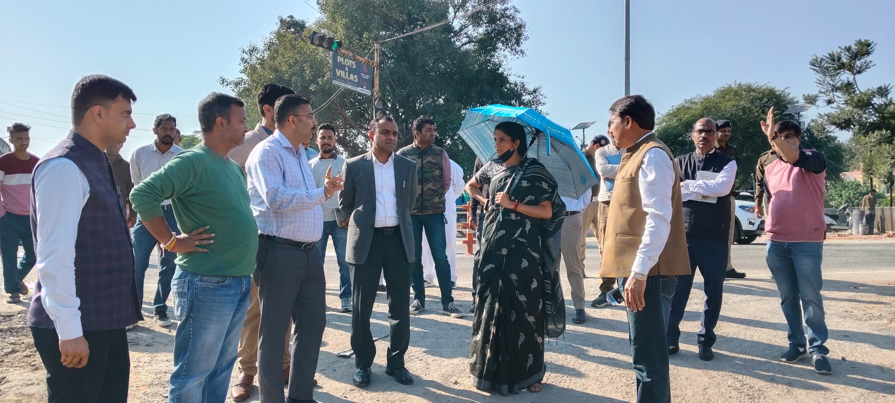
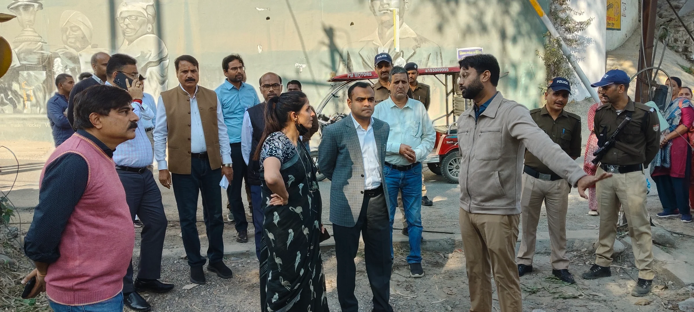

**हरिद्वार विशेष संवाददाता | आसिफ खान

हरिद्वार।** कुंभ-2027 के महाआयोजन से पहले धर्मनगरी हरिद्वार की तस्वीर बदलने की कवायद तेज हो गई है। कुंभ मेले में देश-विदेश से पहुंचने वाले करोड़ों श्रद्धालुओं की सुविधाओं को ध्यान में रखते हुए मेला क्षेत्र में अवस्थापना विकास कार्यों को गति दी जा रही है। सड़क, फुटपाथ, चौराहे, घाट, पुल और यातायात व्यवस्था को बेहतर बनाने के लिए मेला प्रशासन पूरी तरह सक्रिय नजर आ रहा है। इसी कड़ी में मेलाधिकारी श्रीमती सोनिका ने जिलाधिकारी मयूर दीक्षित और वरिष्ठ अधिकारियों के साथ विभिन्न क्षेत्रों का ताबड़तोड़ स्थलीय निरीक्षण कर निर्माण कार्यों की वास्तविक स्थिति परखी और संबंधित विभागों को समयसीमा के भीतर गुणवत्ता के साथ काम पूरा करने के सख्त निर्देश दिए।

**सड़क और फुटपाथ पर अव्यवस्थाओं को लेकर सख्ती**

निरीक्षण के दौरान मेलाधिकारी ने स्पष्ट किया कि कुंभ जैसे विशाल आयोजन में श्रद्धालुओं के आवागमन में किसी भी तरह की बाधा नहीं होनी चाहिए। सड़कों और फुटपाथों पर बाधा बन रहे विद्युत पोलों को तत्काल शिफ्ट करने के निर्देश दिए गए। आइरिस पुल के निकट एडमिन रोड, बैरागी कैंप, एनएच सर्विस लेन और शंकराचार्य चौक मार्ग के जंक्शन का निरीक्षण कर सड़क एवं यातायात व्यवस्था को दुरुस्त करने के साथ आसपास के क्षेत्रों का सौंदर्यीकरण करने को कहा गया।

**घाट, पार्क और चेंजिंग रूम पर विशेष फोकस**

आइरिस पुल और महिला मिलन मंदिर के बीच उपलब्ध भूमि को व्यवस्थित कर पार्क विकसित करने की योजना पर भी जोर दिया गया। यहां श्रद्धालुओं के स्नान की सुविधा के लिए घाट को सुव्यवस्थित करने तथा प्रवेश द्वार के समीप पुराने कमरों को प्रसाधन और चेंजिंग रूम के रूप में विकसित करने के निर्देश दिए गए। साफ है कि कुंभ-2027 में श्रद्धालुओं को बेहतर सुविधाएं उपलब्ध कराने के लिए मेला प्रशासन अब व्यवस्थाओं को धरातल पर उतारने में जुटा है।

**शंकराचार्य चौक और कनखल मार्ग की बदलेगी तस्वीर**

मेलाधिकारी ने आइरिस पुल से शंकराचार्य चौक तक सड़क सुधार कार्य शीघ्र पूरा करने और पूरे क्षेत्र को अतिक्रमणमुक्त बनाए रखने के लिए नियमित निगरानी के निर्देश दिए। शंकराचार्य चौक पर चल रहे सुधार, सौंदर्यीकरण और लैंडस्केपिंग कार्यों की भी समीक्षा की गई। वहीं कनखल मार्ग पर सड़क सुधार और फुटपाथ निर्माण की प्रगति परखते हुए बेतरतीब खड़े विद्युत एवं अन्य पोलों को हटाने के निर्देश दिए गए। डाम कोठी रोड के चौड़ीकरण और आसपास के घाटों के अनुरक्षण कार्यों को भी प्राथमिकता देने को कहा गया।

**पंतद्वीप में सुविधाओं और पैदल पुल पर जोर**

पंतद्वीप क्षेत्र में यूआईआईडीबी की परियोजना के तहत चल रहे निर्माण कार्यों का निरीक्षण करते हुए मेलाधिकारी ने तय समयसीमा में काम पूरा करने के निर्देश दिए। उन्होंने शौचालयों सहित सभी जनसुविधाओं को बेहतर बनाने पर विशेष जोर दिया। साथ ही पंतद्वीप से लालजीवाला तक पैदल आवागमन को सुगम बनाने के लिए राष्ट्रीय राजमार्ग के ऊपर पैदल पुल निर्माण की कार्रवाई तेजी से आगे बढ़ाने की अपेक्षा की।

**बैरागीवाला और दक्षद्वीप में भी विकास कार्यों की पड़ताल**

निरीक्षण के दौरान बैरागीवाला और दक्षद्वीप क्षेत्र में सड़क, बिजली, पेयजल आपूर्ति, पुलों और घाटों के निर्माण एवं मरम्मत कार्यों की भी समीक्षा की गई। मेलाधिकारी ने अधिकारियों को दो टूक निर्देश दिए कि निर्माण कार्यों में गुणवत्ता से कोई समझौता न हो और निर्धारित मानकों के अनुरूप सभी कार्य समय पर पूरे किए जाएं।

कुंभ-2027 की तैयारियों को लेकर मेला प्रशासन की सक्रियता से साफ है कि इस बार हरिद्वार में बुनियादी सुविधाओं को मजबूत करने पर विशेष जोर दिया जा रहा है। हालांकि इन निर्देशों की असली परीक्षा तय समयसीमा में धरातल पर दिखाई देने वाले कार्यों से होगी। श्रद्धालुओं को सुगम यातायात, स्वच्छ घाट और बेहतर जनसुविधाएं उपलब्ध कराना प्रशासन के सामने सबसे बड़ी चुनौती रहेगी।

निरीक्षण में ये अधिकारी रहे मौजूद: जिलाधिकारी मयूर दीक्षित, अपर मेलाधिकारी नंदन कुमार, एचआरडीए सचिव प्रत्यूष सिंह, उप मेलाधिकारी मनजीत सिंह, लोक निर्माण विभाग के अधीक्षण अभियंता डीपी सिंह, अधिशासी अभियंता योगेश कुमार, पीआईयू के अधिशासी अभियंता प्रवीण कुश, यूपीडीसीसी के परियोजना प्रबंधक आशीष भट्ट, एचआरडीए के उद्यान अधिकारी ए.आर. जोशी सहित विभिन्न विभागों के अधिकारी मौजूद रहे।
