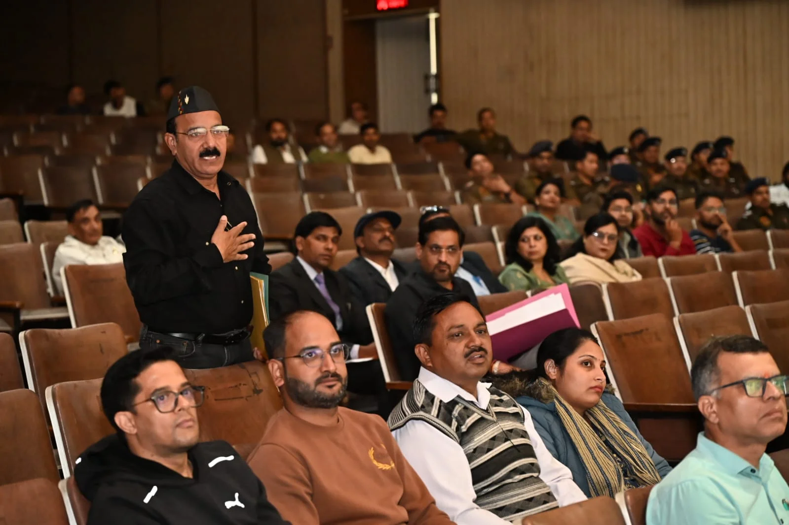
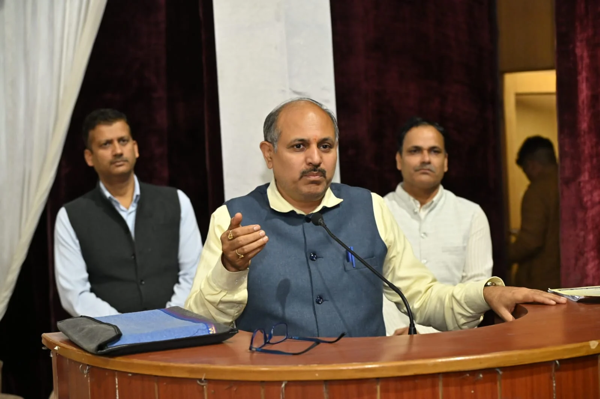
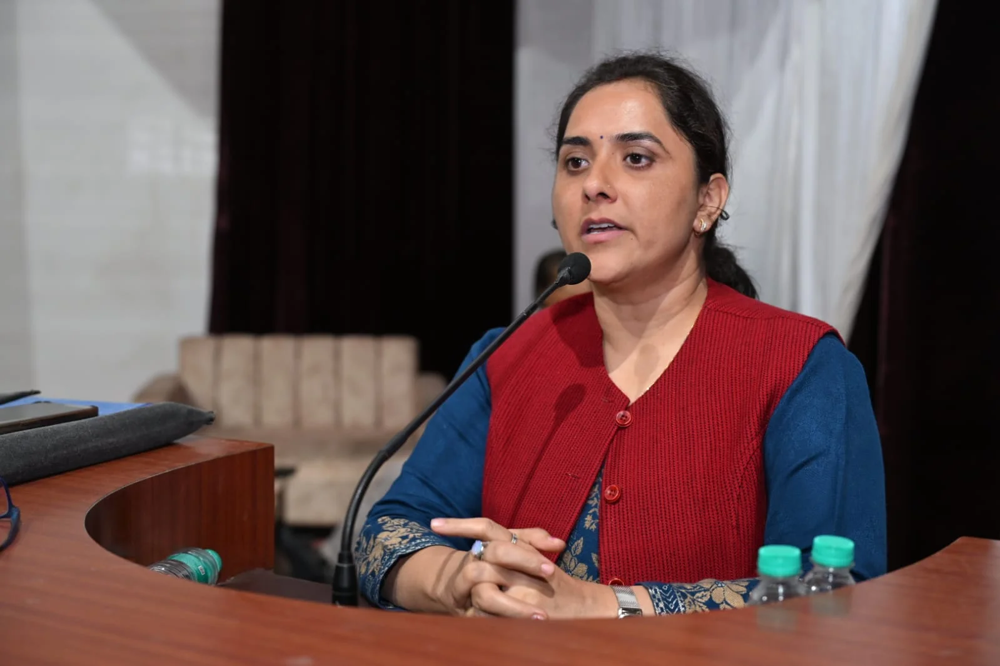
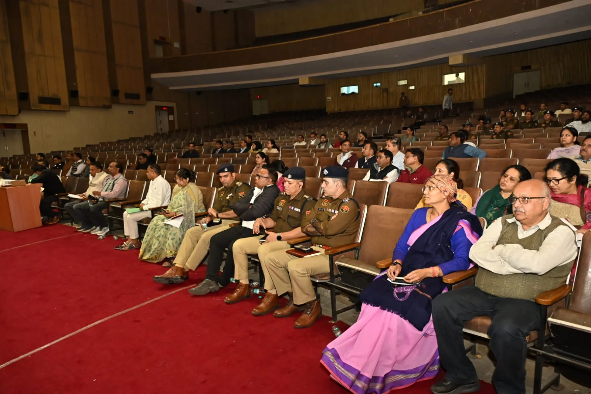

**हरिद्वार संवाददाता | आसिफ खान

हरिद्वार।** विधानसभा सामान्य निर्वाचन-2027 को लेकर जिला प्रशासन ने अभी से तैयारियों का मोर्चा संभाल लिया है। चुनाव के दौरान किसी भी तरह की लापरवाही, अव्यवस्था और सुरक्षा संबंधी चूक की गुंजाइश न रहे, इसके लिए निर्वाचन तंत्र को मजबूत करने की कवायद तेज कर दी गई है। इसी कड़ी में गुरुवार को भेल कन्वेंशन हॉल में जोनल एवं सेक्टर ऑफिसर्स का एकदिवसीय प्रशिक्षण आयोजित किया गया। प्रशिक्षण के दौरान अधिकारियों को निर्वाचन संबंधी जिम्मेदारियों, मतदान केंद्रों की मैपिंग और संवेदनशील एवं अति संवेदनशील क्षेत्रों की पहचान सहित कई महत्वपूर्ण बिंदुओं पर विस्तार से जानकारी दी गई।

भारत निर्वाचन आयोग के दिशा-निर्देशों के अनुपालन में जिलाधिकारी एवं जिला निर्वाचन अधिकारी मयूर दीक्षित के निर्देशन में आयोजित इस प्रशिक्षण का उद्देश्य आगामी विधानसभा चुनाव को निर्विघ्न, निष्पक्ष, शांतिपूर्ण एवं सफलतापूर्वक संपन्न कराने के लिए अधिकारियों को पूरी तरह तैयार करना है।

**क्रिटिकल और वल्नरेबल बूथों की मैपिंग पर विशेष जोर**

प्रशिक्षण में मुख्य फोकस क्रिटिकल एवं वल्नरेबल मैपिंग पर रहा। अधिकारियों को बताया गया कि निर्वाचन के दौरान संवेदनशील और अति संवेदनशील मतदान क्षेत्रों की सही पहचान बेहद जरूरी है। इसके लिए जोनल एवं सेक्टर ऑफिसर्स अपने-अपने आवंटित क्षेत्रों का स्थलीय निरीक्षण करेंगे और मतदान स्थलों की वास्तविक स्थिति का आकलन करेंगे। साथ ही मतदान केंद्रों पर न्यूनतम आवश्यक सुविधाओं की उपलब्धता भी सुनिश्चित कराई जाएगी।

**सीडीओ ने दिए समयबद्धता और जिम्मेदारी से काम करने के निर्देश**

मुख्य विकास अधिकारी डॉ. ललित नारायण मिश्र ने कहा कि निर्वाचन प्रक्रिया को सफलतापूर्वक संपन्न कराने में जोनल एवं सेक्टर ऑफिसर्स की भूमिका बेहद महत्वपूर्ण है। उन्होंने अधिकारियों को निर्देशित किया कि मतदान केंद्रों की मैपिंग सहित सभी निर्वाचन संबंधी कार्य निर्धारित मानकों के अनुरूप समयबद्ध तरीके से पूरे किए जाएं। उन्होंने स्पष्ट किया कि प्रशिक्षण के दौरान किसी भी अधिकारी को समस्या या कठिनाई आती है तो वह मुख्य संदर्भदाता एवं सहायक नोडल प्रशिक्षण से मार्गदर्शन प्राप्त कर सकता है।

**एडीएम ने भी अधिकारियों को कराया जिम्मेदारी का एहसास**

अपर जिलाधिकारी श्रीमती नीतू डागर ने प्रशिक्षण के महत्वपूर्ण बिंदुओं पर प्रकाश डालते हुए अधिकारियों को निर्वाचन संबंधी कार्यों को गंभीरता, सतर्कता और पूरी जिम्मेदारी के साथ संपादित करने की जानकारी दी। उन्होंने निर्वाचन की तैयारियों में प्रत्येक स्तर पर समन्वय बनाए रखने के महत्व पर भी जोर दिया।

**मैदान में उतरकर परखेंगे मतदान केंद्रों की हकीकत**

प्रशिक्षण नोडल एवं कृषि एवं भूमि संरक्षण अधिकारी अमरेंद्र चौधरी ने बताया कि आगामी विधानसभा सामान्य निर्वाचन को देखते हुए क्रिटिकल एवं वल्नरेबल मैपिंग का कार्य अत्यंत महत्वपूर्ण है। इसी उद्देश्य से अधिकारियों को मैपिंग की प्रक्रिया और उससे जुड़े विभिन्न तकनीकी एवं व्यावहारिक पहलुओं की जानकारी दी गई। अब अधिकारी अपने आवंटित क्षेत्रों में मतदान स्थलों का स्थलीय निरीक्षण कर वहां उपलब्ध न्यूनतम आवश्यक सुविधाओं का जायजा लेंगे।

**पहले सत्र के बाद शेष अधिकारियों को भी किया गया प्रशिक्षित**

सहायक नोडल प्रशिक्षण डॉ. संतोष कुमार चमोला ने बताया कि जोनल एवं सेक्टर ऑफिसर्स के प्रशिक्षण का प्रथम सत्र 16 नवंबर 2026 को आयोजित किया जा चुका है। इसी क्रम में गुरुवार को शेष एवं नए नामित अधिकारियों को प्रशिक्षण दिया गया, ताकि चुनाव के दौरान प्रत्येक अधिकारी अपनी जिम्मेदारियों का प्रभावी ढंग से निर्वहन कर सके।

प्रशिक्षण कार्यक्रम में संतोष रावत, विजय सिंह नेगी सहित जिला निर्वाचन कार्यालय के कार्मिक एवं संबंधित अधिकारी उपस्थित रहे।

**चुनावी तैयारियों का संदेश साफ: मतदान से पहले हर बूथ की व्यवस्था पर प्रशासन की नजर रहेगी।**
