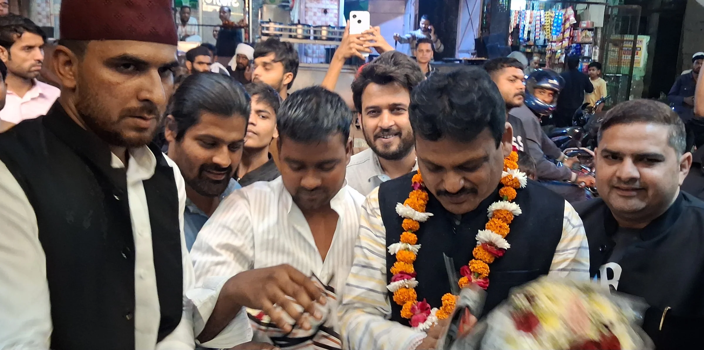
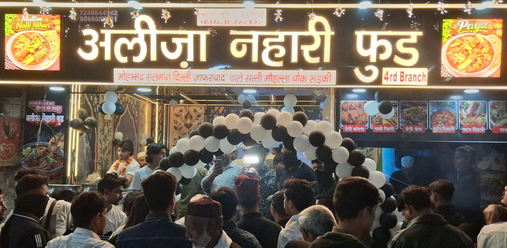

**रूडकी संवाददाता | आसिफ खान

रुड़की (हरिद्वार)।** रुड़की के खानपान के शौकीनों के लिए बड़ी खुशखबरी है। दिल्ली के जाफराबाद के मशहूर जायके की पहचान बन चुके अलीजा नहारी फूड ने अब रुड़की में भी अपने स्वाद का जलवा बिखेरना शुरू कर दिया है। नगर के सत्ती मोहल्ले में बादशाह चौक के समीप अलीजा नहारी फूड की चौथी ब्रांच का भव्य शुभारंभ किया गया। प्रतिष्ठान का उद्घाटन वरिष्ठ कांग्रेस नेता सचिन गुप्ता ने फीता काटकर किया। उद्घाटन के साथ ही यहां ग्राहकों की ऐसी भीड़ उमड़ी कि प्रतिष्ठान पर दिनभर चहल-पहल का माहौल बना रहा।

उद्घाटन समारोह में प्रतिष्ठान के ऑनर फैसल कुरैशी और सलमान अंसारी ने वरिष्ठ कांग्रेस नेता सचिन गुप्ता का बुके भेंट कर जोरदार स्वागत किया। सचिन गुप्ता ने प्रतिष्ठान का विधिवत शुभारंभ करते हुए संचालकों को नई शुरुआत की बधाई दी और उनके कारोबार की तरक्की की कामना की।

**मुफ्त भोजन की घोषणा, पहले ही दिन ग्राहकों की उमड़ी भीड़**

उद्घाटन के खास मौके पर ऑनर फैसल कुरैशी और सलमान अंसारी की ओर से लोगों के लिए मुफ्त भोजन की व्यवस्था की गई। जैसे ही इस पहल की जानकारी लोगों तक पहुंची, बड़ी संख्या में लोग अलीजा नहारी फूड पहुंचने लगे। देखते ही देखते प्रतिष्ठान पर ग्राहकों की भारी भीड़ जमा हो गई। लोगों ने यहां के लजीज व्यंजनों का स्वाद चखा और जायके की जमकर तारीफ की।

**दिल्ली से पहुंचे मशहूर यूट्यूबर, सोशल मीडिया पर भी छाया उद्घाटन**

इस भव्य शुभारंभ में नगर की कई प्रमुख हस्तियों के साथ दिल्ली से पहुंचे मशहूर यूट्यूबर और सोशल मीडिया इंफ्लुएंसर भी शामिल हुए। उन्होंने प्रतिष्ठान के खास व्यंजनों का स्वाद लिया, वीडियो बनाए और सोशल मीडिया के माध्यम से लोगों को अलीजा नहारी फूड पहुंचकर यहां के जायके का अनुभव लेने की अपील की। इससे उद्घाटन समारोह और भी खास बन गया।

**दिल्ली के जाफराबाद का मशहूर स्वाद अब रुड़की में**

प्रतिष्ठान के ऑनर सलमान अंसारी ने बताया कि उनकी लंबे समय से इच्छा थी कि दिल्ली के जाफराबाद का मशहूर स्वाद रुड़की के लोगों तक पहुंचाया जाए। सोशल मीडिया पर भी लगातार लोग रुड़की में अलीजा नहारी फूड की ब्रांच खोलने की मांग कर रहे थे। इसी मांग और लोगों के प्यार को देखते हुए रुड़की में चौथी शाखा शुरू की गई है। इससे पहले दिल्ली में दो और बुलंदशहर में एक ब्रांच संचालित है।

उन्होंने बताया कि प्रतिष्ठान में ग्राहकों को निहारी, बकरे का कोरमा, बकरे की चाप, बकरे की रान और बटेर का शोरमा समेत कई खास व्यंजनों का स्वाद मिलेगा। परिवार के साथ आने वाले ग्राहकों के लिए बैठने की विशेष व्यवस्था भी की गई है।

**किफायती कीमतों पर बेहतरीन स्वाद देना प्राथमिकता : फैसल कुरैशी**

ऑनर फैसल कुरैशी ने कहा कि उनका उद्देश्य ग्राहकों को बेहतरीन गुणवत्ता, शानदार स्वाद और किफायती कीमतों पर लजीज व्यंजन उपलब्ध कराना है। उन्होंने विश्वास जताया कि रुड़की के लोगों का प्यार और सहयोग प्रतिष्ठान को नई पहचान दिलाएगा।

वहीं वरिष्ठ कांग्रेस नेता सचिन गुप्ता ने फैसल कुरैशी और सलमान अंसारी को बधाई देते हुए कहा कि नए प्रतिष्ठान के खुलने से रुड़की के लोगों को उम्दा भोजन का एक और विकल्प मिलेगा। उन्होंने उम्मीद जताई कि यह कारोबार निरंतर तरक्की करेगा और शहर में अपनी अलग पहचान बनाएगा।

इस अवसर पर युवा कांग्रेस नेता प्रणय प्रताप सिंह, युवा समाजसेवी शेख जमाल अहमद, साजिद अंसारी, जावेद अली, मोहम्मद जुनैद, हाजी इनाम सहित अनेक गणमान्य लोग मौजूद रहे।
