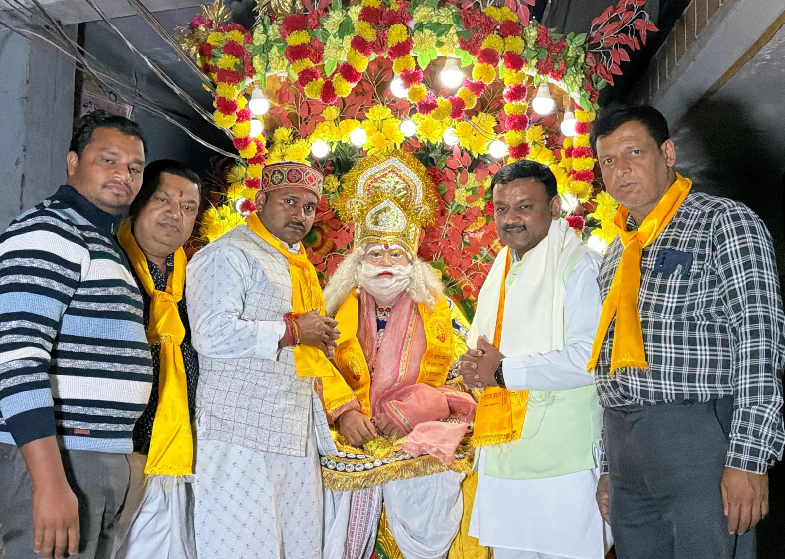
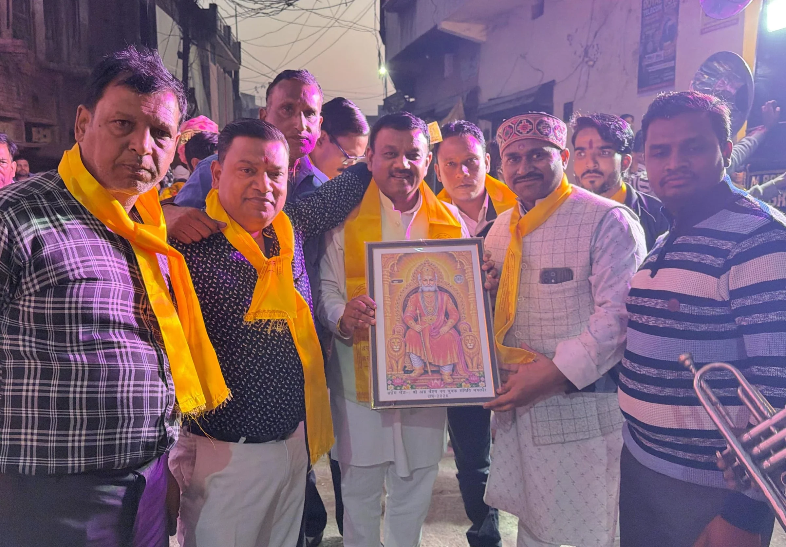

**रूडकी संवाददाता | आसिफ खान 

रुड़की/मंगलौर।** महाराजा श्री अग्रसेन जी महाराज के आदर्शों, सामाजिक एकता और भाईचारे का संदेश लेकर मंगलौर में 44वीं भव्य शोभायात्रा बड़े ही धूमधाम और हर्षोल्लास के साथ निकाली गई। श्री अग्र वैश्य नवयुवक समिति, मंगलौर के तत्वावधान में आयोजित इस शोभायात्रा में श्रद्धा, उत्साह और सामाजिक एकजुटता का अद्भुत संगम देखने को मिला। आकर्षक झांकियों और धार्मिक जयकारों से पूरा कस्बा भक्तिमय माहौल में सराबोर नजर आया।

शोभायात्रा का शुभारंभ पूर्व मेयर गौरव गोयल ने किया। इस अवसर पर उन्होंने महाराजा श्री अग्रसेन जी महाराज को नमन करते हुए कहा कि महाराजा अग्रसेन जी ने समाज को एक सूत्र में पिरोने और समानता, सहयोग एवं भाईचारे की भावना को मजबूत करने का ऐतिहासिक कार्य किया। उनके सामाजिक योगदान और राष्ट्र निर्माण में दिए गए सहयोग को कभी भुलाया नहीं जा सकता।

उन्होंने कहा कि वर्तमान समय में आवश्यकता है कि हम महाराजा अग्रसेन जी के दिखाए मार्ग पर चलें और समाज की भलाई के साथ-साथ राष्ट्र निर्माण में अपनी सक्रिय भागीदारी सुनिश्चित करें। उनके आदर्श आज भी समाज को एकजुटता और सेवा का संदेश देते हैं।

शोभायात्रा में शामिल मनमोहक एवं आकर्षक झांकियां लोगों के आकर्षण का प्रमुख केंद्र रहीं। कस्बे के विभिन्न मार्गों से गुजरती हुई शोभायात्रा जब प्रमुख बाजारों और मोहल्लों से निकली तो जगह-जगह श्रद्धालुओं ने पुष्पवर्षा कर उसका भव्य स्वागत किया। पूरे मार्ग में उत्साह और उल्लास का माहौल बना रहा। शोभायात्रा का समापन हनुमान चौक पर हुआ।

इस दौरान श्री अग्र वैश्य नवयुवक समिति के अध्यक्ष रूपक सिंघल सहित समिति के पदाधिकारियों ने पूर्व मेयर गौरव गोयल का सम्मान किया। आयोजन में समाज के लोगों की सक्रिय भागीदारी ने कार्यक्रम को यादगार बना दिया।

इस अवसर पर अवनीश गर्ग, गौरव गुप्ता, शोभित सिंघल, अरविंद गोयल, शोभित माहवार, अमित सिंघल, हिमांशु तायल, मोहित मित्तल, मनोज सिंघल, मोहित सिंघल, शुभम तायल, राहुल तायल, नरेश चोपड़ा, रामकुमार कपूर एवं अतुल माहेश्वरी सहित बड़ी संख्या में गणमान्य लोग मौजूद रहे।
