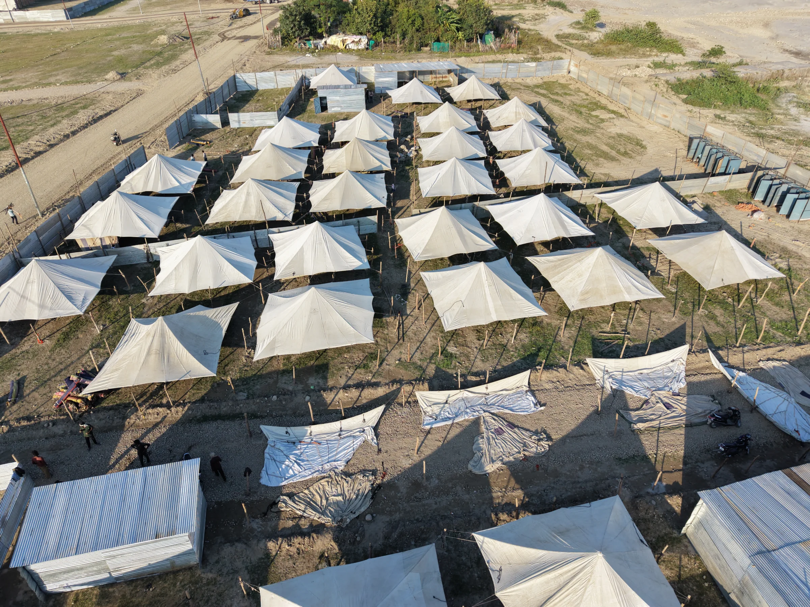
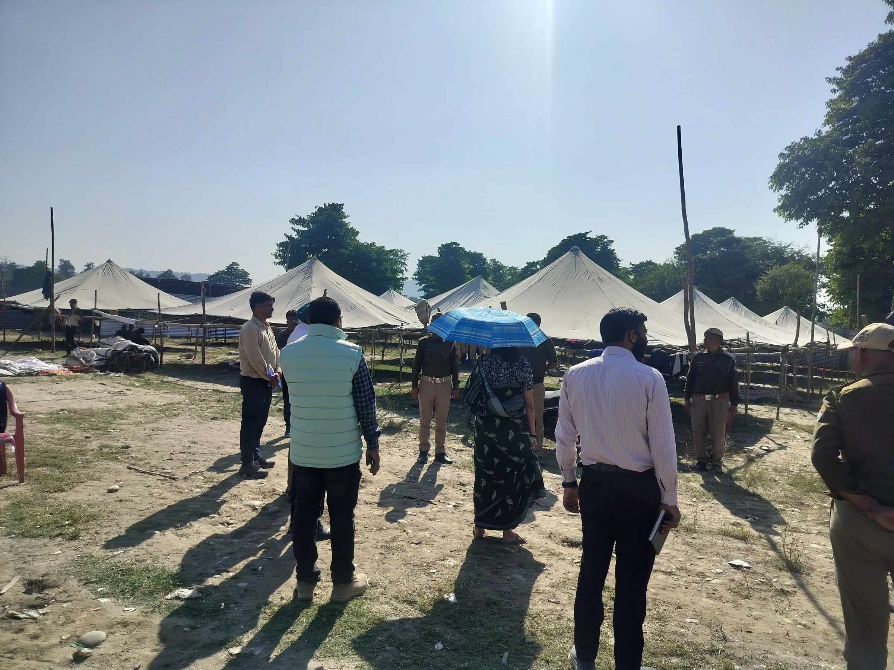
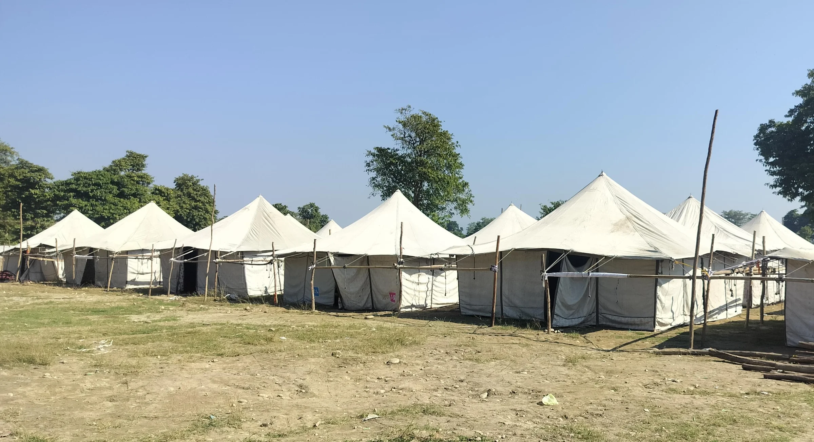

**हरिद्वार संवाददाता | आसिफ खान

हरिद्वार।** गंगा के पावन तटों पर अब कुंभ-2027 की तैयारियां धरातल पर आकार लेने लगी हैं। कुंभ के विशाल आयोजन को व्यवस्थित बनाने के लिए हरिद्वार में अस्थायी कुंभ नगरी बसाने का काम शुरू हो चुका है। पंतद्वीप, बैरागी कैंप, गौरीशंकर और दक्षद्वीप में टेंटों की स्थापना शुरू होने के साथ ही मेला क्षेत्र में कुंभ की तैयारियों ने रफ्तार पकड़ ली है। पांच हजार से अधिक टेंट लगाने की प्रस्तावित योजना इस बात का संकेत है कि आगामी कुंभ के लिए व्यवस्थाओं का दायरा कितना व्यापक होने जा रहा है।

कुंभ के दौरान केवल श्रद्धालुओं, साधु-संतों और अखाड़ों की व्यवस्थाएं ही चुनौती नहीं होंगी, बल्कि आयोजन को सफल बनाने में जुटने वाले हजारों अधिकारियों और कर्मचारियों के लिए भी विशाल आवासीय एवं कार्यालयी व्यवस्था तैयार करनी होगी। इसी को ध्यान में रखते हुए पुलिस, प्रशासन और विभिन्न विभागों के करीब 30 से 35 हजार कार्मिकों की तैनाती के अनुरूप अलग-अलग सेक्टरों में अस्थायी शिविर विकसित किए जा रहे हैं।

**पांच हजार टेंटों से सजेगी अस्थायी नगरी**

मेला क्षेत्र में इस बार पारंपरिक और आधुनिक सुविधाओं से युक्त टेंटों का व्यापक इंतजाम प्रस्तावित है। स्विस कॉटेज, ईपी टेंट, फैमिली टेंट, छोलदारी, दरबारी, महाराजा और पगोडा टेंट के साथ जर्मन हैंगर भी स्थापित किए जाएंगे। इन टेंटों में कार्मिकों के ठहरने के साथ-साथ विभागीय कार्यालयों और जरूरी कार्यों के लिए भी स्थान उपलब्ध कराया जाएगा। यानी गंगा तटों पर बसने वाली यह अस्थायी नगरी केवल आवासीय शिविरों तक सीमित नहीं रहेगी, बल्कि कुंभ की प्रशासनिक गतिविधियों का भी प्रमुख केंद्र बनेगी।

**मेलाधिकारी सोनिका ने परखी तैयारियां, गुणवत्ता से समझौता नहीं करने के निर्देश**

गुरुवार को मेलाधिकारी श्रीमती सोनिका ने बैरागी कैंप, पंतद्वीप और दक्षद्वीप पहुंचकर टेंट स्थापना और शिविरों से जुड़ी व्यवस्थाओं का स्थलीय निरीक्षण किया। उन्होंने निर्माण एवं स्थापना कार्यों की प्रगति का जायजा लेते हुए प्रस्तावित आवासीय सुविधाओं और आधारभूत व्यवस्थाओं की पड़ताल की।

मेलाधिकारी ने अधिकारियों को स्पष्ट निर्देश दिए कि टेंटों की गुणवत्ता में किसी भी प्रकार की लापरवाही बर्दाश्त नहीं की जाएगी। यहां रहने वाले कार्मिकों को सुरक्षित, स्वच्छ और सुविधाजनक आवास उपलब्ध कराना प्राथमिकता होनी चाहिए। उन्होंने कहा कि सभी व्यवस्थाएं समय रहते पूरी की जाएं, ताकि कुंभ के दौरान किसी प्रकार की अव्यवस्था सामने न आए।

**सड़क, बिजली, पानी और शौचालय की व्यवस्था पर भी सख्ती**

निरीक्षण के दौरान मेलाधिकारी ने शिविर स्थलों तक सुगम आवागमन के लिए सड़क व्यवस्था दुरुस्त रखने, निर्बाध विद्युत आपूर्ति, स्वच्छ पेयजल, पर्याप्त शौचालय और नियमित सफाई सुनिश्चित करने के निर्देश दिए। उन्होंने स्पष्ट किया कि टेंट लगाने के साथ ही इन मूलभूत सुविधाओं को भी विकसित किया जाए। कार्मिकों के मेला क्षेत्र में पहुंचने से पहले सभी व्यवस्थाएं पूरी तरह तैयार रहनी चाहिए।

**अखाड़ों और आश्रमों के शिविर भी बसने को तैयार**

एक ओर विभागीय कार्मिकों के लिए टेंट सिटी तैयार हो रही है, वहीं दूसरी ओर अखाड़ों, आश्रमों और विभिन्न धार्मिक एवं सामाजिक संस्थाओं के लिए आवंटित भूमि पर भी शिविर स्थापना की तैयारियां तेज हो रही हैं। आने वाले महीनों में इन शिविरों के स्थापित होने के साथ ही गंगा तटों पर कुंभ का पारंपरिक, धार्मिक और आध्यात्मिक स्वरूप दिखाई देने लगेगा।

**निरीक्षण के दौरान उप मेलाधिकारी श्री मनजीत सिंह सहित संबंधित अधिकारी मौजूद रहे।**

कुल मिलाकर, कुंभ-2027 की अस्थायी नगरी अब कागजी योजनाओं से निकलकर जमीन पर उतरने लगी है। पांच हजार से अधिक टेंटों की प्रस्तावित स्थापना और हजारों कार्मिकों के लिए आवासीय एवं कार्यालयी इंतजाम इस महाआयोजन की व्यापक तैयारियों की तस्वीर पेश कर रहे हैं। अब निगाहें इस बात पर रहेंगी कि निर्धारित समयसीमा में इन शिविरों के साथ बिजली, पानी, सड़क और स्वच्छता जैसी सुविधाएं कितनी प्रभावी ढंग से पूरी होती हैं।
