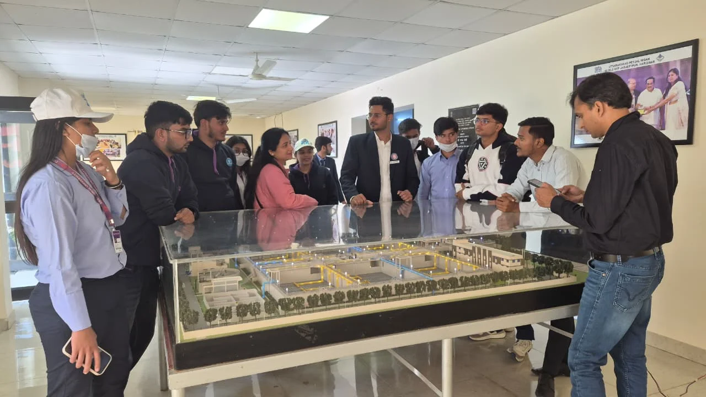
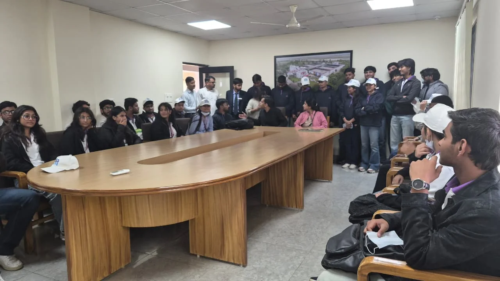
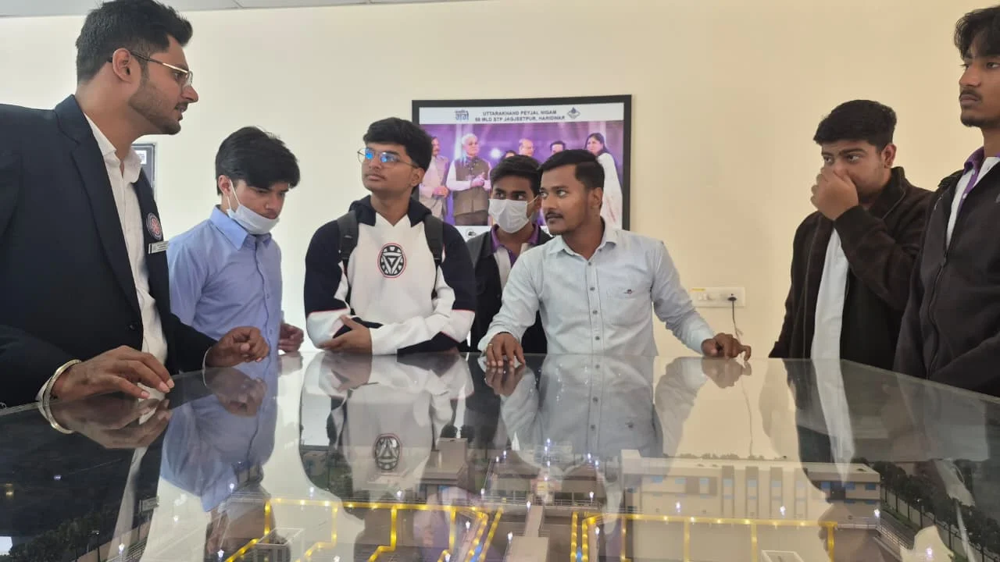

**हरिद्वार संवाददाता | आसिफ खान

हरिद्वार।** गंगा को प्रदूषण मुक्त बनाने की मुहिम केवल सरकारी योजनाओं और दावों तक सीमित नहीं, बल्कि इसके पीछे आधुनिक तकनीक और जमीनी स्तर पर हो रही मेहनत की भी अहम भूमिका है। इसी व्यवस्था को करीब से समझने के लिए डीबीएस ग्लोबल यूनिवर्सिटी, देहरादून के विद्यार्थियों ने हरिद्वार के जगजीतपुर स्थित नमामि गंगे परियोजना के तहत निर्मित 68 एमएलडी सीवेज ट्रीटमेंट प्लांट (एसटीपी) का शैक्षिक भ्रमण किया। यहां विद्यार्थियों ने देखा कि शहरों से निकलने वाला दूषित पानी किस तरह वैज्ञानिक प्रक्रियाओं से गुजरकर शोधित किया जाता है और किस प्रकार गंगा में प्रदूषण का बोझ कम करने के प्रयास किए जा रहे हैं।

भ्रमण के दौरान विद्यार्थियों को एसटीपी की आधुनिक तकनीक, विभिन्न शोधन इकाइयों और सीवेज प्रबंधन की पूरी प्रक्रिया की विस्तार से जानकारी दी गई। उन्हें बताया गया कि घरों और आवासीय क्षेत्रों से निकलने वाले गंदे पानी में मौजूद ठोस अपशिष्ट, हानिकारक तत्वों और प्रदूषकों को अलग-अलग चरणों में हटाकर निर्धारित मानकों के अनुरूप उपचारित किया जाता है। इसका मुख्य उद्देश्य बिना शोधन के दूषित पानी को गंगा और अन्य जल स्रोतों में पहुंचने से रोकना है।

**महिला सशक्तीकरण की मिसाल बना पिंक एसटीपी**

इस 68 एमएलडी सीवेज ट्रीटमेंट प्लांट की सबसे खास पहचान इसका पिंक एसटीपी होना है। यहां दिन के समय कार्यरत समस्त कर्मचारी महिलाएं हैं। परियोजना प्रबंधक इंजीनियर मीनाक्षी मित्तल के नेतृत्व में संचालित यह व्यवस्था महिला सशक्तीकरण और आत्मनिर्भरता की दिशा में एक उल्लेखनीय पहल के रूप में सामने आई है। विद्यार्थियों ने इस अनूठी व्यवस्था के बारे में भी जानकारी प्राप्त की और जाना कि तकनीकी क्षेत्र में महिलाएं किस तरह जिम्मेदारी और दक्षता के साथ अपनी भूमिका निभा रही हैं।

**किताबी ज्ञान से आगे बढ़कर समझी पर्यावरण संरक्षण की हकीकत**

शैक्षिक भ्रमण के दौरान विद्यार्थियों ने एसटीपी की विभिन्न तकनीकी इकाइयों को नजदीक से देखा और जल शोधन की प्रक्रियाओं को व्यावहारिक रूप में समझा। उन्होंने जाना कि तेजी से बढ़ते शहरीकरण और जनसंख्या के बीच जल प्रदूषण एक बड़ी चुनौती बनता जा रहा है। ऐसे में एसटीपी का प्रभावी संचालन गंगा की स्वच्छता, जल संसाधनों के संरक्षण और पर्यावरणीय संतुलन के लिए बेहद जरूरी है।

जिला परियोजना अधिकारी सत्यदेव आर्य ने बताया कि इस शैक्षिक भ्रमण का उद्देश्य विद्यार्थियों को पर्यावरण संरक्षण, जल प्रबंधन और आधुनिक तकनीकों की वास्तविक जानकारी उपलब्ध कराना है। उन्होंने कहा कि कक्षा में मिलने वाले सैद्धांतिक ज्ञान को जब विद्यार्थी धरातल पर देखते हैं तो उनकी समझ और अनुभव दोनों मजबूत होते हैं।

उन्होंने बताया कि इस तरह के शैक्षिक भ्रमण विद्यार्थियों को केवल तकनीकी जानकारी ही नहीं देते, बल्कि उन्हें जल संरक्षण, स्वच्छता और प्राकृतिक संसाधनों के प्रति अपनी जिम्मेदारी समझने के लिए भी प्रेरित करते हैं।

इस अवसर पर प्लांट इंचार्ज संदीप, सचिन कुमार, अंजली तथा डीबीएस ग्लोबल यूनिवर्सिटी की ओर से शैलजा भंडारी सहित विश्वविद्यालय के विद्यार्थी मौजूद रहे।
