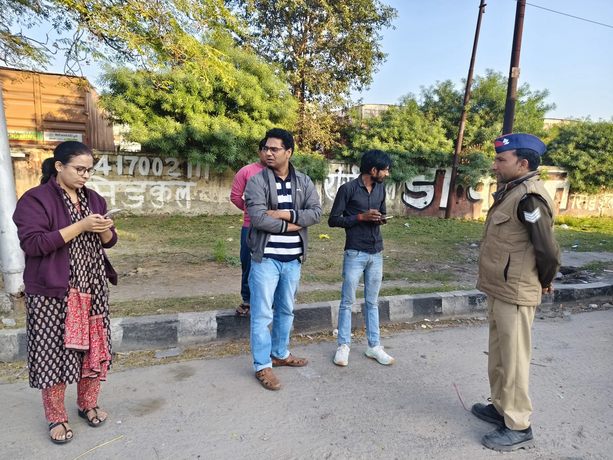
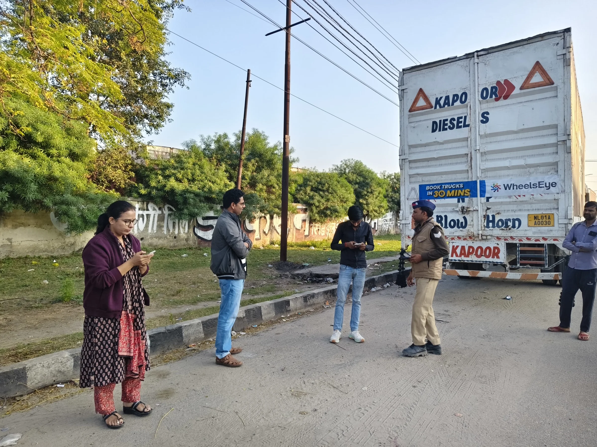

**हरिद्वार संवाददाता | आसिफ खान

हरिद्वार।** सिडकुल की सड़कों को अपनी निजी पार्किंग समझकर भारी वाहन खड़े करने वालों पर आखिरकार परिवहन विभाग का डंडा चल गया। अवैध पार्किंग के कारण बाधित हो रहे यातायात और लगातार बढ़ते दुर्घटना के खतरे को देखते हुए परिवहन विभाग ने विशेष चेकिंग अभियान चलाकर लापरवाह वाहन चालकों के खिलाफ बड़ी कार्रवाई की है। अभियान के दौरान सड़क पर बेतरतीब तरीके से खड़े मिले 45 भारी वाहनों के चालान काटे गए और उन्हें ब्लैकलिस्ट करने की कार्रवाई भी की गई।

जिलाधिकारी मयूर दीक्षित के निर्देशों पर एआरटीओ (प्रशासन) निखिल शर्मा एवं एआरटीओ (प्रवर्तन) नेहा झा के नेतृत्व में परिवहन विभाग की संयुक्त टीम ने सिडकुल क्षेत्र में विशेष अभियान चलाया। चेकिंग के दौरान सड़क किनारे और यातायात मार्गों पर अवैध रूप से खड़े भारी वाहनों को निशाने पर लिया गया। अधिकारियों की इस कार्रवाई से नियमों को ताक पर रखकर वाहन खड़े करने वाले चालकों और वाहन स्वामियों में हड़कंप मच गया।

सिडकुल जैसे औद्योगिक क्षेत्र में रोजाना हजारों वाहनों और आम नागरिकों की आवाजाही रहती है। इसके बावजूद भारी वाहनों की मनमानी पार्किंग से सड़कों पर यातायात व्यवस्था प्रभावित होती है। कई स्थानों पर सड़कें वाहनों की पार्किंग का अघोषित अड्डा बन जाती हैं, जिससे राहगीरों और अन्य वाहन चालकों को परेशानी का सामना करना पड़ता है। इतना ही नहीं, बेतरतीब खड़े भारी वाहन कभी भी बड़े सड़क हादसे का कारण बन सकते हैं।

परिवहन विभाग ने इस बार केवल चालान काटकर औपचारिकता पूरी नहीं की, बल्कि वाहनों को ब्लैकलिस्ट करने की कार्रवाई भी की है। अधिकारियों के मुताबिक, ब्लैकलिस्ट प्रविष्टि प्रभावी रहने पर लागू नियमों और पोर्टल व्यवस्था के अनुसार वाहनों की फिटनेस सहित अन्य विभागीय सेवाएं प्रभावित हो सकती हैं।

अधिकारियों ने वाहन चालकों और ट्रांसपोर्टरों को स्पष्ट निर्देश दिए हैं कि भारी वाहनों को केवल निर्धारित अथवा अधिकृत पार्किंग स्थलों पर ही खड़ा किया जाए। औद्योगिक प्रतिष्ठानों को भी अपने यहां आने वाले वाहनों की पार्किंग व्यवस्था दुरुस्त रखने की जिम्मेदारी निभानी होगी।

परिवहन विभाग ने साफ कर दिया है कि सिडकुल में अवैध पार्किंग को किसी भी कीमत पर बर्दाश्त नहीं किया जाएगा। अभियान आगे भी जारी रहेगा और नियमों का उल्लंघन करने वालों के खिलाफ नियमानुसार सख्त कार्रवाई की जाएगी।

अब सवाल यह है कि क्या इस कार्रवाई के बाद सिडकुल की सड़कों से अवैध पार्किंग का कब्जा हटेगा या फिर कुछ दिन बाद दोबारा वही मनमानी शुरू हो जाएगी?
