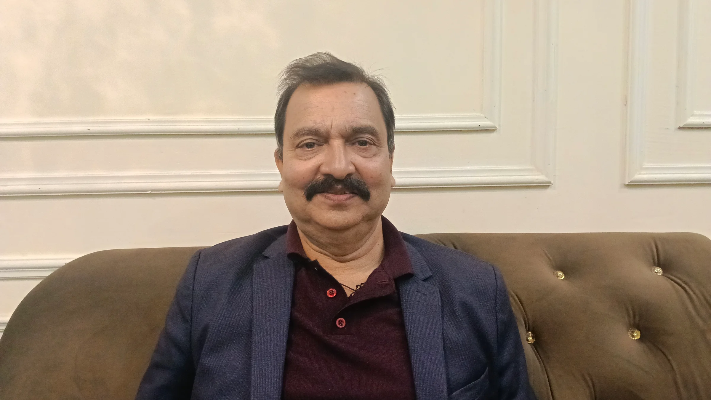
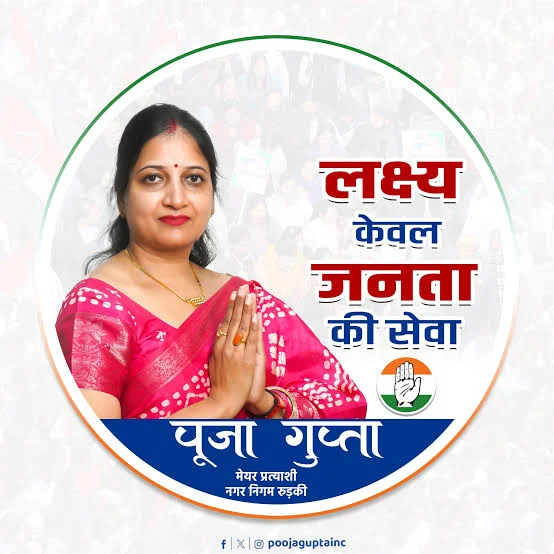
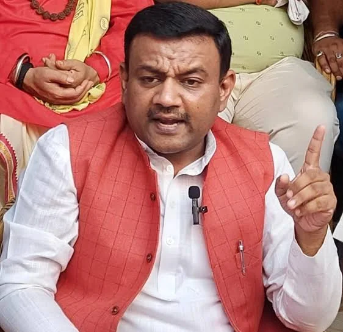
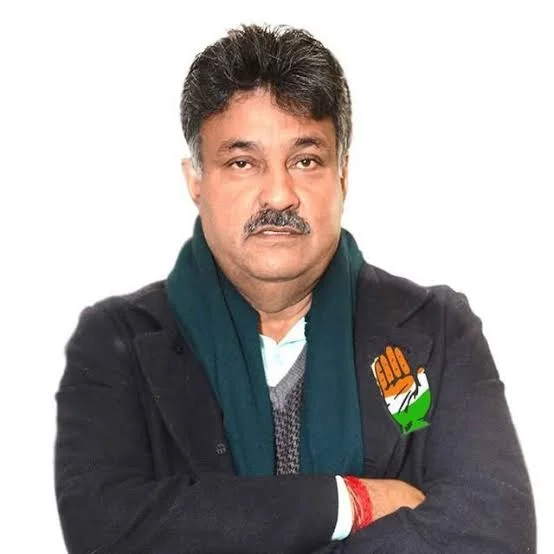

**रूडकी विशेष संवाददाता | आसिफ खान 

रुड़की।** विधानसभा चुनाव 2027 की आहट के साथ ही रुड़की विधानसभा क्षेत्र संख्या-31 में कांग्रेस के टिकट को लेकर राजनीतिक हलचल तेज होने लगी है। कांग्रेस के टिकट पर दावेदारी को लेकर कई चेहरे सामने आ रहे हैं, लेकिन वरिष्ठ कांग्रेस नेता प्रमुख गर्ग ने अपनी लंबी राजनीतिक पारी, संगठनात्मक अनुभव और परिवार की पुरानी कांग्रेसी विरासत के साथ अपनी दावेदारी पेश कर राजनीतिक चर्चाओं को नया मोड़ दे दिया है।

रुड़की की सियासत में इस बार कांग्रेस के टिकट का फैसला आसान नहीं रहने वाला। एक तरफ वर्षों से संगठन में जिम्मेदारियां निभाने वाले प्रमुख गर्ग हैं, तो दूसरी तरफ पूर्व मेयर प्रत्याशी पूजा गुप्ता, पूर्व मेयर गौरव गोयल और पूर्व मेयर यशपाल राणा जैसे नाम भी राजनीतिक चर्चा में हैं। इन चेहरों का राजनीतिक सफर और पिछला चुनावी एवं प्रशासनिक रिकॉर्ड भी संभावित दावेदारों की चर्चा का हिस्सा बनता दिखाई दे रहा है।

**पहली दावेदारी: प्रमुख गर्ग, कांग्रेस से पीढ़ियों पुराना रिश्ता और संगठन में लंबा अनुभव**

प्रमुख गर्ग की दावेदारी का सबसे अहम पहलू उनका कांग्रेस के साथ दशकों पुराना जुड़ाव है। उनका कहना है कि उनका परिवार पीढ़ियों से कांग्रेस से जुड़ा रहा है और वह स्वयं जन्म से लेकर आज तक कांग्रेस की विचारधारा और संगठन के साथ खड़े रहे हैं।

छात्र राजनीति से अपने राजनीतिक सफर की शुरुआत करने वाले प्रमुख गर्ग लंबे समय तक कांग्रेस के छात्र संगठन के अध्यक्ष रहे। इसके बाद उन्होंने कांग्रेस इंटक के अध्यक्ष की जिम्मेदारी भी संभाली। वर्तमान में वह अग्रवाल समाज के प्रदेश अध्यक्ष हैं और उत्तराखंड प्रदेश कांग्रेस कमेटी में PCC सदस्य के रूप में भी अपनी भूमिका निभा रहे हैं।

उनकी दावेदारी का आधार केवल राजनीतिक पदों की सूची नहीं, बल्कि संगठन में वर्षों तक निभाई गई जिम्मेदारियां, पारिवारिक कांग्रेसी पृष्ठभूमि और सामाजिक क्षेत्र में सक्रियता भी है। साफ छवि, सरल स्वभाव और आम लोगों से सीधे जुड़ाव को वह अपनी सार्वजनिक पहचान का महत्वपूर्ण हिस्सा बताते हैं।

प्रमुख गर्ग का राजनीतिक संदेश स्पष्ट है कि कांग्रेस के साथ उनका रिश्ता चुनावी मौसम का नहीं, बल्कि वर्षों की राजनीतिक और पारिवारिक निष्ठा का है। ऐसे में उनकी दावेदारी को लेकर कांग्रेस के अंदर संगठनात्मक अनुभव और पुराने कार्यकर्ताओं के सम्मान का सवाल भी चर्चा में आ सकता है।

**दूसरी दावेदारी: पूजा गुप्ता, निकाय चुनाव की हार के बाद विधानसभा की चर्चा**

पूर्व मेयर प्रत्याशी पूजा गुप्ता का नाम भी रुड़की की राजनीतिक चर्चाओं में शामिल है। वर्ष 2025 के नगर निकाय चुनाव में कांग्रेस ने उन्हें मेयर पद का प्रत्याशी बनाया था, लेकिन चुनाव परिणाम उनके पक्ष में नहीं रहा। निर्दलीय प्रत्याशी श्रेष्ठा राणा को 32,157 वोट मिले, जबकि कांग्रेस प्रत्याशी पूजा गुप्ता को 18,417 वोटों से संतोष करना पड़ा। इस चुनाव में कांग्रेस को हार का सामना करना पड़ा था।

अब विधानसभा चुनाव 2027 को लेकर उनका नाम संभावित राजनीतिक चेहरों के बीच लिया जा रहा है। ऐसे में सवाल यह भी है कि पिछले निकाय चुनाव के नतीजों से पार्टी क्या राजनीतिक सबक लेती है और आगामी विधानसभा चुनाव में प्रत्याशी चयन के लिए किन मानकों को प्राथमिकता देती है।

**तीसरी दावेदारी: गौरव गोयल, विवादों के बीच कार्यकाल पूरा होने से पहले छोड़ी थी मेयर की कुर्सी**

पूर्व मेयर गौरव गोयल का नाम भी रुड़की की राजनीति में महत्वपूर्ण माना जाता है, लेकिन उनके मेयर कार्यकाल का अंत विवादों और इस्तीफे के साथ हुआ था। वर्ष 2019 में निर्दलीय प्रत्याशी के रूप में मेयर बने गौरव गोयल ने जुलाई 2023 में अपना इस्तीफा शासन को सौंप दिया था। उनका कार्यकाल पांच वर्ष पूरा होने से पहले ही समाप्त हो गया।

उस समय नगर निगम में मेयर और पार्षदों के बीच लगातार खींचतान, बोर्ड बैठकों में हंगामे और अधिकारियों एवं कर्मचारियों के साथ विवादों की खबरें सामने आती रही थीं। आखिरकार लंबे समय से चल रहे विवादों के बीच उन्होंने पद छोड़ दिया। गौरव गोयल ने अपने इस्तीफे के बाद प्रेसवार्ता में यह भी कहा था कि वह अपेक्षा के अनुरूप काम नहीं कर सके और नैतिक जिम्मेदारी समझते हुए इस्तीफा दिया।

अब यदि उनका नाम आगामी विधानसभा चुनाव की चर्चाओं में आता है तो उनके मेयर कार्यकाल और उसके अंत का राजनीतिक घटनाक्रम भी चर्चा से बाहर नहीं रहेगा।

**चौथी दावेदारी: यशपाल राणा, पांच साल चुनाव लड़ने पर लगी थी रोक**

पूर्व मेयर यशपाल राणा का नाम भी रुड़की की राजनीति में चर्चा का हिस्सा है। हालांकि उनका पिछला राजनीतिक और प्रशासनिक रिकॉर्ड भी कम महत्वपूर्ण नहीं है। वर्ष 2018 में बीटीगंज स्थित नगर निगम की लीज संपत्ति से जुड़े मामले में शासन ने उनके खिलाफ कार्रवाई के निर्देश जारी किए थे। सरकारी जमीन से जुड़े इस प्रकरण में मुकदमा दर्ज कराने के निर्देशों के साथ उनके अगले पांच वर्षों तक मेयर, डिप्टी मेयर और सभासद का चुनाव लड़ने पर रोक लगाने के आदेश भी जारी किए गए थे।

इस मामले में यशपाल राणा ने कार्रवाई को अपने खिलाफ राजनीतिक षड्यंत्र बताया था। यह प्रकरण उनकी राजनीतिक पारी का एक अहम विवादित अध्याय रहा। इसके अलावा जनवरी 2025 में कांग्रेस ने उन्हें अनुशासनहीनता के आरोप में छह साल के लिए पार्टी से निष्कासित करने की कार्रवाई भी की थी।

ऐसे में यदि उनके नाम को लेकर आगामी विधानसभा चुनाव के संदर्भ में चर्चा होती है तो उनकी राजनीतिक स्थिति और पार्टी से मौजूदा संबंध भी महत्वपूर्ण सवाल होंगे।

**अब कांग्रेस हाईकमान के सामने चार चेहरों के बीच चयन की चुनौती!**

रुड़की विधानसभा क्षेत्र-31 में कांग्रेस के संभावित चेहरों की चर्चा के बीच प्रमुख गर्ग की दावेदारी में संगठन के प्रति लंबे समय की निष्ठा, छात्र राजनीति का अनुभव, इंटक में जिम्मेदारी, सामाजिक नेतृत्व और परिवार की कांग्रेसी विरासत जैसे पहलू सामने हैं।

वहीं पूजा गुप्ता के सामने निकाय चुनाव का पिछला परिणाम, गौरव गोयल के साथ जुड़ा मेयर कार्यकाल और समय से पहले इस्तीफे का घटनाक्रम तथा यशपाल राणा के मामले में पूर्व चुनावी प्रतिबंध और पार्टी से निष्कासन का इतिहास राजनीतिक चर्चा के महत्वपूर्ण पहलू हैं।

अब सबसे बड़ा सवाल कांग्रेस नेतृत्व के सामने है कि रुड़की-31 में प्रत्याशी चयन का आधार क्या होगा? संगठन में वर्षों तक काम करने का अनुभव, पारिवारिक राजनीतिक विरासत, सामाजिक सक्रियता या निकाय राजनीति में पूर्व में निभाई गई जिम्मेदारियां?

प्रमुख गर्ग ने अपनी दावेदारी खुलकर सामने रख दी है। अब कांग्रेस नेतृत्व को तय करना है कि रुड़की विधानसभा की सियासी पिच पर किस चेहरे को मौका दिया जाता है। 2027 की चुनावी लड़ाई से पहले टिकट का यह मुकाबला निश्चित रूप से रुड़की कांग्रेस की राजनीति में सबसे चर्चित विषयों में शामिल रहने वाला है।
