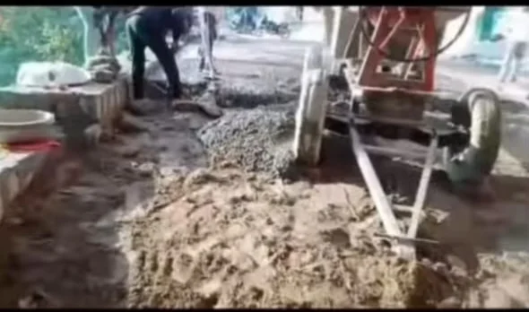
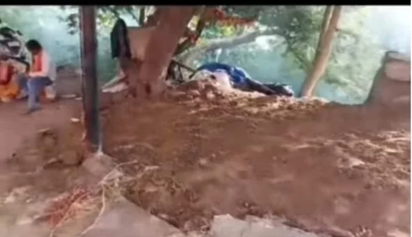
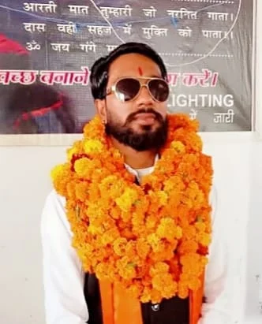

\*\*हरिद्वार संवाददाता | आसिफ खान

हरिद्वार।\*\* धर्मनगरी हरिद्वार में कुंभ-2027 की तैयारियों के नाम पर करोड़ों रुपये के निर्माण कार्य तेजी से कराए जा रहे हैं, लेकिन इन निर्माण कार्यों की गुणवत्ता पर उठते सवाल अब प्रशासनिक व्यवस्था के लिए भी चुनौती बनते दिखाई दे रहे हैं। मां मंशा देवी मंदिर के पैदल मार्ग पर निर्माणाधीन RCC सड़क को लेकर गंभीर आरोप सामने आए हैं। शिकायतकर्ता का आरोप है कि सड़क निर्माण में निर्धारित तकनीकी मानकों की अनदेखी की जा रही है और कुछ स्थानों पर कच्ची मिट्टी एवं अपर्याप्त सामग्री के ऊपर ही RCC निर्माण कराया जा रहा है।

यदि शिकायत में लगाए गए आरोप जांच में सही साबित होते हैं तो यह महज निर्माण की लापरवाही नहीं, बल्कि श्रद्धालुओं की सुरक्षा और सरकारी धन के इस्तेमाल से जुड़ा गंभीर मामला होगा। जिस मार्ग से प्रतिदिन हजारों श्रद्धालु मां मंशा देवी के दर्शन के लिए गुजरते हैं, उसी मार्ग के निर्माण की गुणवत्ता पर सवाल खड़े होना प्रशासनिक निगरानी व्यवस्था पर भी बड़ा प्रश्नचिह्न है।

**कुंभ की तैयारी या गुणवत्ता से समझौता? तस्वीरों ने खड़े किए सवाल**

मंशा देवी मंदिर का पैदल मार्ग धार्मिक दृष्टि से बेहद महत्वपूर्ण है। आगामी कुंभ मेले में श्रद्धालुओं की आवाजाही को देखते हुए इस मार्ग की मजबूती और सुरक्षा सर्वोच्च प्राथमिकता होनी चाहिए। लेकिन निर्माण कार्य को लेकर सामने आई जानकारी और उपलब्ध तस्वीरों के आधार पर शिकायतकर्ता ने सवाल उठाए हैं कि क्या सड़क का मजबूत बेस तैयार किया जा रहा है? क्या निर्धारित मोटाई और सामग्री का इस्तेमाल हो रहा है? क्या कंक्रीट की गुणवत्ता की नियमित जांच की जा रही है?

RCC सड़क निर्माण में बेस की तैयारी, कंक्रीट का निर्धारित अनुपात, सरिया, मोटाई और तकनीकी प्रक्रिया का पालन अनिवार्य होता है। इनमें किसी भी स्तर पर कमी सड़क की मजबूती को प्रभावित कर सकती है। ऐसे में निर्माण कार्य की वास्तविक स्थिति की निष्पक्ष तकनीकी जांच जरूरी हो गई है।

**ठेकेदार काम कर रहा है, लेकिन निगरानी कौन कर रहा है?**

इस पूरे मामले में सबसे बड़ा सवाल निर्माण कार्य की निगरानी को लेकर उठ रहा है। आखिर मौके पर जिम्मेदार अभियंता कितनी बार निरीक्षण कर रहे हैं? निर्माण में इस्तेमाल होने वाली सामग्री के नमूने लिए जा रहे हैं या नहीं? स्वीकृत एस्टीमेट और वास्तविक निर्माण में कितना अंतर है? यदि निर्माण कार्य निर्धारित मानकों के अनुरूप है तो तकनीकी जांच से इसे स्पष्ट करने में परेशानी क्यों होनी चाहिए?

भैरव सेना संगठन के राष्ट्रीय अध्यक्ष एवं उत्तराखंड क्रांति दल के जिला संगठन महामंत्री मोहित चौहान ने इसी मुद्दे को लेकर प्रशासन के खिलाफ आवाज उठाई है। उन्होंने कुंभ मेला अधिकारी, जिलाधिकारी हरिद्वार, मुख्य सचिव और मुख्यमंत्री को शिकायत भेजकर पूरे मामले की उच्चस्तरीय तकनीकी जांच कराने की मांग की है।

**मुख्यमंत्री से मुख्य सचिव तक शिकायत, अब कागजी जवाब नहीं जमीन पर जांच चाहिए**

मोहित चौहान ने अपनी शिकायत में साफ कहा है कि केवल फाइलों और कागजों में निर्माण की गुणवत्ता प्रमाणित करना पर्याप्त नहीं है। अधिकारियों की टीम मौके पर पहुंचकर वास्तविक निर्माण की जांच करे। सड़क के बेस की मोटाई, कंक्रीट की गुणवत्ता, मिश्रण अनुपात, सरिया और इस्तेमाल की जा रही सामग्री का परीक्षण कराया जाए।

उन्होंने मांग की है कि जरूरत पड़ने पर निर्माणाधीन सड़क से नमूने लेकर मान्यता प्राप्त प्रयोगशाला में परीक्षण कराया जाए। साथ ही स्वीकृत तकनीकी एस्टीमेट, टेंडर की शर्तें, कार्यादेश, डिजाइन, ठेकेदार और कार्यदायी संस्था का पूरा विवरण भी जांच के दायरे में लाया जाए।

**सरकारी धन का हिसाब कौन देगा? दोषी मिले तो कार्रवाई से पीछे न हटे प्रशासन**

शिकायत में यह भी मांग उठाई गई है कि निर्माण कार्य की निगरानी करने वाले अभियंताओं और संबंधित अधिकारियों की भूमिका की जांच की जाए। यदि प्रारंभिक जांच में अनियमितताएं सामने आती हैं तो संबंधित हिस्से पर भुगतान और आगे की स्वीकृति नियमानुसार रोकी जाए। घटिया सामग्री अथवा तकनीकी मानकों के उल्लंघन की पुष्टि होने पर ठेकेदार, कार्यदायी संस्था और जिम्मेदार अधिकारियों के विरुद्ध कठोर कार्रवाई की जाए।

**साथ ही मानकविहीन निर्माण को निर्धारित प्रक्रिया के अनुसार दोबारा कराने की मांग भी की गई है।**

**कुंभ से पहले ही उठे सवाल, कहीं बाद में न भुगतनी पड़े श्रद्धालुओं को कीमत!**

मोहित चौहान का कहना है कि कुंभ मेले के नाम पर भारी सरकारी बजट खर्च किया जा रहा है। ऐसे में प्रत्येक निर्माण कार्य की गुणवत्ता और पारदर्शिता सुनिश्चित करना प्रशासन की जिम्मेदारी है। यदि किसी महत्वपूर्ण धार्मिक मार्ग पर ही निर्माण की गुणवत्ता को लेकर सवाल उठ रहे हैं तो प्रशासन को तत्काल जवाबदेही तय करनी चाहिए।

अब निगाहें कुंभ मेला प्रशासन और जिला प्रशासन पर टिकी हैं। क्या अधिकारी मौके पर पहुंचकर निर्माण की वास्तविक स्थिति जांचेंगे? क्या ठेकेदार और निगरानी करने वाले अभियंताओं की जिम्मेदारी तय होगी? क्या जांच रिपोर्ट सार्वजनिक की जाएगी?

कुंभ की तैयारियों में केवल निर्माण पूरा करने की जल्दबाजी नहीं, बल्कि निर्माण की मजबूती और श्रद्धालुओं की सुरक्षा भी जरूरी है। मंशा देवी पैदल मार्ग पर उठे सवालों को नजरअंदाज करना प्रशासन के लिए आसान नहीं होना चाहिए। अब शिकायत पर कार्रवाई होगी या मामला फाइलों में दबकर रह जाएगा, इसका जवाब प्रशासन को देना होगा।
