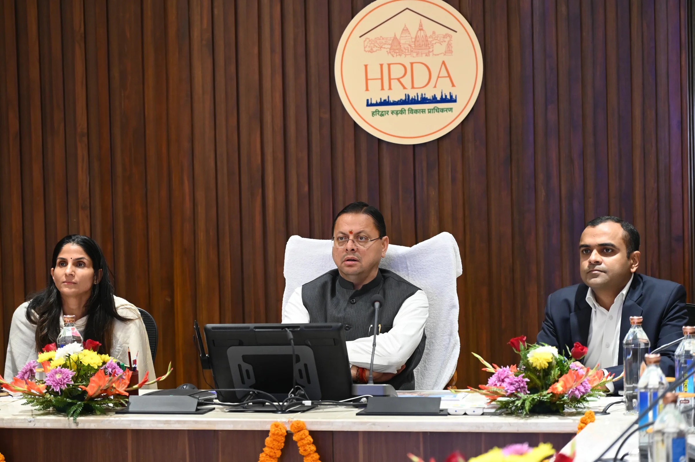
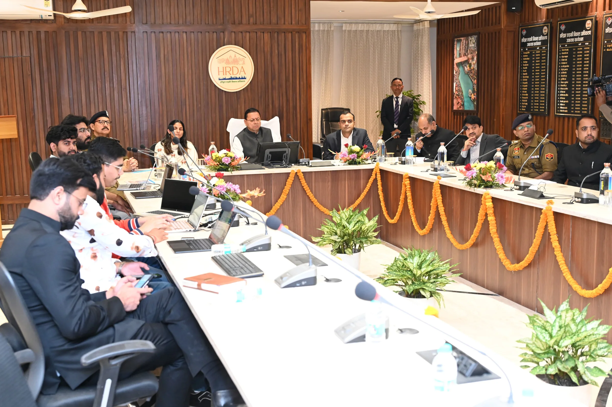
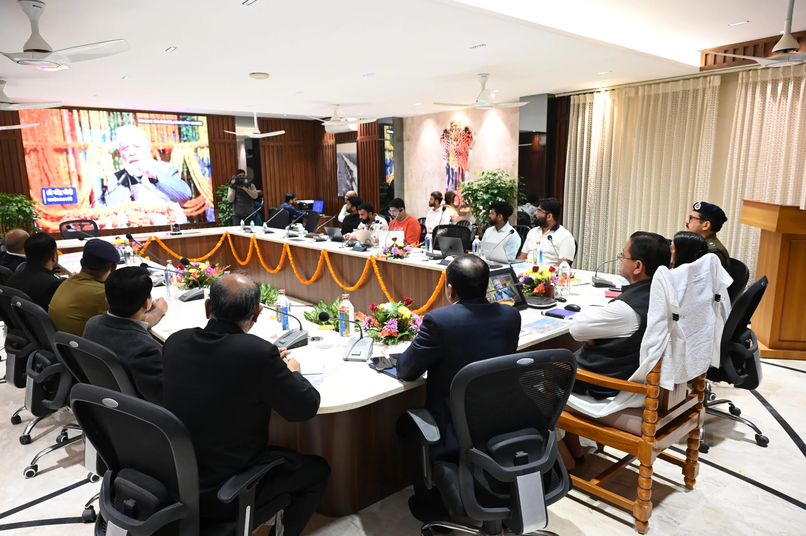

**हरिद्वार विशेष संवाददाता | आसिफ खान

हरिद्वार।** सरकारी योजनाओं की जानकारी के लिए अब आम आदमी को दफ्तरों के चक्कर काटने और अधिकारियों के आगे-पीछे भटकने से राहत मिलने की उम्मीद है। आर्टिफिशियल इंटेलिजेंस (एआई) अब सरकारी योजनाओं की जानकारी आमजन तक पहुंचाने का नया माध्यम बनने जा रहा है। मुख्यमंत्री पुष्कर सिंह धामी के सम्मुख हरिद्वार-रुड़की विकास प्राधिकरण के सभागार में एआई आधारित मोबाइल ऐप एवं पोर्टल का प्रदर्शन किया गया। इस पहल को सरकारी कामकाज में तकनीक के इस्तेमाल और जनसुविधाओं को डिजिटल बनाने की दिशा में महत्वपूर्ण कदम बताया जा रहा है।

प्रस्तुतीकरण के दौरान जिलाधिकारी मयूर दीक्षित ने मुख्यमंत्री को ऐप एवं पोर्टल की कार्यप्रणाली, विशेषताओं और उपयोगिता से अवगत कराया। बताया गया कि इस तकनीक के माध्यम से सरकार की विभिन्न जनकल्याणकारी योजनाओं की निगरानी की जा सकेगी। स्वच्छता, स्वास्थ्य, शिक्षा समेत अलग-अलग विभागों की योजनाओं की प्रगति और उनके क्रियान्वयन पर नजर रखने में भी यह व्यवस्था सहायक होगी।

**सवाल सिर्फ ऐप लॉन्च करने का नहीं, योजनाओं का लाभ अंतिम व्यक्ति तक पहुंचाने का है!**

मुख्यमंत्री पुष्कर सिंह धामी ने कहा कि आर्टिफिशियल इंटेलिजेंस जैसी आधुनिक तकनीक शासन व्यवस्था को अधिक पारदर्शी, प्रभावी और जनसुलभ बनाने में अहम भूमिका निभा सकती है। एआई आधारित ऐप एवं पोर्टल से आमजन को सरकारी योजनाओं की जानकारी सरल, सुलभ और त्वरित तरीके से उपलब्ध कराने में मदद मिलेगी। इससे लोगों को योजनाओं को समझने और उनका लाभ उठाने में आसानी होगी।

मुख्यमंत्री ने स्पष्ट किया कि आधुनिक तकनीक का उद्देश्य केवल सरकारी व्यवस्था को डिजिटल बनाना नहीं, बल्कि आम आदमी की समस्याओं का तेजी से समाधान करना और सरकारी सेवाओं को सुविधाजनक बनाना भी है। सरकार की कोशिश है कि तकनीक का लाभ समाज के अंतिम छोर पर खड़े व्यक्ति तक पहुंचे और योजनाओं का क्रियान्वयन जमीन पर प्रभावी ढंग से दिखाई दे।

**कुंभ-2027 की तैयारियों पर भी मुख्यमंत्री का फोकस**

एआई ऐप एवं पोर्टल के प्रदर्शन के साथ मुख्यमंत्री ने आगामी कुंभ मेला-2027 की तैयारियों की भी समीक्षा की। मेलाधिकारी सोनिका ने मुख्यमंत्री को कुंभ मेले के दृष्टिगत संचालित विभिन्न विकास कार्यों, आधारभूत सुविधाओं के विस्तार और आयोजन से जुड़ी तैयारियों की प्रगति की विस्तृत जानकारी दी।

कुंभ जैसे विशाल धार्मिक आयोजन को लेकर व्यवस्थाओं की समीक्षा के दौरान विकास कार्यों और बुनियादी सुविधाओं की प्रगति पर विशेष ध्यान दिया गया। अब चुनौती इन योजनाओं को निर्धारित समयसीमा में धरातल पर उतारने और श्रद्धालुओं को बेहतर सुविधाएं उपलब्ध कराने की होगी।

**अधिकारियों की रही मौजूदगी**

इस अवसर पर आईजी मेला योगेंद्र सिंह रावत, एसएसपी नवनीत सिंह भुल्लर, मुख्य नगर आयुक्त हरिद्वार नंदन कुमार, मुख्य विकास अधिकारी ललित नारायण मिश्र, एसएसपी मेला आयुष अग्रवाल, हरिद्वार-रुड़की विकास प्राधिकरण के सचिव प्रत्यूष सिंह सहित विभिन्न विभागों के अधिकारी मौजूद रहे।

अब देखना यह होगा कि एआई आधारित यह पहल सरकारी योजनाओं की जानकारी को वास्तव में कितनी आसान बनाती है और आमजन को इसका लाभ कितनी तेजी से मिल पाता है।
