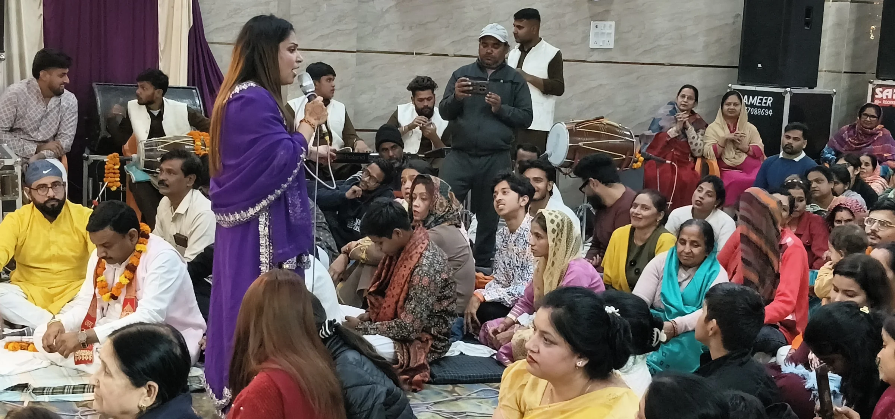
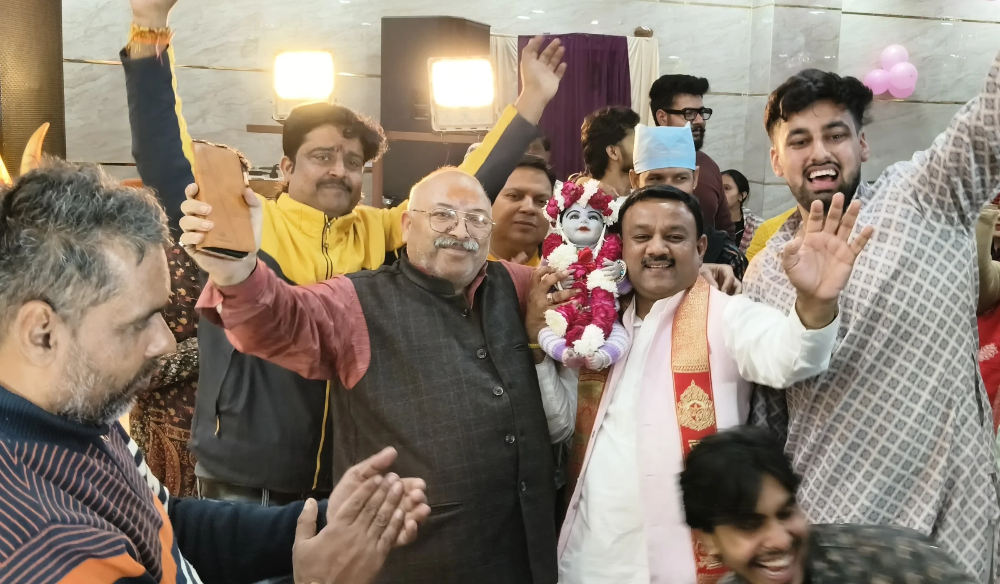
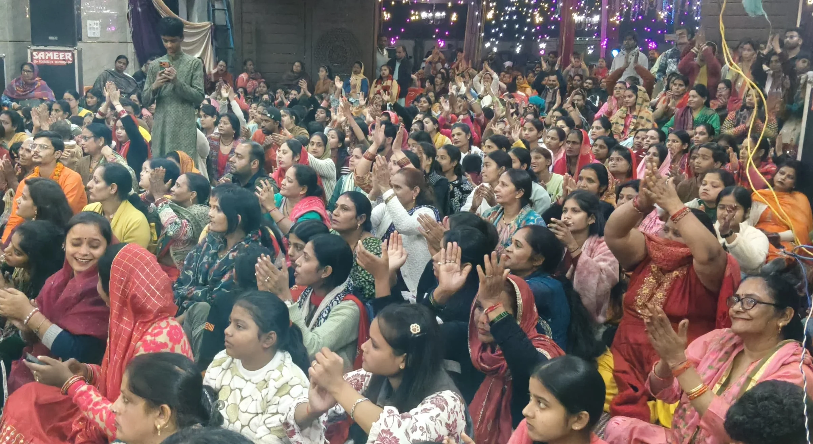

**रूडकी संवाददाता | आसिफ खान 

रुड़की।** धर्मनगरी रुड़की के लालकुर्ती स्थित प्राचीन खाटू श्याम मंदिर में आयोजित भव्य भजन संध्या में आस्था, श्रद्धा और भक्ति का ऐसा नजारा देखने को मिला कि देर रात तक पूरा मंदिर परिसर बाबा खाटू श्याम के जयकारों से गूंजता रहा। श्री लक्ष्मी नारायण खाटू श्याम मंदिर सभा की ओर से आयोजित इस धार्मिक कार्यक्रम में श्रद्धालुओं का उत्साह देखते ही बन रहा था। बाबा श्याम के दरबार में भक्तों की भारी मौजूदगी और भजनों की गूंज ने पूरे वातावरण को भक्तिमय बना दिया। भजन संध्या में पहुंचे श्रद्धालु देर रात तक भक्ति के रंग में सराबोर होकर झूमते और जयकारे लगाते नजर आए।

कार्यक्रम में भजन गायिका रश्मि पांचाल ने अपनी शानदार प्रस्तुतियों से ऐसा समां बांधा कि श्रद्धालु मंत्रमुग्ध हो गए। उनके एक से बढ़कर एक धार्मिक भजनों और मधुर भक्ति गीतों ने भक्तों को भावविभोर कर दिया। जैसे-जैसे भजनों की लय और संगीत ने रफ्तार पकड़ी, वैसे-वैसे मंदिर परिसर में मौजूद श्रद्धालुओं का उत्साह भी चरम पर पहुंचता गया। महिलाएं, पुरुष और युवा बाबा श्याम की भक्ति में झूमते दिखाई दिए। तालियों की गड़गड़ाहट और बाबा के जयकारों से पूरा परिसर गूंज उठा।

**भक्ति के रंग में रंगा पूरा मंदिर परिसर**

भजन संध्या का माहौल ऐसा रहा कि श्रद्धालु समय का ध्यान भूलकर देर रात तक भजनों का आनंद लेते रहे। किसी ने हाथ उठाकर बाबा की आराधना की तो कोई तालियों की थाप पर भक्ति में लीन होकर झूमता नजर आया। बड़ी संख्या में महिलाओं और युवाओं की मौजूदगी ने कार्यक्रम की रौनक को और बढ़ा दिया। बाबा खाटू श्याम के दरबार में श्रद्धालुओं की आस्था और उत्साह ने धार्मिक आयोजन को यादगार बना दिया।

**पूर्व मेयर गौरव गोयल सहित कई अतिथियों ने की पूजा-अर्चना**

धार्मिक कार्यक्रम में पहुंचे पूर्व मेयर गौरव गोयल ने विधि-विधान से पूजा-अर्चना कर भगवान खाटू श्याम का आशीर्वाद प्राप्त किया। उन्होंने सभी के सुख, शांति, समृद्धि और कल्याण की कामना की। इस अवसर पर मेयर अनीता देवी अग्रवाल, राज्यमंत्री श्यामवीर सैनी, समाजसेवी अरविंद कश्यप तथा मेयर प्रतिनिधि ललित मोहन अग्रवाल ने भी मंदिर पहुंचकर पूजा-अर्चना की और बाबा श्याम के चरणों में शीश नवाया।

अतिथियों ने कहा कि धार्मिक आयोजन समाज को आध्यात्मिक रूप से जोड़ने के साथ ही आपसी प्रेम, सद्भाव और भाईचारे की भावना को मजबूत करते हैं। सभी ने कामना की कि बाबा खाटू श्याम की कृपा प्रत्येक व्यक्ति पर बनी रहे और हर घर में सुख-समृद्धि, खुशहाली तथा शांति का वास हो।

**समिति पदाधिकारियों ने अतिथियों का किया सम्मान**

कार्यक्रम के दौरान श्री लक्ष्मी नारायण खाटू श्याम मंदिर सभा के पदाधिकारियों ने पहुंचे अतिथियों का सम्मान किया। आयोजन में समिति की व्यवस्थाओं और श्रद्धालुओं की सहभागिता ने कार्यक्रम को विशेष स्वरूप प्रदान किया। मंदिर परिसर में देर रात तक भक्ति का माहौल बना रहा और श्रद्धालु बाबा श्याम की आराधना में लीन रहे।

इस अवसर पर समिति अध्यक्ष संजय बंसल, सचिव सुनील महावर, संयम अग्रवाल, राजकुमार, मनीष अग्रवाल, राम लखन अग्रवाल सहित समिति के अन्य पदाधिकारी और बड़ी संख्या में श्रद्धालु मौजूद रहे।

कुल मिलाकर लालकुर्ती स्थित प्राचीन खाटू श्याम मंदिर में आयोजित भजन संध्या ने रुड़की में भक्ति और आस्था की अनूठी छटा बिखेर दी। रश्मि पांचाल के भजनों की मधुर गूंज, श्रद्धालुओं का उत्साह और बाबा श्याम के जयकारों ने इस आयोजन को यादगार बना दिया।
