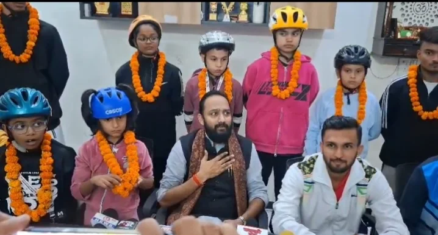
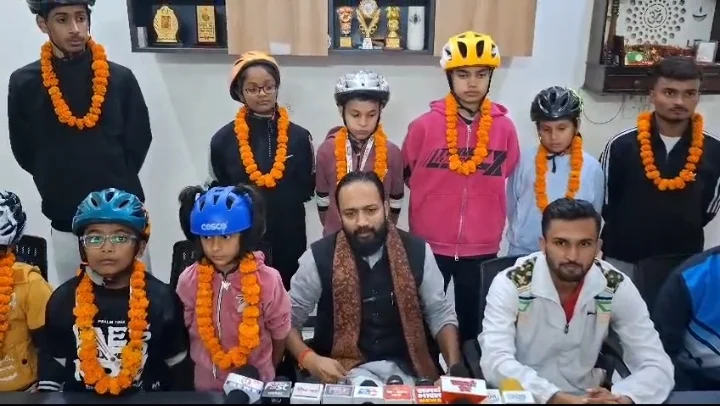

**रूडकी संवाददाता | आसिफ खान** 

**रुड़की (हरिद्वार)।** हौसलों की उड़ान हो तो उम्र कभी बाधा नहीं बनती और मेहनत का जुनून हो तो सफलता खुद कदम चूमती है। रुड़की के नन्हे स्केटरों ने खेल के मैदान में कुछ ऐसा ही करिश्मा कर दिखाया है। देहरादून में आयोजित 26वीं उत्तराखंड राज्य रोलर स्केटिंग चैंपियनशिप एवं चयन प्रतियोगिता में रुड़की के खिलाड़ियों ने पदकों की झड़ी लगाते हुए कुल 11 पदक अपने नाम कर लिए। दो स्वर्ण, तीन रजत और छह कांस्य पदकों के साथ इन बच्चों ने न केवल अपनी प्रतिभा का दम दिखाया, बल्कि रुड़की को खेल के नक्शे पर नई पहचान भी दिलाई। सबसे बड़ी उपलब्धि यह रही कि आठ खिलाड़ियों ने राष्ट्रीय प्रतियोगिता के लिए चयनित होकर अपनी कामयाबी का परचम लहरा दिया।

इन नन्हे खिलाड़ियों की इस शानदार उपलब्धि ने शहर में उत्साह का माहौल पैदा कर दिया है। उनकी मेहनत और कामयाबी को सम्मान देते हुए फोनिक्स यूनिवर्सिटी के चेयरमैन चैरब जैन ने अपने कैंप कार्यालय पर खिलाड़ियों को विशेष रूप से आमंत्रित किया। यहां उन्होंने सभी खिलाड़ियों को फूल-मालाएं पहनाकर सम्मानित किया और उनकी उपलब्धि पर जमकर सराहना की। सम्मान समारोह में बच्चों के चेहरों पर खुशी और भविष्य में कुछ बड़ा कर गुजरने का आत्मविश्वास साफ दिखाई दिया।

**चैरब जैन का बड़ा भरोसा—खिलाड़ियों के सपनों को नहीं रुकने देंगे!**

इस अवसर पर चेयरमैन चैरब जैन ने खिलाड़ियों का हौसला बढ़ाते हुए स्पष्ट कहा कि प्रतिभाशाली बच्चों को आगे बढ़ने के लिए जिस भी प्रकार के सहयोग की आवश्यकता होगी, उसमें हरसंभव मदद की जाएगी। उन्होंने भरोसा दिलाया कि खिलाड़ियों की जरूरतों और समस्याओं को सरकार तक पहुंचाया जाएगा तथा सरकारी स्तर पर आवश्यक सहायता दिलाने के लिए भी प्रयास किए जाएंगे।

उन्होंने कहा कि युवा और छात्र ही देश का असली भविष्य हैं। आज जो बच्चे खेल के मैदान में पसीना बहा रहे हैं, वही कल देश का नाम रोशन करने वाले सितारे बनेंगे। इन बच्चों ने अपनी मेहनत, लगन और अनुशासन से जो मुकाम हासिल किया है, वह दूसरे युवाओं और विद्यार्थियों के लिए भी प्रेरणा है। प्रतिभाओं को पहचानना, उनका सम्मान करना और उन्हें आगे बढ़ने के अवसर उपलब्ध कराना बेहद जरूरी है।

**देहरादून में रुड़की के खिलाड़ियों का दबदबा, पदकों पर किया कब्जा**

14 और 15 नवंबर को देहरादून के परेड ग्राउंड स्थित रोलर हॉकी रिंक में आयोजित प्रतियोगिता में रुड़की के खिलाड़ियों ने शानदार खेल का प्रदर्शन किया। सूर्यांश त्यागी और अभिमन्यु सिंह ने स्वर्ण पदक जीतकर प्रतियोगिता में अपनी श्रेष्ठता साबित की। ध्रुपद रखिल, अगस्त्य और आर्यन पाल ने रजत पदक हासिल किए। वहीं खुशी चौधरी, ध्रुव ठाकुर, शान्वी भंडारी, अर्चित शर्मा, अरि सिंह और चैतन्य सुयाल ने कांस्य पदक जीतकर रुड़की की झोली में सफलता के छह और पदक डाल दिए।

**आठ खिलाड़ियों का राष्ट्रीय टीम में चयन, अब बेंगलुरु में दिखेगा दम!**

राज्य स्तरीय प्रतियोगिता में बेहतरीन प्रदर्शन के आधार पर ध्रुपद रखिल, ध्रुव ठाकुर, शान्वी भंडारी, आहना प्रताप, आध्या अग्रवाल, अरि सिंह, भुवन लूथरा और आर्यन पाल का चयन 64वीं आरएसएफआई राष्ट्रीय रोलर स्केटिंग चैंपियनशिप-2026 के लिए हुआ है। वहीं अभिनंदन त्यागी, खुशी चौधरी और चैतन्य बंसल को रिजर्व खिलाड़ियों में स्थान मिला है।

चयनित खिलाड़ी 5 से 15 दिसंबर तक बेंगलुरु में आयोजित होने वाली राष्ट्रीय चैंपियनशिप में उत्तराखंड का प्रतिनिधित्व करेंगे। अब इन खिलाड़ियों के सामने राष्ट्रीय स्तर पर अपनी प्रतिभा का लोहा मनवाने और प्रदेश के लिए पदक जीतने की चुनौती है।

**कोच प्रिंस पाल बोले—बच्चों की मेहनत ने दिलाई बड़ी कामयाबी**

कोच प्रिंस पाल ने खिलाड़ियों की सफलता का श्रेय उनकी कड़ी मेहनत, नियमित अभ्यास और अनुशासन को दिया। उन्होंने कहा कि बच्चों ने जिस समर्पण के साथ प्रतियोगिता में प्रदर्शन किया है, वह काबिल-ए-तारीफ है। राष्ट्रीय प्रतियोगिता में भी खिलाड़ी इसी जज्बे के साथ उतरेंगे और उत्तराखंड के लिए पदक जीतने का पूरा प्रयास करेंगे। उन्होंने उन खिलाड़ियों का भी हौसला बढ़ाया जो पदक या चयन हासिल नहीं कर सके और उनसे निरंतर अभ्यास जारी रखने की अपील की।

**सिर्फ सम्मान नहीं, प्रतिभाओं को आगे बढ़ाने का संदेश बना समारोह**

खिलाड़ियों की इस उपलब्धि पर अभिभावकों और खेल प्रेमियों ने खुशी जताते हुए उन्हें बधाई दी। वहीं चैरब जैन द्वारा खिलाड़ियों को सम्मानित कर हरसंभव सहयोग का भरोसा देना उनके लिए नई ऊर्जा और प्रोत्साहन लेकर आया। अब जरूरत है कि इन उभरती प्रतिभाओं को खेल सुविधाएं, बेहतर प्रशिक्षण और हर जरूरी संसाधन उपलब्ध हों, ताकि रुड़की की यह प्रतिभा राष्ट्रीय और अंतरराष्ट्रीय मंच पर भी अपनी चमक बिखेर सके।

रुड़की के इन नन्हे सितारों ने 11 पदकों के जरिए अपनी ताकत दिखा दी है। अब बेंगलुरु की बारी है, जहां ये खिलाड़ी एक बार फिर साबित करने उतरेंगे कि रुड़की की धरती पर प्रतिभा की कोई कमी नहीं है।
