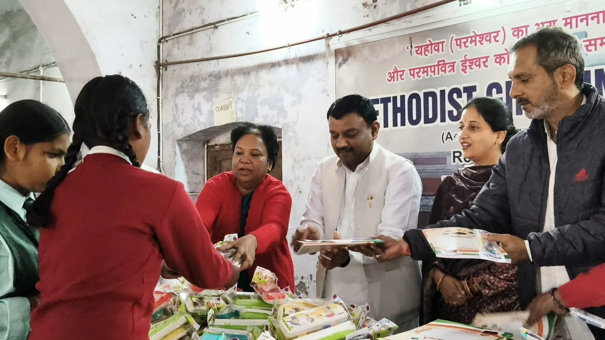
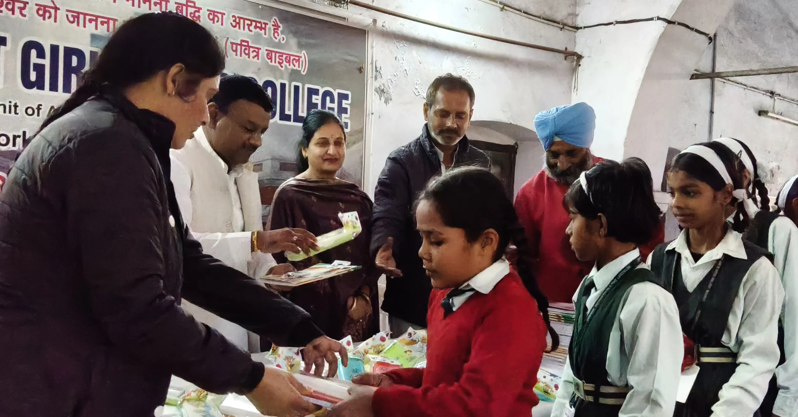
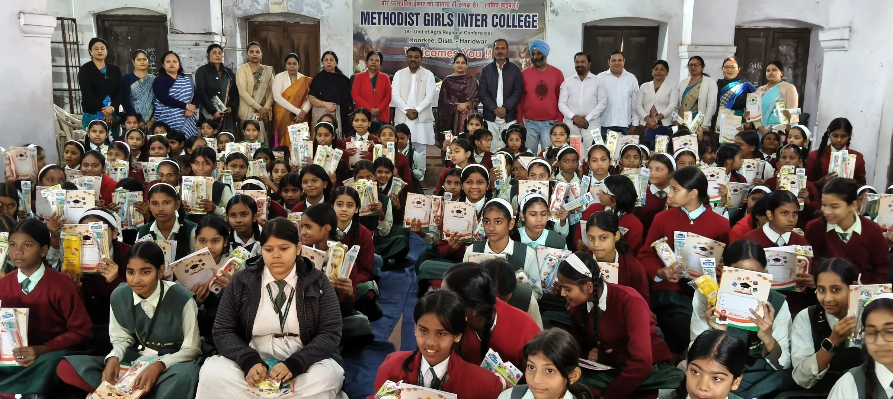

**रूडकी संवाददाता | आसिफ खान 

रुड़की।** बच्चों के हाथों में किताबें और आंखों में सुनहरे भविष्य के सपने सजाने की मुहिम के तहत पूर्व मेयर गौरव गोयल ने सिविल लाइंस स्थित मैथोडिस्ट गर्ल्स इंटर कॉलेज में सैकड़ों छात्राओं को निशुल्क पाठ्य सामग्री वितरित कर शिक्षा के प्रति जागरूकता का संदेश दिया। इस दौरान कॉलेज परिसर में उत्साह का माहौल देखने को मिला। छात्राओं को पाठ्य सामग्री मिलने से उनके चेहरों पर खुशी झलक उठी।

कार्यक्रम में पूर्व मेयर गौरव गोयल ने छात्राओं का उत्साहवर्धन करते हुए कहा कि शिक्षा केवल डिग्री हासिल करने का माध्यम नहीं, बल्कि जीवन को नई दिशा देने और समाज में अपनी पहचान स्थापित करने का सबसे मजबूत आधार है। उन्होंने कहा कि जीवन में यदि सफलता की ऊंचाइयों को छूना है तो शिक्षा के महत्व को समझना होगा। बिना शिक्षा के सशक्त और आत्मनिर्भर समाज की कल्पना अधूरी है। प्रत्येक बच्चे को बेहतर शिक्षा मिले, इसके लिए समाज के हर व्यक्ति को अपनी जिम्मेदारी निभानी चाहिए।

कार्यक्रम में अतिथि के रूप में पहुंचीं वरिष्ठ कांग्रेस नेत्री पूजा गुप्ता ने छात्राओं के उज्ज्वल भविष्य, उत्तम स्वास्थ्य और दीर्घायु की कामना करते हुए कहा कि आज के दौर में बेटियों के लिए शिक्षा सबसे बड़ी ताकत है। शिक्षा के बल पर ही वे आत्मनिर्भर बनकर हर क्षेत्र में अपनी प्रतिभा का लोहा मनवा सकती हैं। उन्होंने छात्राओं से पूरी मेहनत, लगन और आत्मविश्वास के साथ पढ़ाई करने का आह्वान किया।

समाजसेवी शेखर सिंघल ने भी विद्यार्थियों को प्रेरित करते हुए कहा कि शिक्षा के क्षेत्र में आगे बढ़कर बच्चे अपने परिवार, समाज और देश का नाम रोशन करें। उन्होंने कहा कि जरूरतमंद बच्चों की मदद करना केवल सामाजिक कार्य नहीं, बल्कि उनके भविष्य को बेहतर बनाने की दिशा में महत्वपूर्ण योगदान है।

वहीं कॉलेज की प्रधानाचार्य सीमा एम. कुमार ने पूर्व मेयर गौरव गोयल का आभार व्यक्त करते हुए कहा कि इस प्रकार के प्रयास विद्यार्थियों का मनोबल बढ़ाते हैं। निशुल्क पाठ्य सामग्री मिलने से बच्चों को पढ़ाई के लिए प्रोत्साहन मिलता है और उनमें आगे बढ़ने का नया उत्साह पैदा होता है।

इस अवसर पर कॉलेज प्रबंधिका श्रीमती दीपिका चार्ली, सहायक अध्यापिका ऐस्तर आनंद, मीना डेनियल, सरिता दास, सोनिया सिंह, कुमारी अनुष्का, श्रीमती नीलम, पूनम कन्खा, कुमारी रीना, सुखबीर सिंह सोनी तथा लवी त्यागी सहित अनेक गणमान्य लोग मौजूद रहे।

संदेश साफ है—बच्चों के हाथों में किताबें होंगी, तभी उनके सपनों को उड़ान मिलेगी। समाज की असली तरक्की शिक्षा के विस्तार से ही संभव है।
