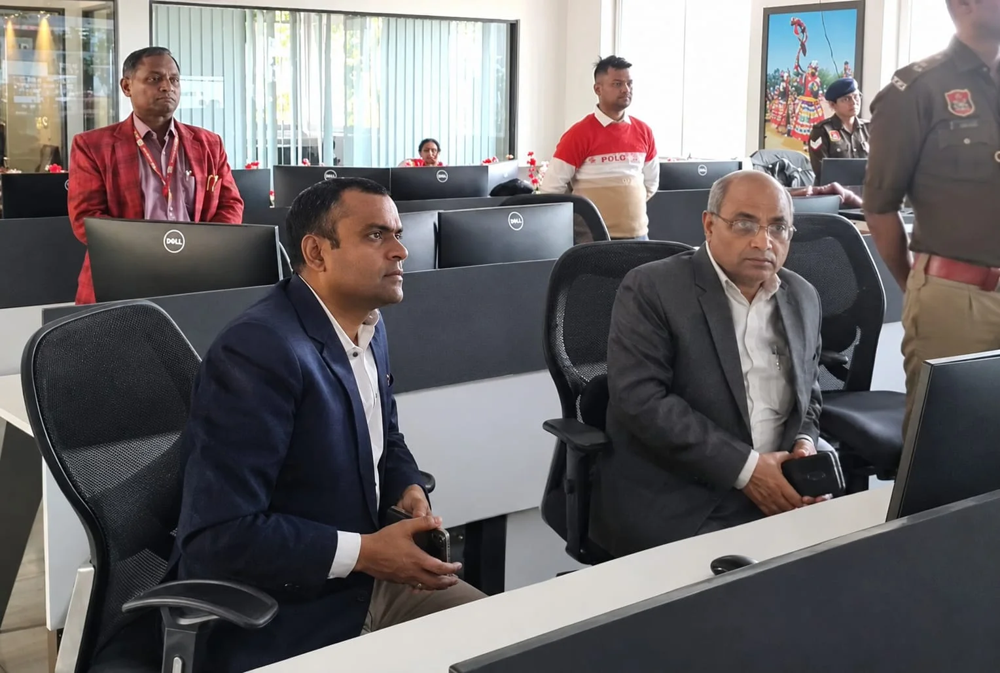
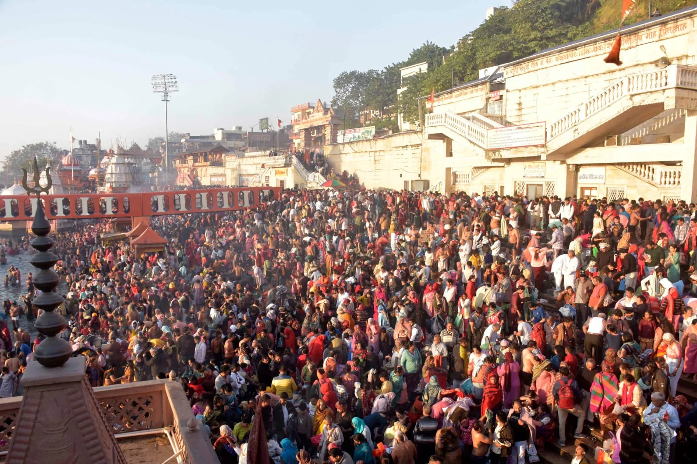
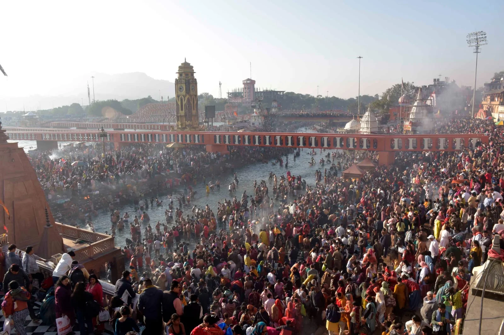

**हरिद्वार संवाददाता | आसिफ खान

हरिद्वार।** कार्तिक पूर्णिमा स्नान पर्व को लेकर धर्मनगरी हरिद्वार में प्रशासन पूरी तरह अलर्ट मोड पर आ गया है। लाखों श्रद्धालुओं की संभावित आवाजाही को देखते हुए गंगा घाटों से लेकर प्रमुख स्नान स्थलों तक सुरक्षा, यातायात और भीड़ प्रबंधन की व्यवस्थाओं पर प्रशासन ने निगरानी तेज कर दी है। श्रद्धालुओं की सुरक्षा में किसी भी तरह की चूक न हो, इसके लिए अधिकारियों को पूरी मुस्तैदी के साथ मैदान में डटे रहने के निर्देश दिए गए हैं।

इसी क्रम में आयुक्त गढ़वाल मंडल आनंद स्वरूप एवं जिलाधिकारी मयूर दीक्षित ने मेला नियंत्रण भवन (सीसीआर) स्थित मेला कंट्रोल रूम पहुंचकर व्यवस्थाओं का गहन निरीक्षण किया। दोनों अधिकारियों ने कंट्रोल रूम में स्थापित सीसीटीवी कैमरों के माध्यम से हरकी पैड़ी सहित विभिन्न गंगा घाटों और प्रमुख स्नान स्थलों पर श्रद्धालुओं की आवाजाही तथा भीड़ की स्थिति का जायजा लिया। अधिकारियों ने स्पष्ट किया कि भीड़ प्रबंधन में किसी भी स्तर पर ढिलाई नहीं होनी चाहिए।

निरीक्षण के दौरान आयुक्त और जिलाधिकारी ने संबंधित अधिकारियों से यातायात व्यवस्था, सुरक्षा प्रबंधन, घाटों पर उपलब्ध सुविधाओं और भीड़ नियंत्रण के लिए किए गए इंतजामों की विस्तृत जानकारी ली। उन्होंने निर्देश दिए कि सभी संवेदनशील एवं प्रमुख स्थानों पर सीसीटीवी कैमरों के माध्यम से लगातार निगरानी रखी जाए। जहां भी श्रद्धालुओं की भीड़ का दबाव बढ़ता दिखाई दे, वहां तत्काल प्रभावी कदम उठाए जाएं, ताकि किसी भी अप्रिय स्थिति को समय रहते रोका जा सके।

**भीड़ नियंत्रण में लापरवाही की कोई गुंजाइश नहीं**

आयुक्त आनंद स्वरूप ने अधिकारियों को निर्देशित किया कि स्नान पर्व के दौरान सभी विभाग आपसी समन्वय बनाकर काम करें। भीड़ प्रबंधन को सर्वोच्च प्राथमिकता देते हुए श्रद्धालुओं को सुरक्षित और सुगम स्नान की सुविधा उपलब्ध कराई जाए। उन्होंने कहा कि प्रत्येक अधिकारी अपनी जिम्मेदारी को गंभीरता से निभाए और किसी भी परिस्थिति में व्यवस्थाएं प्रभावित नहीं होनी चाहिए।

वहीं जिलाधिकारी मयूर दीक्षित ने ड्यूटी पर तैनात जोनल एवं सेक्टर मजिस्ट्रेटों को सख्त निर्देश दिए कि वे अपने-अपने क्षेत्रों में लगातार भ्रमणशील रहें और केवल निर्धारित स्थानों पर बैठकर ड्यूटी पूरी करने तक सीमित न रहें। घाटों, रास्तों और भीड़भाड़ वाले क्षेत्रों में व्यवस्थाओं का लगातार निरीक्षण किया जाए। किसी भी स्थान पर भीड़ एकत्रित होने या दबाव बढ़ने की स्थिति में तत्काल कार्रवाई सुनिश्चित की जाए।

**कंट्रोल रूम से हर गतिविधि पर नजर, अधिकारियों को अलर्ट रहने के निर्देश**

जिलाधिकारी ने पुलिस एवं अन्य विभागीय अधिकारियों के साथ निरंतर समन्वय बनाए रखने पर जोर देते हुए कहा कि किसी भी आपात स्थिति से निपटने के लिए सभी आवश्यक व्यवस्थाएं सक्रिय रखी जाएं। महत्वपूर्ण गतिविधियों और परिस्थितियों की नियमित जानकारी कंट्रोल रूम को उपलब्ध कराई जाए, जिससे जरूरत पड़ने पर तत्काल निर्णय लेकर कार्रवाई की जा सके।

कार्तिक पूर्णिमा स्नान पर्व के मद्देनजर प्रशासन की यह सक्रियता साफ संकेत दे रही है कि इस बार भीड़ प्रबंधन और श्रद्धालुओं की सुरक्षा को लेकर कोई जोखिम नहीं लिया जा रहा है। अब निगाहें इस बात पर रहेंगी कि मैदान में तैनात अधिकारी इन निर्देशों को कितनी गंभीरता से अमल में लाते हैं और श्रद्धालुओं को सुरक्षित, सुगम एवं व्यवस्थित गंगा स्नान की सुविधा किस तरह उपलब्ध कराई जाती है।
