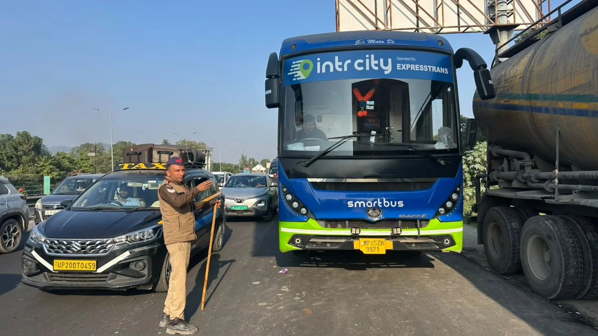
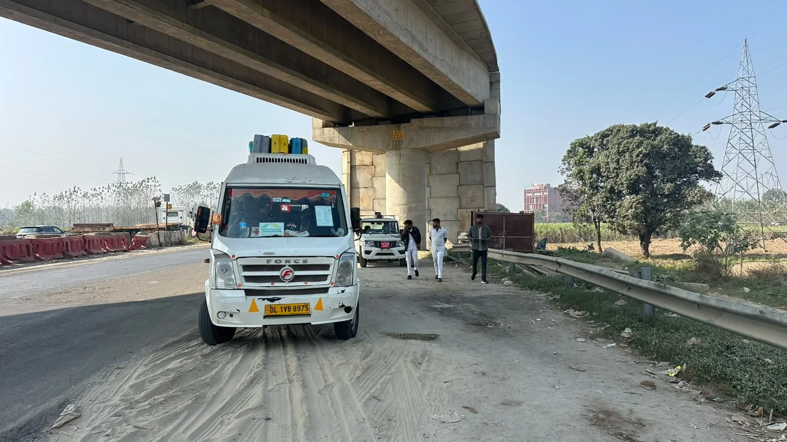
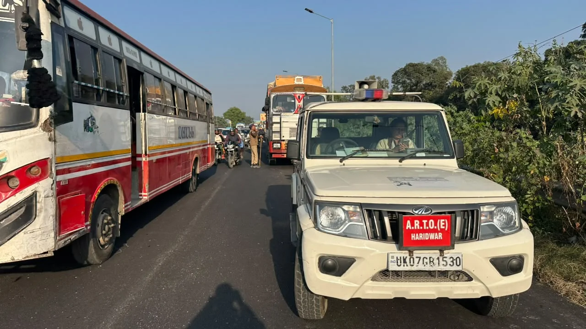

**हरिद्वार संवाददाता | आसिफ खान

हरिद्वार।** धर्मनगरी में यातायात व्यवस्था को बिगाड़ने वाले वाहन चालकों और यात्री सुरक्षा मानकों की अनदेखी करने वालों के खिलाफ परिवहन विभाग ने सख्त रुख अपनाते हुए बड़ा चेकिंग अभियान चलाया। जिलाधिकारी मयूर दीक्षित के निर्देशों पर की गई इस कार्रवाई में नियमों की धज्जियां उड़ाने वाले वाहन चालकों पर शिकंजा कसा गया। अभियान के दौरान कुल 42 वाहनों के विरुद्ध 44 चालान किए गए, जबकि नियमों का उल्लंघन करने वाले दो मालवाहक वाहनों को सीज कर दिया गया। कार्रवाई में 19 बसें भी जांच के दायरे में रहीं।

परिवहन विभाग की इस कार्रवाई ने एक बार फिर शहर की यातायात व्यवस्था और यात्री सुरक्षा को लेकर गंभीर सवाल खड़े कर दिए हैं। सवाल यह है कि आखिर सड़कों पर नियमों को ताक पर रखकर वाहन खड़े करने और बसों में यात्रियों की सुरक्षा से समझौता करने वालों पर अब तक प्रभावी अंकुश क्यों नहीं लग पाया?

**नो स्टॉपिंग जोन में खड़े वाहनों पर कार्रवाई, सड़क पर कब्जा करने वालों को चेतावनी**

कश्यप आश्रम, ऋषिकुल, मायापुर और राष्ट्रीय राजमार्ग पर यातायात में बाधा पैदा करने वाले तथा नो स्टॉपिंग जोन में खड़े 19 वाहनों के खिलाफ कार्रवाई की गई। सड़क किनारे मनमाने ढंग से वाहन खड़े करना न केवल यातायात को प्रभावित करता है, बल्कि राहगीरों और अन्य वाहन चालकों की जान को भी खतरे में डालता है। परिवहन विभाग ने ऐसे वाहन चालकों को स्पष्ट संदेश दिया कि सार्वजनिक सड़कों को निजी पार्किंग समझने की छूट किसी को नहीं मिलेगी।

**बसों में यात्री सुरक्षा की अनदेखी, आपातकालीन द्वार और ओवरलोडिंग पर कार्रवाई**

अभियान के दौरान बसों की जांच में कई गंभीर खामियां सामने आईं। तीन बसों के आपातकालीन द्वार निर्धारित मानकों के अनुरूप नहीं पाए गए, जबकि तीन बसों में क्षमता से अधिक यात्री सवार मिले। इसके अतिरिक्त दो बसों में अनधिकृत परिवर्तन भी पाया गया। यात्रियों की सुरक्षा से जुड़े इन मामलों ने बस संचालन में नियमों के पालन को लेकर चिंता बढ़ा दी है।

**कागजों में कमी पर दो वाहन सीज, सात वाहनों पर तेज रफ्तार का शिकंजा**

जांच के दौरान परमिट, परिवहन कर, बीमा, फिटनेस और अन्य आवश्यक दस्तावेजों में अनियमितताएं मिलने पर कार्रवाई की गई। बकाया कर, बीमा एवं फिटनेस संबंधी अभिलेखों की अनियमितताओं के चलते दो मालवाहक वाहनों को सीज किया गया। वहीं श्यामपुर क्षेत्र में निर्धारित गति सीमा का उल्लंघन करने वाले सात वाहनों के चालान किए गए।

**अधिकारियों के नेतृत्व में चला अभियान**

यह अभियान एआरटीओ (प्रशासन) निखिल शर्मा एवं एआरटीओ (प्रवर्तन) नेहा झा के नेतृत्व में संचालित किया गया। कार्रवाई में परिवहन कर अधिकारी रवीन्द्र पाल सैनी और परिवहन उपनिरीक्षक अश्वनी कुमार भी शामिल रहे।

परिवहन विभाग ने वाहन चालकों एवं वाहन स्वामियों को चेतावनी दी है कि निर्धारित पार्किंग स्थलों का ही इस्तेमाल करें, गति सीमा का पालन करें और यात्री सुरक्षा से जुड़े सभी मानकों को अनिवार्य रूप से पूरा करें।

सवाल साफ है—सड़क पर मनमानी और यात्रियों की सुरक्षा से समझौता अब नहीं चलेगा! परिवहन विभाग ने अभियान लगातार जारी रखने की बात कही है। अब देखना होगा कि इस सख्ती का असर धरातल पर कितना दिखाई देता है और यातायात नियमों को ठेंगा दिखाने वालों पर आगे कितनी प्रभावी कार्रवाई होती है।
